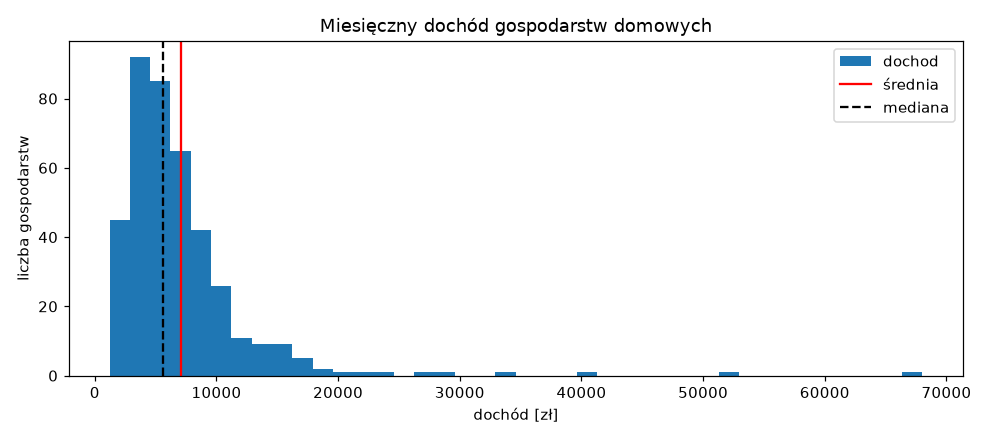
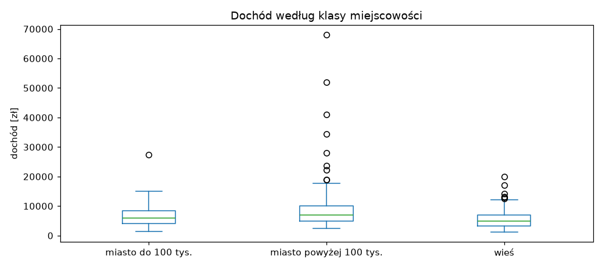
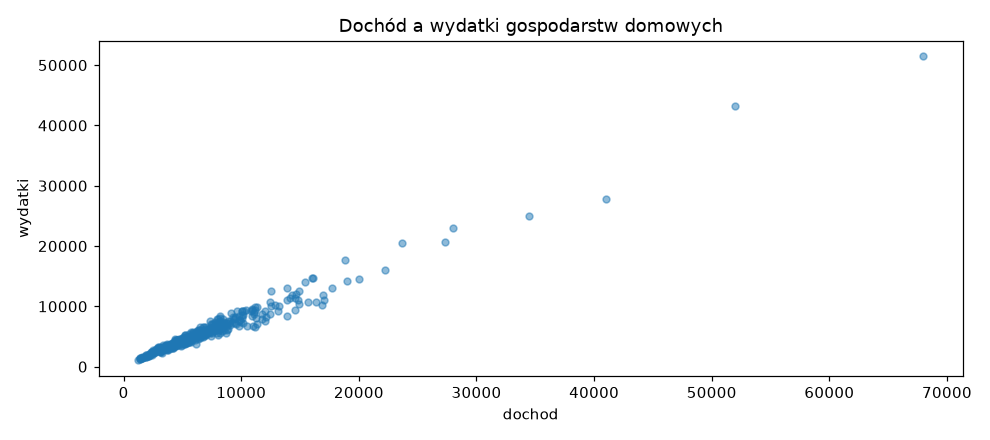
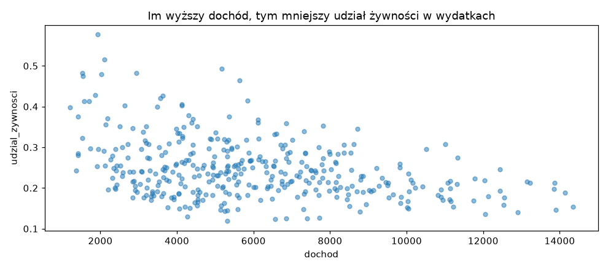
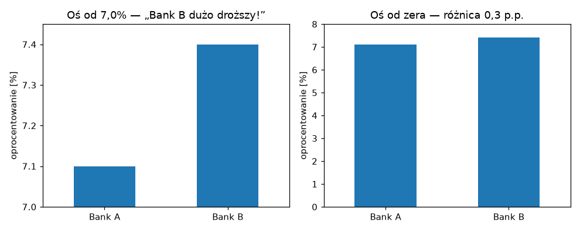

# Zajęcia 2

## Statystyka opisowa bez wzorów — co naprawdę mówią liczby

Co miesiąc w wiadomościach pada kwota „przeciętnego wynagrodzenia w Polsce"
i co miesiąc spora część słuchaczy myśli: chyba nie u mnie. I ma rację — bo
**przeciętne** w tym zdaniu znaczy **średnie**, a średnia w przypadku zarobków
zachowuje się w bardzo specyficzny sposób.

Dziś uczymy się czytać liczby, które opisują dane: średnią, medianę,
rozproszenie, wartości odstające i korelację. Bez wyprowadzania wzorów — za to
z pytaniem, które zadaje sobie każdy dobry analityk: **co ta liczba mówi, a co
ukrywa?** Najpierw w Excelu, potem — jak na poprzednich zajęciach — to samo
w Pythonie.

Po dzisiejszych zajęciach będziesz w stanie:

- wyjaśnić, kiedy średnia kłamie i dlaczego GUS publikuje także medianę,
- opisać rozproszenie danych kwartylami i odchyleniem standardowym — i wiedzieć,
  dlaczego w finansach to po prostu **ryzyko**,
- znaleźć wartości odstające i zdecydować, co z nimi zrobić,
- policzyć korelację, odczytać ją z wykresu punktowego i nie wyciągnąć z niej
  wniosku, którego ona nie dowodzi,
- dobrać wykres do pytania i rozpoznać wykres, który manipuluje.

!!! tip "Przykłady z zajęć w Colabie"

    Część z Pythonem jest też w gotowym notatniku — z kodem do uruchomienia.
    Otwórz go i uruchamiaj komórki po kolei, czytając materiał. Żeby zachować
    swoje zmiany, zapisz kopię: **Plik → Zapisz kopię na Dysku**.

    [](https://colab.research.google.com/github/kubzal/wsb-merito/blob/main/notebooks/semestr_zimowy_2026_27/data_science/zajecia_2.ipynb)

---

## Plan na dziś

| Blok | Czas |
|---|---|
| Po co statystyka opisowa | 10 min |
| Excel: średnia kontra mediana | 15 min |
| Excel: rozproszenie — kwartyle i odchylenie standardowe | 20 min |
| Excel: wartości odstające | 10 min |
| Excel: korelacja i wykres punktowy | 15 min |
| Przerwa | 10 min |
| To samo w Pythonie | 30 min |
| Wykresy, które coś pokazują | 10 min |
| **Zadanie 2** | **60 min** |

---

## Po co statystyka opisowa

Na zajęciach 1 mieliśmy 576 transakcji. Nikt nie przeczyta 576 wierszy — dlatego
zamieniliśmy je na kilka liczb: przychód, zysk, marżę. To właśnie jest
**statystyka opisowa**: streszczenie dużej tabeli w kilku liczbach, które da się
zrozumieć i porównać.

Każde streszczenie coś gubi. Sztuka polega na tym, żeby wiedzieć **co**. Dziś
zadamy sobie trzy pytania o każdy zbiór danych:

1. **Jaka wartość jest typowa?** — średnia, mediana.
2. **Jak bardzo wartości się od siebie różnią?** — rozstęp, kwartyle, odchylenie
   standardowe.
3. **Czy dwie rzeczy idą w parze?** — korelacja.

### Dane, na których pracujemy

Pracujemy na budżetach **400 gospodarstw domowych** — dane wzorowane na badaniu
budżetów domowych, które co roku prowadzi GUS. Każdy wiersz to jedno
gospodarstwo i jego miesięczne finanse.

- :material-microsoft-excel: [**gospodarstwa_2026.xlsx**](dane/gospodarstwa_2026.xlsx) — do Excela
- :material-file-delimited: [**gospodarstwa_2026.csv**](dane/gospodarstwa_2026.csv) — do Pythona

| Kolumna | Co oznacza |
|---|---|
| `id` | identyfikator gospodarstwa |
| `klasa_miejscowosci` | wieś, miasto do 100 tys., miasto powyżej 100 tys. |
| `liczba_osob` | ile osób tworzy gospodarstwo (1–6) |
| `dochod` | miesięczny dochód rozporządzalny całego gospodarstwa (zł) |
| `wydatki` | miesięczne wydatki całego gospodarstwa (zł) |
| `wydatki_zywnosc` | z tego: wydatki na żywność (zł) |

W Excelu dane zajmują arkusz `dane`, wiersze **2–401**, kolumny **A–F**. Jest też
drugi, malutki arkusz `fundusze` — przyda się przy rozproszeniu.

---

## Część 1: Excel

### Średnia kontra mediana

W wolnych komórkach z boku (np. od `I2` w dół) policz:

```text
=ŚREDNIA(D2:D401)          7 066,20 zł
=MEDIANA(D2:D401)          5 625,00 zł
```

Dwie miary „typowego" dochodu, a różnica między nimi to prawie 1 500 zł. Która
jest prawdziwa? **Obie** — tylko odpowiadają na różne pytania:

- **Średnia** — gdyby cały dochód wszystkich gospodarstw zebrać i podzielić po
  równo, każde dostałoby 7 066 zł.
- **Mediana** — wartość środkowa. Gdy ustawisz gospodarstwa od najbiedniejszego
  do najbogatszego, mediana jest dokładnie pośrodku: **połowa ma mniej, połowa
  więcej**. Typowe gospodarstwo ma ok. 5 600 zł.

Skąd różnica? Posortuj dane po dochodzie malejąco. Na górze jest kilka
gospodarstw z dochodem 28–68 tys. zł miesięcznie. Pięć gospodarstw na
czterysta — a ciągną średnią w górę dla wszystkich.

!!! example "Eksperyment — zrób to teraz"

    Znajdź gospodarstwo z dochodem 68 000 zł i dopisz mu jedno zero
    (680 000 zł — typowa literówka przy wpisywaniu danych). Patrz na swoje dwie
    formuły:

    | | przed | po literówce |
    |---|---|---|
    | średnia | 7 066 zł | **8 596 zł** |
    | mediana | 5 625 zł | **5 625 zł** |

    **Jedna** błędna komórka z czterystu podniosła średnią o ponad 1 500 zł.
    Mediana nawet nie drgnęła. Cofnij zmianę (`Ctrl` + `Z`).

To jest najważniejsza lekcja dnia:

!!! quote "Średnia jest wrażliwa na wartości skrajne. Mediana nie."

    Dlatego przy zarobkach, cenach mieszkań, majątku czy wartości zamówień —
    wszędzie tam, gdzie kilka bardzo dużych wartości może zawyżyć wynik —
    **zawsze patrz na medianę obok średniej**. GUS publikuje obie właśnie
    z tego powodu. Gdy średnia jest wyraźnie większa od mediany, wiesz od razu, że
    w danych jest garstka bardzo dużych wartości.

Kiedy średnia jest w porządku? Gdy wartości są rozłożone mniej więcej
symetrycznie i nie ma skrajności — np. wzrost dorosłych osób, czas dojazdu do
pracy, ocena produktu w skali 1–5. Wtedy średnia i mediana wychodzą prawie takie
same.

!!! note "A średnia jest potrzebna do sum"

    Mediana ma jedną wadę: nie da się z niej policzyć sumy. Jeśli chcesz wiedzieć,
    ile **łącznie** wydadzą wszystkie gospodarstwa w Polsce (np. żeby oszacować
    rynek), potrzebujesz średniej × liczby gospodarstw. Do pytania „ile ma
    typowy człowiek" — mediana. Do pytania „ile jest razem" — średnia.

### Rozproszenie — jak bardzo dane się różnią

Średnia i mediana mówią, gdzie jest środek. Ale nie mówią, czy wszyscy są blisko
środka, czy rozrzuceni po całej skali.

Przejdź do arkusza `fundusze`. Masz tam miesięczne stopy zwrotu (w %) dwóch
funduszy inwestycyjnych przez rok. Policz dla obu kolumn średnią:

```text
=ŚREDNIA(B2:B13)           0,50%     fundusz A
=ŚREDNIA(C2:C13)           0,50%     fundusz B
```

Identyczne. Czyli fundusze są tak samo dobre? Spójrz na same liczby: fundusz A
co miesiąc zarabia między 0,3% a 0,7%. Fundusz B raz zarabia 4,2%, raz traci 3%.
Jeśli w marcu musisz wypłacić pieniądze, w funduszu A wiesz, czego się
spodziewać. W funduszu B — rzucasz monetą.

Tę różnicę mierzy **odchylenie standardowe**:

```text
=ODCH.STANDARD.PRÓBKI(B2:B13)    0,11     fundusz A
=ODCH.STANDARD.PRÓBKI(C2:C13)    2,60     fundusz B
```

Odchylenie standardowe to — w uproszczeniu — **typowa odległość wartości od
średniej**. Fundusz A odchyla się od swojej średniej typowo o 0,11 punktu
procentowego, fundusz B — o 2,6. W finansach odchylenie standardowe stóp zwrotu
nazywa się po prostu **zmiennością** albo **ryzykiem**. Ta sama średnia, zupełnie
inne ryzyko.

!!! note "Próbka czy populacja?"

    Excel ma dwie funkcje: `ODCH.STANDARD.PRÓBKI` (`STDEV.S`) i
    `ODCH.STANDARD.POPUL` (`STDEV.P`). Różnią się minimalnie. Używaj **próbki** —
    tak samo liczy pandas, więc wyniki z Excela i Pythona będą identyczne.

#### Rozproszenie dochodów

Wracamy do arkusza `dane`. Pełny zestaw miar rozproszenia dla dochodu:

```text
=MIN(D2:D401)                    1 210 zł
=KWARTYL(D2:D401;1)              4 032,50 zł    pierwszy kwartyl (Q1)
=MEDIANA(D2:D401)                5 625 zł       drugi kwartyl = mediana
=KWARTYL(D2:D401;3)              8 222,50 zł    trzeci kwartyl (Q3)
=MAX(D2:D401)                    68 000 zł
=ODCH.STANDARD.PRÓBKI(D2:D401)   5 925,91 zł
```

Jak czytać kwartyle — dzielą gospodarstwa na cztery równe części:

| Przedział | Co znaczy |
|---|---|
| poniżej **Q1** (4 033 zł) | 25% najbiedniejszych gospodarstw |
| między **Q1** a **Q3** (4 033 – 8 223 zł) | **środkowe 50%** — „typowe" gospodarstwa |
| powyżej **Q3** (8 223 zł) | 25% najzamożniejszych |

Różnica `Q3 − Q1` to **rozstęp międzykwartylowy** (IQR): tu 4 190 zł. Mówi,
jak szeroki jest „środek" — i podobnie jak mediana, nie przejmuje się
skrajnościami.

Za to **rozstęp** (`MAX − MIN` = 66 790 zł) i **odchylenie standardowe**
(5 926 zł) są — tak jak średnia — mocno zawyżone przez kilka bogatych gospodarstw.
Zasada się powtarza: przy danych ze skrajnościami mediana i kwartyle mówią
więcej niż średnia i odchylenie.

!!! tip "Odchylenie w relacji do średniej"

    Czy odchylenie 5 926 zł to dużo? Zależy od skali. Dla dochodów rzędu 7 tys.
    — ogromnie dużo. Dla cen mieszkań rzędu 700 tys. — prawie nic. Dlatego
    często dzieli się odchylenie przez średnią i dostaje **współczynnik
    zmienności**: tu `5 926 / 7 066 ≈ 0,84`, czyli 84%. Pozwala porównywać
    rozproszenie rzeczy mierzonych w zupełnie różnych skalach.

!!! note "`KWARTYL` w nowszych Excelach"

    Excel podpowie Ci też `KWARTYL.PRZEDZ.ZAMK` (`QUARTILE.INC`) — daje
    dokładnie to samo co `KWARTYL`. Po angielsku: `QUARTILE(D2:D401,1)`.

### Wartości odstające

Skąd wiedzieć, które wartości są „skrajne"? Najpopularniejsza reguła używa
kwartyli: za **odstające** uznajemy wartości oddalone od pudełka Q1–Q3 o więcej
niż półtora IQR.

```text
górna granica = Q3 + 1,5 × IQR = 8 222,50 + 1,5 × 4 190 = 14 507,50 zł
dolna granica = Q1 − 1,5 × IQR = 4 032,50 − 6 285      = −2 252,50 zł
```

Dolna granica jest ujemna, więc z dołu nic nie odstaje — dochód nie bywa
ujemny. A ile gospodarstw jest powyżej górnej granicy? Jeśli granicę masz
policzoną w komórce, np. `I10`:

```text
=LICZ.JEŻELI(D2:D401;">"&I10)      26
```

`">"&I10` skleja znak „większe niż" z wartością z komórki — to ten sam `&` co
przy kwartałach na zajęciach 1.

26 gospodarstw odstaje. **Co z nimi zrobić?** To pytanie o dane, a nie
o statystykę:

| Sytuacja | Co robimy |
|---|---|
| wartość niemożliwa (dochód 680 000 przy wydatkach 5 000, wiek 230 lat) | to **błąd** — poprawiamy albo usuwamy |
| wartość rzadka, ale prawdziwa (zamożne gospodarstwo) | **zostawiamy** — to część rzeczywistości |
| chcemy opisać „typowego" klienta | raportujemy medianę zamiast średniej albo pokazujemy wynik z odstającymi i bez nich |

Nasze 26 gospodarstw jest prawdziwych — nie ma powodu ich usuwać. Ale gdy
ktoś zapyta „ile zarabia typowe gospodarstwo", odpowiadamy medianą.

!!! warning "Nie usuwaj niewygodnych danych"

    Wyrzucenie wartości odstających tylko dlatego, że „psują" wynik, to
    najprostszy sposób na sfałszowanie analizy. Jeśli coś usuwasz — napisz
    **co**, **ile** i **dlaczego**.

### Korelacja i wykres punktowy

Ostatnie pytanie: czy dwie rzeczy idą w parze? Gospodarstwa, które więcej
zarabiają, więcej wydają — to brzmi oczywiście, ale **jak bardzo**?

Zaznacz kolumny `dochod` i `wydatki` (`D1:E401`), potem *Wstawianie → Wykres
punktowy (XY)*. Każda kropka to jedno gospodarstwo. Kropki układają się wzdłuż
ukośnej linii — im dalej w prawo, tym wyżej.

Tę zależność streszcza jedna liczba — **współczynnik korelacji**:

```text
=WSP.KORELACJI(D2:D401;E2:E401)        0,99
```

Korelacja przyjmuje wartości od −1 do 1:

| Wartość | Znaczenie | Wykres punktowy |
|---|---|---|
| bliska **1** | gdy jedno rośnie, drugie też rośnie | kropki wzdłuż linii w górę |
| ok. **0,5** | umiarkowany związek | chmura wyraźnie pochylona |
| bliska **0** | brak liniowego związku | bezładna chmura |
| bliska **−1** | gdy jedno rośnie, drugie maleje | kropki wzdłuż linii w dół |

Dodaj kolumnę `G`: `udzial_zywnosci` = `=F2/E2` (jaką część wydatków stanowi
żywność) i skopiuj w dół. Teraz:

```text
=WSP.KORELACJI(C2:C401;F2:F401)        0,83     liczba osób a wydatki na żywność
=WSP.KORELACJI(D2:D401;G2:G401)       −0,43     dochód a udział żywności
```

Pierwsza jest oczywista: więcej osób, więcej jedzenia. Druga jest ciekawsza —
**im wyższy dochód, tym mniejszą część budżetu pochłania jedzenie**. Bogatsze
gospodarstwa wydają na żywność więcej złotówek, ale mniejszy procent. To
**prawo Engla**, jedno z najstarszych odkryć ekonomii (1857) — i właśnie
znalazłeś je w danych sam.

!!! danger "Korelacja to nie przyczynowość"

    Sprzedaż lodów i liczba utonięć są silnie skorelowane. Lody nikogo nie topią —
    po prostu jedno i drugie rośnie latem. Korelacja mówi, że dwie rzeczy **idą
    w parze**. Nie mówi, **która powoduje którą** ani czy w ogóle któraś
    powoduje drugą. Tu akurat mechanizm jest jasny (dochód pozwala wydawać), ale
    to wiemy z ekonomii, nie z liczby 0,99.

!!! warning "Korelacja widzi tylko linię prostą"

    Współczynnik korelacji mierzy zależność **liniową**. Jeśli zależność jest
    silna, ale zakrzywiona (np. w kształcie litery U), korelacja może wyjść
    bliska zera. Dlatego **zawsze** patrz też na wykres punktowy — sama liczba
    może Cię oszukać.

---

## Przerwa — 10 minut

---

## Część 2: to samo w Pythonie

Jak na poprzednich zajęciach: te same pytania, te same odpowiedzi, tylko
zapisane jako kod — a do tego kilka rzeczy, które w Pythonie są dużo prostsze
niż w Excelu.

### Wczytanie i `describe()` — teraz już rozumiesz wszystko

```python
import pandas as pd
import matplotlib.pyplot as plt

URL = "https://kubzal.github.io/wsb-merito/semestr_zimowy_2026_27/data_science/dane/gospodarstwa_2026.csv"
df = pd.read_csv(URL)

df.describe().round(2)
```

```text
       liczba_osob    dochod   wydatki  wydatki_zywnosc
count       400.00    400.00    400.00           400.00
mean          2.68   7066.20   5804.80          1244.62
std           1.40   5925.91   4513.82           562.23
min           1.00   1210.00   1030.00           310.00
25%           1.00   4032.50   3450.00           787.50
50%           2.00   5625.00   4775.00          1175.00
75%           4.00   8222.50   6847.50          1600.00
max           6.00  68000.00  51470.00          4280.00
```

Na zajęciach 1 kazałem patrzeć tylko na `mean`, `min` i `max`. Teraz rozumiesz
każdy wiersz:

- `mean` — średnia, `50%` — **mediana**. Dla dochodu 7 066 kontra 5 625: od
  razu widać, że są skrajnie wysokie wartości.
- `std` — odchylenie standardowe (to samo co `ODCH.STANDARD.PRÓBKI`).
- `25%` i `75%` — pierwszy i trzeci kwartyl.

Jedna komenda daje wszystko, co w Excelu wymagało sześciu formuł na kolumnę.

Pojedyncze miary:

```python
print(df["dochod"].mean(), df["dochod"].median())
print(df["dochod"].quantile([0.25, 0.75]))
```

```text
7066.2 5625.0
0.25    4032.5
0.75    8222.5
Name: dochod, dtype: float64
```

### Fundusze — rozproszenie w trzech linijkach

```python
fundusze = pd.DataFrame({
    "fundusz_A": [0.6, 0.4, 0.5, 0.7, 0.3, 0.5, 0.6, 0.4, 0.5, 0.6, 0.4, 0.5],
    "fundusz_B": [3.1, -2.4, 1.8, -1.5, 4.2, -3.0, 2.5, -0.8, 1.2, -2.9, 3.6, 0.2],
})

fundusze.agg(["mean", "std", "min", "max"]).round(2)
```

```text
      fundusz_A  fundusz_B
mean       0.50        0.5
std        0.11        2.6
min        0.30       -3.0
max        0.70        4.2
```

`agg` liczy kilka statystyk naraz — znasz go z `groupby` na zajęciach 1.

### Statystyki w grupach

To, co w Excelu wymaga tabeli przestawnej (i w ogóle nie umie mediany), w pandas
to jedna linijka:

```python
df.groupby("klasa_miejscowosci")["dochod"].agg(["mean", "median", "std", "count"]).round(0)
```

```text
                           mean  median     std  count
klasa_miejscowosci
miasto do 100 tys.       6538.0  5955.0  3723.0    104
miasto powyżej 100 tys.  9287.0  6925.0  8611.0    136
wieś                     5522.0  4990.0  3063.0    160
```

Zobacz duże miasta: średnia **9 287**, mediana **6 925**. Różnica 2 400 zł —
dużo większa niż w pozostałych grupach. Wszystkie bardzo zamożne gospodarstwa
mieszkają w dużych miastach i to one ciągną średnią. Gdyby porównywać tylko
średnie, różnica między miastem a wsią wyglądałaby na dwa razy większą, niż
jest naprawdę dla typowego gospodarstwa.

### Histogram — kształt rozkładu

W Excelu histogram to kilka kliknięć i walka z przedziałami. Tu:

```python
df["dochod"].plot.hist(bins=40, figsize=(9, 4), title="Miesięczny dochód gospodarstw domowych")
plt.axvline(df["dochod"].mean(), color="red", label="średnia")
plt.axvline(df["dochod"].median(), color="black", linestyle="--", label="mediana")
plt.xlabel("dochód [zł]")
plt.ylabel("liczba gospodarstw")
plt.legend()
```



Histogram dzieli dochody na przedziały (`bins=40` — czterdzieści słupków)
i pokazuje, ile gospodarstw wpada do każdego. Widać to, co dotąd było tylko
liczbami:

- większość gospodarstw jest stłoczona po lewej, między 2 a 10 tys. zł,
- w prawo ciągnie się **długi ogon** — pojedyncze gospodarstwa aż do 68 tys.,
- ogon odciąga **średnią** (czerwona) w prawo od **mediany** (przerywana).

Taki rozkład nazywa się **prawoskośnym**. Mają go prawie wszystkie dane
o pieniądzach: dochody, majątek, ceny, wartość zamówień.

`plt` to biblioteka matplotlib, na której pandas rysuje wykresy. Przez nią
dorysowujemy linie (`axvline` — pionowa linia), podpisy osi i legendę.

### Wykres pudełkowy — kwartyle w obrazku

```python
df.plot.box(column="dochod", by="klasa_miejscowosci", figsize=(9, 4))
plt.title("Dochód według klasy miejscowości")
plt.ylabel("dochód [zł]")
```



Wykres pudełkowy to kwartyle narysowane:

- **pudełko** — od Q1 do Q3, czyli środkowe 50% gospodarstw,
- **kreska w pudełku** — mediana,
- **wąsy** — sięgają do najdalszych wartości, które jeszcze **nie** są
  odstające (półtora IQR od pudełka),
- **kółka** — wartości odstające, każde to jedno gospodarstwo.

Od razu widać, że w dużych miastach pudełko jest najwyżej (typowo zarabia się
więcej) i że tam są wszystkie najbardziej skrajne kółka.

### Wartości odstające

Granica z Excela, policzona w Pythonie:

```python
q1 = df["dochod"].quantile(0.25)
q3 = df["dochod"].quantile(0.75)
granica = q3 + 1.5 * (q3 - q1)

odstajace = df[df["dochod"] > granica]
print(granica, len(odstajace))
```

```text
14507.5 26
```

Ile zmienia się wynik bez nich?

```python
typowe = df[df["dochod"] <= granica]

print("wszystkie:", round(df["dochod"].mean()), df["dochod"].median())
print("bez odstających:", round(typowe["dochod"].mean()), typowe["dochod"].median())
```

```text
wszystkie: 7066 5625.0
bez odstających: 5977 5425.0
```

Średnia spadła o prawie 1 100 zł, mediana o 200. Jeszcze raz ta sama lekcja:
mediana jest odporna na skrajności, średnia nie.

### Korelacja

Dodajemy udział żywności i liczymy korelacje **wszystkich par kolumn naraz**:

```python
df["udzial_zywnosci"] = df["wydatki_zywnosc"] / df["wydatki"]

df.corr(numeric_only=True).round(2)
```

```text
                 liczba_osob  dochod  wydatki  wydatki_zywnosc  udzial_zywnosci
liczba_osob             1.00    0.41     0.41             0.83             0.20
dochod                  0.41    1.00     0.99             0.81            -0.43
wydatki                 0.41    0.99     1.00             0.81            -0.45
wydatki_zywnosc         0.83    0.81     0.81             1.00            -0.07
udzial_zywnosci         0.20   -0.43    -0.45            -0.07             1.00
```

To **macierz korelacji** — w każdej komórce korelacja kolumny z wiersza
z kolumną z nagłówka. Na przekątnej same jedynki (każda kolumna jest idealnie
skorelowana sama ze sobą), a tabela jest symetryczna. `numeric_only=True` pomija
kolumny tekstowe. W Excelu na tę tabelę potrzebowałbyś dziesięciu formuł
`WSP.KORELACJI`.

Wykres punktowy:

```python
df.plot.scatter(x="dochod", y="wydatki", alpha=0.5, figsize=(9, 4),
                title="Dochód a wydatki gospodarstw domowych")
```



`alpha=0.5` robi kropki półprzezroczystymi — tam, gdzie się nakładają, robi się
ciemniej i widać, gdzie jest gęsto.

I prawo Engla — tym razem bez odstających gospodarstw, bo przez nie cała chmura
ścisnęłaby się przy lewej krawędzi:

```python
typowe = df[df["dochod"] <= granica]
typowe.plot.scatter(x="dochod", y="udzial_zywnosci", alpha=0.5, figsize=(9, 4),
                    title="Im wyższy dochód, tym mniejszy udział żywności w wydatkach")
```



Chmura opada w prawo, ale jest szeroka — stąd korelacja −0,43, a nie −0,9.
Związek jest wyraźny, ale daleki od reguły: przy tym samym dochodzie jedne
gospodarstwa wydają na jedzenie 15%, inne 35%.

---

## Wykresy, które coś pokazują

Na zajęciach 1 była zasada: zanim narysujesz wykres, odpowiedz, **jakie zdanie
ma z niego wynikać**. Dziś ją uzupełniamy — typ wykresu wynika z typu pytania:

| Pytanie | Wykres | Przykład z dziś |
|---|---|---|
| jak rozkładają się wartości? | **histogram** | dochody gospodarstw |
| czym różnią się grupy? | **pudełkowy** albo **słupkowy** | dochód: wieś kontra miasta |
| czy dwie rzeczy idą w parze? | **punktowy** | dochód a wydatki |
| jak coś zmienia się w czasie? | **liniowy** | przychód Południa z zajęć 1 |
| jaki jest udział części w całości? | **słupkowy** (koło — tylko przy 2–3 częściach) | struktura wydatków |

### Jak kłamać wykresem

Dwa banki, oprocentowanie kredytu: 7,1% i 7,4%. Ten sam fakt, dwa wykresy:



Po lewej Bank B wygląda na **trzy razy** droższy — bo oś pionowa zaczyna się
od 7%, a nie od zera. Po prawej widać prawdę: różnica jest niewielka. Lewy
wykres nie zawiera żadnej fałszywej liczby, a mimo to wprowadza w błąd.

!!! warning "Na co uważać — u siebie i u innych"

    - **Wykres słupkowy zawsze od zera.** Długość słupka to wartość — ucięta oś
      przekłamuje proporcje. (Wykres liniowy może zaczynać się wyżej, bo tam
      patrzymy na zmianę, a nie na długość.)
    - **Bez 3D.** Trójwymiarowe słupki i koła zniekształcają proporcje i niczego
      nie dodają.
    - **Odsetki, gdy grupy są różnej wielkości.** 160 gospodarstw wiejskich
      i 104 małomiasteczkowe — porównuj medianę albo procent, nie sumę.
    - **Podpisane osie z jednostką.** „dochód [zł]" zamiast „dochod".
    - **Tytuł, który mówi wniosek.** „Im wyższy dochód, tym mniejszy udział
      żywności" zamiast „Wykres 3".

---

## Ściągawka

| Chcę… | Excel | Python (pandas) |
|---|---|---|
| średnia | `=ŚREDNIA(D2:D401)` | `df["dochod"].mean()` |
| mediana | `=MEDIANA(D2:D401)` | `df["dochod"].median()` |
| średnia z warunkiem | `=ŚREDNIA.JEŻELI(B2:B401;"wieś";D2:D401)` | `df[df["klasa_miejscowosci"] == "wieś"]["dochod"].mean()` |
| mediana z warunkiem | `=MEDIANA(JEŻELI(B2:B401="wieś";D2:D401))` | `df[df["klasa_miejscowosci"] == "wieś"]["dochod"].median()` |
| kwartyl | `=KWARTYL(D2:D401;1)` | `df["dochod"].quantile(0.25)` |
| odchylenie standardowe | `=ODCH.STANDARD.PRÓBKI(D2:D401)` | `df["dochod"].std()` |
| min / max | `=MIN(…)`, `=MAX(…)` | `.min()`, `.max()` |
| wszystko naraz | — | `df.describe()` |
| kilka miar w grupach | tabela przestawna (bez mediany) | `df.groupby("g")["k"].agg(["mean", "median", "std", "count"])` |
| ile powyżej progu | `=LICZ.JEŻELI(D2:D401;">"&I10)` | `(df["dochod"] > granica).sum()` |
| korelacja dwóch kolumn | `=WSP.KORELACJI(D2:D401;E2:E401)` | `df["dochod"].corr(df["wydatki"])` |
| korelacje wszystkich par | — | `df.corr(numeric_only=True)` |
| histogram | *Wstawianie → Wykres statystyczny → Histogram* | `df["k"].plot.hist(bins=40)` |
| wykres pudełkowy | *Wstawianie → Wykres statystyczny → Pole i wąsy* | `df.plot.box(column="k", by="g")` |
| wykres punktowy | *Wstawianie → Punktowy (XY)* | `df.plot.scatter(x="a", y="b")` |
| linia na wykresie | — | `plt.axvline(wartosc, color="red", label="…")` |
| podpisy | *Elementy wykresu* | `plt.title(…)`, `plt.xlabel(…)`, `plt.ylabel(…)` |

!!! note "Nazwy angielskie"

    `ŚREDNIA.JEŻELI` = `AVERAGEIF`, `KWARTYL` = `QUARTILE`,
    `ODCH.STANDARD.PRÓBKI` = `STDEV.S`, `WSP.KORELACJI` = `CORREL`,
    `JEŻELI` = `IF`. Mediana z warunkiem działa od razu w Excelu 365; w starszych
    wersjach zatwierdź formułę `Ctrl` + `Shift` + `Enter`.

---

## Zadanie 2 — Ile naprawdę zarabia się w firmie? (12 pkt)

**Czas:** ok. 60 minut (30 min Excel + 30 min Python)
**Oddanie:** plik `.xlsx` (część 1) oraz notatnik `.ipynb` (część 2) na Moodle

W firmie produkcyjnej MeritoTech trwają negocjacje płacowe. Prezes w komunikacie
dla prasy pisze: **„Średnie wynagrodzenie w naszej firmie przekracza 8 300 zł
brutto"**. Związki zawodowe odpowiadają: **„Typowy pracownik zarabia niecałe
6 800 zł"**. Obie strony powołują się na te same dane. Twoim zadaniem jest
sprawdzić, kto ma rację — i co powinno trafić na stół negocjacyjny.

Dane obejmują **320 pracowników**:

- :material-microsoft-excel: [**wynagrodzenia_2026.xlsx**](dane/wynagrodzenia_2026.xlsx) — do części 1
- :material-file-delimited: [**wynagrodzenia_2026.csv**](dane/wynagrodzenia_2026.csv) — do części 2

| Kolumna | Co oznacza |
|---|---|
| `pracownik_id` | identyfikator pracownika |
| `dzial` | Produkcja, Logistyka, Sprzedaż, IT, Administracja, Zarząd |
| `staz_lat` | staż pracy w firmie (lata) |
| `wynagrodzenie` | miesięczne wynagrodzenie brutto (zł) |
| `ocena_roczna` | ocena z ostatniej oceny okresowej (1 — najsłabsza, 5 — najlepsza) |

Rób części po kolei i **pokaż mi wynik każdej z nich, gdy będzie gotowa**.

### Część 1 — Excel (ok. 30 min)

Dane zajmują wiersze **2–321**, kolumny **A–E**.

1. Policz **średnią** i **medianę** wynagrodzenia w całej firmie oraz **średnią
   bez Zarządu** (`ŚREDNIA.JEŻELI` z warunkiem `"<>Zarząd"`).
2. Policz **Q1**, **Q3**, **IQR** i **górną granicę** wartości odstających.
   Policz, ilu pracowników jest powyżej granicy, i filtrem sprawdź, z których
   działów pochodzą.
3. Zbuduj **tabelę przestawną**: `dzial` w wierszach, a w wartościach
   wynagrodzenie trzy razy — jako **średnia**, **odchylenie standardowe**
   i **liczba**. Obok dopisz formułą **współczynnik zmienności** (odchylenie ÷
   średnia). Pomijając Zarząd: w którym dziale płace są najbardziej
   zróżnicowane?
4. Wstaw **wykres punktowy** stażu i wynagrodzenia, policz **korelację** stażu
   z wynagrodzeniem oraz oceny rocznej z wynagrodzeniem. W pustej komórce
   napisz 2–3 zdania: **kto ma rację — prezes czy związki — i dlaczego obie
   liczby są prawdziwe?**

### Część 2 — Python (ok. 30 min)

Nowy notatnik w Colabie:

```python
import pandas as pd
import matplotlib.pyplot as plt

URL = "https://kubzal.github.io/wsb-merito/semestr_zimowy_2026_27/data_science/dane/wynagrodzenia_2026.csv"
df = pd.read_csv(URL)
```

1. Wyświetl `describe()`. Policz średnią i medianę wynagrodzenia — dla całej
   firmy i bez Zarządu — i sprawdź, czy zgadzają się z Excelem.
2. Policz w podziale na działy: średnią, medianę, odchylenie standardowe
   i liczbę pracowników (`groupby` + `agg`). Dodaj kolumnę `wsp_zmiennosci`
   i posortuj tabelę malejąco po medianie.
3. Narysuj **histogram** wynagrodzeń z zaznaczoną średnią i medianą oraz
   **wykres pudełkowy** wynagrodzenia według działów — **bez Zarządu**. Każdy
   wykres z tytułem i podpisanymi osiami.
4. Wyświetl macierz korelacji. Na koniec dodaj **komórkę tekstową** i napisz
   notatkę dla obu stron negocjacji (4–5 zdań): ile zarabia typowy pracownik
   i którą miarę należy podawać, który dział ma najbardziej zróżnicowane płace,
   czy staż i ocena roczna przekładają się na wynagrodzenie.

### Wskazówki

- Ściągawka Excel ↔ Python jest kilka sekcji wyżej — korzystaj z niej.
- `"<>Zarząd"` w Excelu znaczy „różne od Zarząd". W pandas: `df[df["dzial"] != "Zarząd"]`.
- Odchylenie standardowe w tabeli przestawnej: kliknij pole w Wartościach →
  *Ustawienia pola wartości* → **OdchStd** (po angielsku *StdDev*; nie
  *OdchStdc* — to wersja „populacji"). Tak samo zmieniasz na **Średnia**
  i **Licznik**.
- Wykres punktowy w Excelu: zaznacz **tylko** dwie kolumny liczbowe (`C1:D321`),
  bez kolumny z działem.
- Kolumnę `wsp_zmiennosci` dodajesz tak jak `marza_%` na zajęciach 1 — najpierw
  wynik `groupby` do zmiennej, potem nowa kolumna.
- Wykres pudełkowy bez Zarządu: najpierw przefiltruj, potem rysuj —
  `bez_zarzadu.plot.box(column="wynagrodzenie", by="dzial")`. Z Zarządem
  pozostałe pudełka zleją się w kreski na dole wykresu.
- Kilka wykresów w jednej komórce zleje się w jeden. Rysuj każdy w osobnej
  komórce albo dopisz `plt.show()` po każdym.

!!! tip "Na co patrzę przy ocenie"

    Jak na zajęciach 1: czy **liczby się zgadzają** i czy **wniosek wynika z tego,
    co policzyłeś**. Odpowiedź „prezes kłamie" albo „związki kłamią" jest zła —
    obie strony podają prawdziwe liczby. Dobra odpowiedź wyjaśnia, skąd bierze się
    różnica i która liczba lepiej opisuje typowego pracownika.

### Punktacja (12 pkt)

| Punkty | Za co |
|---|---|
| **12 pkt** | obie części zrobione **na zajęciach** i pokazane prowadzącemu |
| **8 pkt** | jedna z dwóch części zrobiona **na zajęciach** i pokazana prowadzącemu |
| **4 pkt** | zadanie dokończone po zajęciach i wysłane na Moodle **w terminie** |
| **0 pkt** | brak rozwiązania albo wysłane po terminie |

Termin przesłania na Moodle: **2026-11-28** (dzień przed kolejnymi zajęciami).

!!! danger "Serio, róbcie to na zajęciach"

    Ta sama godzina pracy jest warta 12 pkt tu i teraz albo 4 pkt w domu. Mamy
    tylko cztery zadania w całym semestrze, więc każde z nich to 12% oceny
    końcowej. Jestem na sali po to, żeby Wam pomagać — korzystajcie z tego,
    zamiast walczyć z tym samym problemem wieczorem w domu.
