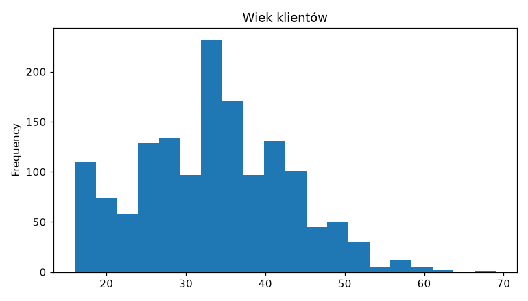
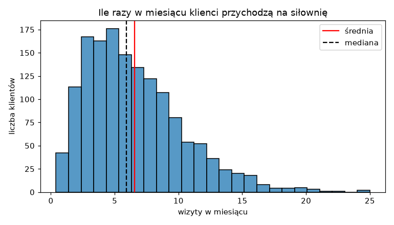
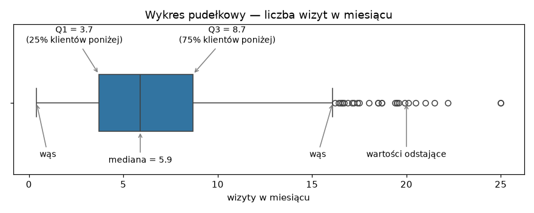
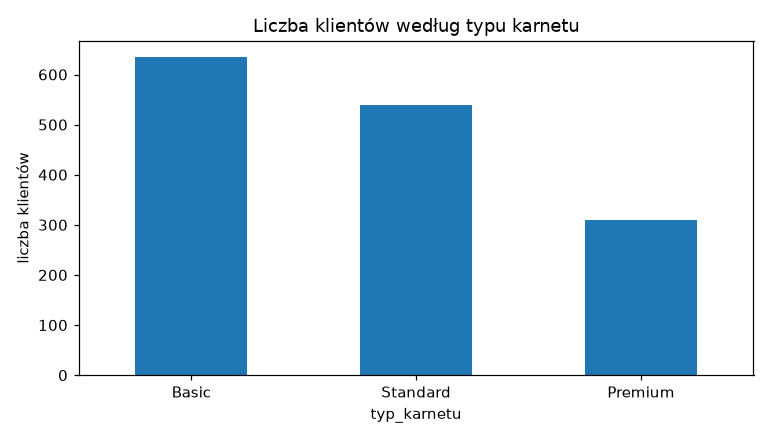
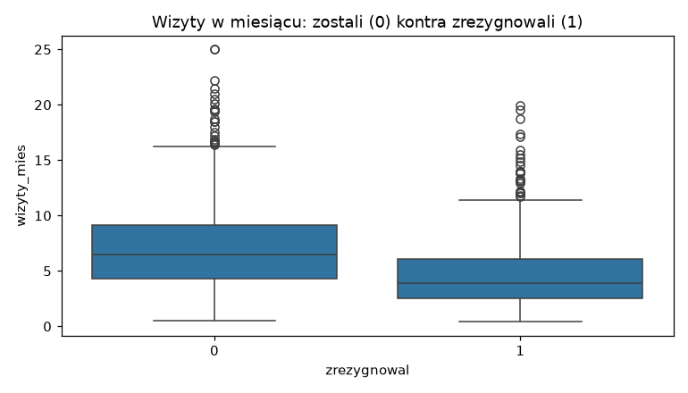
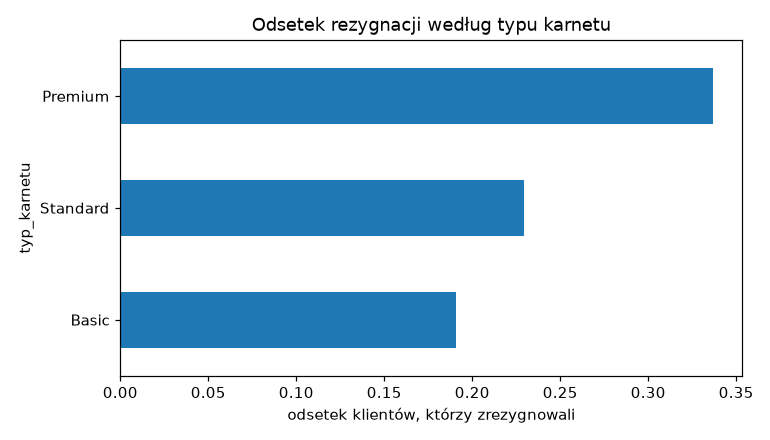
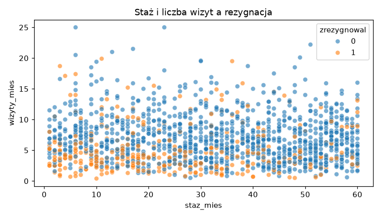
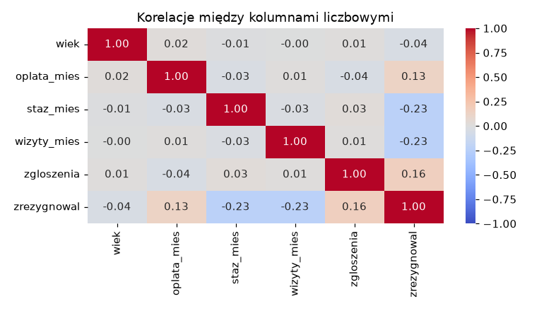

# Zajęcia 3

## Eksploracyjna analiza danych i wizualizacja

Dane są wczytane i wyczyszczone. Kusi, żeby od razu wrzucić je do modelu — i to
jest błąd, który popełnia prawie każdy na początku. Zanim cokolwiek policzysz,
trzeba dane **obejrzeć**: jak rozkładają się wartości, co jest typowe, co
odstaje i czym różnią się grupy, które nas interesują.

Ten etap nazywa się **eksploracyjną analizą danych** (*EDA, exploratory data
analysis*), a jego głównym narzędziem jest wykres. Tabela z tysiącem liczb nie
mówi nic. Ten sam tysiąc liczb na histogramie mówi wszystko w dwie sekundy.

Po dzisiejszych zajęciach będziesz w stanie:

- narysować histogram, wykres pudełkowy, słupkowy i punktowy w matplotlib
  i seaborn,
- odczytać z histogramu kształt rozkładu i wyjaśnić, dlaczego średnia różni się
  od mediany,
- odczytać wykres pudełkowy i wskazać wartości odstające,
- porównać dwie grupy klientów wykresem i tabelą krzyżową,
- policzyć korelacje, narysować je jako mapę ciepła i wiedzieć, czego korelacja
  **nie** mówi.

!!! tip "Przykłady z zajęć w Colabie"

    Cały materiał z tej strony jest też w gotowym notatniku — z kodem do
    uruchomienia. Otwórz go i uruchamiaj komórki po kolei, czytając materiał. Żeby zachować
    swoje zmiany, zapisz kopię: **Plik → Zapisz kopię na Dysku**.

    [](https://colab.research.google.com/github/kubzal/wsb-merito/blob/main/notebooks/semestr_zimowy_2026_27/data_science_w_pythonie/zajecia_3.ipynb)

!!! info "Gdzie jesteśmy"

    W workflow projektu z pierwszych zajęć to punkt 4 — eksploracja. Ćwiczymy na
    danych siłowni, które wyczyściłeś dwa tygodnie temu. W zadaniu dostaniesz
    nowy zbiór — kredyty bankowe — i za godzinę na
    [Uczeniu głębokim](../uczenie_glebokie/zajecia_3.md) trafi on do modelu.
    To, co dziś zobaczysz na wykresach, powie Ci, czego się po tym modelu
    spodziewać.

---

## Plan na dziś

| Blok | Czas |
|---|---|
| Po co EDA i pierwszy wykres | 8 min |
| Jedna zmienna — histogram, wykres pudełkowy, słupki | 15 min |
| Dwie zmienne — porównanie grup, tabela krzyżowa, wykres punktowy | 12 min |
| Korelacja i mapa ciepła | 7 min |
| Dobre praktyki i ściągawka | 3 min |
| **Zadanie 3** | **45 min** |

---

## Po co EDA

EDA zaczyna się od **pytań**, nie od wykresów. Dla danych siłowni naturalne
pytania to:

1. Kim są nasi klienci? Ile mają lat, jak często przychodzą, jaki mają karnet?
2. Czy coś w danych wygląda podejrzanie?
3. **Czym różnią się klienci, którzy zrezygnowali, od tych, którzy zostali?**

Trzecie pytanie jest najważniejsze, bo to dokładnie to, czego za chwilę będzie
się uczył model. Jeśli na wykresie nie widać żadnej różnicy między grupami —
model też jej prawdopodobnie nie znajdzie.

### Dane, na których pracujemy

Wczytujemy wzorcową, wyczyszczoną wersję danych siłowni z zajęć 2:

```python
import pandas as pd

URL = "https://kubzal.github.io/wsb-merito/semestr_zimowy_2026_27/uczenie_glebokie/dane/silownia_czyste.csv"
df = pd.read_csv(URL)
df.describe().round(1)
```

```text
         wiek  oplata_mies  staz_mies  wizyty_mies  zgloszenia  zrezygnowal
count  1484.0       1484.0     1484.0       1484.0      1484.0       1484.0
mean     33.3        130.5       31.2          6.5         0.8          0.2
std       9.5         38.5       17.2          3.8         0.9          0.4
min      16.0         79.0        1.0          0.4         0.0          0.0
25%      26.8         99.0       17.0          3.7         0.0          0.0
50%      33.0        129.0       32.0          5.9         1.0          0.0
75%      40.0        139.0       46.0          8.7         1.0          0.0
max      69.0        199.0       60.0         25.0         5.0          1.0
```

`describe()` znasz od pierwszych zajęć. To dobry start, ale 48 liczb naraz
trudno ogarnąć wzrokiem — i nie odpowiadają one na pytanie 3. Pora na wykresy.

### Narzędzia: matplotlib i seaborn

W Pythonie rysuje się głównie dwiema bibliotekami. Obie są w Colabie od razu:

```python
import matplotlib.pyplot as plt
import seaborn as sns
```

- **matplotlib** — podstawa, na której stoi wszystko inne. Daje pełną kontrolę
  nad wykresem: tytuły, osie, kolory, linie. Konwencja importu to `plt`.
- **seaborn** — nakładka na matplotlib, stworzona do pracy z DataFrame'ami.
  Jedna linijka zamiast dziesięciu, zwłaszcza przy porównywaniu grup. Konwencja
  importu to `sns`.

Do tego pandas sam potrafi narysować kolumnę metodą `.plot()` — pod spodem też
używa matplotlib.

### Pierwszy wykres

```python
df["wiek"].plot(kind="hist", bins=20, title="Wiek klientów")
```



Większość klientów ma 20–45 lat, starszych jest coraz mniej. Ale jeden słupek
wyraźnie odstaje — przy 33 latach jest dwa razy więcej osób niż obok. Skąd?

To **my** go zrobiliśmy. Na poprzednich zajęciach uzupełniliśmy brakujący
i niemożliwy wiek medianą — a mediana wynosi 33. Ok. 60 osób dostało ten sam
wiek, stąd słupek. Pierwsza lekcja EDA: **dane pamiętają, co im zrobiłeś.**
Uzupełnianie braków zawsze zostawia ślad i dobrze jest umieć go rozpoznać.

!!! tip "Średnik na końcu linii"

    W Colabie nad wykresem pojawia się czasem napis w rodzaju
    `<Axes: title={'center': 'Wiek klientów'}>`. To nie błąd, tylko wartość
    zwrócona przez ostatnią linijkę komórki. Żeby go ukryć, dopisz na końcu
    `plt.show()` albo postaw średnik po ostatniej linijce.

---

## Jedna zmienna

### Histogram — jak rozkładają się wartości

Histogram dzieli zakres wartości na przedziały (*bins*) i pokazuje, ile
obserwacji wpada do każdego z nich. Narysujmy liczbę wizyt w miesiącu, tym razem
w seaborn, i dorysujmy średnią i medianę:

```python
sns.histplot(data=df, x="wizyty_mies", bins=25)
plt.axvline(df["wizyty_mies"].mean(), color="red", label="średnia")
plt.axvline(df["wizyty_mies"].median(), color="black", linestyle="--", label="mediana")
plt.legend()
plt.title("Ile razy w miesiącu klienci przychodzą na siłownię")
plt.xlabel("wizyty w miesiącu")
plt.ylabel("liczba klientów")
```



Wszystkie linijki od `plt.` dotyczą **tego samego** wykresu — matplotlib dokłada
kolejne elementy do ostatnio narysowanego. `axvline` rysuje pionową linię
(*vertical line*) w podanym miejscu osi X.

Co widać:

- Typowy klient przychodzi 3–8 razy w miesiącu.
- Rozkład ma **długi ogon w prawo** — garstka osób chodzi 15–25 razy. Taki
  rozkład nazywa się **prawoskośnym**.
- **Średnia (6.55) jest większa od mediany (5.9)**, bo ogon ciągnie ją w prawo.
  Pamiętasz drogi laptop z pierwszych zajęć? To ten sam mechanizm.

Prawoskośne są prawie wszystkie dane „o ludziach i pieniądzach": zarobki, ceny
mieszkań, wartość zamówień, liczba obserwujących. Dlatego w raportach
o wynagrodzeniach GUS podaje medianę, a nie tylko średnią.

!!! note "Ile słupków?"

    `bins` decyduje o tym, jak szczegółowy jest histogram. Za mało słupków
    (np. 5) — wszystko zlewa się w jedną bryłę. Za dużo (np. 200) — wykres robi
    się poszarpany i widać głównie szum. 20–30 to zwykle dobry początek;
    potem warto spróbować dwóch–trzech wartości i wybrać najczytelniejszą.

### Wykres pudełkowy — typowe wartości i odstające

Histogram pokazuje kształt rozkładu. **Wykres pudełkowy** (*boxplot*) streszcza
go do pięciu liczb i od razu wskazuje wartości odstające:

```python
sns.boxplot(data=df, x="wizyty_mies")
```

Ten sam wykres z opisanymi elementami:



Jak go czytać:

- **Pudełko** to środkowe 50% klientów — od pierwszego kwartyla (Q1 = 3.7) do
  trzeciego (Q3 = 8.7). Te same liczby co `25%` i `75%` w `describe()`.
- **Kreska w pudełku** to mediana.
- **Wąsy** sięgają do najdalszych „normalnych" wartości — nie dalej niż
  półtorej długości pudełka od jego krawędzi.
- **Kółka** za wąsami to **wartości odstające** (*outliers*) — tu 28 osób, które
  chodzą na siłownię ponad 16 razy w miesiącu.

!!! warning "Odstająca to nie to samo co niemożliwa"

    Na poprzednich zajęciach wiek 230 lat zamieniliśmy na brak, bo był
    **niemożliwy**. Ktoś, kto chodzi na siłownię 20 razy w miesiącu, jest
    nietypowy, ale całkowicie prawdziwy. Wykres pudełkowy wskaże wartości
    odstające, ale to Ty decydujesz, czy to błąd, czy po prostu ciekawy
    przypadek. Domyślnie: **zostawiasz**.

### Kategorie — wykres słupkowy

Dla kolumny tekstowej histogram nie ma sensu. Liczymy wystąpienia
`value_counts()` (znasz je z pierwszych zajęć) i rysujemy jako słupki:

```python
df["typ_karnetu"].value_counts().plot(kind="bar", title="Liczba klientów według typu karnetu")
plt.xticks(rotation=0)
plt.ylabel("liczba klientów")
```



`plt.xticks(rotation=0)` obraca podpisy pod słupkami do poziomu — pandas
domyślnie stawia je pionowo, co przy krótkich nazwach tylko przeszkadza.

!!! note "A wykres kołowy?"

    Ludzkie oko dużo lepiej porównuje długości słupków niż kąty wycinków. Przy
    trzech kategoriach koło jeszcze ujdzie, przy sześciu już nikt nie powie, który
    wycinek jest większy. W analizie danych prawie zawsze wybieraj słupki.

---

## Dwie zmienne

Teraz pytanie numer 3: czym różnią się klienci, którzy odeszli?

### Liczba kontra grupa — wykresy pudełkowe obok siebie

```python
sns.boxplot(data=df, x="zrezygnowal", y="wizyty_mies")
plt.title("Wizyty w miesiącu: zostali (0) kontra zrezygnowali (1)")
```



To jest najważniejszy wykres dnia. Seaborn podzielił klientów według kolumny
`x` i dla każdej grupy narysował osobne pudełko. Różnica jest wyraźna: klienci,
którzy zrezygnowali, przychodzili rzadziej. Liczbowo możesz to sprawdzić
filtrem:

```python
odeszli = df[df["zrezygnowal"] == 1]
zostali = df[df["zrezygnowal"] == 0]

print(odeszli["wizyty_mies"].median(), zostali["wizyty_mies"].median())
```

```text
3.9 6.5
```

Mediana 3.9 wizyty kontra 6.5. Ma to sens biznesowy: kto przestaje chodzić, ten
po kilku miesiącach przestaje też płacić. **To jest cecha, z której model
będzie korzystał najbardziej** — i rzeczywiście, drzewo z zajęć 2 na Uczeniu
głębokim zadawało pytanie o wizyty jako pierwsze.

### Kategoria kontra grupa — tabela krzyżowa

Czy rezygnacje zależą od typu karnetu? Dla dwóch kolumn kategorycznych
liczymy **tabelę krzyżową** — ile klientów jest w każdej kombinacji:

```python
pd.crosstab(df["typ_karnetu"], df["zrezygnowal"])
```

```text
zrezygnowal    0    1
typ_karnetu
Basic        514  121
Premium      205  104
Standard     416  124
```

Liczby bezwzględne są mylące — klientów Basic jest dwa razy więcej niż Premium.
Potrzebujemy **odsetków w każdym wierszu**, czyli `normalize="index"`:

```python
pd.crosstab(df["typ_karnetu"], df["zrezygnowal"], normalize="index").round(3)
```

```text
zrezygnowal      0      1
typ_karnetu
Basic        0.809  0.191
Premium      0.663  0.337
Standard     0.770  0.230
```

Teraz widać: z Premium odchodzi co trzeci klient, z Basic — co piąty. Kolumnę
`1` łatwo narysować:

```python
odsetek = pd.crosstab(df["typ_karnetu"], df["zrezygnowal"], normalize="index")[1]
odsetek.sort_values().plot(kind="barh", title="Odsetek rezygnacji według typu karnetu")
plt.xlabel("odsetek klientów, którzy zrezygnowali")
```



`kind="barh"` to słupki poziome — wygodne, gdy nazwy kategorii są długie.
`sort_values()` układa je od najmniejszej do największej, więc wykres czyta się
jak ranking.

!!! tip "Grupowanie na następnych zajęciach"

    Odsetek rezygnacji w każdej grupie to tak naprawdę **średnia** kolumny
    `zrezygnowal` (zera i jedynki) policzona osobno dla każdego karnetu. Do
    liczenia czegokolwiek „w grupach" pandas ma `groupby` — to temat kolejnych
    zajęć. Dziś wystarczy nam `crosstab`.

### Liczba kontra liczba — wykres punktowy

Dwie kolumny liczbowe pokazujemy jako chmurę punktów — każdy klient to jedna
kropka. Parametr `hue` koloruje kropki według trzeciej kolumny:

```python
sns.scatterplot(data=df, x="staz_mies", y="wizyty_mies", hue="zrezygnowal", alpha=0.6)
plt.title("Staż i liczba wizyt a rezygnacja")
```



Pomarańczowe kropki (rezygnacje) skupiają się na dole wykresu — mało wizyt —
i trochę gęściej po lewej, przy krótkim stażu. Odchodzą głównie nowi klienci,
którzy rzadko przychodzą.

`alpha=0.6` robi kropki półprzezroczystymi. Przy 1500 punktach wiele z nich
nachodzi na siebie, a dzięki przezroczystości widać, gdzie jest ich gęsto.

---

## Korelacja

Zamiast oglądać wykres punktowy dla każdej pary kolumn, można policzyć jedną
liczbę — **współczynnik korelacji**. Przyjmuje wartości od −1 do 1:

| Wartość | Znaczenie |
|---|---|
| bliska **1** | gdy jedna kolumna rośnie, druga też rośnie |
| bliska **0** | brak liniowej zależności |
| bliska **−1** | gdy jedna kolumna rośnie, druga maleje |

```python
korelacje = df.corr(numeric_only=True)
korelacje.round(2)
```

```text
             wiek  oplata_mies  staz_mies  wizyty_mies  zgloszenia  zrezygnowal
wiek         1.00         0.02      -0.01        -0.00        0.01        -0.04
oplata_mies  0.02         1.00      -0.03         0.01       -0.04         0.13
staz_mies   -0.01        -0.03       1.00        -0.03        0.03        -0.23
wizyty_mies -0.00         0.01      -0.03         1.00        0.01        -0.23
zgloszenia   0.01        -0.04       0.03         0.01        1.00         0.16
zrezygnowal -0.04         0.13      -0.23        -0.23        0.16         1.00
```

`numeric_only=True` pomija kolumny tekstowe — korelacji miasta z wiekiem nie da
się policzyć. Tabelę liczb dużo łatwiej czytać jako **mapę ciepła**:

```python
sns.heatmap(korelacje, annot=True, fmt=".2f", cmap="coolwarm", vmin=-1, vmax=1)
plt.title("Korelacje między kolumnami liczbowymi")
```



- `annot=True` wpisuje liczby w pola, `fmt=".2f"` zaokrągla je do dwóch miejsc.
- `cmap="coolwarm"` — czerwony dla dodatnich, niebieski dla ujemnych, szary
  dla zera.
- `vmin=-1, vmax=1` ustala skalę kolorów na pełny zakres. Bez tego seaborn
  dopasuje skalę do danych i korelacja 0.2 może wyglądać na ciemnoczerwoną.

Interesuje nas głównie **ostatni wiersz** — jak każda cecha wiąże się
z rezygnacją. Staż i wizyty: −0.23 (im więcej, tym rzadziej ktoś odchodzi).
Zgłoszenia i opłata: dodatnie (im więcej skarg i im drożej, tym częściej).
Wiek: praktycznie zero.

Przekątna to same jedynki — każda kolumna jest idealnie skorelowana sama ze
sobą. Tabela jest też symetryczna, więc wystarczy czytać połowę.

!!! warning "Dwie pułapki korelacji"

    **Korelacja mierzy tylko zależność liniową.** −0.23 brzmi słabo, a przecież
    wykres pudełkowy pokazał dużą różnicę w wizytach. Zależność jest, tylko nie
    układa się w prostą linię — szansa odejścia rośnie gwałtownie dopiero przy
    bardzo małej liczbie wizyt. Dlatego korelacja nigdy nie zastępuje wykresu.

    **Korelacja to nie przyczynowość.** Sprzedaż lodów i liczba utonięć są
    mocno skorelowane — bo obie rosną latem. Lody nikogo nie topią. Z samych
    danych nie wiemy, czy klienci odchodzą, **bo** przestali chodzić, czy
    przestali chodzić, **bo** już postanowili odejść.

---

## Dobre praktyki

Wykres w notatniku dla siebie może być byle jaki. Wykres, który ktoś inny ma
zrozumieć, musi spełniać kilka warunków:

- **Tytuł** — najlepiej taki, który mówi, co widać.
- **Podpisane osie** — z jednostką, jeśli jest (zł, mies., liczba klientów).
- **Jeden wykres — jedna wiadomość.** Lepsze trzy proste wykresy niż jeden,
  na którym jest wszystko.
- **Bez efektów 3D i bez koła** przy więcej niż kilku kategoriach.
- **Odsetki, nie liczby**, gdy porównujesz grupy różnej wielkości.

### Ściągawka

| Chcę… | Kod |
|---|---|
| zaimportować biblioteki | `import matplotlib.pyplot as plt` i `import seaborn as sns` |
| histogram | `sns.histplot(data=df, x="kol", bins=25)` |
| pionowa linia (np. średnia) | `plt.axvline(df["kol"].mean(), color="red", label="średnia")` |
| wykres pudełkowy | `sns.boxplot(data=df, x="kol")` |
| pudełka w grupach | `sns.boxplot(data=df, x="grupa", y="kol")` |
| słupki dla kategorii | `df["kol"].value_counts().plot(kind="bar")` |
| słupki poziome | `seria.plot(kind="barh")` |
| tabela krzyżowa | `pd.crosstab(df["a"], df["b"])` |
| odsetki w wierszach | `pd.crosstab(df["a"], df["b"], normalize="index")` |
| wykres punktowy z kolorem | `sns.scatterplot(data=df, x="a", y="b", hue="grupa", alpha=0.6)` |
| macierz korelacji | `df.corr(numeric_only=True)` |
| mapa ciepła | `sns.heatmap(korelacje, annot=True, fmt=".2f", cmap="coolwarm", vmin=-1, vmax=1)` |
| tytuł, podpisy osi, legenda | `plt.title(...)`, `plt.xlabel(...)`, `plt.ylabel(...)`, `plt.legend()` |
| wykres o innym rozmiarze | `plt.figure(figsize=(10, 4))` — **przed** rysowaniem |
| kilka wykresów w jednej komórce | `plt.show()` po każdym z nich |

---

## Zadanie 3 — Kto nie spłaci kredytu? (6 pkt)

**Czas:** maks. 45 minut
**Środowisko:** Google Colab
**Oddanie:** notatnik `.ipynb` na Moodle

MeritoBank udzielił w zeszłym roku 2000 kredytów konsumpcyjnych. Część klientów
przestała je spłacać. Bank chce za godzinę zbudować model, który oceni ryzyko
nowych wniosków — ale zanim powstanie model, ktoś musi te dane poznać i
powiedzieć, czego można się po nich spodziewać. Ten ktoś to Ty.

Dane są już czyste — dziś tylko je oglądasz.

| Kolumna | Znaczenie |
|---|---|
| `klient_id` | identyfikator klienta |
| `wiek` | wiek klienta w latach |
| `dochod_mies` | miesięczny dochód netto w zł |
| `staz_pracy_lat` | staż pracy u obecnego pracodawcy w latach |
| `cel_kredytu` | gotówkowy, samochodowy, remont albo konsolidacyjny |
| `kwota_kredytu` | kwota kredytu w zł |
| `okres_mies` | na ile miesięcy udzielono kredytu |
| `inne_kredyty` | ile innych kredytów klient spłaca |
| `opoznienia_12m` | ile razy w ostatnich 12 miesiącach spóźnił się z ratą |
| `niesplacony` | czy klient przestał spłacać kredyt (`1` — tak, `0` — nie) |

Rób części po kolei i **pokaż mi wynik każdej części, gdy będzie gotowa**.
**Każdy wykres musi mieć tytuł i podpisane osie.**

### Część 1 — poznaj klientów banku (ok. 20 min)

```python
URL = "https://kubzal.github.io/wsb-merito/semestr_zimowy_2026_27/data_science_w_pythonie/dane/kredyty_2026.csv"
```

1. Wczytaj dane, sprawdź rozmiar i typy kolumn. Policz, **jaki odsetek**
   kredytów nie został spłacony.
2. Narysuj histogram `dochod_mies` z zaznaczoną średnią i medianą oraz wykres
   pudełkowy `kwota_kredytu`. W komórce tekstowej odpowiedz: jaki kształt ma
   rozkład dochodu, co jest większe — średnia czy mediana — i dlaczego? Czy
   odstające kwoty kredytów to Twoim zdaniem błędy?
3. Narysuj wykres słupkowy liczby kredytów według `cel_kredytu`.

### Część 2 — kto nie spłaca? (ok. 25 min)

1. Narysuj dwa wykresy pudełkowe porównujące klientów, którzy spłacają
   i którzy nie spłacają (`niesplacony`): dla `dochod_mies` i dla
   `staz_pracy_lat`. Podaj mediany obu cech w obu grupach.
2. Policz tabelą krzyżową **odsetek niespłaconych kredytów** dla każdego celu
   kredytu i narysuj go jako słupki posortowane od najmniejszego.
3. Narysuj mapę ciepła korelacji. W komórce tekstowej napisz krótką notatkę dla
   zarządu banku (3–5 zdań): które **trzy cechy liczbowe** najsilniej wiążą się
   z niespłaceniem kredytu (i w którą stronę), który cel kredytu jest
   najbardziej ryzykowny i czy korelacja wystarcza, żeby stwierdzić, że to te
   cechy **powodują** problemy ze spłatą.

### Wskazówki

- Odsetek niespłaconych: `df["niesplacony"].mean()` — bo kolumna to zera
  i jedynki.
- Histogram ze średnią i medianą to dokładnie przykład z sekcji „Histogram" —
  podmień tylko kolumnę i podpisy.
- Kilka wykresów w jednej komórce zleje się w jeden. Dopisz `plt.show()` po
  każdym albo rysuj każdy w osobnej komórce.
- Mediany w grupach: filtr `df[df["niesplacony"] == 1]["dochod_mies"].median()`
  i to samo dla `0`.
- W tabeli krzyżowej z `normalize="index"` kolumna `1` to odsetek
  niespłaconych. Wybierasz ją jak zwykłą kolumnę: `[1]`.
- Na mapie ciepła patrz na wiersz (albo kolumnę) `niesplacony`. Liczy się
  **wartość bezwzględna** — −0.2 to silniejszy związek niż 0.1.
- Notatka dla zarządu to nie miejsce na `dochod_mies` i `corr` — pisz tak, jak
  napisałbyś do kogoś, kto nie zna Pythona.

### Punktacja (6 pkt)

| Punkty | Za co |
|---|---|
| **6 pkt** | obie części zrobione **na zajęciach** i pokazane prowadzącemu |
| **4 pkt** | jedna z dwóch części zrobiona na zajęciach |
| **2 pkt** | zadanie dokończone po zajęciach i wysłane na Moodle **w terminie** |
| **0 pkt** | brak rozwiązania albo wysłane po terminie |

Termin przesłania na Moodle: **dzień przed kolejnymi zajęciami**.

!!! danger "Serio, róbcie to na zajęciach"

    Te same 45 minut pracy jest warte 6 pkt tu i teraz albo 2 pkt w domu. Przez
    cały semestr robi to różnicę 32 punktów, czyli całej oceny w górę lub w dół.
