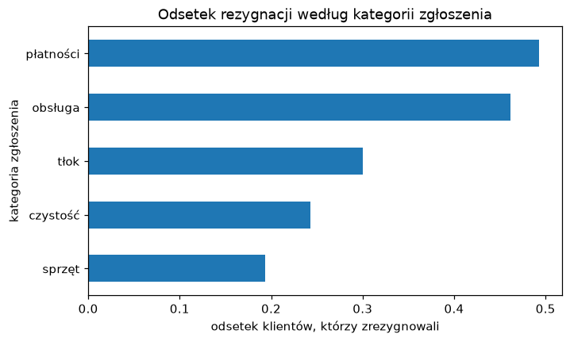

# Zajęcia 4

## Grupowanie i łączenie danych

Na poprzednich zajęciach odsetek rezygnacji dla każdego typu karnetu liczyliśmy
tabelą krzyżową i obiecaliśmy, że da się prościej. Da się — i to jest pierwsza
połowa dzisiejszych zajęć: **grupowanie**, czyli liczenie czegokolwiek osobno
dla każdej grupy. Średnia w każdym mieście, mediana w każdym karnecie, liczba
klientów w każdej kombinacji jednego i drugiego.

Druga połowa wynika z prostego faktu: w prawdziwej firmie dane prawie nigdy nie
leżą w jednej tabeli. Klienci są w jednym systemie, zgłoszenia w drugim, kluby
w trzecim. Żeby cokolwiek z nimi zrobić, trzeba je najpierw **połączyć** po
wspólnej kolumnie — i nie zgubić ani nie rozmnożyć przy tym połowy wierszy.

Po dzisiejszych zajęciach będziesz w stanie:

- policzyć statystykę w grupach `groupby` i wyjaśnić schemat „podziel — policz
  — złóż",
- policzyć kilka statystyk naraz `agg` i nadać wynikom czytelne nazwy,
- pogrupować dane po dwóch kolumnach i rozłożyć wynik w tabelę `unstack`,
- połączyć dwie tabele `merge` i dobrać rodzaj złączenia (`left`, `inner`,
  `right`, `outer`),
- połączyć tabelę klientów z tabelą zdarzeń: najpierw `groupby`, potem
  `merge`, i sprawdzić, czy liczba wierszy się zgadza.

!!! tip "Przykłady z zajęć w Colabie"

    Cały materiał z tej strony jest też w gotowym notatniku — z kodem do
    uruchomienia. Otwórz go i uruchamiaj komórki po kolei, czytając materiał. Żeby zachować
    swoje zmiany, zapisz kopię: **Plik → Zapisz kopię na Dysku**.

    [](https://colab.research.google.com/github/kubzal/wsb-merito/blob/main/notebooks/semestr_zimowy_2026_27/data_science_w_pythonie/zajecia_4.ipynb)

!!! info "Gdzie jesteśmy"

    W workflow projektu z pierwszych zajęć to wciąż przygotowanie danych —
    zbieranie ich z kilku źródeł w jedną tabelę, z którą da się pracować.
    Ćwiczymy na siłowni, w zadaniu wracamy do MeritoBanku. Za godzinę na
    [Uczeniu głębokim](../uczenie_glebokie/zajecia_4.md) dane kredytowe trafią do
    pierwszego sztucznego neuronu.

---

## Plan na dziś

| Blok | Czas |
|---|---|
| Podziel — policz — złóż: pierwszy `groupby` | 10 min |
| Kilka statystyk naraz i grupowanie po dwóch kolumnach | 12 min |
| Dane w kilku tabelach — `merge` | 12 min |
| Jeden-do-wielu: najpierw `groupby`, potem `merge` | 8 min |
| Ściągawka | 3 min |
| **Zadanie 4** | **45 min** |

---

## Grupowanie

### Dane, na których pracujemy

Znowu siłownia — ta sama wyczyszczona wersja co na zajęciach 3:

```python
import pandas as pd

URL = "https://kubzal.github.io/wsb-merito/semestr_zimowy_2026_27/uczenie_glebokie/dane/silownia_czyste.csv"
df = pd.read_csv(URL)
df.head()
```

```text
  klient_id  wiek    miasto typ_karnetu  oplata_mies  staz_mies  wizyty_mies  zgloszenia  zrezygnowal
0     K1342    45    Gdańsk       Basic         99.0         20          1.2           0            1
1     K0802    34    Poznań    Standard        119.0         17          7.6           1            0
2     K0240    34  Warszawa       Basic         99.0          5          5.1           1            0
3     K0144    46    Poznań       Basic         99.0         52          2.4           0            0
4     K0619    48   Wrocław       Basic         99.0         52          6.1           1            0
```

### Podziel — policz — złóż

Pytanie z poprzednich zajęć: jaki jest odsetek rezygnacji w każdym typie
karnetu? Z `groupby` to jedna linijka:

```python
df.groupby("typ_karnetu")["zrezygnowal"].mean()
```

```text
typ_karnetu
Basic       0.190551
Premium     0.336570
Standard    0.229630
Name: zrezygnowal, dtype: float64
```

Te same liczby co w kolumnie `1` tabeli krzyżowej z zajęć 3. Czyta się to od
lewej do prawej, dokładnie w kolejności, w jakiej pandas wykonuje pracę:

```text
df.groupby("typ_karnetu")     ["zrezygnowal"]        .mean()
        PODZIEL               na której kolumnie        POLICZ        → ZŁÓŻ w jedną tabelę

 Basic    → 635 klientów  → 1, 0, 0, 0, 1, …    → średnia 0.191 ┐
 Premium  → 309 klientów  → 0, 1, 1, 0, 0, …    → średnia 0.337 ├→ wynik
 Standard → 540 klientów  → 0, 0, 1, 0, 0, …    → średnia 0.230 ┘
```

Ten schemat (*split — apply — combine*) jest wszędzie: tabele przestawne
w Excelu, `GROUP BY` w SQL, raporty w każdej firmie. Zmieniasz tylko kolumnę
grupującą, kolumnę liczoną i statystykę:

```python
df.groupby("miasto")["wizyty_mies"].median()
```

```text
miasto
Gdańsk      5.70
Kraków      6.05
Poznań      6.10
Warszawa    5.90
Wrocław     5.30
Name: wizyty_mies, dtype: float64
```

Zamiast `mean` i `median` możesz użyć każdej statystyki, którą znasz:
`sum`, `min`, `max`, `std`, `count`. Jedna jest szczególna — **ile wierszy jest
w każdej grupie** — i nie potrzebuje kolumny:

```python
df.groupby("miasto").size()
```

```text
miasto
Gdańsk      215
Kraków      290
Poznań      204
Warszawa    564
Wrocław     211
dtype: int64
```

To samo co `df["miasto"].value_counts()`, tylko posortowane alfabetycznie,
a nie od największej grupy.

### Wynik grupowania to zwykła seria

Wynik `groupby` to seria (albo DataFrame), więc działa na nim wszystko, co już
znasz — sortowanie, zaokrąglanie, wykresy:

```python
df.groupby("miasto")["zrezygnowal"].mean().sort_values(ascending=False).round(3)
```

```text
miasto
Warszawa    0.254
Wrocław     0.251
Kraków      0.245
Gdańsk      0.209
Poznań      0.181
Name: zrezygnowal, dtype: float64
```

Poznań trzyma klientów najlepiej, Warszawa — najgorzej. Nazwy miast trafiły do
**indeksu** (to te pogrubione etykiety po lewej). Jeśli wolisz je mieć w zwykłej
kolumnie — np. żeby potem połączyć tabelę z inną — dopisz `.reset_index()`.

---

## Kilka statystyk naraz

### `agg` — raport w jednej tabeli

Zwykle chcesz o każdej grupie wiedzieć kilka rzeczy jednocześnie. Do tego służy
`agg` z **nazwanymi agregacjami** — każda linijka to
`nazwa_w_wyniku=("kolumna", "statystyka")`:

```python
raport = df.groupby("typ_karnetu").agg(
    klienci=("klient_id", "count"),
    odsetek_rezygnacji=("zrezygnowal", "mean"),
    srednia_oplata=("oplata_mies", "mean"),
    mediana_wizyt=("wizyty_mies", "median"),
)
raport.round(2)
```

```text
             klienci  odsetek_rezygnacji  srednia_oplata  mediana_wizyt
typ_karnetu
Basic            635                0.19           94.80            6.1
Premium          309                0.34          195.57            5.8
Standard         540                0.23          135.17            5.6
```

Jedna tabela, którą można wkleić do raportu. Kolumna `klienci` jest tu nie bez
powodu — o tym za chwilę.

### Grupowanie po dwóch kolumnach

Czy Premium jest problemem w każdym mieście, czy tylko w niektórych? Podajemy
**listę** kolumn grupujących:

```python
df.groupby(["miasto", "typ_karnetu"])["zrezygnowal"].mean().round(2)
```

```text
miasto    typ_karnetu
Gdańsk    Basic          0.14
          Premium        0.31
          Standard       0.20
Kraków    Basic          0.19
...
Wrocław   Basic          0.19
          Premium        0.43
          Standard       0.25
Name: zrezygnowal, dtype: float64
```

Wyszło 15 wierszy w długiej kolumnie — mało czytelne. `unstack()` przenosi
drugi poziom grupowania do kolumn i robi z wyniku tabelę:

```python
odsetek = df.groupby(["miasto", "typ_karnetu"])["zrezygnowal"].mean().unstack()
odsetek.round(2)
```

```text
typ_karnetu  Basic  Premium  Standard
miasto
Gdańsk        0.14     0.31      0.20
Kraków        0.19     0.34      0.24
Poznań        0.18     0.17      0.18
Warszawa      0.21     0.37      0.25
Wrocław       0.19     0.43      0.25
```

Ciekawe: w Poznaniu Premium wcale nie odstaje (0.17), a we Wrocławiu odchodzi
prawie co drugi klient Premium (0.43). Zanim jednak ogłosisz to zarządowi,
sprawdź, **ilu klientów** stoi za każdą liczbą:

```python
df.groupby(["miasto", "typ_karnetu"]).size().unstack()
```

```text
typ_karnetu  Basic  Premium  Standard
miasto
Gdańsk          71       55        89
Kraków         111       67       112
Poznań          98       35        71
Warszawa       252      117       195
Wrocław        103       35        73
```

Obie skrajne wartości — 0.17 w Poznaniu i 0.43 we Wrocławiu — policzone są
z **35 osób**. Pięciu klientów więcej albo mniej i odsetek przesuwa się o 14
punktów procentowych. To może być prawdziwa różnica, a może przypadek.

!!! warning "Mała grupa, duże liczby"

    Im mniejsza grupa, tym bardziej skrajne wyniki. Odsetek 100% z dwóch osób
    nie znaczy nic. Dlatego do **każdej** średniej czy odsetka w grupach dokładaj
    liczebność grupy — choćby jako `klienci=("klient_id", "count")` w `agg`.
    Grupy poniżej kilkudziesięciu obserwacji opisuj ostrożnie.

### Grupowanie po przedziałach

Kolumny liczbowej o wielu wartościach (np. staż w miesiącach) nie grupuje się
bezpośrednio — wyszłoby 60 grup po kilkanaście osób. Najpierw tniesz ją na
przedziały `pd.cut`, a potem grupujesz po przedziałach. `agg` z listą nazw
statystyk to krótsza wersja, gdy nie potrzebujesz własnych nazw kolumn:

```python
przedzialy = pd.cut(df["staz_mies"], bins=[0, 6, 12, 24, 60])
df.groupby(przedzialy, observed=True)["zrezygnowal"].agg(["count", "mean"]).round(3)
```

```text
           count   mean
staz_mies
(0, 6]       141  0.397
(6, 12]      140  0.364
(12, 24]     278  0.309
(24, 60]     925  0.169
```

Prawie 40% nowych klientów odchodzi w pierwszym półroczu, a z tych, którzy
wytrwali dwa lata — tylko 17%. `(0, 6]` czytaj „powyżej 0, do 6 włącznie".
`observed=True` każe pokazać tylko przedziały, w których ktoś jest.

---

## Dane w kilku tabelach

### Słownik klubów

Dział nieruchomości prowadzi własną tabelę — po jednym wierszu na klub:

```python
URL_KLUBY = "https://kubzal.github.io/wsb-merito/semestr_zimowy_2026_27/data_science_w_pythonie/dane/kluby_2026.csv"
kluby = pd.read_csv(URL_KLUBY)
kluby
```

```text
     miasto                    klub  rok_otwarcia  metraz_m2 otwarty_24h
0  Warszawa      Merito Fit Centrum          2018       1800         tak
1    Kraków    Merito Fit Kazimierz          2020       1100         nie
2    Gdańsk        Merito Fit Oliwa          2021        900         tak
3   Wrocław        Merito Fit Rynek          2019       1000         nie
4    Poznań       Merito Fit Jeżyce          2022        750         nie
5      Łódź  Merito Fit Manufaktura          2026       1200         tak
```

Obie tabele mają kolumnę `miasto` — to jest **klucz**, po którym je połączymy.
Każdy klient ma jedno miasto, każde miasto ma jeden klub, więc każdemu
klientowi dopisujemy informacje o jego klubie:

```python
pelne = df.merge(kluby, on="miasto", how="left")
print(df.shape, "→", pelne.shape)
pelne[["klient_id", "miasto", "klub", "otwarty_24h"]].head(3)
```

```text
(1484, 9) → (1484, 13)
  klient_id    miasto                klub otwarty_24h
0     K1342    Gdańsk    Merito Fit Oliwa         tak
1     K0802    Poznań   Merito Fit Jeżyce         nie
2     K0240  Warszawa  Merito Fit Centrum         tak
```

Wierszy tyle samo, kolumn o cztery więcej — dokładnie to, czego chcieliśmy.
Teraz można grupować po cechach klubu, których w tabeli klientów w ogóle nie
było:

```python
pelne.groupby("otwarty_24h")[["wizyty_mies", "zrezygnowal"]].mean().round(3)
```

```text
             wizyty_mies  zrezygnowal
otwarty_24h
nie                6.559        0.228
tak                6.534        0.241
```

Kluby całodobowe nie przyciągają częściej i nie trzymają klientów lepiej.
Brak różnicy to też wynik — dział nieruchomości właśnie się dowiedział, że
dopłacanie do nocnych zmian nie przekłada się na lojalność.

### Rodzaje złączeń

Zwróć uwagę na Łódź. Klub otwarto w tym roku i nie ma jeszcze żadnego klienta
w naszej tabeli. Co się z nim stanie, zależy od parametru `how`:

| `how=` | Co zostaje | Tu |
|---|---|---|
| `"left"` | wszystkie wiersze z **lewej** tabeli (`df`); brakujące dane z prawej → `NaN` | 1484 — Łódź znika |
| `"inner"` | tylko wiersze, których klucz jest **w obu** tabelach | 1484 — Łódź znika |
| `"right"` | wszystkie wiersze z **prawej** tabeli (`kluby`) | 1485 — Łódź z `NaN` w danych klienta |
| `"outer"` | wszystko z obu tabel | 1485 |

Domyślnie `merge` robi `inner`. W praktyce najczęściej chcesz `left`: masz
główną tabelę (klientów, kredyty, zamówienia) i dokładasz do niej informacje
z innych tabel, **nie gubiąc** żadnego wiersza głównej. Tu `left` i `inner`
dały ten sam wynik, bo każde miasto klienta jest w słowniku klubów — ale to
szczęście, nie reguła.

!!! tip "Klucz nazywa się inaczej w każdej tabeli?"

    Gdy w jednej tabeli kolumna to `miasto`, a w drugiej `lokalizacja`, użyj
    `df.merge(kluby, left_on="miasto", right_on="lokalizacja", how="left")`.
    A jeśli klucz to np. `"Kraków"` w jednej i `"KRAKÓW "` w drugiej — wracasz do
    ujednolicania tekstu z zajęć 2. `merge` porównuje wartości co do znaku.

---

## Jeden-do-wielu

### Dziennik zgłoszeń

System obsługi klienta zapisuje każde zgłoszenie jako osobny wiersz:

```python
URL_ZGL = "https://kubzal.github.io/wsb-merito/semestr_zimowy_2026_27/data_science_w_pythonie/dane/zgloszenia_2026.csv"
zgl = pd.read_csv(URL_ZGL)
print(zgl.shape)
zgl.head()
```

```text
(1201, 4)
  zgloszenie_id klient_id        data kategoria
0         Z0001     K1115  2026-01-02    sprzęt
1         Z0002     K0249  2026-01-03      tłok
2         Z0003     K0367  2026-01-03      tłok
3         Z0004     K0446  2026-01-03    sprzęt
4         Z0005     K0564  2026-01-03      tłok
```

Tu relacja jest inna niż z klubami: **jeden klient może mieć wiele zgłoszeń**
— albo żadnego. Co się stanie, jeśli połączymy tabele wprost?

```python
df.merge(zgl, on="klient_id").shape
```

```text
(1201, 12)
```

Zamiast 1484 klientów mamy 1201 wierszy. Klient z trzema zgłoszeniami pojawił
się trzy razy, a 663 klientów bez zgłoszeń zniknęło (domyślne `inner`). Każda
średnia policzona na takiej tabeli będzie przekłamana — klienci, którzy dużo
narzekają, liczą się kilka razy.

!!! danger "Zawsze sprawdzaj `shape` przed i po `merge`"

    Jeśli łączysz tabelę klientów z czymkolwiek i liczba wierszy **wzrosła**,
    klucz w drugiej tabeli się powtarza. Jeśli **spadła** — część kluczy nie
    znalazła pary. Ani jedno, ani drugie nie wywoła błędu. pandas grzecznie
    zrobi to, o co go poprosiłeś, a przekłamany wynik zobaczysz dopiero
    w raporcie.

### Najpierw `groupby`, potem `merge`

Właściwa kolejność: najpierw **streszczamy** tabelę zdarzeń do jednego wiersza
na klienta, a dopiero potem łączymy:

```python
na_klienta = zgl.groupby("klient_id").size().reset_index(name="liczba_zgloszen")
print(na_klienta.shape)
na_klienta.head(3)
```

```text
(821, 2)
  klient_id  liczba_zgloszen
0     K0005                2
1     K0006                1
2     K0007                2
```

`reset_index(name=...)` zamienia indeks z identyfikatorami na zwykłą kolumnę
i nazywa kolumnę z wynikiem. Teraz łączymy — `left`, żeby nie zgubić klientów
bez zgłoszeń:

```python
df2 = df.merge(na_klienta, on="klient_id", how="left")
print(df2.shape)
print("brak zgłoszeń (NaN):", df2["liczba_zgloszen"].isna().sum())
```

```text
(1484, 10)
brak zgłoszeń (NaN): 663
```

Klient, którego nie ma w dzienniku, dostał `NaN`. Ale tu brak znaczy coś
konkretnego — **zero zgłoszeń** — więc uzupełniamy zerem, nie medianą:

```python
df2["liczba_zgloszen"] = df2["liczba_zgloszen"].fillna(0).astype(int)
print((df2["liczba_zgloszen"] == df2["zgloszenia"]).all())
```

```text
True
```

Wynik zgadza się co do klienta z kolumną `zgloszenia`. Teraz już wiesz, skąd
ona się wzięła — ktoś przed Tobą zrobił dokładnie te trzy kroki.

### Nowa informacja z tabeli zdarzeń

Dziennik ma coś, czego w tabeli klientów nie było: **kategorię** zgłoszenia.
Dopiszmy do każdego zgłoszenia informację, czy klient odszedł, i pogrupujmy po
kategorii:

```python
z = zgl.merge(df[["klient_id", "zrezygnowal"]], on="klient_id", how="left")

z.groupby("kategoria")["zrezygnowal"].agg(["count", "mean"]).sort_values("mean").round(3)
```

```text
           count   mean
kategoria
sprzęt       305  0.193
czystość     268  0.243
tłok         283  0.300
obsługa      197  0.462
płatności    148  0.493
```

Tym razem lewą tabelą są zgłoszenia, więc 1201 wierszy to dokładnie to, czego
chcemy — jeden wiersz na zgłoszenie. A wniosek jest konkretny: na sprzęt
narzekają ci, którzy chodzą, a na obsługę i płatności — ci, którzy zaraz
odejdą. Prawie połowa klientów ze zgłoszeniem o płatnościach zrezygnowała.

```python
import matplotlib.pyplot as plt

z.groupby("kategoria")["zrezygnowal"].mean().sort_values().plot(
    kind="barh", title="Odsetek rezygnacji według kategorii zgłoszenia")
plt.xlabel("odsetek klientów, którzy zrezygnowali")
plt.ylabel("kategoria zgłoszenia")
```



Gdyby ktoś zostawił tylko kolumnę `zgloszenia` z samą liczbą, tej informacji
by nie było. Dlatego dane zbiera się z tabel źródłowych, a nie tylko z gotowych
podsumowań.

!!! note "A sklejanie tabel jedna pod drugą?"

    `merge` dokleja kolumny **obok** po kluczu. Czasem potrzebujesz czegoś
    innego — np. masz zgłoszenia z każdego miesiąca w osobnym pliku i chcesz je
    ułożyć **jedno pod drugim**. Do tego służy
    `pd.concat([styczen, luty, marzec], ignore_index=True)`. Tabele muszą mieć
    te same kolumny.

---

## Ściągawka

| Chcę… | Kod |
|---|---|
| statystykę w grupach | `df.groupby("grupa")["kol"].mean()` |
| liczbę wierszy w grupach | `df.groupby("grupa").size()` |
| kilka statystyk z nazwami | `df.groupby("grupa").agg(ile=("id", "count"), srednia=("kol", "mean"))` |
| kilka statystyk bez nazw | `df.groupby("grupa")["kol"].agg(["count", "mean"])` |
| grupować po dwóch kolumnach | `df.groupby(["a", "b"])["kol"].mean()` |
| rozłożyć wynik w tabelę | `... .unstack()` |
| grupy z indeksu do kolumny | `... .reset_index()` albo `... .reset_index(name="nazwa")` |
| grupować po przedziałach | `df.groupby(pd.cut(df["kol"], bins=[0, 6, 12, 60]), observed=True)` |
| dołączyć kolumny z innej tabeli | `df.merge(inna, on="klucz", how="left")` |
| klucz o innej nazwie | `df.merge(inna, left_on="a", right_on="b", how="left")` |
| tabela zdarzeń → jeden wiersz na klienta | `zdarzenia.groupby("klient_id").agg(...).reset_index()` |
| brak zdarzeń = zero | `df["kol"] = df["kol"].fillna(0)` |
| sprawdzić, czy merge nic nie zepsuł | `print(df.shape, wynik.shape)` |
| skleić tabele jedna pod drugą | `pd.concat([t1, t2], ignore_index=True)` |

---

## Zadanie 4 — Trzy systemy, jeden klient (6 pkt)

**Czas:** maks. 45 minut
**Środowisko:** Google Colab
**Oddanie:** notatnik `.ipynb` na Moodle

Wracamy do MeritoBanku. Dane o kredytach już znasz — ale bank ma jeszcze dwa
systemy, które nigdy ze sobą nie rozmawiały: **system płatności** (każda
wpłacona rata to osobny wiersz) i **CRM** (oddział, segment klienta i to, skąd
klient przyszedł). Dyrektorzy oddziałów chcą wiedzieć, jak wypadają na tle
banku. Żeby im odpowiedzieć, trzeba najpierw złożyć trzy tabele w jedną.

Na początku notatnika wpisz swój numer albumu — od niego zależy, który oddział
analizujesz w części 2:

```python
NR_ALBUMU = 123456   # ← wpisz swój numer albumu

ODDZIALY = ["Warszawa", "Kraków", "Wrocław", "Poznań",
            "Gdańsk", "Łódź", "Lublin", "Katowice"]
MOJ_ODDZIAL = ODDZIALY[NR_ALBUMU % 8]
print("Mój oddział:", MOJ_ODDZIAL)
```

```python
URL_KREDYTY = "https://kubzal.github.io/wsb-merito/semestr_zimowy_2026_27/data_science_w_pythonie/dane/kredyty_2026.csv"
URL_SPLATY = "https://kubzal.github.io/wsb-merito/semestr_zimowy_2026_27/data_science_w_pythonie/dane/splaty_2026.csv"
URL_CRM = "https://kubzal.github.io/wsb-merito/semestr_zimowy_2026_27/data_science_w_pythonie/dane/klienci_crm_2026.csv"
```

Tabelę kredytów znasz z zajęć 3. Dwie nowe:

| `splaty_2026.csv` | Znaczenie |
|---|---|
| `klient_id` | identyfikator klienta |
| `miesiac` | miesiąc wpłaty (`2026-01` … `2026-10`) |
| `kwota_wplaty` | ile klient wpłacił w zł |
| `dni_opoznienia` | o ile dni po terminie przyszła wpłata (`0` — w terminie) |

| `klienci_crm_2026.csv` | Znaczenie |
|---|---|
| `klient_id` | identyfikator klienta |
| `oddzial` | oddział, który prowadzi klienta |
| `segment` | `standard` albo `premium` |
| `kanal_pozyskania` | skąd przyszedł klient: `oddział`, `internet` albo `pośrednik` |

Rób części po kolei i **pokaż mi wynik każdej części, gdy będzie gotowa**.

### Część 1 — grupowanie (ok. 20 min)

1. Wczytaj kredyty. Jedną tabelą `agg` policz dla każdego celu kredytu: liczbę
   kredytów, odsetek niespłaconych i medianę kwoty kredytu. Posortuj od
   najbardziej ryzykownego celu.
2. Policz liczbę klientów i odsetek niespłaconych dla każdej wartości
   `inne_kredyty` i narysuj odsetek jako wykres słupkowy. W komórce tekstowej
   odpowiedz: od ilu innych kredytów nie spłaca więcej niż połowa klientów? Czy
   wynikom dla 5 i 6 innych kredytów można ufać?
3. Policz odsetek niespłaconych w podziale na cel kredytu **i** to, czy klient
   miał w ostatnim roku jakiekolwiek opóźnienie — rozłożone w tabelę (cele
   w wierszach). Kto jest bardziej ryzykowny: klient z kredytem
   konsolidacyjnym bez opóźnień czy klient z kredytem gotówkowym
   z opóźnieniami?

### Część 2 — łączenie (ok. 25 min)

1. Wczytaj spłaty i streść je do **jednego wiersza na klienta**: liczba wpłat,
   średnie opóźnienie i największe opóźnienie (w dniach).
2. Dołącz do kredytów najpierw podsumowanie spłat, potem CRM — tak, żeby nie
   zgubić żadnego kredytu. Sprawdź, że wierszy jest nadal 2000. Ilu klientów
   nie ma w 2026 roku ani jednej wpłaty, a ilu brakuje w CRM? Uzupełnij
   brakującą liczbę wpłat zerem i sprawdź, czy klienci bez wpłat spłacają
   kredyt.
3. Policz dla każdego oddziału liczbę klientów i odsetek niespłaconych
   kredytów i posortuj od najgorszego — na którym miejscu jest **Twój
   oddział**? Potem policz odsetek niespłaconych według kanału pozyskania
   w Twoim oddziale i w całym banku. W komórce tekstowej napisz 2–3 zdania do
   dyrektora Twojego oddziału.

### Wskazówki

- Agregacje z nazwami to przykład z sekcji „`agg` — raport w jednej tabeli".
  Na odsetek niespłaconych wystarczy `("niesplacony", "mean")`.
- Do sortowania po kolumnie wyniku: `.sort_values("odsetek", ascending=False)`.
- „Czy miał jakiekolwiek opóźnienie" to `df["opoznienia_12m"] > 0` — taką
  serię `True`/`False` możesz podać do `groupby` zamiast nazwy kolumny:
  `df.groupby(["cel_kredytu", df["opoznienia_12m"] > 0])`.
- W części 2 pamiętaj o `.reset_index()` po grupowaniu spłat — `merge` łączy
  po kolumnie `klient_id`, a nie po indeksie.
- „Nie zgubić żadnego kredytu" to `how="left"`, z kredytami po lewej stronie.
- Braki po złączeniu: `df["oddzial"].isna().sum()`.
- Odsetek dla jednego oddziału: najpierw filtr `df[df["oddzial"] == MOJ_ODDZIAL]`,
  potem `groupby`. Dla całego banku — to samo bez filtra.
- Pisz do dyrektora jak do człowieka, nie do Pythona — bez nazw kolumn.

### Punktacja (6 pkt)

| Punkty | Za co |
|---|---|
| **6 pkt** | obie części zrobione **na zajęciach** i pokazane prowadzącemu |
| **4 pkt** | jedna z dwóch części zrobiona na zajęciach |
| **2 pkt** | zadanie dokończone po zajęciach i wysłane na Moodle **w terminie** |
| **0 pkt** | brak rozwiązania albo wysłane po terminie |

Termin przesłania na Moodle: **dzień przed kolejnymi zajęciami**.

!!! danger "Serio, róbcie to na zajęciach"

    Te same 45 minut pracy jest warte 6 pkt tu i teraz albo 2 pkt w domu. Przez
    cały semestr robi to różnicę 32 punktów, czyli całej oceny w górę lub w dół.
