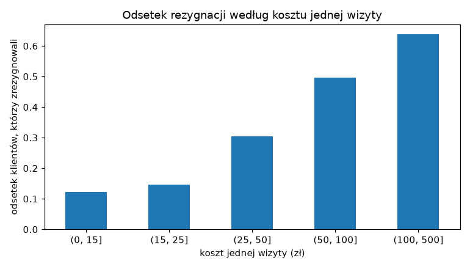

# Zajęcia 5

## Feature engineering — cechy, które mówią więcej

Do tej pory brałeś kolumny takie, jakie przyszły z systemu, i najwyżej je
czyściłeś. Tymczasem model widzi tylko liczby w kolumnach. Nie wie, że opłata
199 zł przy jednej wizycie w miesiącu to pieniądze wyrzucone w błoto, a klient
z 10 wizytami za te same 199 zł robi świetny interes. Ty to wiesz — i możesz mu
to powiedzieć, dopisując nową kolumnę.

To jest **feature engineering** (inżynieria cech): budowanie z danych, które już
masz, nowych cech, które lepiej opisują problem. Ilorazy, progi, kategorie
zamienione na liczby, podsumowania z innych tabel. W projektach na danych
tabelarycznych to zwykle daje więcej niż zamiana modelu na „mądrzejszy" — i za
godzinę na Uczeniu głębokim sprawdzisz to na własnych liczbach.

Po dzisiejszych zajęciach będziesz w stanie:

- wyjaśnić, czym jest cecha i feature engineering,
- sprawdzić, czy cecha mówi coś o zmiennej celu — `corrwith` i odsetek
  w przedziałach,
- budować cechy z liczb: ilorazy i flagi,
- zamieniać kategorie na liczby — mapowaniem `map` (gdy jest porządek)
  i kodowaniem one-hot `get_dummies` (gdy go nie ma),
- budować cechy z tabeli zdarzeń i z dat,
- rozpoznać **wyciek danych** — cechę, której nie znałbyś w chwili decyzji.

!!! tip "Przykłady z zajęć w Colabie"

    Cały materiał z tej strony jest też w gotowym notatniku — z kodem do
    uruchomienia. Otwórz go i uruchamiaj komórki po kolei, czytając materiał. Żeby zachować
    swoje zmiany, zapisz kopię: **Plik → Zapisz kopię na Dysku**.

    [](https://colab.research.google.com/github/kubzal/wsb-merito/blob/main/notebooks/semestr_zimowy_2026_27/data_science_w_pythonie/zajecia_5.ipynb)

!!! info "Gdzie jesteśmy"

    W workflow projektu z pierwszych zajęć to ostatni krok przygotowania
    danych — tuż przed modelem. Dane są już czyste (zajęcia 2), obejrzane
    (zajęcia 3) i zebrane w jedną tabelę (zajęcia 4). Teraz robimy z nich
    tabelę, z której model nauczy się jak najwięcej. Ćwiczymy na siłowni,
    w zadaniu wracamy do MeritoBanku — a za godzinę na
    [Uczeniu głębokim](../uczenie_glebokie/zajecia_5.md) Twoje cechy trafią do
    pierwszej sieci neuronowej.

---

## Plan na dziś

| Blok | Czas |
|---|---|
| Czym jest cecha i jak sprawdzić, czy coś mówi | 5 min |
| Cechy z liczb — ilorazy i flagi | 10 min |
| Kategorie na liczby — `map` i one-hot | 10 min |
| Cechy z tabeli zdarzeń i z dat | 10 min |
| Wyciek danych i gotowa tabela cech | 7 min |
| Ściągawka | 3 min |
| **Zadanie 5** | **45 min** |

---

## Cecha i jak ją ocenić

### Dane, na których pracujemy

Znowu siłownia — wyczyszczona wersja z zajęć 3 i 4:

```python
import pandas as pd
import matplotlib.pyplot as plt

URL = "https://kubzal.github.io/wsb-merito/semestr_zimowy_2026_27/uczenie_glebokie/dane/silownia_czyste.csv"
df = pd.read_csv(URL)
df.head(3)
```

```text
  klient_id  wiek    miasto typ_karnetu  oplata_mies  staz_mies  wizyty_mies  zgloszenia  zrezygnowal
0     K1342    45    Gdańsk       Basic         99.0         20          1.2           0            1
1     K0802    34    Poznań    Standard        119.0         17          7.6           1            0
2     K0240    34  Warszawa       Basic         99.0          5          5.1           1            0
```

**Cecha** (*feature*) to każda kolumna, na podstawie której model ma coś
przewidzieć — tu: wiek, opłata, staż, wizyty, zgłoszenia, miasto, typ karnetu.
**Zmienna celu** to to, co przewidujemy — `zrezygnowal`. Znasz to z pierwszych
zajęć z Uczenia głębokiego.

### Czy cecha coś mówi?

Zanim zaczniemy dopisywać kolumny, potrzebujemy miary, czy nowa kolumna jest
lepsza od starych. Najprostsza to korelacja z zajęć 3 — tym razem liczona
między każdą cechą a zmienną celu. Robi to jedna metoda, `corrwith`:

```python
liczbowe = ["wiek", "oplata_mies", "staz_mies", "wizyty_mies", "zgloszenia"]
df[liczbowe].corrwith(df["zrezygnowal"]).round(3)
```

```text
wiek          -0.045
oplata_mies    0.132
staz_mies     -0.228
wizyty_mies   -0.227
zgloszenia     0.160
dtype: float64
```

Czytasz to tak samo jak mapę ciepła: **znak** to kierunek (ujemna — im więcej,
tym rzadziej klient odchodzi), **wartość bezwzględna** to siła. Najmocniejsze
są dziś staż i wizyty, ok. 0.23. To jest poprzeczka — nowa cecha jest warta
uwagi, jeśli ją przeskoczy.

!!! note "Korelacja to pierwsze sito, nie wyrok"

    Korelacja widzi tylko zależności typu „im więcej, tym więcej". Cecha
    o korelacji bliskiej zera może być przydatna, jeśli ryzyko rośnie np. tylko
    powyżej jakiegoś progu. Dlatego do korelacji zawsze warto dołożyć odsetek
    w przedziałach — jak za chwilę.

---

## Cechy z liczb

### Iloraz — ile kosztuje jedna wizyta

Opłata sama w sobie mówi niewiele: 199 zł to dużo czy mało? Zależy, ile razy
klient przychodzi. Zróbmy cechę, która łączy obie informacje — **koszt jednej
wizyty**:

```python
df["koszt_wizyty"] = df["oplata_mies"] / df["wizyty_mies"]
df[["oplata_mies", "wizyty_mies", "koszt_wizyty"]].head(3).round(1)
```

```text
   oplata_mies  wizyty_mies  koszt_wizyty
0         99.0          1.2          82.5
1        119.0          7.6          15.7
2         99.0          5.1          19.4
```

Klient z pierwszego wiersza przychodzi nieco ponad raz w miesiącu, więc za
jedno wejście płaci 82.50 zł — prawie tyle, co inni za cały miesiąc. Czy nowa
cecha przeskakuje poprzeczkę?

```python
df[["oplata_mies", "wizyty_mies", "koszt_wizyty"]].corrwith(df["zrezygnowal"]).round(3)
```

```text
oplata_mies     0.132
wizyty_mies    -0.227
koszt_wizyty    0.296
dtype: float64
```

Przeskakuje i to wyraźnie: 0.30 wobec 0.13 i 0.23 dla kolumn, z których
powstała. Zobaczmy to w przedziałach:

```python
przedzialy = pd.cut(df["koszt_wizyty"], bins=[0, 15, 25, 50, 100, 500])
df.groupby(przedzialy, observed=True)["zrezygnowal"].agg(["count", "mean"]).round(3)
```

```text
              count   mean
koszt_wizyty              
(0, 15]         444  0.122
(15, 25]        413  0.145
(25, 50]        433  0.305
(50, 100]       147  0.497
(100, 500]       47  0.638
```

```python
df.groupby(przedzialy, observed=True)["zrezygnowal"].mean().plot(
    kind="bar", title="Odsetek rezygnacji według kosztu jednej wizyty")
plt.xticks(rotation=0)
plt.xlabel("koszt jednej wizyty (zł)")
plt.ylabel("odsetek klientów, którzy zrezygnowali")
```



Kto płaci za wizytę do 25 zł, odchodzi w 12–15% przypadków. Kto płaci ponad
100 zł — prawie w dwóch przypadkach na trzy. To jest informacja, której nie było
w żadnej pojedynczej kolumnie: model, który dostaje osobno opłatę i wizyty,
musiałby sam „wymyślić" dzielenie. Prosty model tego nie umie, a sieć
neuronowa — tylko jeśli ma dość danych.

!!! warning "Dzielenie przez zero"

    Klient z zerową liczbą wizyt dostałby koszt wizyty `inf` (nieskończoność)
    i popsułby każdą średnią. W naszych danych najmniejsza wartość to 0.4, ale
    zawsze to sprawdzaj: `(df["wizyty_mies"] == 0).sum()`. Jeśli zera są,
    zdecyduj, co znaczą — np. `df["wizyty_mies"].clip(lower=0.5)` traktuje
    „zero wizyt" jak „pół wizyty", więc koszt wychodzi wysoki, ale skończony.

### Flaga — tak albo nie

Czasem ważniejsze od dokładnej wartości jest to, czy przekroczyła próg. Na
zajęciach 4 wyszło, że w pierwszym półroczu odchodzi prawie 40% klientów.
Zróbmy z tego cechę — **flagę** 0/1:

```python
df["nowy_klient"] = (df["staz_mies"] <= 6).astype(int)
df.groupby("nowy_klient")["zrezygnowal"].agg(["count", "mean"]).round(3)
```

```text
             count   mean
nowy_klient              
0             1343  0.218
1              141  0.397
```

Porównanie `df["staz_mies"] <= 6` daje serię `True`/`False`, a `astype(int)`
zamienia ją na 1/0 — tak lubią modele. Flaga przydaje się wtedy, gdy ryzyko
**skacze** na progu, a nie zmienia się równo. Model liczący ważoną sumę (jak
regresja logistyczna) sam takiego skoku nie zapisze — ze stażu w miesiącach
wyjdzie mu tylko „im dłużej, tym lepiej, zawsze w tym samym tempie".

!!! note "A logarytm?"

    Kwoty — dochody, ceny domów, kwoty kredytów — mają zwykle długi prawy ogon:
    większość klientów zarabia kilka tysięcy, kilku zarabia kilkadziesiąt.
    Częstą cechą jest wtedy logarytm, `np.log(df["dochod"])`, który ten ogon
    „ściska". Na siłowni nie ma takich kolumn, więc dziś go tylko odnotowujemy.

---

## Kategorie na liczby

Regresja logistyczna i sieć neuronowa liczą ważoną sumę cech. Nie da się
pomnożyć „Warszawy" przez wagę 0.3. Kolumny tekstowe trzeba więc zamienić na
liczby — i sposób zależy od tego, czy kategorie mają **porządek**.

### Kategorie z porządkiem — `map`

Karnety mają naturalną kolejność: Basic < Standard < Premium. Zapisujemy ją
słownikiem:

```python
df["karnet_poziom"] = df["typ_karnetu"].map({"Basic": 1, "Standard": 2, "Premium": 3})
df[["typ_karnetu", "karnet_poziom"]].drop_duplicates()
```

```text
   typ_karnetu  karnet_poziom
0        Basic              1
1     Standard              2
27     Premium              3
```

Jeśli po `map` pojawią się braki (`df["karnet_poziom"].isna().sum()`), to
w danych jest wartość spoza słownika — np. `"premium "` ze spacją. Wracasz
wtedy do ujednolicania tekstu z zajęć 2.

### Kategorie bez porządku — one-hot

Z miastami tak się nie da. Gdyby Warszawa była 1, a Kraków 2, model uznałby,
że Kraków to „dwa razy Warszawa", a Gdańsk (3) leży „dalej" od Warszawy niż
Kraków. Bzdura. Zamiast tego każde miasto dostaje **własną kolumnę 0/1** — to
jest **kodowanie one-hot** (*one-hot encoding*, „jedna gorąca"):

```python
miasta = pd.get_dummies(df["miasto"], prefix="miasto", dtype=int)
miasta.head(3)
```

```text
   miasto_Gdańsk  miasto_Kraków  miasto_Poznań  miasto_Warszawa  miasto_Wrocław
0              1              0              0                0               0
1              0              0              1                0               0
2              0              0              0                1               0
```

W każdym wierszu jest dokładnie jedna jedynka — w kolumnie miasta klienta.
`prefix` dokleja przedrostek do nazw kolumn, a `dtype=int` daje zera
i jedynki zamiast `False`/`True`. Nowe kolumny doklejamy obok tabeli —
`pd.concat` z `axis=1` (z zajęć 4 znasz go w wersji „jedna pod drugą"):

```python
print(df.shape)
df = pd.concat([df, miasta], axis=1)
print(df.shape)
```

```text
(1484, 12)
(1484, 17)
```

Pięć miast — pięć nowych kolumn. Oryginalną kolumnę `miasto` zostawiamy, żeby
dało się po niej grupować — do modelu po prostu jej nie weźmiemy.

!!! warning "One-hot nie na wszystko"

    - **Kategorie o tysiącach wartości** (identyfikator klienta, kod pocztowy)
      dałyby tysiące kolumn, z których każda opisuje kilka osób. `klient_id`
      w ogóle nie jest cechą — to tylko etykieta wiersza.
    - **Nowe kategorie.** Pamiętasz Łódź z zajęć 4? Model nauczony na pięciu
      miastach nie ma kolumny `miasto_Łódź`. Gdy pojawi się pierwszy klient
      z Łodzi, dostanie same zera — model potraktuje go jak „miasto przeciętne".

---

## Cechy z tabeli zdarzeń

### Nie tylko „ile", ale „jakie"

Kolumna `zgloszenia` mówi, ile zgłoszeń złożył klient. Na zajęciach 4 wyszło
jednak, że ważniejsze jest, **jakie**: na sprzęt narzekają ci, którzy chodzą,
a na obsługę i płatności — ci, którzy zaraz odejdą. Zróbmy z tego cechy.
Najpierw liczba zgłoszeń każdej kategorii dla każdego klienta — `groupby` po
dwóch kolumnach i `unstack`, jak na zajęciach 4:

```python
URL_ZGL = "https://kubzal.github.io/wsb-merito/semestr_zimowy_2026_27/data_science_w_pythonie/dane/zgloszenia_2026.csv"
zgl = pd.read_csv(URL_ZGL)

kategorie = zgl.groupby(["klient_id", "kategoria"]).size().unstack(fill_value=0)
kategorie = kategorie.add_prefix("zgl_")
kategorie.head(3)
```

```text
kategoria  zgl_czystość  zgl_obsługa  zgl_płatności  zgl_sprzęt  zgl_tłok
klient_id                                                                
K0005                 1            0              0           0         1
K0006                 1            0              0           0         0
K0007                 0            0              1           0         1
```

`unstack(fill_value=0)` od razu wpisuje zero tam, gdzie klient nie miał
zgłoszenia danej kategorii, a `add_prefix` dokleja przedrostek do nazw kolumn.
Teraz łączymy z klientami — `left`, a klientom bez żadnego zgłoszenia
wpisujemy zera:

```python
kolumny_zgl = list(kategorie.columns)
df = df.merge(kategorie.reset_index(), on="klient_id", how="left")
df[kolumny_zgl] = df[kolumny_zgl].fillna(0).astype(int)
print(df.shape)

df[kolumny_zgl + ["zgloszenia"]].corrwith(df["zrezygnowal"]).round(3)
```

```text
(1484, 22)
zgl_czystość     0.007
zgl_obsługa      0.188
zgl_płatności    0.188
zgl_sprzęt      -0.044
zgl_tłok         0.068
zgloszenia       0.160
dtype: float64
```

Zgłoszenia o obsłudze i płatnościach mają z rezygnacją korelację 0.19 każde
— więcej niż wszystkie zgłoszenia razem (0.16). Zgłoszenia o sprzęcie mają
nawet znak ujemny. Złóżmy obie „złe" kategorie w jedną cechę:

```python
df["zgl_powazne"] = df["zgl_obsługa"] + df["zgl_płatności"]
print("korelacja:", round(df["zgl_powazne"].corr(df["zrezygnowal"]), 3))

df.groupby(df["zgl_powazne"].clip(upper=2))["zrezygnowal"].agg(["count", "mean"]).round(3)
```

```text
korelacja: 0.258
             count   mean
zgl_powazne              
0             1192  0.185
1              247  0.401
2               45  0.644
```

Korelacja 0.26 — prawie dwa razy więcej niż sama liczba zgłoszeń.
`clip(upper=2)` zamienia wszystko powyżej 2 na 2, więc ostatni wiersz czytaj
„2 i więcej". Klient bez poważnych zgłoszeń odchodzi w 19% przypadków,
z dwoma — w 64%.

### Cechy z dat

Dziennik zgłoszeń ma też datę. Z daty da się wyciągnąć wiele cech — ale model
nie rozumie napisu `"2026-03-14"`. Najpierw zamieniamy go na datę
`pd.to_datetime` (zajęcia 2), a potem wyciągamy liczby:

| Chcę… | Kod |
|---|---|
| miesiąc (1–12) | `zgl["data"].dt.month` |
| dzień tygodnia (0 = poniedziałek) | `zgl["data"].dt.day_of_week` |
| czy weekend | `(zgl["data"].dt.day_of_week >= 5).astype(int)` |
| ile dni minęło | `(pd.Timestamp("2026-09-30") - zgl["data"]).dt.days` |

Dla nas najciekawsze jest ostatnie: **ile dni minęło od ostatniego zgłoszenia**
klienta. Dane kończą się 30 września 2026, więc to jest nasze „dziś":

```python
zgl["data"] = pd.to_datetime(zgl["data"])
ostatnie = zgl.groupby("klient_id")["data"].max()
dni = (pd.Timestamp("2026-09-30") - ostatnie).dt.days

df = df.merge(dni.rename("dni_od_zgloszenia").reset_index(), on="klient_id", how="left")
print("brak zgłoszeń:", df["dni_od_zgloszenia"].isna().sum())
```

```text
brak zgłoszeń: 663
```

Znowu 663 braki — klienci bez zgłoszeń. Tym razem **nie** uzupełniamy zerem:
zero dni znaczyłoby „zgłosił się dziś", czyli dokładnie odwrotnie. Uczciwiej
wpisać dużą liczbę — „dawno albo nigdy" — np. 365:

```python
df["dni_od_zgloszenia"] = df["dni_od_zgloszenia"].fillna(365)

przedzialy_dni = pd.cut(df["dni_od_zgloszenia"], bins=[-1, 30, 90, 180, 300, 365])
df.groupby(przedzialy_dni, observed=True)["zrezygnowal"].agg(["count", "mean"]).round(3)
```

```text
                   count   mean
dni_od_zgloszenia              
(-1, 30]             135  0.333
(30, 90]             212  0.307
(90, 180]            260  0.238
(180, 300]           214  0.252
(300, 365]           663  0.186
```

Świeże zgłoszenie (ostatni miesiąc) to 33% rezygnacji, stare — 24–25%, brak
zgłoszeń — 19%. Efekt jest, ale słabszy niż przy kategoriach. Tak też bywa:
nie każda cecha, która brzmi sensownie, okazuje się mocna — dlatego każdą się
sprawdza.

!!! tip "Uzupełnianie braków po złączeniu"

    Za każdym razem zapytaj, co znaczy brak w **tej** kolumnie. Brak zgłoszeń
    w liczbie zgłoszeń to zero. Brak zgłoszeń w „dniach od zgłoszenia" to
    „bardzo dawno". Brak wieku w ankiecie to „nie wiemy" — i wtedy mediana.
    Ta sama metoda `fillna`, trzy różne decyzje.

---

## Wyciek danych

### Cecha za dobra, żeby była prawdziwa

Wyobraź sobie, że dział IT dorzuca do tabeli kolumnę `wizyty_pazdziernik` —
liczbę wizyt w październiku. Korelacja z rezygnacją wychodzi gigantyczna.
Nic dziwnego: kto zrezygnował we wrześniu, w październiku ma zero wizyt.
Model z taką cechą miałby świetne wyniki w notatniku i byłby **zupełnie
bezużyteczny** w praktyce — bo chcemy przewidzieć rezygnację, **zanim** się
zdarzy, a wtedy październikowych wizyt jeszcze nie ma.

To jest **wyciek danych** (*data leakage*): cecha, która zawiera informację
z przyszłości albo wprost z odpowiedzi. Na zajęciach 3 z Uczenia głębokiego
poznałeś wyciek przy skalowaniu. Ten jest groźniejszy, bo nie widać go w kodzie
— widać go dopiero, gdy zapytasz:

> **Czy znałbym tę wartość w chwili, w której model ma podjąć decyzję?**

| Cecha | Wyciek? | Dlaczego |
|---|---|---|
| liczba wizyt w ostatnim miesiącu przed decyzją | nie | znamy ją w chwili decyzji |
| wizyty w miesiącu **po** dacie, dla której przewidujemy | **tak** | to już przyszłość |
| powód rezygnacji z ankiety wyjściowej | **tak** | istnieje tylko dla tych, którzy odeszli |
| zgłoszenie „chcę anulować karnet" | **tak** | to właściwie sama odpowiedź |
| liczba zgłoszeń o płatnościach | raczej nie | ale warto spytać, czy nie powstają **przy** rezygnacji |

!!! danger "Za dobre, żeby było prawdziwe"

    Jeśli jedna cecha ma z celem korelację 0.9 albo model nagle osiąga 99%
    accuracy — nie świętuj, tylko szukaj wycieku. W prawdziwych danych tak
    mocnych cech prawie nie ma. W zadaniu zobaczysz taki przypadek na własne
    oczy.

### Gotowa tabela cech

Na koniec zbieramy wszystko, co ma trafić do modelu. Tabela do modelu ma
cztery cechy: **jeden wiersz na klienta, same liczby, żadnych braków, żadnego
wycieku**:

```python
cechy = (liczbowe
         + ["koszt_wizyty", "nowy_klient", "karnet_poziom", "zgl_powazne", "dni_od_zgloszenia"]
         + list(miasta.columns))

gotowe = df[cechy + ["zrezygnowal"]]
print(gotowe.shape, "| braków:", gotowe.isna().sum().sum())

gotowe.to_csv("silownia_cechy.csv", index=False)
```

```text
(1484, 16) | braków: 0
```

Z 5 cech liczbowych zrobiło się 15. Tekstowe kolumny (`miasto`,
`typ_karnetu`) i `klient_id` zostały poza tabelą — ich informacja siedzi
w kolumnach liczbowych. Plik `silownia_cechy.csv` znajdziesz w Colabie
w panelu **Pliki** po lewej.

!!! note "Więcej cech to nie zawsze lepiej"

    Każda cecha to dla modelu kolejna rzecz do nauczenia się, a danych mamy
    tyle samo. Cechy słabe albo powtarzające to samo (`zgloszenia`
    i `zgl_powazne`, `oplata_mies` i `karnet_poziom`) mogą modelowi bardziej
    przeszkodzić niż pomóc — zwłaszcza dużemu. Co z tego wychodzi w praktyce,
    zobaczysz za godzinę.

---

## Ściągawka

| Chcę… | Kod |
|---|---|
| korelacja każdej cechy z celem | `df[cechy].corrwith(df["cel"])` |
| korelacja jednej kolumny z celem | `df["kol"].corr(df["cel"])` |
| iloraz dwóch kolumn | `df["nowa"] = df["a"] / df["b"]` |
| sprawdzić zera przed dzieleniem | `(df["b"] == 0).sum()` |
| flaga 0/1 | `df["flaga"] = (df["kol"] > prog).astype(int)` |
| kategoria z porządkiem → liczba | `df["kol"].map({"niski": 1, "średni": 2, "wysoki": 3})` |
| kategoria bez porządku → one-hot | `pd.get_dummies(df["kol"], prefix="kol", dtype=int)` |
| dokleić kolumny obok | `pd.concat([df, nowe_kolumny], axis=1)` |
| zdarzenia → liczba w każdej kategorii | `zd.groupby(["id", "kategoria"]).size().unstack(fill_value=0)` |
| przedrostek w nazwach kolumn | `tabela.add_prefix("zgl_")` |
| obciąć wartości z góry | `df["kol"].clip(upper=2)` |
| tekst → data | `pd.to_datetime(df["data"])` |
| miesiąc / dzień tygodnia | `df["data"].dt.month`, `df["data"].dt.day_of_week` |
| ile dni minęło | `(pd.Timestamp("2026-09-30") - df["data"]).dt.days` |
| odsetek celu w przedziałach cechy | `df.groupby(pd.cut(df["kol"], bins=[...]), observed=True)["cel"].mean()` |
| zapisać tabelę do pliku | `df.to_csv("plik.csv", index=False)` |

---

## Zadanie 5 — Ile z pensji idzie na ratę (6 pkt)

**Czas:** maks. 45 minut
**Środowisko:** Google Colab
**Oddanie:** notatnik `.ipynb` na Moodle

Dział ryzyka MeritoBanku buduje nowy model oceny wniosków kredytowych.
Analitycy od dawna powtarzają, że ważna jest nie sama kwota kredytu ani sam
dochód, tylko to, **jaką część pensji klient oddaje co miesiąc na ratę**.
Tej kolumny w żadnym systemie nie ma — Twoim zadaniem jest ją zbudować,
sprawdzić, czy analitycy mają rację, i przygotować tabelę cech dla modelu.

Na początku notatnika wpisz swój numer albumu — od niego zależy, który cel
kredytu analizujesz w części 1:

```python
NR_ALBUMU = 123456   # ← wpisz swój numer albumu

CELE = ["gotówkowy", "samochodowy", "remont", "konsolidacyjny"]
MOJ_CEL = CELE[NR_ALBUMU % 4]
print("Mój cel kredytu:", MOJ_CEL)

URL_KREDYTY = "https://kubzal.github.io/wsb-merito/semestr_zimowy_2026_27/data_science_w_pythonie/dane/kredyty_2026.csv"
URL_SPLATY = "https://kubzal.github.io/wsb-merito/semestr_zimowy_2026_27/data_science_w_pythonie/dane/splaty_2026.csv"
```

Obie tabele znasz z zajęć 3 i 4.

Rób części po kolei i **pokaż mi wynik każdej części, gdy będzie gotowa**.

### Część 1 — obciążenie ratą (ok. 20 min)

1. Wczytaj kredyty i dodaj dwie kolumny: `rata` — miesięczna rata
   w przybliżeniu, czyli kwota kredytu podzielona przez okres (bez odsetek),
   oraz `obciazenie` — jaka część miesięcznego dochodu idzie na ratę. Jaką
   część dochodu oddaje na ratę typowy (medianowy) klient? Ilu klientów oddaje
   na ratę **ponad połowę** dochodu?
2. Jedną linijką policz korelację z `niesplacony` dla kwoty kredytu, okresu,
   dochodu, raty i obciążenia. W komórce tekstowej odpowiedz: czy nowe cechy
   mówią o ryzyku więcej niż kolumny, z których powstały?
3. Potnij obciążenie na przedziały `[0, 0.1, 0.2, 0.3, 0.5, 5]` i policz liczbę
   klientów i odsetek niespłaconych w każdym przedziale — dla całego banku
   (z wykresem słupkowym odsetka) i osobno dla **Twojego celu kredytu**.
   W komórce tekstowej: od jakiego obciążenia ryzyko wyraźnie rośnie w całym
   banku, a od jakiego w Twoim celu? Czy wynikom dla najmniejszych grup można
   ufać?

### Część 2 — kategorie, wyciek i tabela cech (ok. 25 min)

1. Zakoduj `cel_kredytu` metodą one-hot (przedrostek `cel`) i doklej nowe
   kolumny do kredytów. Dodaj flagę `mial_opoznienia` — 1, jeśli klient miał
   w ostatnim roku choć jedno opóźnienie. Policz korelację z `niesplacony` dla
   kolumn celu, flagi i `opoznienia_12m`. W komórce tekstowej: który cel jest
   najbardziej ryzykowny? Czy flaga mówi o ryzyku więcej niż liczba opóźnień?
2. Streść spłaty do jednego wiersza na klienta — liczba wpłat i największe
   opóźnienie — i dołącz do kredytów tak, żeby nie zgubić żadnego kredytu
   (brak wpłat = 0 wpłat). Policz korelację obu nowych kolumn z `niesplacony`.
   W komórce tekstowej: czy dział ryzyka może użyć tych cech w modelu, który
   ocenia **nowe** wnioski kredytowe? Dlaczego?
3. Złóż tabelę cech dla modelu: same kolumny liczbowe, bez identyfikatora,
   bez tekstu i bez wycieku, plus `niesplacony` na końcu. Wypisz jej kształt,
   sprawdź, że nie ma braków, i zapisz ją do pliku `kredyty_cechy.csv`.
   W komórce tekstowej wypisz, których kolumn **nie** wziąłeś i dlaczego.

### Wskazówki

- Obciążenie to iloraz, tak jak koszt wizyty w notatkach. Wynik 0.25 znaczy,
  że rata to ćwierć dochodu. Mediana: `kr["obciazenie"].median()`, liczba
  klientów powyżej progu: `(kr["obciazenie"] > 0.5).sum()`.
- Korelacja z celem kilku kolumn naraz: `kr[lista_kolumn].corrwith(kr["niesplacony"])`.
- Odsetek w przedziałach to przykład z sekcji „Iloraz — ile kosztuje jedna
  wizyta". Dla Twojego celu najpierw filtr `kr[kr["cel_kredytu"] == MOJ_CEL]`,
  potem to samo.
- Pamiętaj o ostrzeżeniu „Mała grupa, duże liczby" z zajęć 4 — liczebność
  przedziału jest tak samo ważna jak odsetek.
- One-hot i doklejanie kolumn: `pd.get_dummies(..., prefix="cel", dtype=int)`,
  potem `pd.concat([kr, cele], axis=1)`. Listę nowych kolumn masz w
  `list(cele.columns)`.
- Streszczenie spłat i złączenie robiłeś w zadaniu 4 — `groupby`, `agg`,
  `reset_index`, `merge(..., how="left")`, `fillna(0)`. Sprawdź `shape`.
- Przy wycieku zadaj pytanie z notatek: czy znałbym tę wartość w chwili, gdy
  klient składa wniosek?
- Tabela cech: `kr[lista_cech + ["niesplacony"]]`. Braki:
  `.isna().sum().sum()`.

### Punktacja (6 pkt)

| Punkty | Za co |
|---|---|
| **6 pkt** | obie części zrobione **na zajęciach** i pokazane prowadzącemu |
| **4 pkt** | jedna z dwóch części zrobiona na zajęciach |
| **2 pkt** | zadanie dokończone po zajęciach i wysłane na Moodle **w terminie** |
| **0 pkt** | brak rozwiązania albo wysłane po terminie |

Termin przesłania na Moodle: **dzień przed kolejnymi zajęciami**.

!!! danger "Serio, róbcie to na zajęciach"

    Te same 45 minut pracy jest warte 6 pkt tu i teraz albo 2 pkt w domu. Przez
    cały semestr robi to różnicę 32 punktów, czyli całej oceny w górę lub w dół.
