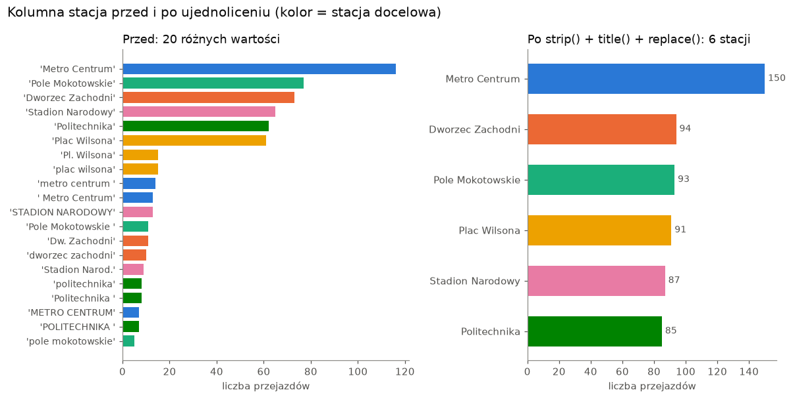
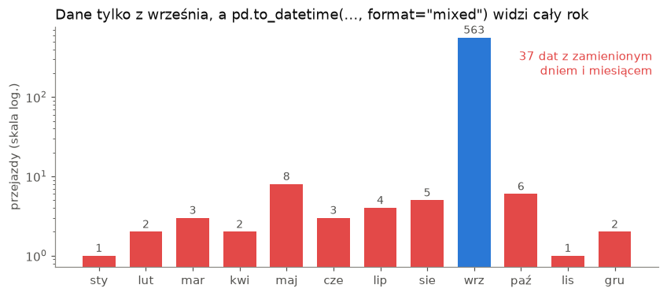
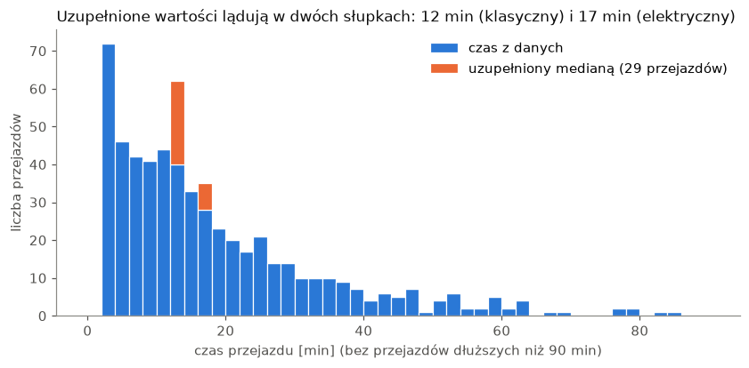
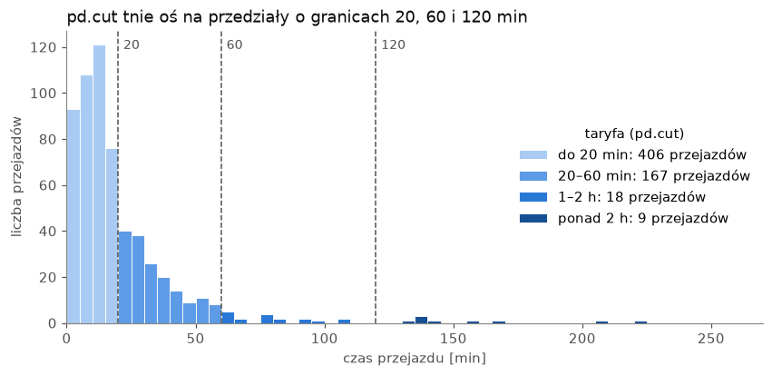
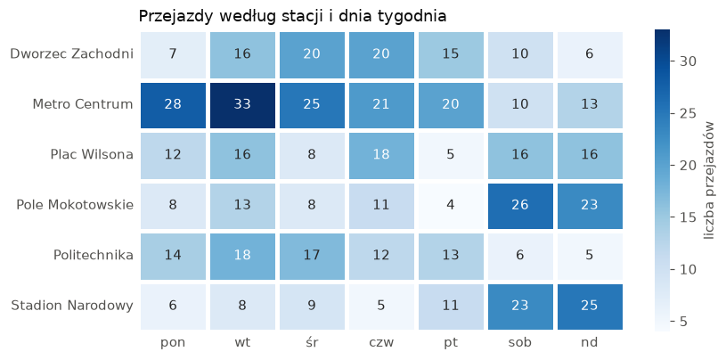
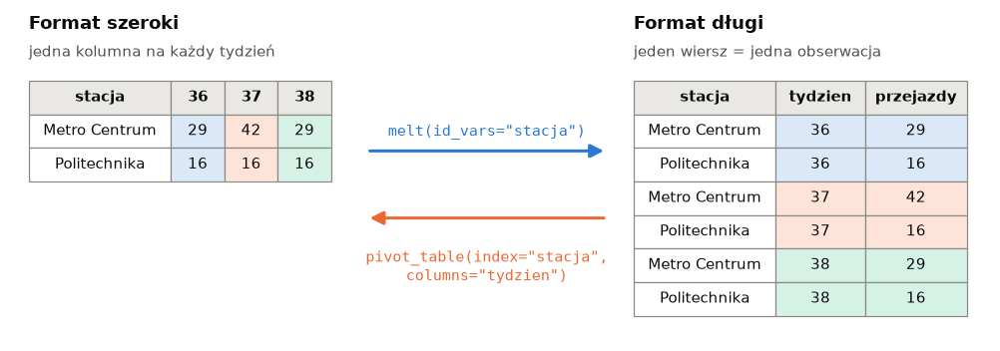

# Zajęcia 2

## Czyszczenie i przetwarzanie danych

Na poprzednich zajęciach dane udało się wczytać. Niestety „wczytane" nie znaczy
„dobre". Prawdziwe dane mają dziury, powtórzone wiersze, miasto zapisane na pięć
sposobów i daty w trzech formatach — bo wprowadzali je ludzie, eksportowały różne
systemy, a ktoś po drodze „trochę poprawił w Excelu".

Analitycy żartują, że 80% pracy to sprzątanie danych, a 20% narzekanie na
sprzątanie. Coś w tym jest: zanim policzysz pierwszą średnią, musisz mieć
pewność, że liczysz na tym, na czym myślisz. Dziś robimy drugi krok naszej drogi:
**pozyskanie → czyszczenie → analiza → wizualizacja**.

Po dzisiejszych zajęciach będziesz w stanie:

- zdiagnozować zbiór danych: znaleźć braki, duplikaty, złe typy i niespójne
  kategorie,
- ujednolicić tekst (`.str.strip()`, `.str.title()`, `replace`),
- zamienić na liczby i daty kolumny, które pandas wczytał jako tekst — także
  wtedy, gdy siedzą w nich śmieci typu „brak" albo daty w kilku formatach,
- świadomie zdecydować, co zrobić z brakiem: usunąć, uzupełnić czy oznaczyć,
- dodać nowe kolumny, pociąć liczby na przedziały (`pd.cut`), zbudować tabelę
  przestawną (`pivot_table`) i przejść między formatem szerokim a długim (`melt`).

!!! tip "Przykłady z zajęć w Colabie"

    Cały materiał z tej strony jest też w gotowym notatniku — z kodem do
    uruchomienia. Otwórz go i uruchamiaj komórki po kolei, czytając materiał. Żeby zachować
    swoje zmiany, zapisz kopię: **Plik → Zapisz kopię na Dysku**.

    [](https://colab.research.google.com/github/kubzal/wsb-merito/blob/main/notebooks/semestr_zimowy_2026_27/metody_analizy_przetwarzania_i_wizualizacji_danych/zajecia_2.ipynb)

!!! info "Gdzie jesteśmy"

    W demo wracamy do miejskiej wypożyczalni rowerów z pierwszych zajęć — tym
    razem z eksportem przejazdów z całego września, w którym jest wszystko, co
    może pójść nie tak. W zadaniu wracasz do sklepu „Gadżet24": polskie zamówienia,
    które poznałeś miesiąc temu, przeszły przez ręce stażysty.

---

## Plan na dziś

| Blok | Czas |
|---|---|
| Przypomnienie zajęć 1 | 5 min |
| „Garbage in, garbage out" — typowe problemy z danymi | 10 min |
| Diagnoza i czyszczenie — braki, duplikaty, tekst, liczby, daty | 25 min |
| Przetwarzanie — nowe kolumny, przedziały, tabele przestawne, `melt` | 15 min |
| Przerwa | 10 min |
| **Zadanie 2** | **60 min** |
| Omówienie | 10 min |

---

## Przypomnienie — zajęcia 1

- Dane przychodzą z plików, API i baz danych, a cel jest zawsze ten sam:
  **DataFrame**.
- `pd.read_csv` ma parametry na „polskie" pliki: `encoding="cp1250"`, `sep=";"`,
  `decimal=","`, `skiprows=...`.
- Zagnieżdżony JSON spłaszcza `pd.json_normalize`, a dane z API pobiera
  `requests.get(URL).json()`.
- Tabele łączy `merge` (po kluczu) albo `merge_asof` (po „ostatniej wartości
  wcześniej") — i po każdym łączeniu liczymy wiersze.

Dziś zakładamy, że plik już się wczytał. Problem w tym, że w środku jest bałagan.

---

## Garbage in, garbage out

Stara zasada informatyki: **śmieci na wejściu = śmieci na wyjściu**. Najlepszy
model i najładniejszy wykres nie pomogą, jeśli dane są złe. Co gorsza, złe dane
rzadko powodują błąd. Najczęściej dostajesz wynik, który **wygląda** poprawnie,
tylko jest nieprawdziwy.

Typowe problemy, które spotkasz prawie w każdym zbiorze:

| Problem | Przykład | Jak go wykryć |
|---|---|---|
| **braki** | puste pole, `NaN` | `df.isna().sum()` |
| **ukryte braki** | „brak", „b.d.", „-", „?" w kolumnie liczbowej | kolumna ma typ `str` zamiast liczby |
| **duplikaty** | to samo zamówienie wyeksportowane dwa razy | `df.duplicated().sum()` |
| **niespójne kategorie** | „Warszawa", „warszawa ", „WAW" | `df["kol"].value_counts()`, `unique()` |
| **zły typ** | cena „12,50 zł" jako tekst, data jako tekst | `df.info()` |
| **kilka formatów** | „2026-09-01" i „01.09.2026" w jednej kolumnie | podgląd danych, błąd przy konwersji |
| **wartości niemożliwe** | czas przejazdu −14 min, wiek 230 lat | `df.describe()`, filtr z warunkiem |

Z brakami można zrobić trzy rzeczy — i każda jest czasem dobra, a czasem zła:

| Strategia | Kiedy | Ryzyko |
|---|---|---|
| **usuń** wiersz (`dropna`) | braków jest mało, a wiersz bez tej wartości jest bezużyteczny | tracisz dane; jeśli braki nie są losowe, wynik się przekrzywia |
| **uzupełnij** (`fillna`) | wartość da się sensownie oszacować (mediana, wartość z innej tabeli) | wymyślasz dane; zostawiają ślad na wykresach |
| **oznacz** (nowa kolumna `..._brak`) | sam fakt braku może coś znaczyć | nic nie tracisz, ale kolumn przybywa |

W praktyce często łączy się dwie ostatnie: uzupełniasz, ale zostawiasz sobie
kolumnę z informacją, które wartości były wymyślone.

---

## Dane, na których pracujemy

Wypożyczalnia rowerów wyeksportowała przejazdy z września 2026. Eksport skleił
ktoś z dwóch systemów, więc spodziewamy się kłopotów:

- :material-file-delimited: [**przejazdy_wrzesien_2026.csv**](dane/przejazdy_wrzesien_2026.csv)

| Kolumna | Co oznacza |
|---|---|
| `id` | numer przejazdu |
| `start` | data i godzina wypożyczenia |
| `stacja` | stacja, na której wypożyczono rower |
| `rower` | klasyczny albo elektryczny |
| `czas_min` | czas przejazdu w minutach |
| `oplata` | ile klient zapłacił (pierwsze 20 minut gratis) |

```python
import pandas as pd

URL = "https://kubzal.github.io/wsb-merito/semestr_zimowy_2026_27/metody_analizy_przetwarzania_i_wizualizacji_danych/dane/przejazdy_wrzesien_2026.csv"
df = pd.read_csv(URL)
df.head()
```

```text
   id             start            stacja        rower czas_min   oplata
0   1  2026-09-01 06:09  pole mokotowskie    klasyczny        6  0,00 zł
1   1  2026-09-01 06:09  pole mokotowskie    klasyczny        6  0,00 zł
2   2  2026-09-01 06:28  Pole Mokotowskie  elektryczny       35  2,00 zł
3   3  2026-09-01 06:53     Metro Centrum   KLASYCZNY        16  0,00 zł
4   4  2026-09-01 07:25     Metro Centrum  elektryczny       15  0,00 zł
```

Już w pięciu wierszach widać trzy problemy: wiersz 0 i 1 są identyczne,
„pole mokotowskie" i „Pole Mokotowskie" to ta sama stacja, a „KLASYCZNY" krzyczy
wielkimi literami. Zobaczmy, co jeszcze się kryje.

---

## Diagnoza — co jest nie tak

Zanim cokolwiek naprawisz, musisz wiedzieć, **co** jest zepsute. Diagnoza to
zawsze te same kilka poleceń.

### Typy i braki — `info()`

```python
df.info()
```

```text
<class 'pandas.DataFrame'>
RangeIndex: 615 entries, 0 to 614
Data columns (total 6 columns):
 #   Column    Non-Null Count  Dtype
---  ------    --------------  -----
 0   id        615 non-null    int64
 1   start     615 non-null    str
 2   stacja    615 non-null    str
 3   rower     615 non-null    str
 4   czas_min  604 non-null    str
 5   oplata    615 non-null    str
dtypes: int64(1), str(5)
memory usage: 29.0 KB
```

Pięć z sześciu kolumn to tekst (`str`). Dla `stacja` i `rower` to w porządku. Ale
`czas_min` i `oplata` powinny być liczbami, a `start` datą. To pierwszy sygnał
ostrzegawczy: **liczba wczytana jako tekst oznacza, że w kolumnie siedzi coś,
co liczbą nie jest.**

### Ile braków — `isna().sum()`

```python
df.isna().sum()
```

```text
id           0
start        0
stacja       0
rower        0
czas_min    11
oplata       0
dtype: int64
```

11 pustych pól w `czas_min`. Zapamiętaj tę liczbę — za chwilę okaże się, że
braków jest więcej, tylko część z nich udaje tekst.

### Statystyki — `describe()`

```python
df.describe()
```

```text
               id
count  615.000000
mean   300.769106
std    173.506316
min      1.000000
25%    151.500000
50%    302.000000
75%    450.500000
max    600.000000
```

`describe()` policzył statystyki tylko dla `id`, bo tylko ta kolumna jest liczbą.
Tu widać też coś ciekawego: wierszy jest 615, a najwyższy numer przejazdu to 600.
Skąd 15 nadmiarowych?

### Duplikaty — `duplicated()`

```python
df.duplicated().sum()
```

```text
np.int64(15)
```

Jest 15 wierszy, które są dokładną kopią wcześniejszego wiersza. `keep=False`
pokazuje wszystkie egzemplarze, łącznie z oryginałem:

```python
df[df.duplicated(keep=False)].head(6)
```

```text
    id             start            stacja        rower czas_min   oplata
0    1  2026-09-01 06:09  pole mokotowskie    klasyczny        6  0,00 zł
1    1  2026-09-01 06:09  pole mokotowskie    klasyczny        6  0,00 zł
24  24  2026-09-02 07:51      politechnika  elektryczny        4  0,00 zł
25  24  2026-09-02 07:51      politechnika  elektryczny        4  0,00 zł
68  67  04.09.2026 11:27  Stadion Narodowy  elektryczny       16  0,00 zł
69  67  04.09.2026 11:27  Stadion Narodowy  elektryczny       16  0,00 zł
```

### Warianty tekstu — `value_counts()` i `unique()`

```python
df["stacja"].value_counts()
```

```text
stacja
Metro Centrum        118
Pole Mokotowskie      79
Dworzec Zachodni      74
Stadion Narodowy      69
Politechnika          64
Plac Wilsona          62
Pl. Wilsona           15
plac wilsona          15
metro centrum         14
 Metro Centrum        13
STADION NARODOWY      13
Pole Mokotowskie      11
Dw. Zachodni          11
dworzec zachodni      10
Stadion Narod.        10
politechnika           9
Politechnika           8
METRO CENTRUM          7
POLITECHNIKA           7
pole mokotowskie       6
Name: count, dtype: int64
```

Stacji jest sześć, a pandas widzi dwadzieścia różnych wartości. „Pole Mokotowskie"
pojawia się dwa razy — w jednym z nich na końcu jest spacja, której
w `value_counts()` nie widać. Spacje zdradza `unique()`, bo pokazuje napisy
w apostrofach:

```python
df["rower"].unique()
```

```text
<StringArray>
['klasyczny', 'elektryczny', 'KLASYCZNY ', 'Elektryczny', 'Klasyczny',
 'e-bike']
Length: 6, dtype: str
```

`'KLASYCZNY '` ma spację na końcu, a `'e-bike'` to po prostu inna nazwa roweru
elektrycznego.

!!! note "Wynik diagnozy"

    - 15 zduplikowanych wierszy,
    - `stacja`: 20 wariantów zapisu 6 stacji (wielkość liter, spacje, skróty),
    - `rower`: 6 wariantów zapisu 2 typów,
    - `czas_min`: tekst zamiast liczby, 11 pustych pól,
    - `oplata`: tekst „0,00 zł" zamiast liczby,
    - `start`: tekst zamiast daty, a w podglądzie widać dwa formaty
      (`2026-09-04` i `04.09.2026`).

    Taka lista to pierwsza rzecz, którą robisz z nowym zbiorem. Teraz naprawiamy
    po kolei.

---

## Czyszczenie

### Duplikaty

```python
df = df.drop_duplicates()
df.shape
```

```text
(600, 6)
```

Zostało 600 wierszy — dokładnie tyle, ile wynosi najwyższy numer przejazdu.
Pamiętaj o `df = ...`: metody pandas zwracają **nową** tabelę, a nie zmieniają
starej. Bez przypisania duplikaty zostaną.

!!! warning "Duplikaty, które nie wyglądają na duplikaty"

    `duplicated()` szuka wierszy identycznych **co do znaku**. Jeśli to samo
    zamówienie raz ma „Warszawa", a raz „warszawa ", dla pandas to dwa różne
    wiersze. Dlatego duplikaty sprawdza się jeszcze raz **po** ujednoliceniu
    tekstu — albo od razu po kluczu, który musi być unikalny:
    `df.duplicated(subset=["id"]).sum()`.

### Tekst — `.str.strip()`, `.str.title()`, `replace`

Po `.str` masz dostęp do metod napisów z Pythona, wykonywanych na każdym
wierszu naraz. Łączymy je w łańcuch — każda działa na wyniku poprzedniej:

```python
df["stacja"] = df["stacja"].str.strip().str.title()
df["stacja"].value_counts()
```

```text
stacja
Metro Centrum       150
Pole Mokotowskie     93
Politechnika         85
Dworzec Zachodni     83
Stadion Narodowy     78
Plac Wilsona         76
Pl. Wilsona          15
Dw. Zachodni         11
Stadion Narod.        9
Name: count, dtype: int64
```

`strip()` usunął spacje z początku i końca, `title()` zamienił „METRO CENTRUM"
i „metro centrum" na „Metro Centrum". Z dwudziestu wariantów zostało dziewięć.
Skrótów żadna metoda tekstowa nie rozpozna — to musimy powiedzieć wprost,
słownikiem w `replace` (`{"jak jest": "jak ma być"}`):

```python
df["stacja"] = df["stacja"].replace({
    "Dw. Zachodni": "Dworzec Zachodni",
    "Pl. Wilsona": "Plac Wilsona",
    "Stadion Narod.": "Stadion Narodowy",
})
df["stacja"].value_counts()
```

```text
stacja
Metro Centrum       150
Dworzec Zachodni     94
Pole Mokotowskie     93
Plac Wilsona         91
Stadion Narodowy     87
Politechnika         85
Name: count, dtype: int64
```

Sześć stacji. Różnicę dobrze widać na wykresie: każdy kolor to jedna stacja,
rozsmarowana po kilku wariantach zapisu.



Gdybyś liczył przychód stacji na surowych danych, „Plac Wilsona" straciłby co
trzeci przejazd na rzecz „Pl. Wilsona" i „plac wilsona". Żadnego błędu, po prostu
zła liczba.

Z rowerem robimy to samo, tylko zamiast `title()` bierzemy `lower()` — typ roweru
to zwykłe słowo, a nie nazwa własna:

```python
df["rower"] = df["rower"].str.strip().str.lower().replace({"e-bike": "elektryczny"})
df["rower"].value_counts()
```

```text
rower
klasyczny      400
elektryczny    200
Name: count, dtype: int64
```

!!! tip "`replace` czy `map`?"

    `replace(słownik)` zamienia **tylko** wartości, które są w słowniku, a resztę
    zostawia. `map(słownik)` zamienia wszystkie, a tych spoza słownika — na
    `NaN`. Do poprawiania kilku wariantów używaj `replace`, do zamiany całej
    kolumny (np. „tak"/„nie" → 1/0) — `map`.

### Liczby zapisane jako tekst

Opłata wygląda tak: `"2,00 zł"`. Usuwamy to, czego Python nie rozumie, i dopiero
wtedy zmieniamy typ:

```python
df["oplata"] = df["oplata"].str.replace(" zł", "").str.replace(",", ".").astype(float)
df["oplata"].describe()
```

```text
count    600.000000
mean       0.876667
std        2.492350
min        0.000000
25%        0.000000
50%        0.000000
75%        1.000000
max       32.000000
Name: oplata, dtype: float64
```

Mediana opłaty to 0 zł — ponad połowa przejazdów mieści się w darmowych
20 minutach.

Z czasem przejazdu ten sam trik nie zadziała:

```python
df["czas_min"].astype(float)
```

```text
ValueError: could not convert string to float: 'brak'
```

W kolumnie, oprócz liczb i pustych pól, ktoś wpisywał słowo „brak". Szukanie
wszystkich takich słów ręcznie byłoby żmudne. Zamiast tego używamy
`pd.to_numeric` z parametrem `errors="coerce"` (*wymuś*): co da się zamienić na
liczbę — zamień, a resztę zastąp `NaN`.

```python
czas = pd.to_numeric(df["czas_min"], errors="coerce")
print("braki przed:", df["czas_min"].isna().sum())
print("braki po:   ", czas.isna().sum())
```

```text
braki przed: 11
braki po:    25
```

Przybyło 14 braków. To były **ukryte braki** — tekst, który udawał wartość.
Zanim je zaakceptujesz, zobacz, co dokładnie zamieniłeś na `NaN`:

```python
df.loc[czas.isna() & df["czas_min"].notna(), "czas_min"].value_counts()
```

```text
czas_min
brak    9
b.d.    5
Name: count, dtype: int64
```

„brak" i „b.d." (*brak danych*) — wszystko w porządku, to naprawdę braki. Gdyby
na tej liście była np. liczba z przecinkiem „12,5", trzeba by ją najpierw
poprawić, a nie wyrzucać.

!!! warning "`errors="coerce"` bez sprawdzenia to zamiatanie pod dywan"

    `coerce` nigdy nie rzuci błędem — po cichu zamieni na `NaN` wszystko, czego
    nie rozumie. Także wartości, które dało się uratować. Dlatego zawsze porównuj
    liczbę braków przed i po, i patrz, co zginęło.

### Wartości niemożliwe

Teraz `czas_min` jest liczbą, więc możemy zadać pytanie, którego wcześniej nie
dało się zadać: czy wszystkie czasy mają sens?

```python
df["czas_min"] = czas
df[df["czas_min"] < 0]
```

```text
      id             start            stacja      rower  czas_min  oplata
333  328  16.09.2026 12:44  Dworzec Zachodni  klasyczny     -29.0     1.0
463  453  2026-09-23 06:06  Pole Mokotowskie  klasyczny     -43.0     1.0
489  478  2026-09-24 08:11      Plac Wilsona  klasyczny      -7.0     0.0
516  505  2026-09-25 10:28     Metro Centrum  klasyczny     -23.0     1.0
```

Przejazd nie może trwać −29 minut. Prawdziwej wartości nie znamy, więc uczciwie
jest potraktować ją jak brak. `df.loc[warunek, "kolumna"] = wartość` czytamy:
„w wierszach spełniających warunek, w tej kolumnie, wpisz tę wartość":

```python
import numpy as np

df.loc[df["czas_min"] < 0, "czas_min"] = np.nan
df["czas_min"].isna().sum()
```

```text
np.int64(29)
```

Z 11 braków widocznych na początku zrobiło się 29. Dobrze, że to wiemy, zanim
policzyliśmy średni czas przejazdu.

### Daty w kilku formatach

```python
pd.to_datetime(df["start"])
```

```text
ValueError: time data "01.09.2026 08:30" doesn't match format "%Y-%m-%d %H:%M". You might want to try:
    - passing `format` if your strings have a consistent format;
    - passing `format='ISO8601'` if your strings are all ISO8601 but not necessarily in exactly the same format;
    - passing `format='mixed'`,
```

pandas ustalił format na podstawie pierwszego wiersza (`2026-09-01 06:09`)
i zatrzymał się na pierwszej dacie zapisanej po polsku. Komunikat podsuwa
`format='mixed'` — spróbujmy, a wynik od razu sprawdźmy. Wszystkie przejazdy są
z września, więc każdy inny miesiąc to błąd:

```python
proba = pd.to_datetime(df["start"], format="mixed")
proba.dt.month.value_counts()
```

```text
start
9     563
5       8
10      6
8       5
7       4
3       3
6       3
2       2
4       2
12      2
1       1
11      1
Name: count, dtype: int64
```



Wrześniowe przejazdy rozjechały się po całym roku, a pandas nawet nie
ostrzegł. Które daty ucierpiały?

```python
df.loc[proba.dt.month != 9, "start"].head()
```

```text
5     01.09.2026 08:30
27    02.09.2026 08:14
31    02.09.2026 11:36
40    03.09.2026 08:11
52    03.09.2026 16:33
Name: start, dtype: str
```

`format="mixed"` zgaduje format dla każdego wiersza osobno i zakłada amerykański
zapis „miesiąc.dzień". `01.09.2026` przeczytał jako 9 stycznia. Daty z dniem
powyżej 12 (`16.09.2026`) wyszły dobrze, bo miesiąca 16 nie ma — i właśnie dlatego
ten błąd tak łatwo przeoczyć.

!!! danger "Nie pozwól pandas zgadywać dat"

    `format="mixed"` i `dayfirst=True` to zgadywanie. Z `dayfirst=True` popsują
    się z kolei daty ISO: `2026-09-04` stanie się 9 kwietnia. Jeśli w kolumnie
    jest kilka formatów, **każdy z nich podaj wprost**.

Bezpieczny sposób: zamieniamy kolumnę kilka razy, za każdym razem z jednym
formatem i z `errors="coerce"`. Każda próba trafia tylko w „swoje" wiersze,
a pozostałe zostawia jako `NaT` (brak daty). Potem sklejamy wyniki przez
`fillna` — „gdzie pierwsza próba nie trafiła, weź wynik drugiej":

```python
iso = pd.to_datetime(df["start"], format="%Y-%m-%d %H:%M", errors="coerce")
pl = pd.to_datetime(df["start"], format="%d.%m.%Y %H:%M", errors="coerce")
df["start"] = iso.fillna(pl)
print(df["start"].isna().sum(), df["start"].dt.month.unique())
```

```text
0 [9]
```

Zero braków i tylko wrzesień. Gdyby został jakiś `NaT`, znaczyłoby to, że jest
jeszcze trzeci format — wtedy wypisujesz te wiersze i dokładasz kolejną próbę.

| Zapis | Format |
|---|---|
| `2026-09-01` | `"%Y-%m-%d"` |
| `01.09.2026` | `"%d.%m.%Y"` |
| `20260901` | `"%Y%m%d"` |
| `2026-09-01 08:30` | `"%Y-%m-%d %H:%M"` |

### Braki — usunąć, uzupełnić czy oznaczyć?

Zostało 29 przejazdów bez czasu. Usunięcie ich wyrzuciłoby też ich opłaty
i stacje — szkoda. Uzupełnimy je, ale rozsądniej niż jedną medianą dla
wszystkich: rowery elektryczne jeżdżą dłużej niż klasyczne.

```python
df.groupby("rower")["czas_min"].median()
```

```text
rower
elektryczny    17.0
klasyczny      12.0
Name: czas_min, dtype: float64
```

`groupby(...).transform("median")` liczy medianę w każdej grupie i „rozkłada" ją
z powrotem na wszystkie wiersze — wynik ma tyle samo wierszy co `df`, więc
pasuje do `fillna`. Przy okazji **oznaczamy**, które wartości będą wymyślone:

```python
df["czas_uzupelniony"] = df["czas_min"].isna()
mediany = df.groupby("rower")["czas_min"].transform("median")
df["czas_min"] = df["czas_min"].fillna(mediany)
print(df["czas_min"].isna().sum(), df["czas_uzupelniony"].sum())
```

```text
0 29
```

Uzupełnianie zawsze zostawia ślad. Wszystkie 29 wymyślonych czasów wpadło
w dwie wartości — 12 i 17 minut — i na histogramie widać to jako dwa
podejrzanie wysokie słupki:



Przy 29 z 600 wierszy to akceptowalne. Gdyby uzupełnionych była połowa,
histogram pokazywałby głównie nasze założenia, a nie dane. Kolumna
`czas_uzupelniony` pozwala w każdej chwili sprawdzić, czy wnioski nie zmieniają
się po wyrzuceniu wymyślonych wartości.

Sprawdzamy całość:

```python
df.info()
```

```text
<class 'pandas.DataFrame'>
Index: 600 entries, 0 to 614
Data columns (total 7 columns):
 #   Column            Non-Null Count  Dtype
---  ------            --------------  -----
 0   id                600 non-null    int64
 1   start             600 non-null    datetime64[us]
 2   stacja            600 non-null    str
 3   rower             600 non-null    str
 4   czas_min          600 non-null    float64
 5   oplata            600 non-null    float64
 6   czas_uzupelniony  600 non-null    bool
dtypes: bool(1), datetime64[us](1), float64(2), int64(1), str(2)
memory usage: 33.4 KB
```

Każda kolumna ma właściwy typ i nie ma braków.

### Raport „przed / po"

Czyszczenie to seria decyzji — i ktoś (szef, recenzent, Ty za pół roku) będzie
chciał wiedzieć, jakie. Dlatego kończymy je krótkim raportem:

| Problem | Ile wierszy | Co zrobiłem |
|---|---|---|
| duplikaty | 15 | usunięte (`drop_duplicates`) → 600 wierszy |
| `stacja` — 20 wariantów zapisu 6 stacji | 146 | `strip` + `title` + `replace` dla skrótów |
| `rower` — 6 wariantów zapisu 2 typów | 162 | `strip` + `lower` + `replace("e-bike")` |
| `oplata` jako tekst „2,00 zł" | 600 | usunięte „ zł", przecinek → kropka, `float` |
| `czas_min`: puste pola | 11 | uzupełnione medianą typu roweru |
| `czas_min`: „brak", „b.d." | 14 | `to_numeric(errors="coerce")` → uzupełnione jw. |
| `czas_min` ujemny | 4 | zamienione na brak → uzupełnione jw. |
| `start` w dwóch formatach | 83 (format polski) | dwie próby `to_datetime` z formatem + `fillna` |

---

## Przetwarzanie — nowe kolumny

Czyste dane to dopiero połowa sukcesu. Żeby odpowiadać na pytania biznesowe,
często trzeba dodać kolumny, których w eksporcie nie było. To też jest przygotowanie
danych — w uczeniu maszynowym nazywa się je **inżynierią cech**.

### Z daty: `.dt`

Kiedy kolumna jest prawdziwą datą, `.dt` daje dostęp do jej części:

```python
df["dzien_tyg"] = df["start"].dt.day_of_week
df["godzina"] = df["start"].dt.hour
df["weekend"] = df["dzien_tyg"] >= 5
df["tydzien"] = df["start"].dt.isocalendar().week
df[["start", "dzien_tyg", "godzina", "weekend", "tydzien"]].head()
```

```text
                start  dzien_tyg  godzina  weekend  tydzien
0 2026-09-01 06:09:00          1        6    False       36
2 2026-09-01 06:28:00          1        6    False       36
3 2026-09-01 06:53:00          1        6    False       36
4 2026-09-01 07:25:00          1        7    False       36
5 2026-09-01 08:30:00          1        8    False       36
```

- `day_of_week` — dzień tygodnia jako liczba: 0 = poniedziałek, 6 = niedziela
  (1 września 2026 to wtorek),
- `hour`, `month`, `day`, `year` — godzina, miesiąc, dzień, rok,
- `isocalendar().week` — numer tygodnia w roku.

Nowa kolumna od razu pozwala zadać nowe pytanie. Czy w weekend jeździ się dłużej?

```python
df.groupby("weekend")["czas_min"].median()
```

```text
weekend
False    12.0
True     24.0
Name: czas_min, dtype: float64
```

Dwa razy dłużej. W tygodniu rower to dojazd do pracy, w weekend — wycieczka.

### Przedziały: `pd.cut`

Czasem liczba jest zbyt szczegółowa. Cennik wypożyczalni nie rozróżnia przejazdu
13- i 14-minutowego — liczy się tylko, w którym **progu** się mieścisz.
`pd.cut` tnie kolumnę liczbową na przedziały:

```python
df["taryfa"] = pd.cut(
    df["czas_min"],
    bins=[0, 20, 60, 120, float("inf")],
    labels=["do 20 min", "20–60 min", "1–2 h", "ponad 2 h"],
)
df[["czas_min", "taryfa"]].head()
```

```text
   czas_min     taryfa
0       6.0  do 20 min
2      35.0  20–60 min
3      16.0  do 20 min
4      15.0  do 20 min
5      30.0  20–60 min
```

- `bins` — granice przedziałów; `float("inf")` to nieskończoność, czyli „i więcej",
- `labels` — nazwy przedziałów; musi ich być o jedną mniej niż granic,
- przedziały są domknięte z prawej: `(20, 60]` — przejazd trwający dokładnie
  20 minut wpada do „do 20 min" i jest darmowy, zgodnie z cennikiem.



Po co to wszystko? Bo przedział to kategoria, a po kategorii można grupować:

```python
df.groupby("taryfa", observed=True)["oplata"].agg(["count", "sum"])
```

```text
           count    sum
taryfa
do 20 min    406   21.0
20–60 min    167  234.0
1–2 h         18  124.0
ponad 2 h      9  147.0
```

Dwie trzecie przejazdów jest darmowych. A 9 przejazdów dłuższych niż 2 godziny
przyniosło więcej pieniędzy niż 18 przejazdów godzinnych. Takiego wniosku nie
wyczytasz z 600 pojedynczych czasów.

!!! note "Skąd 21 zł w darmowej taryfie?"

    Przejazdy do 20 minut powinny kosztować 0 zł. Te 21 zł to ślad po naszym
    sprzątaniu: część przejazdów z uzupełnionym czasem (12 albo 17 minut)
    w rzeczywistości trwała dłużej — i opłata to zdradza. Dane pamiętają, co im
    zrobiłeś. Gdyby opłata miała być podstawą analizy, lepiej byłoby odtworzyć
    przedział z opłaty, a nie z mediany.

`observed=True` mówi pandas, żeby pokazywał tylko przedziały, które wystąpiły
w danych. Bez tego parametru dostaniesz ostrzeżenie.

### Tabela przestawna: `pivot_table`

**Tabela przestawna** (*pivot table*) to znany z Excela sposób na zestawienie
„coś × coś": wiersze to jedna kategoria, kolumny — druga, a w polach wynik
funkcji agregującej. Ile przejazdów zaczyna się na każdej stacji w każdy dzień
tygodnia?

```python
tabela = df.pivot_table(index="stacja", columns="dzien_tyg", values="id", aggfunc="count")
tabela.columns = ["pon", "wt", "śr", "czw", "pt", "sob", "nd"]
tabela
```

```text
                  pon  wt  śr  czw  pt  sob  nd
stacja
Dworzec Zachodni    7  16  20   20  15   10   6
Metro Centrum      28  33  25   21  20   10  13
Plac Wilsona       12  16   8   18   5   16  16
Pole Mokotowskie    8  13   8   11   4   26  23
Politechnika       14  18  17   12  13    6   5
Stadion Narodowy    6   8   9    5  11   23  25
```

| Parametr | Co oznacza | Tutaj |
|---|---|---|
| `index` | co idzie w wiersze | stacja |
| `columns` | co idzie w kolumny | dzień tygodnia |
| `values` | co liczymy | `id` przejazdu |
| `aggfunc` | jak liczymy | `"count"` — ile; może być `"sum"`, `"mean"`, `"median"` |

Dni tygodnia zostawiliśmy jako liczby 0–6, żeby pandas ułożył je po kolei,
a polskie nazwy nadaliśmy dopiero na końcu. Z polskimi nazwami od początku
kolumny ułożyłyby się alfabetycznie: czw, nd, pon, pt…

Liczby w tabeli łatwiej czytać jako kolory. Taki wykres to **mapa ciepła**
(*heatmap*) — wykresami zajmiemy się na serio za dwa spotkania, ale ten jeden
pokazuję już dziś:

```python
import matplotlib.pyplot as plt
import seaborn as sns

sns.heatmap(tabela, annot=True, fmt="d", cmap="Blues")
plt.title("Przejazdy według stacji i dnia tygodnia")
plt.show()
```



Od razu widać dwa światy: Metro Centrum, Politechnika i Dworzec Zachodni żyją
w dni robocze (dojazdy do pracy i na uczelnię), a Pole Mokotowskie i Stadion
Narodowy — w weekendy (rekreacja). To gotowa wskazówka dla wypożyczalni: rowery
trzeba w piątek wieczorem przewozić z centrum w stronę parków.

`margins=True` dokłada wiersz i kolumnę z sumami:

```python
df.pivot_table(index="stacja", columns="rower", values="oplata", aggfunc="sum",
               margins=True, margins_name="razem")
```

```text
rower             elektryczny  klasyczny  razem
stacja
Dworzec Zachodni         62.0       16.0   78.0
Metro Centrum            52.0       38.0   90.0
Plac Wilsona             58.0       44.0  102.0
Pole Mokotowskie         66.0       19.0   85.0
Politechnika             36.0       17.0   53.0
Stadion Narodowy         82.0       36.0  118.0
razem                   356.0      170.0  526.0
```

Rowery elektryczne to jedna trzecia przejazdów, ale dwie trzecie przychodu.

!!! tip "Puste pola w tabeli przestawnej"

    Jeśli jakaś kombinacja nie wystąpiła w danych (np. żadnego przejazdu
    elektrykiem z danej stacji w niedzielę), w tabeli pojawi się `NaN`. Przy
    zliczaniu i sumowaniu brak oznacza po prostu zero — dopisz wtedy
    `fill_value=0`.

### Format szeroki i długi: `melt`

Tabela przestawna produkuje **format szeroki** — każdy tydzień to osobna
kolumna:

```python
tygodnie = df.pivot_table(index="stacja", columns="tydzien", values="id", aggfunc="count")
tygodnie = tygodnie.reset_index()
tygodnie
```

```text
tydzien            stacja  36  37  38  39  40
0        Dworzec Zachodni  22  23  27  15   7
1           Metro Centrum  29  42  29  34  16
2            Plac Wilsona  15  30  21  21   4
3        Pole Mokotowskie  24  26  17  20   6
4            Politechnika  16  16  16  32   5
5        Stadion Narodowy  13  23  21  25   5
```

(`reset_index()` zamienia stację z indeksu z powrotem w zwykłą kolumnę.)

Taki format jest wygodny dla człowieka — dlatego tak wyglądają raporty
w Excelu. Ale do dalszej pracy w pandas lepszy jest **format długi**: jeden
wiersz = jedna obserwacja („na stacji X w tygodniu Y było Z przejazdów"). Ze
szerokiego robi go `melt`:

```python
dlugi = tygodnie.melt(id_vars="stacja", var_name="tydzien", value_name="przejazdy")
print(dlugi.shape)
dlugi.head(8)
```

```text
(30, 3)
             stacja tydzien  przejazdy
0  Dworzec Zachodni      36         22
1     Metro Centrum      36         29
2      Plac Wilsona      36         15
3  Pole Mokotowskie      36         24
4      Politechnika      36         16
5  Stadion Narodowy      36         13
6  Dworzec Zachodni      37         23
7     Metro Centrum      37         42
```

- `id_vars` — kolumny, które zostają bez zmian (identyfikują wiersz),
- `var_name` — nazwa nowej kolumny, do której trafią **nazwy** dawnych kolumn
  (36, 37, …),
- `value_name` — nazwa kolumny na **wartości**.

6 stacji × 5 tygodni = 30 wierszy. `pivot_table` i `melt` to dwie strony tej
samej operacji:



Po co format długi? Bo na nim działa wszystko, co już znasz — `groupby`,
filtrowanie, `merge` — i wszystkie biblioteki do wykresów (seaborn, Plotly)
oczekują danych właśnie w tym kształcie. Ile przejazdów było w każdym tygodniu?

```python
dlugi.groupby("tydzien")["przejazdy"].sum()
```

```text
tydzien
36    119
37    160
38    131
39    147
40     43
Name: przejazdy, dtype: int64
```

Na formacie szerokim musiałbyś sumować pięć kolumn osobno. (Tydzień 40 jest
krótki, bo wrzesień kończy się w środę.)

!!! tip "Raport z Excela do analizy"

    W pracy często dostaniesz plik w formacie szerokim: miesiące, sklepy albo
    produkty w kolumnach. Pierwsze, co z nim robisz po wczytaniu, to `melt`.

### Zapis wyniku

```python
df.to_csv("przejazdy_czyste.csv", index=False)
```

Czyste dane zapisujesz do **nowego** pliku, a surowe zostawiasz w spokoju. Jeśli
w czyszczeniu był błąd, poprawiasz kod i uruchamiasz go od nowa na surowych
danych. Na tym polega przewaga notatnika nad ręcznym poprawianiem w Excelu:
każdą decyzję widać i każdą można cofnąć.

---

## Ściągawka

| Chcę… | Kod |
|---|---|
| typy i braki naraz | `df.info()` |
| ile braków w kolumnach | `df.isna().sum()` |
| ile duplikatów | `df.duplicated().sum()` |
| duplikaty po kluczu | `df.duplicated(subset=["id"]).sum()` |
| pokazać duplikaty z oryginałami | `df[df.duplicated(keep=False)]` |
| usunąć duplikaty | `df = df.drop_duplicates()` |
| warianty tekstu (ze spacjami) | `df["kol"].unique()` |
| ujednolicić tekst | `df["kol"].str.strip().str.title()` (albo `.str.lower()`) |
| poprawić wybrane wartości | `df["kol"].replace({"stara": "nowa"})` |
| usunąć fragment tekstu | `df["kol"].str.replace(" zł", "")` |
| tekst na liczbę (śmieci → `NaN`) | `pd.to_numeric(df["kol"], errors="coerce")` |
| tekst na datę w danym formacie | `pd.to_datetime(df["kol"], format="%d.%m.%Y", errors="coerce")` |
| skleić dwie próby | `proba1.fillna(proba2)` |
| zamienić wartości spełniające warunek | `df.loc[df["kol"] < 0, "kol"] = np.nan` |
| uzupełnić medianą grupy | `df["kol"].fillna(df.groupby("grupa")["kol"].transform("median"))` |
| oznaczyć braki | `df["kol_brak"] = df["kol"].isna()` |
| część daty | `df["data"].dt.month`, `.dt.day_of_week`, `.dt.hour` |
| przedziały | `pd.cut(df["kol"], bins=[0, 20, 60], labels=["mało", "dużo"])` |
| tabela przestawna | `df.pivot_table(index="a", columns="b", values="c", aggfunc="sum", fill_value=0)` |
| sumy w tabeli przestawnej | `pivot_table(..., margins=True, margins_name="razem")` |
| szeroki → długi | `df.melt(id_vars="a", var_name="b", value_name="c")` |
| indeks z powrotem w kolumnę | `df.reset_index()` |
| zapisać wynik | `df.to_csv("plik.csv", index=False)` |

---

## Zadanie 2 — Sprzątanie po stażyście (12 pkt)

- **Czas:** ok. 60 minut
- **Środowisko:** Google Colab
- **Oddanie:** notatnik `.ipynb` na Moodle

Zarząd „Gadżet24" poprosił o zestawienie polskich zamówień z 2025 roku razem
z miastem klienta. Stażysta dostał to zadanie na swój pierwszy dzień: skleił
eksporty z kilku dni, miasta przepisał „z pamięci", a ceny skopiował z faktur.
Plik działa, tylko liczyć na nim nie można. Twoim zadaniem jest go uratować —
i zostawić po sobie raport, co z nim zrobiłeś.

- :material-file-delimited: [**zamowienia_pl_2025.csv**](dane/zamowienia_pl_2025.csv) —
  2062 wiersze

| Kolumna | Co oznacza |
|---|---|
| `zamowienie_id` | numer zamówienia — w czystych danych każdy występuje **raz** |
| `data` | data złożenia zamówienia |
| `klient_id` | identyfikator klienta |
| `miasto` | miasto klienta — w czystych danych jedno z sześciu: Warszawa, Kraków, Gdańsk, Wrocław, Poznań, Łódź |
| `produkt`, `kategoria` | co kupiono |
| `sztuki` | ile sztuk |
| `cena` | cena jednej sztuki w złotych |

Rób części po kolei i **pokaż mi wynik każdej z nich, gdy będzie gotowa** —
punktacja zależy od tego, ile zdążysz na zajęciach.

### Część 1 — Diagnoza i sprzątanie (ok. 35 min)

```python
URL = "https://kubzal.github.io/wsb-merito/semestr_zimowy_2026_27/metody_analizy_przetwarzania_i_wizualizacji_danych/dane/zamowienia_pl_2025.csv"
```

1. **Diagnoza.** Wczytaj plik do `df`. Sprawdź i wypisz: braki w każdej kolumnie,
   liczbę zduplikowanych wierszy **i** zduplikowanych numerów zamówień, wszystkie
   warianty zapisu miasta, formaty daty oraz wartości w kolumnie `cena`, które
   nie są liczbą.
2. **Sprzątanie.** Doprowadź dane do stanu, w którym:
    - każde zamówienie występuje dokładnie raz,
    - `miasto` ma tylko sześć poprawnych nazw (z polskimi znakami),
    - `data` jest datą (typ `datetime64`), a każdy wiersz ma poprawny dzień
      i miesiąc,
    - `cena` jest liczbą, a brakującą cenę uzupełniasz **medianą ceny tego
      samego produktu**.
3. **Raport.** W komórce tekstowej (Markdown) zrób tabelę „przed / po" taką jak
   w materiale: każdy problem, ile wierszy dotyczył i co z nim zrobiłeś.

Komórka sprawdzająca — skopiuj i uruchom:

```python
print(f"wiersze:     {len(df)}   (powinno być 2012)")
print(f"unikalne id: {df['zamowienie_id'].nunique()}   (powinno być 2012)")
print(f"miasta:      {sorted(df['miasto'].unique())}")
print(f"data:        {df['data'].dtype}, {df['data'].min():%Y-%m-%d} – {df['data'].max():%Y-%m-%d}")
print(f"w marcu:     {(df['data'].dt.month == 3).sum()}   (powinno być 180)")
print(f"cena:        {df['cena'].dtype}, braki: {df['cena'].isna().sum()}   (powinno być float64, 0)")
print(f"przychód:    {(df['sztuki'] * df['cena']).sum():,.2f}   (powinno być 1,169,058.91)")
```

### Część 2 — Przetwarzanie (ok. 25 min)

Każdy liczy na **swojej kategorii i swoim mieście**. Wpisz swój numer albumu
i uruchom komórkę:

```python
NR_ALBUMU = 123456   # ← wpisz swój numer albumu

KATEGORIE = ["Elektronika", "AGD", "Dom", "Akcesoria"]
MIASTA = ["Warszawa", "Kraków", "Gdańsk", "Wrocław", "Poznań", "Łódź"]
KATEGORIA = KATEGORIE[NR_ALBUMU % 4]
MIASTO = MIASTA[NR_ALBUMU // 4 % 6]

print(KATEGORIA, MIASTO)
```

```text
Elektronika Warszawa
```

1. Dodaj do czystego `df` trzy kolumny:
    - `wartosc` — wartość zamówienia (sztuki × cena),
    - `miesiac` — numer miesiąca (1–12),
    - `przedzial` — przedział wartości zamówienia: `do 200 zł`, `200–500 zł`,
      `500–1000 zł`, `ponad 1000 zł` (granice: 0, 200, 500, 1000, nieskończoność).
2. Dla zamówień ze swojej kategorii zbuduj tabelę przestawną `tabela`:
   **miasta w wierszach, miesiące w kolumnach, w polach przychód** (suma
   `wartosc`), bez `NaN`, zaokrąglony do pełnych złotych.
3. W komórce tekstowej odpowiedz:
    - w którym miesiącu Twoje miasto miało najwyższy przychód z Twojej kategorii
      i ile on wyniósł,
    - który przedział wartości jest w Twojej kategorii **najczęstszy** i jaki
      procent jej zamówień do niego należy.

Komórka sprawdzająca:

```python
print(f"wariant:   {KATEGORIA}, {MIASTO}")
print(f"przedziały (wszystkie kategorie): {df['przedzial'].value_counts().sort_index().tolist()}"
      "   (powinno być [643, 734, 308, 327])")
print(f"tabela:    {tabela.shape}   (powinno być (6, 12))")
print(f"braki:     {tabela.isna().sum().sum()}   (powinno być 0)")
print(f"przychód kategorii: {df.loc[df['kategoria'] == KATEGORIA, 'wartosc'].sum():,.2f}")
```

### Wskazówki

- Zrób sobie kopię surowych danych (`surowe = df.copy()`) zaraz po wczytaniu.
  Przyda się do raportu „przed", a jeśli coś zepsujesz, nie musisz pobierać pliku
  od nowa.
- Wariantów miasta jest ponad 30. Najpierw `strip()` + `title()` (albo
  `lower()`), potem `unique()` — to, co zostanie, poprawiasz słownikiem
  w `replace`. Uważaj: `"WAW".title()` daje `"Waw"`, a nie `"WAW"`.
- Daty mają **trzy** formaty. Na ich rozpoznanie wystarczy `unique()` na kilku
  wierszach albo `df["data"].str.len().value_counts()`. Nie używaj
  `format="mixed"` — wynik „w marcu" od razu Cię zdradzi.
- Cena: najpierw usuń „ zł", potem **wszystkie** spacje (`"1 199,00"` → `"1199,00"`),
  potem zamień przecinek na kropkę i dopiero wtedy `pd.to_numeric(..., errors="coerce")`.
  Policz braki przed i po.
- Duplikatów jest więcej, niż pokazuje `duplicated()` na surowych danych.
  Porównaj z `duplicated(subset=["zamowienie_id"])` i sprawdź jeszcze raz
  **po** ujednoliceniu miasta i daty.
- Mediana ceny tego samego produktu: `df.groupby("produkt")["cena"].transform("median")`.
- Część 2, punkt 2: najpierw przefiltruj zamówienia z Twojej kategorii, potem
  `pivot_table(..., aggfunc="sum", fill_value=0)` i `.round(0)`. Miesiąc
  z maksimum w wierszu znajdziesz przez `tabela.loc[MIASTO].idxmax()`.
- Procent zamówień w przedziałach: `value_counts(normalize=True)` zwraca udziały
  zamiast liczebności.
- Wynik się nie zgadza? **Runtime → Restart and run all** — bardzo często winna
  jest komórka uruchomiona dwa razy albo wcale.

### Punktacja (12 pkt)

| Punkty | Za co |
|---|---|
| **12 pkt** | obie części zrobione **na zajęciach** i pokazane prowadzącemu |
| **8 pkt** | jedna z dwóch części zrobiona **na zajęciach** i pokazana prowadzącemu |
| **4 pkt** | zadanie dokończone po zajęciach i wysłane na Moodle **w terminie** |
| **0 pkt** | brak rozwiązania albo wysłane po terminie |

Termin przesłania na Moodle: **2026-12-19** (dzień przed kolejnymi zajęciami).

!!! danger "Serio, róbcie to na zajęciach"

    Ta sama godzina pracy jest warta 12 pkt tu i teraz albo 4 pkt w domu. Mamy
    tylko cztery zadania w całym semestrze, więc każde z nich to 12% oceny
    końcowej. Jestem na sali po to, żeby Wam pomagać — korzystajcie z tego,
    zamiast walczyć z tym samym problemem wieczorem w domu.
