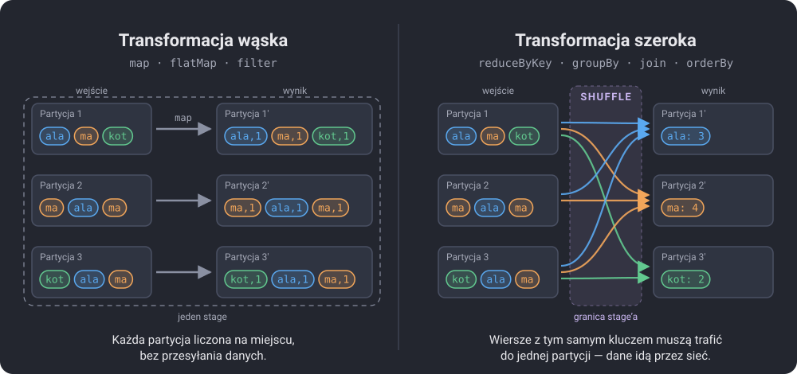

# Zajęcia 2

## Obliczenia rozproszone: od MapReduce do Sparka

Tydzień temu doszliśmy do granicy jednego komputera. Dziś przechodzimy na drugą
stronę: co zrobić, gdy dane trzeba podzielić między wiele maszyn i jak połączyć
wyniki ich pracy w jedną odpowiedź. Zaczniemy od pomysłu, który w 2004 roku
opisał Google — **MapReduce** — i dojdziemy do **Apache Spark**, który jest dziś
standardem przetwarzania dużych danych. Sparka będziemy używać przez resztę
semestru, więc dziś poznajemy jego fundamenty.

Po dzisiejszych zajęciach będziesz w stanie:

- wyjaśnić, jak działa model MapReduce i co dzieje się w fazie shuffle,
- opisać architekturę Sparka: driver, executory, joby, stage'e i taski,
- odróżnić transformację od akcji i wyjaśnić, czym jest leniwe wykonanie,
- wskazać transformacje wąskie i szerokie oraz powiedzieć, dlaczego shuffle
  jest drogi,
- napisać word count w API RDD i w API DataFrame,
- odczytać z planu wykonania, gdzie Spark przesyła dane między partycjami.

---

## Plan na dziś

| Blok | Czas |
|---|---|
| Po co dzielić pracę między maszyny | 5 min |
| Model MapReduce | 8 min |
| Architektura Sparka | 7 min |
| Transformacje, akcje i leniwe wykonanie | 5 min |
| Transformacje wąskie i szerokie — shuffle | 5 min |
| RDD kontra DataFrame | 5 min |
| Demo: word count w PySparku | 10 min |
| **Zadanie 2** | **45 min** |

---

## Po co dzielić pracę między maszyny

Przypomnienie z zeszłego tygodnia: jeden dysk czyta terabajt w kilka minut albo
kilka godzin. Sto dysków czyta ten sam terabajt sto razy szybciej, o ile każdy
czyta **swoją** część. Brzmi prosto, ale od razu pojawiają się pytania:

- **Jak podzielić dane?** Każda maszyna musi wiedzieć, którą część przetwarza.
- **Jak połączyć wyniki?** Jeśli liczymy słowa, to słowo „pan” występuje na
  każdej maszynie. Ktoś musi zsumować te częściowe wyniki.
- **Co, gdy maszyna padnie?** Przy stu maszynach awaria jednej z nich to nie
  wyjątek, tylko codzienność.
- **Gdzie wykonać obliczenia?** Przesłanie terabajta przez sieć trwa godzinami.
  Taniej jest wysłać kod do danych niż dane do kodu.

Ostatni punkt to jedna z najważniejszych zasad przetwarzania rozproszonego:
**przenoś obliczenia, nie dane** (*data locality*). Program ma kilka kilobajtów,
dane — terabajty.

---

## Model MapReduce

MapReduce to sposób zapisania obliczenia tak, żeby dało się je automatycznie
rozłożyć na wiele maszyn. Programista pisze tylko dwie funkcje:

- **map** — przetwarza jeden rekord i zwraca pary `(klucz, wartość)`,
- **reduce** — dostaje klucz i wszystkie wartości dla tego klucza, a zwraca wynik.

Całą resztę, czyli podział danych, przesyłanie, sortowanie i obsługę awarii,
robi framework.

### Word count — „Hello world” przetwarzania danych

Zadanie: policz, ile razy występuje każde słowo w tekście. Tekst jest podzielony
na dwie maszyny:

```text
          Maszyna 1                         Maszyna 2
      "ala ma kota"                     "ala ma psa"
      "kot ma ale"
            │                                 │
            ▼  MAP                            ▼  MAP
  (ala,1) (ma,1) (kota,1)             (ala,1) (ma,1) (psa,1)
  (kot,1) (ma,1) (ale,1)
            │                                 │
            └──────────────┬──────────────────┘
                           ▼  SHUFFLE — pary z tym samym kluczem
                              trafiają na tę samą maszynę
            ┌──────────────┴──────────────────┐
            ▼                                 ▼
     ala: [1, 1]                       kot:  [1]
     ma:  [1, 1, 1]                    kota: [1]
     ale: [1]                          psa:  [1]
            │                                 │
            ▼  REDUCE (suma)                  ▼  REDUCE (suma)
     (ala,2) (ma,3) (ale,1)            (kot,1) (kota,1) (psa,1)
```

Najciekawsza jest środkowa faza, czyli **shuffle**. Żeby zsumować wszystkie
wystąpienia słowa `ma`, wszystkie pary `(ma, 1)` muszą trafić **na jedną
maszynę**. To oznacza przesłanie danych przez sieć: każda maszyna wysyła
fragmenty swoich wyników do każdej innej. Shuffle jest najdroższą częścią prawie
każdego obliczenia rozproszonego.

!!! tip "Combiner — redukcja przed wysłaniem"

    Maszyna 1 ma u siebie dwie pary `(ma, 1)`. Zamiast wysyłać obie, może je
    najpierw zsumować lokalnie i wysłać jedną parę `(ma, 2)`. To jest
    **combiner** (lokalna, częściowa redukcja). Przy prawdziwych tekstach,
    gdzie słowo „się” występuje tysiące razy na każdej maszynie, zmniejsza to
    ilość przesyłanych danych o rzędy wielkości. Zobaczymy go za chwilę w planie
    Sparka pod nazwą `partial_count`.

### Hadoop i jego ograniczenia

Google opisał MapReduce w 2004 roku, a w 2006 roku powstał jego otwarty
odpowiednik — **Apache Hadoop**. Składał się z dwóch części:

- **HDFS** (Hadoop Distributed File System) — system plików, który dzieli pliki
  na bloki po 128 MB i trzyma każdy blok w trzech kopiach na różnych maszynach,
- **MapReduce** — silnik obliczeń działający na tych blokach.

Hadoop zmienił branżę, ale miał poważną wadę: **każdy krok zapisywał wyniki na
dysk**. Algorytm złożony z dziesięciu kroków MapReduce dziesięć razy zapisywał
i czytał wszystkie dane z dysku. Uczenie maszynowe, które przechodzi po tych
samych danych setki razy, było przez to boleśnie wolne. Pisanie wszystkiego
w postaci par map i reduce też nie należało do przyjemności.

---

## Apache Spark

Spark powstał w 2009 roku na Uniwersytecie Kalifornijskim w Berkeley jako
odpowiedź na te problemy. Główne pomysły:

- **trzymaj dane pośrednie w pamięci**, a nie na dysku — dla obliczeń
  wieloetapowych to przyspieszenie nawet o dwa rzędy wielkości,
- **zamiast tylko map i reduce — bogaty zestaw operacji**: filtrowanie, łączenie,
  grupowanie, sortowanie, SQL,
- **całe obliczenie jako graf**, który Spark sam optymalizuje, zanim cokolwiek
  wykona.

Z tego samego zespołu wyrosła firma **Databricks**, na której platformie
będziemy pracować od następnych zajęć.

### Architektura

```text
                     ┌──────────────────────────┐
                     │          DRIVER          │
                     │  Twój program (notatnik) │
                     │  SparkSession            │
                     │  planuje i rozdziela     │
                     │  pracę                   │
                     └────────────┬─────────────┘
                                  │
                     ┌────────────┴─────────────┐
                     │      CLUSTER MANAGER     │
                     │ (YARN, Kubernetes, ...)  │
                     └────────────┬─────────────┘
              ┌───────────────────┼───────────────────┐
              ▼                   ▼                   ▼
     ┌────────────────┐  ┌────────────────┐  ┌────────────────┐
     │   EXECUTOR 1   │  │   EXECUTOR 2   │  │   EXECUTOR 3   │
     │  task  task    │  │  task  task    │  │  task  task    │
     │  [partycje]    │  │  [partycje]    │  │  [partycje]    │
     └────────────────┘  └────────────────┘  └────────────────┘
```

- **Driver** to proces, w którym działa Twój kod. Buduje plan obliczeń, dzieli go
  na zadania i rozsyła je do executorów. Do drivera wracają też wyniki.
- **Executor** to proces na maszynie roboczej, który wykonuje zadania na swoich
  kawałkach danych i trzyma je w pamięci.
- **Cluster manager** przydziela zasoby, czyli decyduje, ile executorów
  i na których maszynach dostanie aplikacja.
- **Partycja** to kawałek danych przetwarzany przez jeden task. Liczba partycji
  decyduje o tym, ile pracy może iść równolegle.

!!! info "Spark w Colabie"

    W Colabie nie mamy klastra. Uruchamiamy Sparka w trybie **lokalnym**
    (`local[*]`): driver i executor to jeden proces na jednej maszynie, a taski
    wykonują się na wątkach, po jednym na rdzeń procesora. Kod jest **dokładnie
    taki sam** jak na klastrze ze stu maszyn — zmienia się tylko adres mastera.
    Dzięki temu naukę Sparka można zacząć na laptopie.

### Job, stage, task

| Pojęcie | Co to jest | Kiedy powstaje |
|---|---|---|
| **Job** | całe obliczenie uruchomione jedną akcją | przy każdym wywołaniu akcji, np. `count()` |
| **Stage** | fragment joba, który da się wykonać bez przesyłania danych między partycjami | Spark tnie job na stage'e w miejscach shuffle |
| **Task** | praca jednego stage'a na jednej partycji | tyle tasków, ile partycji w stage'u |

Word count z rysunku wyżej to **jeden job** złożony z **dwóch stage'ów**: przed
shufflem (map) i po nim (reduce). Jeśli tekst ma 8 partycji, pierwszy stage ma
8 tasków.

---

## Transformacje, akcje i leniwe wykonanie

Operacje w Sparku dzielą się na dwa rodzaje:

| | Transformacje | Akcje |
|---|---|---|
| Co robią | opisują **nowy** zbiór danych na podstawie poprzedniego | zwracają wynik do drivera albo zapisują go na dysk |
| Czy coś liczą | **nie** — tylko dopisują krok do planu | **tak** — uruchamiają cały plan |
| RDD | `map`, `flatMap`, `filter`, `reduceByKey`, `distinct` | `count`, `collect`, `take`, `takeOrdered`, `saveAsTextFile` |
| DataFrame | `select`, `filter`, `groupBy`, `withColumn`, `orderBy` | `count`, `show`, `collect`, `write` |

To jest **leniwe wykonanie** (*lazy evaluation*): transformacje tylko budują
plan, a dopiero akcja go uruchamia. Spark widzi wtedy całe obliczenie naraz
i może je zoptymalizować: połączyć kroki, pominąć niepotrzebne kolumny,
przestawić filtry.

Zbudowany plan to **DAG** (*directed acyclic graph*, skierowany graf acykliczny):
węzły to zbiory danych, krawędzie to transformacje. Ten sam DAG służy też do
**odporności na awarie**. Jeśli executor padnie i zniknie jedna partycja, Spark
wie, z czego i jak ją policzyć (*lineage*, czyli rodowód danych), więc liczy
tylko ją od nowa, a nie całe zadanie.

!!! warning "Akcja na końcu każdej komórki"

    Jeśli komórka zawiera same transformacje, wykonuje się natychmiast i nie
    zwraca żadnego wyniku — bo nic nie zostało policzone. Błąd w lambdzie też
    się wtedy nie pokaże. Wyskoczy dopiero przy pierwszej akcji, czasem kilka
    komórek niżej. Szukając błędu, patrz więc nie tylko na komórkę, w której
    wyskoczył.

---

## Transformacje wąskie i szerokie

- **Wąska** (*narrow*) — każda partycja wyniku zależy od **jednej** partycji
  wejścia. Można ją liczyć na miejscu, bez wymiany danych. Przykłady: `map`,
  `flatMap`, `filter`.
- **Szeroka** (*wide*) — partycja wyniku potrzebuje danych z **wielu** partycji
  wejścia. Wymaga **shuffle**. Przykłady: `reduceByKey`, `groupBy`, `join`,
  `orderBy`, `distinct`.



Po lewej `map` zamienia każde słowo w parę `(słowo, 1)` w obrębie tej samej
partycji. Po prawej `reduceByKey` musi zebrać wszystkie wystąpienia słowa w jednym
miejscu: każde „ala” (niebieskie) z trzech partycji wejścia trafia do partycji 1′,
każde „ma” (pomarańczowe) do partycji 2′. Partycja 2 nie ma żadnego „kot”, więc
nic nie wysyła do partycji 3′.

Kilka wąskich transformacji pod rząd Spark łączy w jeden stage i wykonuje
jednym przebiegiem po danych (*pipelining*). Każda szeroka transformacja to
**granica stage'a**: dane trzeba zapisać, posortować według klucza, przesłać
i odczytać po drugiej stronie.

Shuffle jest drogi z trzech powodów: zapis na dysk, przesyłanie przez sieć
i serializacja danych. Na Databricksie zobaczymy, że optymalizacja zapytań to
w dużej mierze **unikanie zbędnych shuffli**.

!!! tip "`reduceByKey` zamiast `groupByKey`"

    Oba dają możliwość zsumowania wartości dla klucza, ale `groupByKey` przesyła
    przez sieć **każdą pojedynczą parę** `(słowo, 1)`, a `reduceByKey` najpierw
    sumuje lokalnie (combiner!) i wysyła tylko sumy częściowe. Przy dużych
    danych różnica jest dramatyczna.

---

## RDD kontra DataFrame

Spark ma dwa główne API:

| | RDD | DataFrame |
|---|---|---|
| Czym jest | rozproszona kolekcja dowolnych obiektów Pythona | rozproszona tabela z kolumnami i schematem |
| Jak piszesz | funkcje Pythona (`lambda`) | operacje na kolumnach albo SQL |
| Optymalizacja | brak — Spark wykonuje dokładnie to, co napisałeś | optymalizator **Catalyst** przepisuje plan |
| Wydajność w PySparku | niska — każdy wiersz wędruje z JVM do Pythona i z powrotem | wysoka — wszystko liczy się w JVM |
| Kiedy używać | dziś, żeby zrozumieć mechanikę; nietypowe przetwarzanie | prawie zawsze |

Spark jest napisany w Scali i działa w maszynie wirtualnej Javy (JVM). Gdy
w RDD piszesz `lambda w: (w, 1)`, Spark musi każdy rekord przesłać do procesu
Pythona, wykonać tam lambdę i odesłać wynik. W DataFrame nie ma lambd: piszesz
**co** chcesz osiągnąć, a Spark sam wykonuje to w JVM.

!!! info "Dlaczego w ogóle RDD?"

    Na Databricks Free Edition (serverless) API RDD **nie jest dostępne** — tylko
    DataFrame i SQL. RDD poznajemy dziś lokalnie, bo najlepiej pokazuje, jak
    Spark działa pod spodem: map, shuffle, reduce, stage'e. DataFrame robi to
    samo, tylko ukrywa szczegóły.

---

## Demo: word count w PySparku

Dane: **Chłopi** Władysława Reymonta (tom pierwszy, *Jesień*) z serwisu
[Wolne Lektury](https://wolnelektury.pl), który udostępnia polskie lektury
w domenie publicznej jako zwykłe pliki tekstowe.

### Uruchomienie Sparka

W Colabie Java jest już zainstalowana, a PySpark zwykle też. Pierwsza komórka
doinstaluje go tylko wtedy, gdy go brakuje:

```python
!pip install -q "pyspark<4"
```

!!! warning "Dlaczego `pyspark<4`"

    Spark 4 wymaga Javy 17, a Colab ma zwykle starszą wersję. Spark 3.5 działa
    od ręki. Dla tego, czego się dziś uczymy, wersje się nie różnią.

```python
from pyspark.sql import SparkSession

spark = (SparkSession.builder
         .master("local[*]")
         .appName("zajecia2")
         .getOrCreate())
sc = spark.sparkContext

print(spark.version, "| rdzeni:", sc.defaultParallelism)
```

`spark` to **SparkSession**, wejście do API DataFrame. `sc` to **SparkContext**,
wejście do API RDD. W Colabie zobaczysz 2 rdzenie.

### Leniwe wykonanie na żywo

```python
liczby = sc.parallelize(range(1, 10_000_001))
kwadraty = liczby.map(lambda x: x * x)
podzielne = kwadraty.filter(lambda x: x % 3 == 0)
podzielne
```

```text
PythonRDD[1] at RDD at PythonRDD.scala:53
```

Komórka wykonała się w ułamku milisekundy, choć „przetworzyła” 10 milionów
liczb. Nic się nie policzyło — mamy tylko opis. Wynik pojawi się dopiero po
akcji:

```python
podzielne.count()
```

```text
3333333
```

### Word count krok po kroku

Najpierw na trzech linijkach, żeby zobaczyć każdy krok:

```python
tekst = sc.parallelize(["ala ma kota", "kot ma ale", "ala ma psa"], 2)

slowa = tekst.flatMap(lambda linia: linia.split())
slowa.collect()
```

```text
['ala', 'ma', 'kota', 'kot', 'ma', 'ale', 'ala', 'ma', 'psa']
```

`flatMap` z każdej linii robi listę słów i „spłaszcza” je w jedną kolekcję.
Zwykły `map` dałby listę list.

```python
pary = slowa.map(lambda w: (w, 1))
pary.collect()
```

```text
[('ala', 1), ('ma', 1), ('kota', 1), ('kot', 1), ('ma', 1), ('ale', 1), ('ala', 1), ('ma', 1), ('psa', 1)]
```

```python
wynik = pary.reduceByKey(lambda a, b: a + b)
wynik.collect()
```

```text
[('ma', 3), ('kota', 1), ('ale', 1), ('psa', 1), ('ala', 2), ('kot', 1)]
```

To jest dokładnie MapReduce z rysunku: `flatMap` i `map` to faza map,
`reduceByKey` to shuffle i reduce. Kolejność wyników jest przypadkowa — zależy
od tego, na którą partycję trafił klucz.

### Prawdziwa książka

```python
import re
import urllib.request

urllib.request.urlretrieve(
    "https://wolnelektury.pl/media/book/txt/chlopi-czesc-pierwsza-jesien.txt",
    "chlopi.txt",
)

linie = sc.textFile("chlopi.txt")
print(linie.count(), "linii,", linie.getNumPartitions(), "partycje")
linie.take(4)
```

```text
6030 linii, 2 partycje
['Władysław Stanisław Reymont', '', 'Chłopi', 'Część pierwsza. Jesień']
```

Prawdziwy tekst ma wielkie litery, interpunkcję i mnóstwo słów typu „i”, „się”,
„nie”, które zdominowałyby każdy ranking. Dlatego:

- zamieniamy wszystko na małe litery,
- dzielimy tekst wyrażeniem regularnym na ciągi liter (wszystko, co nie jest
  literą, jest separatorem),
- odrzucamy puste napisy i **stopwords**, czyli słowa, które niczego nie
  wnoszą.

```python
WZORZEC = "[^a-ząćęłńóśźż]+"     # separator: wszystko, co nie jest polską literą

STOPWORDS = set("""
a aby ach ale albo ani aż bardzo bez bo by byli był była było były być będzie
chce choć ci co coś czy czyli dla do dobrze gdy gdyż gdzie go i ich im iż ja jak
jakby jako je jednak jego jej jeszcze jest jestem jeśli już ją każdy kiedy kto
która które którego której których który ku lecz lub ma mam mi mnie może mu my
na nad nam nas nawet nic nich niego nie niech niej nim nią no o od on ona one oni
ono oraz po pod potem przecież przed przez przy raz sam se się siebie sobie swoje
swój swego swą swoją ta tak także tam te tego tej ten teraz też to tu tych ty
tylko tym u w was we wiem więc wszystko wy z za zaś ze że żeby
""".split())

licznik = (linie
    .flatMap(lambda linia: re.split(WZORZEC, linia.lower()))
    .filter(lambda w: w != "" and w not in STOPWORDS)
    .map(lambda w: (w, 1))
    .reduceByKey(lambda a, b: a + b))

licznik.takeOrdered(10, key=lambda para: (-para[1], para[0]))
```

```text
[('ino', 375), ('kiej', 207), ('boryna', 117), ('juści', 106), ('abo', 98),
 ('kuba', 97), ('oczy', 94), ('niby', 84), ('zaraz', 84), ('antek', 79)]
```

`takeOrdered(10, key=...)` zwraca 10 elementów o najmniejszym kluczu. Klucz
`(-liczba, słowo)` oznacza: najpierw malejąco po liczbie, przy remisie
alfabetycznie.

Wynik dobrze pokazuje, że **lista stopwords zależy od tekstu**. Reymont pisze
gwarą, więc na szczycie są „ino” (tylko), „kiej” (kiedy), „juści” (pewnie)
i „abo” (albo). Żadna standardowa lista ich nie zawiera. Dla „Chłopów” trzeba by
ją rozszerzyć, dla Sienkiewicza raczej nie.

### Gdzie jest shuffle — `toDebugString()`

```python
print(licznik.toDebugString().decode())
```

```text
(2) PythonRDD[12] at RDD at PythonRDD.scala:53 []
 |  MapPartitionsRDD[9] at mapPartitions at PythonRDD.scala:160 []
 |  ShuffledRDD[8] at partitionBy at NativeMethodAccessorImpl.java:0 []
 +-(2) PairwiseRDD[7] at reduceByKey at <ipython-input-…>:4 []
    |  PythonRDD[6] at reduceByKey at <ipython-input-…>:4 []
    |  chlopi.txt MapPartitionsRDD[1] at textFile at NativeMethodAccessorImpl.java:0 []
    |  chlopi.txt HadoopRDD[0] at textFile at NativeMethodAccessorImpl.java:0 []
```

To jest rodowód (*lineage*) RDD, czytany **od dołu**:

- na dole odczyt pliku (`HadoopRDD`, `textFile`),
- potem wszystkie wąskie transformacje (`flatMap`, `filter`, `map`), sklejone
  przez Sparka w jeden krok `PythonRDD`,
- `+-` i zmiana wcięcia oznacza **granicę stage'a**, a nad nią `ShuffledRDD` —
  tu dane przechodzą przez shuffle,
- `(2)` to liczba partycji na danym poziomie.

Jedno wcięcie, czyli jedna granica, oznacza dwa stage'e.

### To samo w DataFrame

```python
from pyspark.sql import functions as F

df = spark.read.text("chlopi.txt")      # jedna kolumna: value
df.show(4)
```

```text
+---------------------------+
|                      value|
+---------------------------+
|Władysław Stanisław Reymont|
|                           |
|                     Chłopi|
|     Część pierwsza. Jesień|
+---------------------------+
```

```python
slowa = (df
    .select(F.explode(F.split(F.lower("value"), WZORZEC)).alias("slowo"))
    .filter((F.col("slowo") != "") & ~F.col("slowo").isin(list(STOPWORDS))))

ranking = (slowa
    .groupBy("slowo").count()
    .orderBy(F.desc("count"), "slowo"))

ranking.show(10)
```

```text
+------+-----+
| slowo|count|
+------+-----+
|   ino|  375|
|  kiej|  207|
|boryna|  117|
| juści|  106|
|   abo|   98|
|  kuba|   97|
|  oczy|   94|
|  niby|   84|
| zaraz|   84|
| antek|   79|
+------+-----+
```

Wynik identyczny, ale nie ma ani jednej lambdy. `split` tnie tekst na tablicę
słów, `explode` robi z tablicy osobne wiersze — to odpowiednik `flatMap`.

### Plan wykonania — `explain()`

```python
ranking.explain()
```

```text
== Physical Plan ==
AdaptiveSparkPlan isFinalPlan=false
+- Sort [count#8L DESC NULLS LAST, slowo#3 ASC NULLS FIRST], true, 0
   +- Exchange rangepartitioning(count#8L DESC NULLS LAST, slowo#3 ASC NULLS FIRST, 200), ...
      +- HashAggregate(keys=[slowo#3], functions=[count(1)])
         +- Exchange hashpartitioning(slowo#3, 200), ...
            +- HashAggregate(keys=[slowo#3], functions=[partial_count(1)])
               +- Filter (NOT (slowo#3 = ) AND NOT slowo#3 INSET a, aby, ach, ...)
                  +- Generate explode(split(lower(value#0), [^a-ząćęłńóśźż]+, -1)), ...
                     +- FileScan text [value#0] ...
```

Plan znowu czytamy **od dołu**:

| Krok planu | Co oznacza | Odpowiednik w RDD |
|---|---|---|
| `FileScan text` | odczyt pliku | `textFile` |
| `Generate explode(split(...))` | podział linii na słowa | `flatMap` |
| `Filter` | odrzucenie pustych i stopwords | `filter` |
| `HashAggregate(... partial_count)` | **lokalne** liczenie na każdej partycji | combiner w `reduceByKey` |
| `Exchange hashpartitioning(slowo)` | **shuffle** — słowa trafiają na partycję według skrótu (hash) | shuffle w `reduceByKey` |
| `HashAggregate(... count)` | zsumowanie częściowych wyników | reduce |
| `Exchange rangepartitioning(count)` | **drugi shuffle** — do globalnego sortowania | `takeOrdered` (inaczej) |
| `Sort` | sortowanie | |

**`Exchange` to w planie DataFrame'u słowo oznaczające shuffle.** Szukając
w planie drogich miejsc, szukasz właśnie jego. Widać też, że Spark sam dodał
combiner (`partial_count`) — nie musieliśmy o to prosić.

### Spark UI

Spark ma panel webowy, w którym widać każdy job, jego stage'e, liczbę tasków
i ilość danych przesłanych w shufflu. Lokalnie jest pod adresem
[localhost:4040](http://localhost:4040). W Colabie można spróbować otworzyć go
przez proxy:

```python
from google.colab import output
output.serve_kernel_port_as_window(4040, path="/jobs/")
```

Działa to kapryśnie (część linków w panelu może nie działać), dlatego w zadaniu
korzystamy z `toDebugString()` i `explain()`, które pokazują to samo w tekście.
Na Databricksie Spark UI jest wbudowany.

---

## Ściągawka

| Chcę… | RDD | DataFrame |
|---|---|---|
| wczytać plik tekstowy | `sc.textFile("plik.txt")` | `spark.read.text("plik.txt")` |
| liczba elementów / wierszy | `rdd.count()` | `df.count()` |
| kilka pierwszych | `rdd.take(5)` | `df.show(5)` |
| liczba partycji | `rdd.getNumPartitions()` | `df.rdd.getNumPartitions()` |
| przekształcić każdy element | `rdd.map(lambda x: ...)` | `df.select(F.lower("value"))` |
| jeden element → wiele | `rdd.flatMap(lambda x: lista)` | `F.explode(F.split(kol, wzorzec))` |
| przefiltrować | `rdd.filter(lambda x: warunek)` | `df.filter(F.col("a") != "")` |
| „nie należy do listy” | `x not in ZBIOR` | `~F.col("a").isin(lista)` |
| policzyć per klucz | `rdd.map(lambda w: (w, 1)).reduceByKey(lambda a, b: a + b)` | `df.groupBy("a").count()` |
| top N | `rdd.takeOrdered(N, key=lambda p: (-p[1], p[0]))` | `df.orderBy(F.desc("count"), "a").limit(N)` |
| liczba unikalnych | `rdd.distinct().count()` | `df.select("a").distinct().count()` |
| plan wykonania | `print(rdd.toDebugString().decode())` | `df.explain()` |
| wynik jako lista / pandas | `rdd.collect()` | `df.collect()` / `df.toPandas()` |

Do bigramów przydają się dwa gotowe narzędzia z `pyspark.ml.feature`:

| Chcę… | Kod |
|---|---|
| tablica słów w każdej linii, bez pustych | `F.array_remove(F.split(F.lower("value"), WZORZEC), "")` |
| usunąć stopwords z tablicy | `StopWordsRemover(inputCol="slowa", outputCol="bez_stop", stopWords=list(STOPWORDS))` |
| zrobić pary sąsiednich słów | `NGram(n=2, inputCol="bez_stop", outputCol="bigramy")` |
| zastosować transformer | `df = transformer.transform(df)` |

---

## Zadanie 2 — Word count po polsku (6 pkt)

**Czas:** maks. 45 minut
**Środowisko:** Google Colab (PySpark)
**Oddanie:** notatnik `.ipynb` na Moodle

Zadanie ma dwie części. Rób je po kolei i **pokaż mi wynik każdej części, gdy
będzie gotowa** — punktacja zależy od tego, ile zrobisz na zajęciach.

### Twoja książka

Każdy analizuje inną lekturę. Wybiera ją ostatnia cyfra numeru albumu.
Pierwsze komórki notatnika:

```python
!pip install -q "pyspark<4"
```

```python
import re
import urllib.request

from pyspark.sql import SparkSession
from pyspark.sql import functions as F

NR_ALBUMU = 123456                 # ← wpisz swój numer albumu

KSIAZKI = [
    "pan-tadeusz",                    # 0
    "quo-vadis",                      # 1
    "lalka-tom-pierwszy",             # 2
    "ogniem-i-mieczem-tom-pierwszy",  # 3
    "przedwiosnie",                   # 4
    "potop-tom-pierwszy",             # 5
    "krzyzacy-tom-pierwszy",          # 6
    "ziemia-obiecana-tom-pierwszy",   # 7
    "nad-niemnem-tom-pierwszy",       # 8
    "w-pustyni-i-w-puszczy",          # 9
]
KSIAZKA = KSIAZKI[NR_ALBUMU % 10]
print(f"Moja książka: {KSIAZKA}")

urllib.request.urlretrieve(
    f"https://wolnelektury.pl/media/book/txt/{KSIAZKA}.txt", "ksiazka.txt"
)

spark = SparkSession.builder.master("local[*]").appName("zadanie2").getOrCreate()
sc = spark.sparkContext
```

Skopiuj też z demo `WZORZEC` i `STOPWORDS` — **bez zmian**, żebym mógł porównać
Twój wynik z moim. Rozwiązania z cudzą książką nie zaliczam.

### Część 1 — RDD (ok. 20 min)

1. Wczytaj książkę przez `sc.textFile` i wypisz liczbę linii oraz liczbę partycji.
2. Zbuduj word count w API RDD: małe litery, podział wzorcem `WZORZEC`,
   odrzucenie pustych napisów i stopwords, pary `(słowo, 1)`, `reduceByKey`.
   Wypisz:

    - łączną liczbę słów (po odfiltrowaniu),
    - liczbę **różnych** słów,
    - **15 najczęstszych** słów (malejąco po liczbie, przy remisie alfabetycznie).

3. Wypisz rodowód wyniku przez `toDebugString()`. W komórce Markdown odpowiedz:
   w którym miejscu jest shuffle i która operacja go powoduje? Z ilu stage'ów
   składa się ten job?

### Część 2 — DataFrame i bigramy (ok. 25 min)

1. Policz te same **15 najczęstszych** słów w API DataFrame (`spark.read.text`,
   `split`, `explode`, `filter`, `groupBy`, `orderBy`). Wynik musi być
   **identyczny** z częścią 1 — sprawdź to w kodzie, porównując obie listy.
2. Wypisz plan przez `explain()`. W komórce Markdown odpowiedz:

    - ile razy w planie występuje `Exchange` i która operacja w Twoim kodzie
      powoduje każde z nich?
    - co oznacza `partial_count` i czemu odpowiada w części 1?

3. Znajdź **10 najczęstszych bigramów**, czyli par sąsiednich słów. Z każdej
   linii zrób tablicę słów (bez pustych), usuń z niej stopwords
   (`StopWordsRemover`), utwórz pary (`NGram`), rozbij na wiersze i policz.
   W komórce Markdown napisz w 1–2 zdaniach, co bigramy mówią o Twojej książce,
   czego nie widać w rankingu pojedynczych słów.

### Wskazówki

- Ściągawka jest kilka sekcji wyżej — wszystkie potrzebne polecenia tam są.
- Pamiętaj o leniwym wykonaniu: dopóki nie wywołasz akcji, błąd w lambdzie się
  nie pokaże.
- Część 1, punkt 2: zapisz RDD po `reduceByKey` w zmiennej. Liczbę różnych słów
  dostaniesz wtedy przez zwykłe `count()` na tym RDD.
- Część 2, punkt 1: `ranking.limit(15).collect()` zwraca listę obiektów `Row`.
  Zamień ją na listę krotek, np. `[(r["slowo"], r["count"]) for r in ...]`,
  i porównaj z listą z części 1 operatorem `==`.
- Część 2, punkt 3: importy to
  `from pyspark.ml.feature import StopWordsRemover, NGram`. Bigram to napis
  ze spacją w środku, np. `"pan sędzia"`.
- Jeśli Spark po błędzie przestaje odpowiadać: *Środowisko wykonawcze → Uruchom
  ponownie sesję* i wykonaj komórki od początku.

!!! tip "Na co patrzę przy ocenie"

    Na zgodność rankingu z moim (dlatego `WZORZEC` i `STOPWORDS` muszą być
    niezmienione) oraz na odpowiedzi w komórkach Markdown. Chcę zobaczyć, że
    potrafisz wskazać shuffle w obu planach i wyjaśnić, skąd się bierze.

### Punktacja (6 pkt)

| Punkty | Za co |
|---|---|
| **6 pkt** | obie części zrobione **na zajęciach** i pokazane prowadzącemu |
| **4 pkt** | jedna z dwóch części zrobiona na zajęciach |
| **2 pkt** | zadanie dokończone po zajęciach i wysłane na Moodle **w terminie** |
| **0 pkt** | brak rozwiązania albo wysłane po terminie |

Termin przesłania na Moodle: **2026-11-06** (dzień przed kolejnymi zajęciami).

!!! danger "Serio, róbcie to na zajęciach"

    Te same 45 minut pracy jest warte 6 pkt tu i teraz albo 2 pkt w domu. Przez
    cały semestr robi to różnicę 32 punktów, czyli całej oceny w górę lub w dół.
