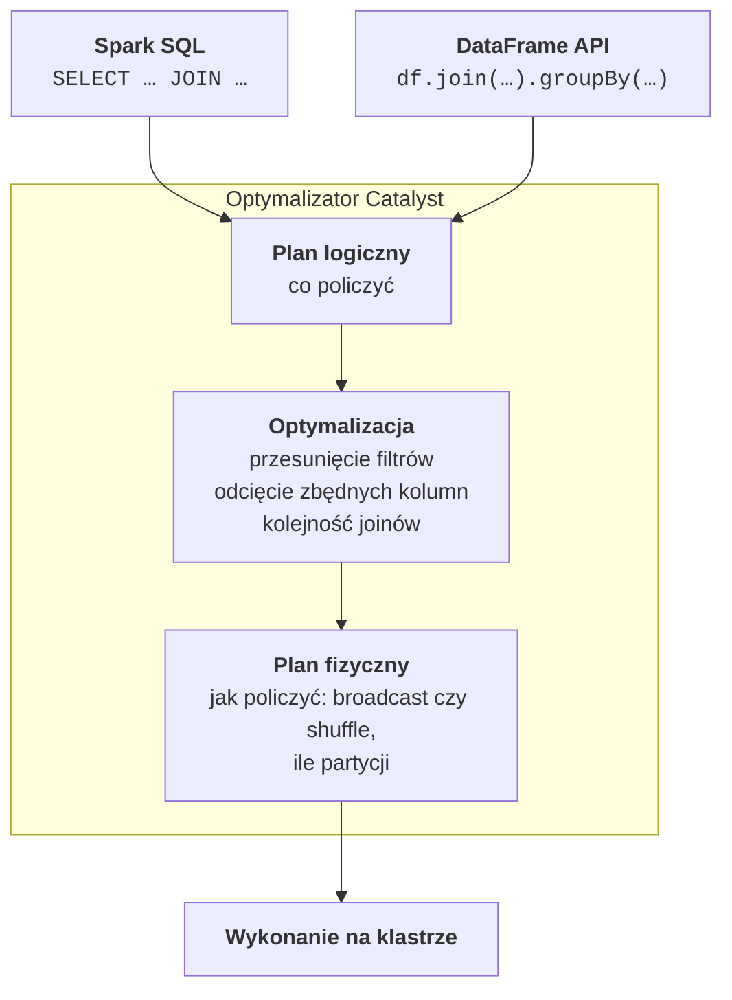
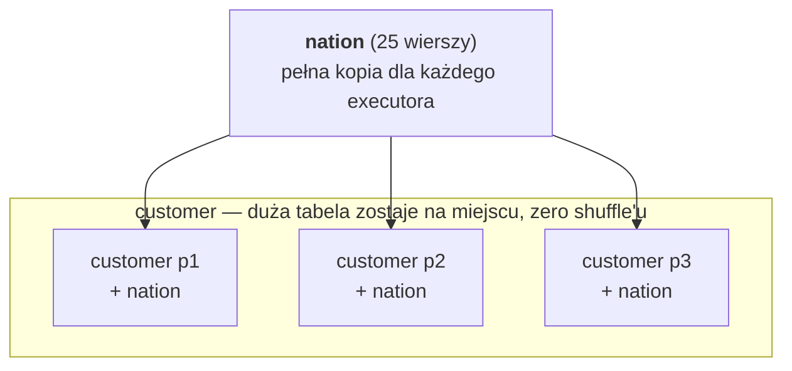
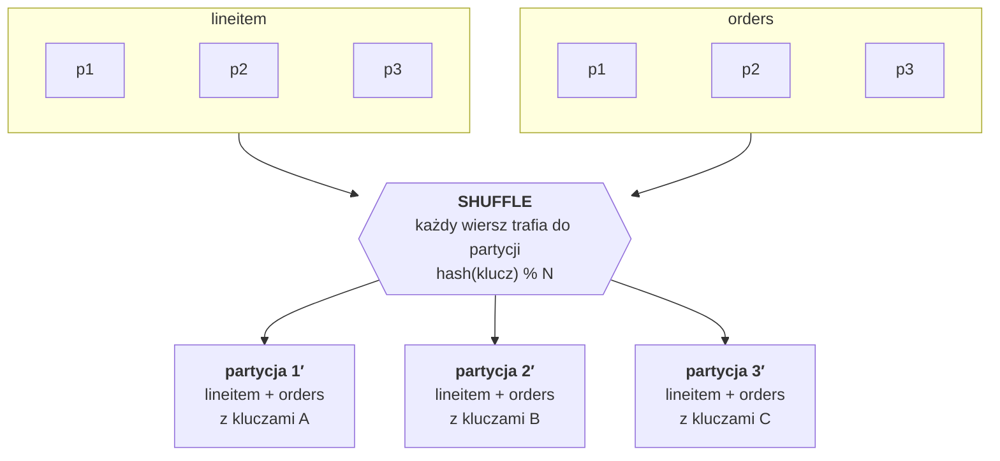
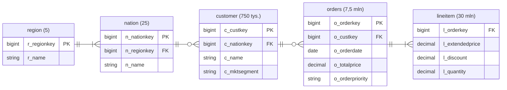

# Zajęcia 3

## Spark SQL i DataFrame w praktyce

Na poprzednich zajęciach uruchamialiśmy Sparka w Colabie, na jednej maszynie,
i liczyliśmy słowa w książce. Dziś przenosimy się na **Databricks** — platformę,
na której Spark działa „na serio” i na której spędzimy większość semestru. Zamiast
jednej książki mamy bazę hurtowni z **30 milionami** pozycji zamówień, a zamiast
liczenia słów — to, czym analityk danych zajmuje się na co dzień: **łączenie tabel**
i **funkcje okienkowe**. Przy okazji zajrzymy Sparkowi pod maskę i zobaczymy, jak
decyduje, którą tabelę przesłać przez sieć, a którą skopiować na każdą maszynę.

Po dzisiejszych zajęciach będziesz w stanie:

- poruszać się po Databricksie: notatnik, compute serverless, komórki `%sql`,
- wyjaśnić, jak Unity Catalog porządkuje dane (katalog, schemat, tabela, wolumen)
  i używać trzyczęściowych nazw tabel,
- napisać to samo zapytanie w Spark SQL i w API DataFrame,
- dobrać rodzaj złączenia (`inner`, `left`, `left_anti`…) do pytania,
- odczytać z planu, czy Spark wykonał złączenie przez **broadcast**, czy przez
  **shuffle**, i wymusić inną strategię,
- używać funkcji okienkowych: rankingów, `LAG` i agregatów w oknie.

---

## Plan na dziś

| Blok | Czas |
|---|---|
| Z Colaba do Databricksa | 5 min |
| Unity Catalog | 7 min |
| Spark SQL i DataFrame — jeden silnik | 3 min |
| Złączenia i strategie złączeń | 8 min |
| Funkcje okienkowe | 7 min |
| Podstawy wydajności | 3 min |
| Demo: TPC-H na Databricksie | 12 min |
| **Zadanie 3** | **45 min** |

---

## Z Colaba do Databricksa

Konto w **Databricks Free Edition** zakładałeś w zadaniu 1. Jeśli jeszcze go nie
masz — zrób to teraz, zanim zaczniemy demo:
[databricks.com/signup/free-edition](https://www.databricks.com/signup/free-edition).

Co się zmienia w porównaniu z Colabem:

| | Colab (zajęcia 2) | Databricks Free Edition |
|---|---|---|
| Gdzie działa Spark | jeden proces na wirtualnej maszynie Google | klaster zarządzany przez Databricks |
| Uruchomienie Sparka | `pip install`, `SparkSession.builder…` | nic — zmienna `spark` już istnieje |
| Moc obliczeniowa | 2 rdzenie | **serverless** — przydzielana automatycznie |
| Skąd dane | pobierasz pliki do sesji | tabele w **Unity Catalog** |
| Języki | Python | Python i SQL w jednym notatniku |
| Po zamknięciu karty | wszystko znika | tabele zostają |

Pierwsze kroki:

1. W lewym menu **+ New → Notebook**.
2. W prawym górnym rogu **Connect → Serverless**. Pierwsze uruchomienie trwa
   kilkanaście sekund, potem jest szybko.
3. Domyślnym językiem komórek jest Python. Komórka zaczynająca się od `%sql` jest
   wykonywana jako SQL.
4. Zamiast `df.show()` używaj `display(df)` — dostajesz tabelę, którą można
   sortować, filtrować i jednym kliknięciem zamienić w wykres.

!!! warning "Czego nie ma w Free Edition"

    Free Edition działa wyłącznie na compute **serverless**, a ten ma kilka
    ograniczeń:

    - **nie ma API RDD** ani `spark.sparkContext` — dlatego RDD poznawaliśmy
      lokalnie,
    - **nie działa `cache()` / `persist()`** — próba kończy się wyjątkiem,
    - **nie ustawisz większości konfiguracji Sparka** przez `spark.conf.set(...)`,
    - tylko **Python i SQL** (bez Scali i R).

    Na nasze potrzeby to wystarczy z nawiązką.

!!! info "Photon"

    Zapytania na serverless wykonuje **Photon** — silnik Databricksa napisany
    w C++, zgodny ze Sparkiem, ale szybszy. Dla Ciebie zmienia się jedno: w planach
    wykonania nazwy kroków mają przedrostek `Photon`, np. `PhotonBroadcastHashJoin`
    zamiast `BroadcastHashJoin`. Logika planu jest ta sama.

---

## Unity Catalog

Na zajęciach 1 i 2 dane były **plikami**: `ksiazka.txt`, `yellow_2024-01.parquet`.
Żeby je przeczytać, trzeba było wiedzieć, gdzie leżą i w jakim są formacie.
W firmie z tysiącem tabel i setką analityków to się nie sprawdza. Potrzebny jest
**katalog** — spis wszystkich danych, który wie, gdzie co leży, jaki ma schemat
i kto ma do tego dostęp. W Databricksie jest nim **Unity Catalog**.

```text
 METASTORE                      jeden na region chmury (u Ciebie: jeden i już)
  │
  ├── KATALOG  samples          dane przykładowe od Databricksa (tylko do odczytu)
  │     ├── SCHEMAT  tpch
  │     │     ├── TABELA  orders
  │     │     ├── TABELA  lineitem
  │     │     └── ...
  │     └── SCHEMAT  nyctaxi
  │           └── TABELA  trips
  │
  ├── KATALOG  workspace        Twój katalog — tu tworzysz własne obiekty
  │     ├── SCHEMAT  default
  │     └── SCHEMAT  zajecia3   (utworzymy go dziś)
  │           ├── TABELA   ...
  │           ├── WIDOK    ...
  │           └── WOLUMEN  ...  zwykłe pliki: CSV, JSON, obrazki
  │
  └── KATALOG  system           logi, koszty, historia zapytań
```

Każda tabela ma więc **trzyczęściową nazwę**: `katalog.schemat.tabela`, np.
`samples.tpch.orders`. Schemat bywa też nazywany bazą danych (*database*) — to
synonimy.

| Obiekt | Co to jest | Przykład |
|---|---|---|
| **Tabela zarządzana** (*managed*) | Databricks sam decyduje, gdzie leżą pliki, i usuwa je razem z tabelą | wszystko, co zapiszesz przez `saveAsTable` |
| **Tabela zewnętrzna** (*external*) | pliki leżą w Twoim magazynie w chmurze, katalog tylko je opisuje | dane, które już są w S3 albo ADLS |
| **Widok** (*view*) | zapisane zapytanie, bez własnych danych | `CREATE VIEW ... AS SELECT ...` |
| **Wolumen** (*volume*) | katalog na zwykłe pliki, adresowany ścieżką | `/Volumes/workspace/zajecia3/surowe/plik.csv` |

Pod spodem tabele w Databricksie to pliki **Parquet** — te same co na zajęciach 1
— z dodatkowym dziennikiem transakcji. Ten format nazywa się **Delta Lake** i jest
tematem następnych zajęć.

Unity Catalog robi jeszcze dwie rzeczy, których w świecie „samych plików” brakuje:

- **uprawnienia** — `GRANT SELECT ON TABLE ... TO ...`, na poziomie katalogu,
  schematu, tabeli, a nawet kolumny,
- **rodowód danych** (*lineage*) — w zakładce *Lineage* tabeli widać, z jakich
  tabel powstała i które z niej korzystają. To ten sam pomysł co rodowód RDD,
  tylko na poziomie całych tabel.

Wszystko to przejrzysz w przeglądarce: ikona **Catalog** w lewym menu.

---

## Spark SQL i DataFrame — jeden silnik

To samo zapytanie możesz napisać w SQL albo w API DataFrame. Nie ma tu wyboru
„szybsze kontra wolniejsze” — oba trafiają do tego samego optymalizatora
**Catalyst** i kończą jako ten sam plan:



W praktyce pisze się mieszanie: SQL tam, gdzie zapytanie jest czytelne jako SQL,
Python tam, gdzie potrzeba pętli, zmiennych albo funkcji. Przejście w obie strony
jest jednym poleceniem:

| Chcę… | Kod |
|---|---|
| wynik SQL jako DataFrame | `df = spark.sql("SELECT ...")` |
| DataFrame dostępny w SQL | `df.createOrReplaceTempView("moj_widok")` |
| wynik ostatniej komórki `%sql` w Pythonie | zmienna `_sqldf` |

---

## Złączenia

### Rodzaje złączeń

Rodzaj złączenia decyduje o tym, **które wiersze** trafią do wyniku. Przykład:
`customer` (klienci) łączone z `orders` (zamówienia) po identyfikatorze klienta.

| Rodzaj | W wyniku | Pytanie, na które odpowiada |
|---|---|---|
| `inner` | tylko klienci, którzy mają zamówienia | „ile wydali klienci?” |
| `left` | wszyscy klienci; bez zamówień → `NULL` w kolumnach zamówień | „ile wydał każdy klient, także ci, co nic nie kupili?” |
| `right` / `full` | jak `left`, ale z drugiej strony / z obu stron | rzadziej potrzebne |
| `left_semi` | klienci, którzy **mają** zamówienia, tylko kolumny klienta | „kto coś kupił?” |
| `left_anti` | klienci, którzy **nie mają** żadnego zamówienia | „kto nic nie kupił?” |
| `cross` | każdy z każdym | prawie nigdy celowo |

!!! warning "Join potrafi gubić i mnożyć wiersze"

    `inner` po cichu **gubi** wiersze, które nie mają pary. Join po kluczu, który
    nie jest unikalny, **mnoży** wiersze — każdy wiersz z lewej łączy się z każdym
    pasującym z prawej. Oba błędy dają wynik, który wygląda poprawnie. Dlatego po
    każdym ważniejszym joinie warto sprawdzić liczbę wierszy albo sumę kontrolną.

### Jak Spark wykonuje złączenie

Ważniejsze z punktu widzenia Big Data jest to, **jak** Spark łączy dwie tabele
leżące w kawałkach na wielu maszynach. Żeby połączyć dwa wiersze, muszą się one
znaleźć w tym samym miejscu. Są na to dwa sposoby.

**Broadcast hash join** — mała tabela jedzie do dużej:



**Shuffle join** — obie tabele jadą przez sieć:



W każdej partycji lądują pozycje i zamówienia z tym samym kluczem, więc można je
połączyć lokalnie.

- **Broadcast hash join** — mała tabela jest wysyłana **w całości** do każdego
  executora, a duża zostaje tam, gdzie leży. Każdy executor łączy swój kawałek
  dużej tabeli z pełną kopią małej. Brak shuffle'u, więc bardzo szybko. Warunek:
  mała tabela musi się zmieścić w pamięci każdego executora.
- **Shuffle join** — obie tabele są dzielone **według klucza złączenia** i
  przesyłane tak, żeby wiersze z tym samym kluczem trafiły do tej samej partycji.
  Potem każda partycja łączy się lokalnie. Działa dla dowolnie dużych tabel, ale
  wymaga dwóch shuffle'i. Występuje w dwóch odmianach: **sort-merge join**
  (obie strony sortowane po kluczu, potem scalane — domyślny w Apache Spark)
  i **shuffle hash join** (z jednej strony budowana tablica haszująca — częsty
  w Photonie).

### Kto decyduje

Spark wybiera strategię sam, na podstawie **oszacowanego rozmiaru** tabel:

- tabela mniejsza od progu (w Apache Spark domyślnie **10 MB**, Databricks
  stosuje własne, zwykle wyższe progi) → broadcast,
- obie duże → shuffle join.

Szacunek bywa nietrafiony — szczególnie po filtrach i agregacjach. Dlatego Spark
ma **AQE** (*Adaptive Query Execution*): po zakończeniu każdego shuffle'u zna już
**prawdziwe** rozmiary danych i może w trakcie wykonania zmienić plan, np.
zamienić shuffle join na broadcast albo scalić za drobne partycje. Dlatego
`explain()` przed uruchomieniem zapytania pokazuje `AdaptiveSparkPlan
isFinalPlan=false` — to plan **początkowy**, a nie ostateczny.

Gdy wiesz lepiej od optymalizatora, możesz mu podpowiedzieć (*join hint*):

| Chcę… | SQL | DataFrame |
|---|---|---|
| wymusić broadcast tabeli `n` | `SELECT /*+ BROADCAST(n) */ ...` | `F.broadcast(n)` |
| wymusić sort-merge join | `SELECT /*+ MERGE(n) */ ...` | `n.hint("merge")` |
| wymusić shuffle hash join | `SELECT /*+ SHUFFLE_HASH(n) */ ...` | `n.hint("shuffle_hash")` |

!!! tip "Jak czytać plan złączeń"

    Szukasz w planie dwóch słów. **`Broadcast`** (`BroadcastHashJoin`,
    `BroadcastExchange`) — mała tabela kopiowana do executorów, tanio.
    **`Exchange hashpartitioning`** (w Photonie `ShuffleExchange`) pod obiema
    stronami joina (`SortMergeJoin`, `ShuffledHashJoin`) — shuffle, drogo.

---

## Funkcje okienkowe

`groupBy` **zwija** grupę do jednego wiersza. Czasem chcemy policzyć coś dla
grupy, ale **zachować wszystkie wiersze** — np. przy każdym kraju pokazać jego
miejsce w regionie albo udział w sprzedaży regionu. Do tego służą **funkcje
okienkowe** (*window functions*).

```text
 GROUP BY region                       SUM(...) OVER (PARTITION BY region)

 region  suma                          region  kraj      wartosc  suma_regionu
 EUROPE  34583                         EUROPE  FRANCE    6964     34583
 ASIA    34339                         EUROPE  GERMANY   6928     34583
 ...                                   EUROPE  ROMANIA   6874     34583
                                       ...
 5 wierszy                             25 wierszy — żaden nie zniknął
```

Okno opisują trzy rzeczy:

```sql
funkcja(...) OVER (
    PARTITION BY region          -- na jakie grupy dzielimy (jak GROUP BY)
    ORDER BY wartosc DESC        -- w jakiej kolejności w grupie
    ROWS BETWEEN ... AND ...     -- ramka: które wiersze bierzemy (opcjonalnie)
)
```

W PySparku to samo zapisuje się obiektem `Window`:

```python
from pyspark.sql.window import Window

w = Window.partitionBy("region").orderBy(F.desc("wartosc"))
df.withColumn("miejsce", F.rank().over(w))
```

Najczęściej używane funkcje:

| Rodzaj | Funkcja | Co zwraca |
|---|---|---|
| ranking | `row_number()` | 1, 2, 3, 4… — zawsze różne numery |
| | `rank()` | remisy mają ten sam numer, potem dziura: 1, 2, 2, 4 |
| | `dense_rank()` | remisy mają ten sam numer, bez dziury: 1, 2, 2, 3 |
| przesunięcie | `lag(kol)` / `lead(kol)` | wartość z poprzedniego / następnego wiersza (pierwszy dostaje `NULL`) |
| agregat | `sum`, `avg`, `count`, `max` w `OVER (...)` | wartość policzona dla całej grupy albo ramki |

Remisy w praktyce: wartości 100, 90, 90, 80 dostają `row_number` 1, 2, 3, 4,
`rank` 1, 2, 2, 4 i `dense_rank` 1, 2, 2, 3. Do „top N w każdej grupie” zwykle
bierze się `row_number`, bo daje dokładnie N wierszy.

!!! tip "Ramka domyślna — pułapka"

    Bez `ORDER BY` agregat w oknie liczy się z **całej** grupy. Z `ORDER BY` —
    tylko od początku grupy **do bieżącego wiersza**. Dlatego
    `SUM(x) OVER (PARTITION BY k ORDER BY t)` daje **sumę narastającą**, a nie
    sumę grupy. Czasem o to chodzi, czasem jest to bardzo zaskakujący błąd.

!!! danger "Okno bez `PARTITION BY`"

    Okno bez `partitionBy` oznacza jedną grupę — **wszystkie dane trafiają do
    jednej partycji** i są przetwarzane na jednej maszynie. Na 25 wierszach to
    nie problem. Na 30 milionach to klaster za kilkaset dolarów na godzinę,
    na którym pracuje jeden rdzeń. Spark ostrzega wtedy w logach: *No Partition
    Defined for Window operation!*

Okno z `PARTITION BY` to w planie kolejny **shuffle** (dane trzeba zebrać według
klucza grupy) i **sortowanie** wewnątrz grup.

---

## Podstawy wydajności

Pięć zasad, które dają najwięcej przy najmniejszym wysiłku:

1. **Czytaj tylko to, czego potrzebujesz.** Wybieraj kolumny i filtruj możliwie
   wcześnie. Catalyst robi to w dużej mierze sam (predicate pushdown z zajęć 1),
   ale…
2. **…nie owijaj kolumny filtra w funkcję.** `YEAR(o_orderdate) = 1995` zmusza
   Sparka do przeczytania wszystkich dat i policzenia roku dla każdej.
   `o_orderdate BETWEEN '1995-01-01' AND '1995-12-31'` może zostać zepchnięte do
   czytnika plików, który pominie całe bloki danych na podstawie statystyk
   min/max.
3. **Agreguj przed joinem**, jeśli się da. Złączenie 750 tysięcy sum per klient
   jest dużo tańsze niż złączenie 30 milionów pozycji zamówień.
4. **Małe tabele broadcastem.** Zwykle Spark wie to sam — sprawdź w planie.
5. **Nie ściągaj dużych danych do drivera.** `collect()` i `toPandas()` na
   30 milionach wierszy położą notatnik. `display()` pokazuje pierwsze wiersze
   i to wystarcza.

---

## Demo: TPC-H na Databricksie

**TPC-H** to standardowy zbiór testowy do porównywania hurtowni danych:
syntetyczna firma hurtowa z klientami, zamówieniami i dostawcami. W Databricksie
jest gotowy w katalogu `samples`, więc nie trzeba niczego wgrywać. Korzystamy
z pięciu tabel:



Jedno zamówienie (`orders`) składa się z kilku pozycji (`lineitem`). Zamówienia
pochodzą z lat **1992–1998**. Kraj klienta to `customer.c_nationkey`, a kraj
należy do jednego z pięciu regionów.

!!! note "Dane syntetyczne"

    TPC-H jest generowany losowo z rozkładu jednostajnego, więc wszystkie kraje,
    lata i segmenty wyglądają bardzo podobnie. Różnice rzędu ułamka procenta to
    szum, a nie trend. Jeśli w Twoim rankingu któryś kraj wygrywa o 0,3%, nie
    otwieraj tam jeszcze filii.

### Rozglądamy się po katalogu

```sql
%sql
SHOW TABLES IN samples.tpch
```

Zobaczysz osiem tabel: `customer`, `lineitem`, `nation`, `orders`, `part`,
`partsupp`, `region`, `supplier`. Opis kolumn i ich typów:

```sql
%sql
DESCRIBE TABLE samples.tpch.orders
```

W Pythonie tabelę z katalogu otwiera `spark.table`. To nie wczytuje danych —
tylko tworzy DataFrame, który je opisuje (leniwe wykonanie z zajęć 2):

```python
from pyspark.sql import functions as F
from pyspark.sql.window import Window

region   = spark.table("samples.tpch.region")
nation   = spark.table("samples.tpch.nation")
customer = spark.table("samples.tpch.customer")
orders   = spark.table("samples.tpch.orders")
lineitem = spark.table("samples.tpch.lineitem")

for nazwa, df in [("customer", customer), ("orders", orders), ("lineitem", lineitem)]:
    print(f"{nazwa:10} {df.count():>12,}")
```

```text
customer        750,000
orders        7,500,000
lineitem     29,999,795
```

### To samo zapytanie w SQL i w DataFrame

Pytanie: ile zamówień złożyli klienci z każdego regionu w 1995 roku i ile były
warte?

```sql
%sql
SELECT r.r_name                             AS region,
       COUNT(*)                             AS liczba_zamowien,
       ROUND(SUM(o.o_totalprice) / 1e6, 1)  AS wartosc_mln
FROM samples.tpch.orders o
JOIN samples.tpch.customer c ON o.o_custkey   = c.c_custkey
JOIN samples.tpch.nation   n ON c.c_nationkey = n.n_nationkey
JOIN samples.tpch.region   r ON n.n_regionkey = r.r_regionkey
WHERE o.o_orderdate BETWEEN '1995-01-01' AND '1995-12-31'
GROUP BY r.r_name
ORDER BY wartosc_mln DESC
```

```python
regiony = (orders
    .filter(F.col("o_orderdate").between("1995-01-01", "1995-12-31"))
    .join(customer, orders.o_custkey == customer.c_custkey)
    .join(nation, customer.c_nationkey == nation.n_nationkey)
    .join(region, nation.n_regionkey == region.r_regionkey)
    .groupBy(F.col("r_name").alias("region"))
    .agg(F.count("*").alias("liczba_zamowien"),
         F.round(F.sum("o_totalprice") / 1e6, 1).alias("wartosc_mln"))
    .orderBy(F.desc("wartosc_mln")))

display(regiony)
```

Oba dają to samo:

```text
+-----------+---------------+-----------+
|     region|liczba_zamowien|wartosc_mln|
+-----------+---------------+-----------+
|     EUROPE|         228543|    34583.4|
|MIDDLE EAST|         228072|    34449.8|
|       ASIA|         227747|    34338.5|
|    AMERICA|         226169|    34139.1|
|     AFRICA|         225777|    34121.9|
+-----------+---------------+-----------+
```

W DataFrame warunek złączenia piszemy jako porównanie kolumn
(`orders.o_custkey == customer.c_custkey`). W TPC-H wszystkie kolumny mają
przedrostek tabeli (`o_`, `c_`, `n_`), więc nazwy się nie powtarzają i nie trzeba
aliasów.

### Plan: wszędzie broadcast

```python
regiony.explain()
```

Fragment planu (skrócony):

```text
+- HashAggregate(keys=[r_name], functions=[partial_count(1), partial_sum(o_totalprice)])
   +- BroadcastHashJoin [n_regionkey], [r_regionkey], Inner, BuildRight
      :- BroadcastHashJoin [c_nationkey], [n_nationkey], Inner, BuildRight
      :  :- BroadcastHashJoin [o_custkey], [c_custkey], Inner, BuildRight
      :  :  :- Filter ((o_orderdate >= 1995-01-01) AND (o_orderdate <= 1995-12-31) ...)
      :  :  :  +- FileScan [o_custkey, o_totalprice, o_orderdate] ...
      :  :  +- BroadcastExchange ...
      :  :     +- FileScan [c_custkey, c_nationkey]
      :  +- BroadcastExchange ...
      :     +- FileScan [n_nationkey, n_regionkey]
      +- BroadcastExchange ...
         +- FileScan [r_regionkey, r_name]
```

Trzy złączenia i ani jednego shuffle'u pod nimi. `region` i `nation` są
maleńkie, a z `customer` potrzebne są tylko dwie kolumny liczbowe — po odcięciu
reszty to kilka megabajtów, więc Spark rozesłał i ją. `BuildRight` znaczy, że
tablica haszująca jest budowana z **prawej** strony joina, czyli z tabeli
rozsyłanej. Zauważ też, że w `FileScan` są tylko potrzebne kolumny — Catalyst
sam je odciął.

!!! note "U Ciebie może wyjść inaczej"

    Czy `customer` zostanie rozesłana, zależy od oszacowanego rozmiaru i progów
    ustawionych w Databricksie. Jeśli zobaczysz przy niej shuffle join — to też
    poprawny plan. Ważne, żebyś umiał to odczytać.

### Kto nic nie kupił — anti join i shuffle

```python
bez_zamowien = customer.join(orders, customer.c_custkey == orders.o_custkey, "left_anti")
bez_zamowien.count()
```

```text
250011
```

Jedna trzecia klientów nie złożyła ani jednego zamówienia — tak został
zaprojektowany TPC-H. Plan:

```text
SortMergeJoin [c_custkey], [o_custkey], LeftAnti
:- Sort [c_custkey ASC NULLS FIRST]
:  +- Exchange hashpartitioning(c_custkey, 200)
:     +- FileScan [c_custkey, c_name, ...]
+- Sort [o_custkey ASC NULLS FIRST]
   +- Exchange hashpartitioning(o_custkey, 200)
      +- FileScan [o_custkey]
```

Teraz widać shuffle join: pod **obiema** stronami joina jest `Exchange
hashpartitioning` po kluczu złączenia, potem `Sort` i scalenie. Tabela `orders`
(7,5 mln wierszy) jest za duża na broadcast.

### Funkcje okienkowe

Miejsce i udział każdego kraju w sprzedaży swojego regionu w 1995 roku:

```python
kraje = (orders
    .filter(F.col("o_orderdate").between("1995-01-01", "1995-12-31"))
    .join(customer, orders.o_custkey == customer.c_custkey)
    .join(nation, customer.c_nationkey == nation.n_nationkey)
    .join(region, nation.n_regionkey == region.r_regionkey)
    .groupBy(F.col("r_name").alias("region"), F.col("n_name").alias("kraj"))
    .agg(F.round(F.sum("o_totalprice") / 1e6, 1).alias("wartosc_mln")))

w_ranking = Window.partitionBy("region").orderBy(F.desc("wartosc_mln"))
w_region  = Window.partitionBy("region")

wynik = (kraje
    .withColumn("miejsce", F.rank().over(w_ranking))
    .withColumn("udzial_proc",
                F.round(100 * F.col("wartosc_mln") / F.sum("wartosc_mln").over(w_region), 1)))

display(wynik.filter(F.col("region") == "EUROPE").orderBy("miejsce"))
```

```text
+------+--------------+-----------+-------+-----------+
|region|          kraj|wartosc_mln|miejsce|udzial_proc|
+------+--------------+-----------+-------+-----------+
|EUROPE|        FRANCE|     6963.7|      1|       20.1|
|EUROPE|UNITED KINGDOM|     6959.3|      2|       20.1|
|EUROPE|       GERMANY|     6928.1|      3|       20.0|
|EUROPE|       ROMANIA|     6873.5|      4|       19.9|
|EUROPE|        RUSSIA|     6858.8|      5|       19.8|
+------+--------------+-----------+-------+-----------+
```

Dwa różne okna: `w_ranking` z `orderBy` do rankingu, `w_region` bez `orderBy`,
żeby suma objęła **cały** region (patrz pułapka z ramką).

Teraz `lag` i suma narastająca — liczba zamówień miesiąc po miesiącu:

```python
miesiace = (orders
    .filter(F.col("o_orderdate").between("1995-01-01", "1995-12-31"))
    .groupBy(F.month("o_orderdate").alias("miesiac"))
    .agg(F.count("*").alias("zamowienia")))

w = Window.orderBy("miesiac")     # bez partitionBy — OK, to tylko 12 wierszy

display(miesiace
    .withColumn("poprzedni", F.lag("zamowienia").over(w))
    .withColumn("zmiana", F.col("zamowienia") - F.col("poprzedni"))
    .withColumn("narastajaco", F.sum("zamowienia").over(w))
    .orderBy("miesiac"))
```

```text
+-------+----------+---------+------+-----------+
|miesiac|zamowienia|poprzedni|zmiana|narastajaco|
+-------+----------+---------+------+-----------+
|      1|     97141|     NULL|  NULL|      97141|
|      2|     87009|    97141|-10132|     184150|
|      3|     96571|    87009|  9562|     280721|
|      4|     93484|    96571| -3087|     374205|
|    ...|       ...|      ...|   ...|        ...|
|     12|     96407|    93033|  3374|    1136308|
+-------+----------+---------+------+-----------+
```

Pierwszy miesiąc nie ma poprzednika, więc `lag` daje `NULL`. Luty ma mniej
zamówień z prostego powodu — ma mniej dni. Dane syntetyczne też mają kalendarz.

### Zapis wyniku do własnego schematu

```python
spark.sql("CREATE SCHEMA IF NOT EXISTS workspace.zajecia3")

wynik.write.mode("overwrite").saveAsTable("workspace.zajecia3.kraje_1995")
```

```sql
%sql
SELECT * FROM workspace.zajecia3.kraje_1995 WHERE miejsce = 1
```

Tabela jest teraz w Unity Catalog — znajdziesz ją w **Catalog → workspace →
zajecia3**, razem ze schematem, przykładowymi danymi i zakładką *Lineage*,
która pokaże, że powstała z czterech tabel `samples.tpch`. Zostanie tam po
zamknięciu notatnika. `mode("overwrite")` sprawia, że ponowne uruchomienie
komórki nadpisze tabelę zamiast zgłaszać błąd.

---

## Ściągawka

| Chcę… | SQL | DataFrame |
|---|---|---|
| otworzyć tabelę | `SELECT * FROM samples.tpch.orders` | `spark.table("samples.tpch.orders")` |
| złączyć tabele | `a JOIN b ON a.k = b.k` | `a.join(b, a.k == b.k)` |
| złączenie innego rodzaju | `LEFT JOIN`, `LEFT ANTI JOIN` | `a.join(b, warunek, "left")`, `"left_anti"` |
| rok / miesiąc z daty | `YEAR(d)`, `MONTH(d)` | `F.year("d")`, `F.month("d")` |
| zakres dat | `d BETWEEN '1995-01-01' AND '1995-12-31'` | `F.col("d").between("1995-01-01", "1995-12-31")` |
| wyrażenie na kolumnach | `l_extendedprice * (1 - l_discount)` | `F.col("l_extendedprice") * (1 - F.col("l_discount"))` |
| agregacja | `SELECT k, SUM(x) AS s ... GROUP BY k` | `df.groupBy("k").agg(F.sum("x").alias("s"))` |
| zaokrąglić | `ROUND(x, 1)` | `F.round("x", 1)` |
| numer w grupie | `ROW_NUMBER() OVER (PARTITION BY k ORDER BY x DESC)` | `F.row_number().over(Window.partitionBy("k").orderBy(F.desc("x")))` |
| poprzedni wiersz | `LAG(x) OVER (PARTITION BY k ORDER BY t)` | `F.lag("x").over(Window.partitionBy("k").orderBy("t"))` |
| suma grupy przy każdym wierszu | `SUM(x) OVER (PARTITION BY k)` | `F.sum("x").over(Window.partitionBy("k"))` |
| wymusić broadcast | `SELECT /*+ BROADCAST(n) */ ...` | `F.broadcast(n)` |
| wymusić shuffle join | `SELECT /*+ MERGE(n) */ ...` | `n.hint("merge")` |
| zapisać tabelę | `CREATE OR REPLACE TABLE t AS SELECT ...` | `df.write.mode("overwrite").saveAsTable("t")` |
| DataFrame jako widok w SQL | | `df.createOrReplaceTempView("v")` |
| plan wykonania | `EXPLAIN SELECT ...` | `df.explain()` |
| jedna wartość jako liczba Pythona | | `df.agg(F.sum("x")).first()[0]` |
| pokazać wynik | wynik komórki `%sql` | `display(df)` |

---

## Zadanie 3 — Przychody krajów w TPC-H (6 pkt)

**Czas:** maks. 45 minut
**Środowisko:** Databricks Free Edition (notatnik, compute serverless)
**Oddanie:** notatnik wyeksportowany jako `.ipynb` na Moodle (*File → Export →
IPython Notebook*)

Zadanie ma dwie części. Rób je po kolei i **pokaż mi wynik każdej części, gdy
będzie gotowa** — punktacja zależy od tego, ile zrobisz na zajęciach.

### Twój kraj

Każdy analizuje inny kraj TPC-H. Wybiera go numer albumu. Pierwsza komórka
notatnika:

```python
from pyspark.sql import functions as F
from pyspark.sql.window import Window

NR_ALBUMU = 123456                 # ← wpisz swój numer albumu
MOJ_KRAJ = NR_ALBUMU % 25          # n_nationkey Twojego kraju

lineitem = spark.table("samples.tpch.lineitem")
orders   = spark.table("samples.tpch.orders")
customer = spark.table("samples.tpch.customer")
nation   = spark.table("samples.tpch.nation")

KRAJ = nation.filter(F.col("n_nationkey") == MOJ_KRAJ).first()["n_name"]
print(f"Mój kraj: {KRAJ}")

spark.sql("CREATE SCHEMA IF NOT EXISTS workspace.zajecia3")
```

**Przychód** z jednej pozycji zamówienia to cena po rabacie:
`l_extendedprice * (1 - l_discount)`. Rok to rok daty zamówienia
(`o_orderdate`). Rozwiązania z cudzym krajem nie zaliczam.

### Część 1 — złączenia (ok. 20 min)

1. Policz przychód dla każdego **kraju klienta** i **roku zamówienia**: złącz
   `lineitem` → `orders` → `customer` → `nation`. Wynik ma mieć kolumny `kraj`,
   `rok`, `przychod` (**bez zaokrąglania**). Zapisz go jako tabelę
   `workspace.zajecia3.przychod_kraj_rok` i sprawdź, że ma **175 wierszy**.
2. Sprawdź w kodzie, że suma kolumny `przychod` w zapisanej tabeli jest
   **równa** przychodowi policzonemu z samej tabeli `lineitem`, bez żadnych
   złączeń. W komórce Markdown odpowiedz: o jakim błędzie świadczyłaby suma
   mniejsza, a o jakim — większa?
3. W komórce `%sql` odczytaj zapisaną tabelę i pokaż ranking krajów za
   **1997 rok**: kraj, przychód w milionach (1 miejsce po przecinku), miejsce.
   Na którym miejscu jest Twój kraj?

### Część 2 — funkcje okienkowe i plan (ok. 25 min)

1. Wyznacz **3 klientów** (`c_name`) z największym łącznym przychodem z całego
   okresu **w każdym kraju** (`row_number`). Sprawdź, że wynik ma 75 wierszy,
   i pokaż trzech klientów swojego kraju.
2. Na tabeli `przychod_kraj_rok` policz dynamikę **rok do roku**: przychód
   z poprzedniego roku (`lag` w oknie per kraj) i zmianę w procentach
   (`zmiana_proc`, 1 miejsce po przecinku). Pokaż wynik dla swojego kraju.
   W komórce Markdown wyjaśnij, skąd w 1998 roku spadek o około 40%.
3. Wywołaj `explain()` na zapytaniu z części 1, punkt 1, i w Markdown odpowiedz:
   jaką strategię wybrał Spark dla **każdego z trzech** złączeń i dlaczego
   `lineitem` z `orders` nie są łączone broadcastem? Następnie wymuś shuffle join
   z tabelą `nation` (`nation.hint("merge")`) i porównaj plany: co się zmieniło
   i dlaczego nowy plan jest gorszy?

### Wskazówki

- Ściągawka jest kilka sekcji wyżej — wszystkie potrzebne polecenia tam są.
- Część 1, punkt 1: zapisz zapytanie w zmiennej (przyda się w części 2, punkt 3),
  a dopiero potem wywołaj `.write.mode("overwrite").saveAsTable(...)`. Liczbę
  wierszy sprawdzisz przez `spark.table("workspace.zajecia3.przychod_kraj_rok").count()`.
- Część 1, punkt 2: kolumny cen są typu `decimal`, więc suma jest dokładna co do
  grosza i można ją porównać operatorem `==`. Dlatego nie zaokrąglaj przychodu
  przed zapisem.
- Część 1, punkt 3: okno bez `PARTITION BY` jest tu w porządku — za 1997 rok jest
  tylko 25 wierszy.
- Część 2, punkt 1: najpierw policz przychód per klient (`lineitem` z `orders`,
  grupowanie po `o_custkey`), dopiero potem dołącz `customer` i `nation`.
  Złączysz 750 tysięcy wierszy zamiast 30 milionów.
- Część 2, punkt 2: jeśli nie wiesz, skąd spadek, sprawdź najpóźniejszą datę
  w `orders` (`F.max("o_orderdate")`).
- Część 2, punkt 3: na Databricksie kroki planu mają przedrostek `Photon`.
  Szukaj słów `Broadcast` i `Shuffle` / `Exchange` oraz nazw złączeń (`…HashJoin`,
  `SortMergeJoin`). Plany są długie — skup się na trzech złączeniach.
- `display()` pokazuje do 10 000 wierszy. Do porównań i liczenia używaj
  `count()` i `first()`, a nie oglądania tabeli.

!!! tip "Na co patrzę przy ocenie"

    Na zgodność liczb z moimi (przychody, ranking, klienci — wszystko
    deterministyczne) oraz na odpowiedzi w komórkach Markdown. Chcę zobaczyć, że
    potrafisz wskazać w planie broadcast i shuffle oraz wyjaśnić, skąd się
    biorą.

### Punktacja (6 pkt)

| Punkty | Za co |
|---|---|
| **6 pkt** | obie części zrobione **na zajęciach** i pokazane prowadzącemu |
| **4 pkt** | jedna z dwóch części zrobiona na zajęciach |
| **2 pkt** | zadanie dokończone po zajęciach i wysłane na Moodle **w terminie** |
| **0 pkt** | brak rozwiązania albo wysłane po terminie |

Termin przesłania na Moodle: **2026-11-20** (dzień przed kolejnymi zajęciami).

!!! danger "Serio, róbcie to na zajęciach"

    Databricks nie ucieknie, ale punkty tak. Te same 45 minut pracy jest warte
    6 pkt tu i teraz albo 2 pkt w domu.
