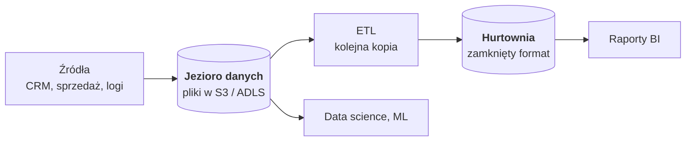
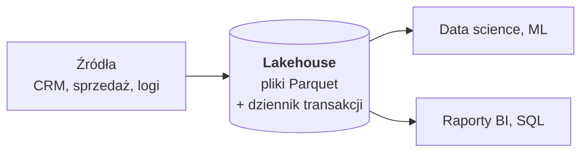

# Zajęcia 4

## Delta Lake — jezioro danych z transakcjami

Na zajęciach 1 zapisywaliśmy dane do plików Parquet, a na zajęciach 3 tworzyliśmy
tabele w Unity Catalog. Wspomniałem wtedy, że tabela w Databricksie to pod spodem
też pliki Parquet — plus **dziennik transakcji**. Dziś zaglądamy do tego dziennika.
Zobaczysz, jak kilka małych plików JSON zamienia zwykły katalog z plikami w tabelę,
którą można bezpiecznie zmieniać, cofnąć do wczorajszego stanu i aktualizować
pojedynczymi wierszami. W hurtowni danych to oczywistości. W jeziorze danych przez
lata było to prawie niemożliwe.

Po dzisiejszych zajęciach będziesz w stanie:

- wyjaśnić różnicę między hurtownią danych, jeziorem danych i lakehouse'em,
- opisać, jak Delta Lake dokłada transakcje do plików Parquet (`_delta_log`)
  i co dają cztery litery **ACID**,
- przeglądać historię tabeli, czytać jej starsze wersje (*time travel*)
  i przywracać je poleceniem `RESTORE`,
- zmieniać dane poleceniami `UPDATE`, `DELETE` i `MERGE` (*upsert*),
- rozpoznać błąd *schema enforcement* i świadomie włączyć ewolucję schematu,
- wyjaśnić, po co są `OPTIMIZE` i `VACUUM`.

!!! tip "Przykłady z zajęć w Databricksie"

    Cały kod z demo jest też w gotowym notatniku. Databricks nie ma przycisku
    „Open in…” takiego jak Colab, ale import notatnika zajmuje kilka sekund:

    1. W lewym menu **Workspace** → **Home** (Twój folder).
    2. Prawy przycisk na folderze albo menu **⋮** w prawym górnym rogu →
       **Import**.
    3. Wybierz **URL** i wklej adres:

        ```text
        https://raw.githubusercontent.com/kubzal/wsb-merito/main/notebooks/semestr_zimowy_2026_27/systemy_big_data/zajecia_4.ipynb
        ```

    4. **Import**, otwórz notatnik i **Connect → Serverless**.

    Notatnik możesz też
    [obejrzeć na GitHubie](https://github.com/kubzal/wsb-merito/blob/main/notebooks/semestr_zimowy_2026_27/systemy_big_data/zajecia_4.ipynb),
    pobrać (*Download raw file*) i przeciągnąć do okna importu (opcja **File**).

---

## Plan na dziś

| Blok | Czas |
|---|---|
| Transakcje; hurtownia, jezioro i lakehouse | 8 min |
| Delta Lake pod maską i ACID | 8 min |
| Time travel | 3 min |
| `UPDATE`, `DELETE` i `MERGE` | 6 min |
| Schemat pod kontrolą | 3 min |
| Konserwacja: `OPTIMIZE` i `VACUUM` | 3 min |
| Demo: cennik sklepu w Delcie | 12 min |
| **Zadanie 4** | **45 min** |

---

## Hurtownia, jezioro i lakehouse

### Najpierw: co to jest transakcja

**Transakcja** to grupa operacji na danych, którą baza traktuje jak **jedną
całość**: albo wykonają się wszystkie, albo żadna. Klasyczny przykład to przelew
100 zł z konta A na konto B. To dwie operacje — zdjąć 100 zł z A i dopisać 100 zł
do B. Jeśli serwer padnie między nimi, bez transakcji 100 zł po prostu znika.
W transakcji baza albo **zatwierdzi** obie zmiany naraz (*commit*), albo
**wycofa** obie (*rollback*), jakby nic się nie stało. W SQL wygląda to tak:

```sql
BEGIN TRANSACTION;

UPDATE konta SET saldo = saldo - 100 WHERE id = 'A';
UPDATE konta SET saldo = saldo + 100 WHERE id = 'B';

COMMIT;      -- dopiero teraz obie zmiany stają się widoczne naraz
```

Gdyby coś poszło nie tak przed `COMMIT`, baza wycofa obie zmiany (albo zrobisz to
sam poleceniem `ROLLBACK`).

Transakcja daje też drugą gwarancję: kto w tym czasie czyta dane, widzi stan
**sprzed** przelewu albo **po** nim, nigdy „w połowie”. Bazy danych, od bankowych
po hurtownie, mają to od dziesięcioleci. Te gwarancje opisują cztery litery
**ACID**, do których wrócimy przy Delta Lake. Zwykłe pliki w katalogu nie mają ich
wcale, i dziś zobaczysz, co z tego wynika.

### Hurtownia danych

**Hurtownia danych** (*data warehouse*) to pomysł z przełomu lat 80. i 90. Dane
z systemów firmy — sprzedaży, CRM-u, księgowości — co noc ładuje się procesem
**ETL** (*extract, transform, load*) do jednej bazy analitycznej o z góry
ustalonym schemacie. Analitycy piszą do niej SQL, a raporty liczą się szybko
i zawsze tak samo.

Hurtownia ma wszystko, czego oczekujemy od bazy danych: transakcje, schemat,
uprawnienia, `UPDATE` i `DELETE`. Ma też wady:

- jest **droga** — płacisz za dyski, moc obliczeniową i często licencję,
- trzyma tylko **dane tabelaryczne** — logów, zdjęć czy nagrań do niej nie
  wrzucisz,
- schemat ustala się **przed** załadowaniem danych (*schema-on-write*) — nowe
  źródło danych to tygodnie pracy,
- dane siedzą w **zamkniętym formacie** jednego dostawcy i czyta je tylko jego
  silnik.

### Jezioro danych

**Jezioro danych** (*data lake*) to odpowiedź z lat 2010. — najpierw Hadoop
(HDFS), potem chmurowe magazyny obiektowe: Amazon S3, Azure Data Lake Storage,
Google Cloud Storage. Wrzucasz wszystko, jak leci: CSV, JSON, logi, obrazki,
Parquet. Składowanie jest **tanie**, formaty są **otwarte**, a te same pliki czyta
Spark, DuckDB, Presto i pandas. Schemat ustalasz dopiero przy odczycie
(*schema-on-read*).

Jezioro nie ma za to transakcji ani kontroli jakości. Po kilku latach bez
porządku zamienia się w **bagno danych** (*data swamp*): tysiące katalogów, nie
wiadomo, który plik jest aktualny, a który to kopia z błędem sprzed roku.

### Dwie warstwy

W praktyce firmy miały oba: jezioro jako tanie archiwum i paliwo dla uczenia
maszynowego, a wybrane dane kopiowane dalej do hurtowni dla raportów.



To działa, ale te same dane leżą w dwóch miejscach. Płacisz za nie dwa razy,
utrzymujesz dodatkowy ETL, dane w hurtowni są o jeden proces „starsze” niż
w jeziorze, a analityk i data scientist co jakiś czas pokazują szefowi dwie różne
liczby na to samo pytanie.

### Lakehouse

Pomysł **lakehouse'u** (spopularyzowany przez Databricks około 2020 roku) jest
prosty: zostawić dane w jeziorze, w otwartym formacie, i dołożyć do nich warstwę,
która daje to, co hurtownia — transakcje, kontrolę schematu, historię zmian.
Tą warstwą jest **otwarty format tabel** (*open table format*). Są trzy
popularne: **Delta Lake** (Databricks), **Apache Iceberg** (Netflix) i **Apache
Hudi** (Uber). Działają na tej samej zasadzie, a my poznamy Deltę.



| | Hurtownia danych | Jezioro danych | Lakehouse |
|---|---|---|---|
| Co przechowuje | tabele | wszystko: tabele, JSON, logi, obrazki | wszystko + tabele z transakcjami |
| Format | zamknięty, jednego dostawcy | otwarte pliki (CSV, Parquet…) | Parquet + dziennik transakcji (Delta, Iceberg) |
| Schemat | przy zapisie | przy odczycie | przy zapisie, z możliwością ewolucji |
| Transakcje, `UPDATE`, `DELETE` | tak | nie | tak |
| Historia zmian | zwykle nie | nie | tak (*time travel*) |
| Koszt składowania | wysoki | niski | niski |
| Przykłady | Teradata, Oracle, Snowflake, BigQuery | HDFS, S3 + Hive | Databricks, Iceberg na S3 |

!!! note "Granice się zacierają"

    Snowflake i BigQuery (wrócimy do niego na zajęciach 7) potrafią dziś czytać
    i zapisywać tabele Iceberga, a Delta może udostępniać swoje tabele jako
    Iceberg. Podział z tabeli jest więc bardziej historyczny niż ostry. Pomysł
    „otwarte pliki + dziennik transakcji” wygrał.

### Co psuje się w jeziorze bez transakcji

Wyobraź sobie katalog `sprzedaz/` z plikami Parquet. Co noc dopisuje do niego
job, w dzień czytają z niego analitycy. Co może pójść źle:

- **Job pada w połowie zapisu.** W katalogu zostaje połowa nowych plików.
  Raporty liczą dzień częściowo i nikt o tym nie wie.
- **Analityk czyta w trakcie zapisu.** Widzi część starych i część nowych
  danych — stan, który nigdy naprawdę nie istniał.
- **Klient żąda usunięcia danych (RODO).** Pliki Parquet nie mają `DELETE`.
  Trzeba przepisać każdy plik, w którym jest choć jeden wiersz klienta,
  i podmienić go tak, żeby nikt w tym czasie nie czytał.
- **Ktoś dopisuje plik, w którym `kwota` jest tekstem.** Nic tego nie
  zatrzymuje. Zapytania wysypią się za tydzień, u kogoś innego.
- **Ktoś nadpisuje katalog błędnymi danymi.** Nie ma „Cofnij”.

Delta Lake rozwiązuje wszystkie pięć problemów jednym pomysłem.

---

## Delta Lake pod maską

### Pliki + dziennik

Tabela Delta to katalog z plikami Parquet i podkatalogiem `_delta_log`:

```text
produkty/
├── _delta_log/
│   ├── 00000000000000000000.json    wersja 0: utwórz tabelę (schemat)
│   ├── 00000000000000000001.json    wersja 1: dodaj plik A
│   ├── 00000000000000000002.json    wersja 2: usuń A, dodaj B
│   ├── 00000000000000000003.json    wersja 3: dodaj C
│   ├── ...
│   └── 00000000000000000010.checkpoint.parquet    stan tabeli zebrany w jednym pliku
├── part-00000-1f3e….snappy.parquet  A  (usunięty w wersji 2, ale dalej leży na dysku)
├── part-00000-8b2c….snappy.parquet  B
└── part-00000-c771….snappy.parquet  C
```

Całość opiera się na trzech zasadach:

1. **Pliki z danymi nigdy się nie zmieniają.** Raz zapisany Parquet zostaje
   taki, jaki był. Zmiana danych to zapis **nowych** plików.
2. **Każda zmiana tabeli to jeden nowy plik w `_delta_log`** — tzw. *commit*.
   Zawiera listę akcji: „dodaj plik B”, „usuń plik A”, czasem „zmień schemat”.
   „Usuń” jest **logiczne** — plik A dalej leży w katalogu, tylko tabela
   przestaje go używać.
3. **Stan tabeli w wersji N to pliki dodane i jeszcze nieusunięte w commitach
   od 0 do N.** Czytelnik najpierw czyta dziennik, a potem tylko te pliki, które
   dziennik wskazuje. Pliku, którego nie ma w dzienniku, nie widzi wcale.

Tak wygląda prawdziwy commit — operacja `MERGE` z naszego demo, skrócona:

```json
{"commitInfo": {"operation": "MERGE", "readVersion": 3,
                "operationMetrics": {"numTargetRowsUpdated": "1",
                                     "numTargetRowsInserted": "1", ...}}}
{"remove": {"path": "part-00001-b626….snappy.parquet", "dataChange": true, ...}}
{"add":    {"path": "part-00000-e6c8….snappy.parquet", "size": 1273, "dataChange": true,
            "stats": "{\"numRecords\": 2,
                       \"minValues\": {\"id\": 2, \"cena\": 19.90},
                       \"maxValues\": {\"id\": 6, \"cena\": 29.90}, ...}"}}
```

Zwróć uwagę na `stats`. Dziennik zna **minimum i maksimum** każdej kolumny
w każdym pliku. Zapytanie `WHERE cena > 50` pominie ten plik bez otwierania go
(*data skipping*). To ten sam pomysł co statystyki w stopce Parquetu z zajęć 1,
tylko zebrany w jednym miejscu dla całej tabeli.

Co kilka commitów (w wersji open source domyślnie co 10) Delta zapisuje
**checkpoint** — plik Parquet z gotowym stanem tabeli. Dzięki temu czytelnik
nie musi przechodzić przez tysiące plików JSON, tylko bierze ostatni checkpoint
i kilka commitów po nim.

### Dlaczego to rozwiązuje problemy z jeziora

- **Job pada w połowie zapisu** → nowe pliki Parquet leżą w katalogu, ale commit
  nie powstał. Dla dziennika nie istnieją, więc nikt ich nie przeczyta.
- **Czytanie w trakcie zapisu** → czytelnik bierze wersję, która była ostatnia
  w chwili rozpoczęcia zapytania, i czyta ją do końca. Nowy commit go nie
  dotyczy.
- **Dwóch piszących naraz** → obaj próbują utworzyć ten sam plik, np.
  `…006.json`. Magazyn pozwala utworzyć go tylko raz, więc jeden wygrywa.
  Drugi sprawdza, czy zmiany się wykluczają. Jeśli nie (np. obaj tylko
  dopisywali), ponawia jako wersja 7. Jeśli tak (obaj zmieniali te same pliki),
  dostaje błąd `ConcurrentModificationException`. To **optymistyczna kontrola
  współbieżności**: nikt niczego nie blokuje, konflikty rozstrzyga się przy
  commicie.
- **`DELETE` i `UPDATE`** → przepisz dotknięte pliki i zapisz commit „usuń
  stare, dodaj nowe”. Szczegóły za chwilę.
- **Kontrola schematu** → schemat jest zapisany w dzienniku (akcja `metaData`),
  więc każdy zapis można z nim porównać.
- **„Cofnij”** → stare pliki i stare commity wciąż istnieją, więc da się
  odtworzyć dowolną wcześniejszą wersję.

### ACID

Cztery litery, które odróżniają bazę danych od katalogu z plikami:

| Litera | Znaczy | W Delta Lake |
|---|---|---|
| **A** — *Atomicity*, niepodzielność | zmiana wchodzi cała albo wcale | jeden commit = jeden plik w dzienniku; bez niego zmiany nie ma |
| **C** — *Consistency*, spójność | dane spełniają reguły tabeli | kontrola schematu, ograniczenia `NOT NULL` i `CHECK` |
| **I** — *Isolation*, izolacja | równoczesne operacje sobie nie przeszkadzają | czytelnik widzi jedną wersję; piszący — kontrola optymistyczna |
| **D** — *Durability*, trwałość | zatwierdzone nie znika | dziennik i pliki w trwałym magazynie obiektowym |

!!! info "Gdzie jest `_delta_log` w Databricksie?"

    Do plików **tabeli zarządzanej** w Unity Catalog nie zajrzysz bezpośrednio.
    Katalog pilnuje, żeby nikt nie omijał uprawnień, czytając pliki z pominięciem
    tabeli. Ten sam dziennik czytają jednak dwa polecenia:
    `DESCRIBE HISTORY` (lista commitów) i `DESCRIBE DETAIL` (format, położenie,
    liczba i rozmiar plików). Na nich oprzemy się w demo.

---

## Time travel

Skoro stare pliki zostają, a dziennik pamięta wszystkie commity, można przeczytać
tabelę w **dowolnej wcześniejszej wersji**:

```sql
DESCRIBE HISTORY produkty                                  -- lista wersji: kto, kiedy, co
SELECT * FROM produkty VERSION AS OF 3                     -- tabela w wersji 3
SELECT * FROM produkty TIMESTAMP AS OF '2026-11-21 15:30'  -- tabela o 15:30
RESTORE TABLE produkty TO VERSION AS OF 3                  -- przywróć wersję 3
```

W Pythonie: `spark.read.option("versionAsOf", 3).table("produkty")`.

Do czego to się przydaje:

- **„Cofnij”** — ktoś puścił `DELETE` bez `WHERE`? `RESTORE` i po kłopocie.
- **Audyt** — `DESCRIBE HISTORY` mówi, kto, kiedy i jakim poleceniem zmienił
  tabelę.
- **Odtwarzalność** — model trenowany na wersji 42 da się wytrenować ponownie
  na dokładnie tych samych danych.
- **Debugowanie** — co się zmieniło od wczoraj? `EXCEPT` między wersjami.

`RESTORE` nie wymazuje historii. To **nowy commit**, który przywraca pliki ze
starej wersji. Wersja z błędem dalej jest w historii i dalej można ją przeczytać.
Da się więc „przywrócić przywrócenie”.

!!! warning "Time travel to nie archiwum"

    Stare pliki nie leżą wiecznie. `VACUUM` (zaraz o nim) usuwa pliki, których
    aktualna wersja już nie używa, a które są starsze niż **7 dni**. Wpisy
    w dzienniku są domyślnie trzymane **30 dni**. Time travel służy więc do
    cofania pomyłek z ostatnich dni, a nie do przechowywania historii biznesowej.
    Jeśli chcesz wiedzieć, w jakim segmencie był klient w zeszłym roku, potrzebujesz
    **SCD typu 2** — o nim przy `MERGE`.

---

## `UPDATE`, `DELETE` i `MERGE`

### Jak zmienić niezmienny plik

Skoro pliki są niezmienne, jak działa `UPDATE`? Delta:

1. szuka plików, w których mogą być pasujące wiersze (statystyki min/max
   pomagają pominąć resztę),
2. **przepisuje** każdy taki plik w całości — z poprawionymi wierszami,
3. zapisuje commit: „usuń stare pliki, dodaj nowe”.

To się nazywa *copy-on-write*. Wada: zmiana jednego wiersza w pliku o rozmiarze
1 GB oznacza przepisanie gigabajta. Dlatego Databricks na nowych tabelach używa
domyślnie **wektorów usunięć** (*deletion vectors*). Zamiast przepisywać plik,
zapisuje obok mały plik z listą wierszy, które „już nie istnieją”. Przepisanie
odkłada na później. W historii zobaczysz wtedy liczniki `numDeletionVectorsAdded`.

### `MERGE` — wszystko naraz

Klasyczna sytuacja: co noc z systemu CRM przychodzi **paczka zmian**. Jedni
klienci są nowi, inni zmienili dane. Trzeba je wprowadzić do kartoteki.
Osobne `UPDATE` i `INSERT` to dwie transakcje, a między nimi coś może się
wysypać. `MERGE` robi to w **jednej**:

```sql
MERGE INTO klienci AS t             -- tabela docelowa (target)
USING zmiany AS s                   -- paczka zmian (source)
ON t.id = s.id                      -- jak parować wiersze
WHEN MATCHED THEN UPDATE SET *      -- klient już jest → nadpisz wszystkie kolumny
WHEN NOT MATCHED THEN INSERT *      -- nowy klient → dopisz
```

Taką operację nazywa się **upsert** (*update + insert*):

```text
 klienci (przed)          zmiany                    klienci (po)
 id  segment              id  segment               id  segment
 1   BUILDING             2   MACHINERY  ── pasuje  1   BUILDING
 2   FURNITURE ─────────► 4   HOUSEHOLD  ── nowy    2   MACHINERY   ← UPDATE
 3   AUTOMOBILE                                     3   AUTOMOBILE
                                                    4   HOUSEHOLD   ← INSERT
```

Klauzule `WHEN` można łączyć i dodawać do nich warunki:

| Klauzula | Kiedy się wykonuje | Przykład |
|---|---|---|
| `WHEN MATCHED [AND warunek] THEN UPDATE SET …` | wiersz jest w obu tabelach | `UPDATE SET t.cena = s.cena` |
| `WHEN MATCHED [AND warunek] THEN DELETE` | wiersz jest w obu tabelach | `WHEN MATCHED AND s.usuniety THEN DELETE` |
| `WHEN NOT MATCHED THEN INSERT …` | wiersz jest tylko w paczce | `INSERT *` |
| `WHEN NOT MATCHED BY SOURCE THEN DELETE` | wiersz jest tylko w tabeli docelowej | pełna synchronizacja z paczką |

`UPDATE SET *` i `INSERT *` działają, gdy paczka ma kolumny o tych samych
nazwach co tabela. Inaczej wypisz je ręcznie: `UPDATE SET t.cena = s.nowa_cena`.

!!! danger "Klucz w paczce musi być unikalny"

    Jeśli w paczce zmian ten sam `id` występuje dwa razy, Delta nie wie, którą
    wersję wpisać, i przerywa `MERGE` błędem
    `DELTA_MULTIPLE_SOURCE_ROW_MATCHING_TARGET_ROW_IN_MERGE`. To ten sam problem
    co mnożenie wierszy przy joinie z zajęć 3. Przed `MERGE` usuń duplikaty
    z paczki, np. `dropDuplicates(["id"])` albo zostaw najnowszy wiersz
    `row_number()`.

To samo w Pythonie, przez obiekt `DeltaTable`:

```python
from delta.tables import DeltaTable

klienci = DeltaTable.forName(spark, "workspace.zajecia4.klienci")
(klienci.alias("t")
    .merge(zmiany.alias("s"), "t.id = s.id")
    .whenMatchedUpdateAll()
    .whenNotMatchedInsertAll()
    .execute())
```

### SCD — co z historią klienta

Hurtownie danych od dawna nazywają ten problem *Slowly Changing Dimensions*
(SCD) — wymiary, które zmieniają się powoli: adres klienta, segment, cena
produktu. Dwa najczęstsze podejścia:

- **SCD typu 1** — nadpisz starą wartość. Nasz `MERGE` wyżej. Prosto, ale nie
  wiesz, jaki segment klient miał wcześniej.
- **SCD typu 2** — każda zmiana to **nowy wiersz**. Stary wiersz dostaje datę
  końca ważności:

```text
 id  segment     valid_from  valid_to    is_current
 2   FURNITURE   2024-03-01  2026-11-21  false       ← zamknięty
 2   MACHINERY   2026-11-21  NULL        true        ← aktualny
```

Raporty sprzedaży mogą wtedy przypisać każde zamówienie do segmentu, w którym
klient był **w dniu zamówienia**. Time travel tego nie zastąpi: pamięta tylko
kilka dni wstecz i mówi, kiedy zmieniła się **tabela**, a nie kiedy klient zmienił
segment.

---

## Schemat pod kontrolą

### Schema enforcement

Delta porównuje **każdy zapis** ze schematem zapisanym w dzienniku:

| Dane mają… | Co robi Delta |
|---|---|
| dodatkową kolumnę, której nie ma w tabeli | **błąd** — `A schema mismatch detected when writing to the Delta table` |
| kolumnę innego typu (`cena` jako tekst) | **błąd** — `Failed to merge fields 'cena' and 'cena'` |
| o jedną kolumnę mniej | zapisuje, brakującą kolumnę wypełnia `NULL` |

To jest **zaleta**, nie złośliwość. Błąd przy zapisie widzisz od razu i wiesz,
który job go spowodował. Bez kontroli schematu złe dane wchodzą po cichu i psują
się dopiero przy odczycie — tydzień później, u kogoś innego.

Uwaga na typy liczbowe: dla Delty `DECIMAL(4,2)` i `DECIMAL(8,2)` to **różne**
typy. Literał `49.00` w SQL ma typ `DECIMAL(4,2)`, więc przy dopisywaniu do
kolumny `DECIMAL(8,2)` trzeba go zrzutować: `CAST(49.00 AS DECIMAL(8, 2))`.

### Schema evolution

Gdy nowa kolumna jest **zamierzona**, mówisz to Delcie wprost:

| Sytuacja | Jak |
|---|---|
| dopisuję DataFrame z nową kolumną | `df.write.mode("append").option("mergeSchema", "true").saveAsTable(...)` |
| dodaję kolumnę ręcznie | `ALTER TABLE t ADD COLUMNS (email STRING)` |
| `MERGE` z nową kolumną w paczce | `MERGE WITH SCHEMA EVOLUTION INTO t USING ...` |
| zmieniam typ kolumny | to nie ewolucja — trzeba przepisać tabelę: `mode("overwrite")` + `option("overwriteSchema", "true")` |

Stare wiersze dostają w nowej kolumnie `NULL`. Pliki nie są przepisywane —
zmienia się tylko schemat w dzienniku.

---

## Konserwacja: `OPTIMIZE` i `VACUUM`

### Problem małych plików

Każdy commit to nowe pliki. Job, który co 5 minut dopisuje kilka wierszy,
po miesiącu zostawi ponad 8 tysięcy małych plików. Odczyt każdego pliku to osobne
żądanie do magazynu i osobne metadane, więc tysiąc plików po 100 kB czyta się
**wielokrotnie** wolniej niż jeden plik 100 MB.

**`OPTIMIZE`** skleja małe pliki w duże (*compaction*). Jak każda zmiana w Delcie
jest to commit: „usuń 1000 małych, dodaj 1 duży”. Dane się nie zmieniają, a czytelnicy
w trakcie niczego nie zauważają.

### Liquid clustering

Na zajęciach 1 partycjonowaliśmy pliki w stylu Hive (`miesiac=1/`, `miesiac=2/`).
Delta to potrafi, ale Databricks zaleca dziś **liquid clustering**:

```sql
CREATE TABLE zamowienia (...) CLUSTER BY (data_zamowienia)
```

`OPTIMIZE` układa wtedy dane tak, żeby podobne wartości kolumny trafiały do tych
samych plików. Statystyki min/max w dzienniku są wtedy „ciasne”, więc zapytanie
z filtrem po dacie pomija większość plików. W odróżnieniu od partycjonowania nie
tworzy tysięcy katalogów przy kolumnie o wielu wartościach i można zmienić
kolumny klastrowania bez przepisywania tabeli.

### `VACUUM`

`OPTIMIZE`, `UPDATE`, `DELETE` i `MERGE` usuwają pliki tylko **logicznie**.
Fizycznie zostają na dysku — dzięki temu działa time travel, ale płacisz za
miejsce. **`VACUUM`** kasuje pliki, których nie używa aktualna wersja tabeli
i które są starsze niż okres przechowywania (domyślnie **7 dni**). Po `VACUUM`
time travel do starszych wersji przestaje działać — dziennik pamięta, że były,
ale ich plików już nie ma.

!!! info "Databricks sprząta sam"

    W Unity Catalog działa *predictive optimization* — Databricks sam od czasu
    do czasu uruchamia na tabelach zarządzanych `OPTIMIZE`, `VACUUM` i `ANALYZE`.
    Jeśli w `DESCRIBE HISTORY` zobaczysz operację, której nie wykonywałeś,
    to właśnie to.

---

## Demo: cennik sklepu w Delcie

Na małej tabeli, którą widać w całości, przejdziemy przez wszystko po kolei:
utworzenie, zmiany, `MERGE`, historię, cofnięcie pomyłki i nową kolumnę. Pracujemy
w schemacie `workspace.zajecia4`.

### Tworzymy tabelę

```python
spark.sql("CREATE SCHEMA IF NOT EXISTS workspace.zajecia4")
spark.sql("DROP TABLE IF EXISTS workspace.zajecia4.produkty")   # żeby demo dało się powtórzyć
```

W Databricksie każda nowa tabela jest domyślnie tabelą Delta — nie trzeba pisać
`USING DELTA`.

```sql
%sql
CREATE TABLE workspace.zajecia4.produkty (
    id     INT,
    nazwa  STRING,
    cena   DECIMAL(8, 2),
    stan   INT
)
```

```sql
%sql
INSERT INTO workspace.zajecia4.produkty VALUES
    (1, 'Kawa ziarnista 1 kg', 79.99,  40),
    (2, 'Herbata zielona',     18.50, 120),
    (3, 'Czekolada gorzka',     7.99, 300),
    (4, 'Miód lipowy',         34.00,  25),
    (5, 'Kakao',               15.49,  60)
```

Tu literały typu `DECIMAL(4,2)` nie przeszkadzają — `INSERT INTO` w SQL sam
rzutuje wartości na typy kolumn. Kontrola schematu dotyczy głównie zapisów
z DataFrame'ów.

### Historia i szczegóły tabeli

```python
historia = spark.sql("DESCRIBE HISTORY workspace.zajecia4.produkty")
display(historia.select("version", "timestamp", "operation", "operationMetrics"))
```

```text
+-------+-------------------+------------+-----------------------------------------+
|version|          timestamp|   operation|                         operationMetrics|
+-------+-------------------+------------+-----------------------------------------+
|      1|2026-11-21 15:42:10|       WRITE| {numFiles -> 1, numOutputRows -> 5, ...}|
|      0|2026-11-21 15:42:09|CREATE TABLE|                                       {}|
+-------+-------------------+------------+-----------------------------------------+
```

Dwie operacje, dwie wersje. Najnowsza jest na górze. W Databricksie zobaczysz
więcej kolumn — m.in. `userName`, czyli **kto** wykonał operację.

```sql
%sql
DESCRIBE DETAIL workspace.zajecia4.produkty
```

`DESCRIBE DETAIL` pokazuje m.in. `format` (`delta`), `location` (gdzie w chmurze
leżą pliki), `numFiles` i `sizeInBytes`.

### `UPDATE` i `DELETE`

Kawa drożeje o 10%, a miód, którego zostało mniej niż 30 słoików, wycofujemy:

```sql
%sql
UPDATE workspace.zajecia4.produkty SET cena = cena * 1.10 WHERE id = 1
```

```sql
%sql
DELETE FROM workspace.zajecia4.produkty WHERE stan < 30
```

Na zwykłych plikach Parquet żadne z tych poleceń by nie zadziałało.

### `MERGE` — przyjmujemy dostawę

Przychodzi dostawa: herbaty jest więcej i ma nową cenę, a do oferty wchodzi yerba
mate. Paczkę zmian przygotowujemy jako widok tymczasowy:

```sql
%sql
CREATE OR REPLACE TEMP VIEW dostawa AS
SELECT * FROM VALUES
    (2, 'Herbata zielona', 19.90, 150),
    (6, 'Yerba mate',      29.90,  80)
AS d(id, nazwa, cena, stan)
```

```sql
%sql
MERGE INTO workspace.zajecia4.produkty AS t
USING dostawa AS s
ON t.id = s.id
WHEN MATCHED THEN UPDATE SET *
WHEN NOT MATCHED THEN INSERT *
```

```text
+-----------------+----------------+----------------+-----------------+
|num_affected_rows|num_updated_rows|num_deleted_rows|num_inserted_rows|
+-----------------+----------------+----------------+-----------------+
|                2|               1|               0|                1|
+-----------------+----------------+----------------+-----------------+
```

```sql
%sql
SELECT * FROM workspace.zajecia4.produkty ORDER BY id
```

```text
+---+-------------------+-----+----+
| id|              nazwa| cena|stan|
+---+-------------------+-----+----+
|  1|Kawa ziarnista 1 kg|87.99|  40|
|  2|    Herbata zielona|19.90| 150|
|  3|   Czekolada gorzka| 7.99| 300|
|  5|              Kakao|15.49|  60|
|  6|         Yerba mate|29.90|  80|
+---+-------------------+-----+----+
```

Kawa droższa, miodu nie ma, herbata zaktualizowana, yerba dopisana. Historia:

```python
historia = spark.sql("DESCRIBE HISTORY workspace.zajecia4.produkty")
display(historia.select("version", "operation", "operationParameters", "operationMetrics"))
```

```text
+-------+------------+--------------------------------+------------------------------------------------------------+
|version|   operation|             operationParameters|                                            operationMetrics|
+-------+------------+--------------------------------+------------------------------------------------------------+
|      4|       MERGE|{predicate -> ["(id = id)"], …} |{…, numTargetRowsUpdated -> 1, numTargetRowsInserted -> 1, …}|
|      3|      DELETE|{predicate -> ["(stan < 30)"]}  |{…, numDeletedRows -> 1, …}                                 |
|      2|      UPDATE|{predicate -> ["(id = 1)"]}     |{…, numUpdatedRows -> 1, …}                                 |
|      1|       WRITE|{mode -> Append, …}             |{…, numOutputRows -> 5, …}                                  |
|      0|CREATE TABLE|{…}                             |{}                                                          |
+-------+------------+--------------------------------+------------------------------------------------------------+
```

Z kolumny `operationMetrics` (to słownik, *map*) pojedynczą wartość wyciąga się
tak:

```python
from pyspark.sql import functions as F

display(historia
    .filter(F.col("operation") == "MERGE")
    .select("version",
            F.col("operationMetrics")["numTargetRowsUpdated"].alias("zaktualizowane"),
            F.col("operationMetrics")["numTargetRowsInserted"].alias("dopisane")))
```

### Time travel

Cennik sprzed wszystkich zmian, czyli wersja 1:

```sql
%sql
SELECT * FROM workspace.zajecia4.produkty VERSION AS OF 1 ORDER BY id
```

```text
+---+-------------------+-----+----+
| id|              nazwa| cena|stan|
+---+-------------------+-----+----+
|  1|Kawa ziarnista 1 kg|79.99|  40|
|  2|    Herbata zielona|18.50| 120|
|  3|   Czekolada gorzka| 7.99| 300|
|  4|        Miód lipowy|34.00|  25|
|  5|              Kakao|15.49|  60|
+---+-------------------+-----+----+
```

Co się zmieniło od wersji 1? Wiersze, które są teraz, a nie było ich wtedy:

```sql
%sql
SELECT * FROM workspace.zajecia4.produkty
EXCEPT
SELECT * FROM workspace.zajecia4.produkty VERSION AS OF 1
```

```text
+---+-------------------+-----+----+
| id|              nazwa| cena|stan|
+---+-------------------+-----+----+
|  1|Kawa ziarnista 1 kg|87.99|  40|
|  2|    Herbata zielona|19.90| 150|
|  6|         Yerba mate|29.90|  80|
+---+-------------------+-----+----+
```

To samo w Pythonie:

```python
v1 = spark.read.option("versionAsOf", 1).table("workspace.zajecia4.produkty")
teraz = spark.table("workspace.zajecia4.produkty")

display(teraz.exceptAll(v1))
```

### Ups — `DELETE` bez `WHERE`

```sql
%sql
DELETE FROM workspace.zajecia4.produkty
```

```sql
%sql
SELECT COUNT(*) FROM workspace.zajecia4.produkty
```

```text
0
```

Pusto. W zwykłym jeziorze danych to byłby telefon do administratora kopii
zapasowych. Tu — jedno polecenie. Ostatnia dobra wersja to 4 (po `MERGE`):

```sql
%sql
RESTORE TABLE workspace.zajecia4.produkty TO VERSION AS OF 4
```

```sql
%sql
SELECT * FROM workspace.zajecia4.produkty ORDER BY id
```

Wszystkie pięć produktów wróciło. W historii są teraz wersje 5 (`DELETE`) i 6
(`RESTORE`) — pomyłka nie zniknęła, tylko została odkręcona.

### Nowa kolumna — schema enforcement i evolution

Dział zakupów chce dopisać matchę, tym razem z kategorią produktu. Takiej kolumny
w tabeli nie ma, więc ta komórka **celowo kończy się błędem** (przy *Run all*
notatnik zatrzyma się tutaj — kolejne komórki uruchom ręcznie):

```python
nowe = spark.sql("""
    SELECT 7 AS id, 'Matcha' AS nazwa, CAST(49.00 AS DECIMAL(8, 2)) AS cena,
           15 AS stan, 'herbata' AS kategoria
""")

nowe.write.mode("append").saveAsTable("workspace.zajecia4.produkty")
```

```text
AnalysisException: [_LEGACY_ERROR_TEMP_DELTA_0007] A schema mismatch detected when
writing to the Delta table (Table ID: 4536b168-...).
To enable schema migration using DataFrameWriter or DataStreamWriter, please set:
'.option("mergeSchema", "true")'.
...
Table schema:
root
-- id: integer (nullable = true)
-- nazwa: string (nullable = true)
-- cena: decimal(8,2) (nullable = true)
-- stan: integer (nullable = true)

Data schema:
root
-- id: integer (nullable = true)
-- nazwa: string (nullable = true)
-- cena: decimal(8,2) (nullable = true)
-- stan: integer (nullable = true)
-- kategoria: string (nullable = true)
```

Delta odmówiła i od razu powiedziała, co zrobić. Nowa kolumna jest zamierzona,
więc włączamy ewolucję schematu:

```python
nowe.write.mode("append").option("mergeSchema", "true").saveAsTable("workspace.zajecia4.produkty")

display(spark.table("workspace.zajecia4.produkty").orderBy("id"))
```

```text
+---+-------------------+-----+----+---------+
| id|              nazwa| cena|stan|kategoria|
+---+-------------------+-----+----+---------+
|  1|Kawa ziarnista 1 kg|87.99|  40|     NULL|
|  2|    Herbata zielona|19.90| 150|     NULL|
|  3|   Czekolada gorzka| 7.99| 300|     NULL|
|  5|              Kakao|15.49|  60|     NULL|
|  6|         Yerba mate|29.90|  80|     NULL|
|  7|             Matcha|49.00|  15|  herbata|
+---+-------------------+-----+----+---------+
```

Stare produkty mają w `kategoria` wartość `NULL`. A co, jeśli ktoś przyśle cenę
jako tekst? Też błąd — i dobrze:

```python
zle = spark.sql("SELECT 8 AS id, 'Rooibos' AS nazwa, 'dwanaście zł' AS cena, 10 AS stan")

zle.write.mode("append").option("mergeSchema", "true").saveAsTable("workspace.zajecia4.produkty")
```

```text
AnalysisException: [DELTA_FAILED_TO_MERGE_FIELDS] Failed to merge fields 'cena' and 'cena'
```

`mergeSchema` dodaje kolumny, ale **typu nie zmieni**. Złe dane nie weszły.

### Sprzątanie

```sql
%sql
OPTIMIZE workspace.zajecia4.produkty
```

```sql
%sql
DESCRIBE DETAIL workspace.zajecia4.produkty
```

Po `OPTIMIZE` `numFiles` spada do 1 — cała tabela mieści się w jednym pliku.
Stare pliki wciąż leżą w magazynie, bo time travel ich potrzebuje.
`VACUUM workspace.zajecia4.produkty` usunąłby tylko te starsze niż 7 dni, więc
dziś nie skasuje niczego.

---

## Ściągawka

| Chcę… | SQL | Python |
|---|---|---|
| zapisać DataFrame jako tabelę Delta | `CREATE TABLE t AS SELECT ...` | `df.write.mode("overwrite").saveAsTable("t")` |
| dopisać wiersze | `INSERT INTO t VALUES (...)` / `INSERT INTO t SELECT ...` | `df.write.mode("append").saveAsTable("t")` |
| zmienić wiersze | `UPDATE t SET kol = ... WHERE ...` | |
| usunąć wiersze | `DELETE FROM t WHERE ...` | |
| upsert | `MERGE INTO t USING s ON t.id = s.id WHEN MATCHED THEN UPDATE SET * WHEN NOT MATCHED THEN INSERT *` | `DeltaTable.forName(spark, "t").alias("t").merge(s.alias("s"), "t.id = s.id").whenMatchedUpdateAll().whenNotMatchedInsertAll().execute()` |
| DataFrame jako widok w SQL | | `df.createOrReplaceTempView("s")` |
| historia tabeli | `DESCRIBE HISTORY t` | `spark.sql("DESCRIBE HISTORY t")` |
| wartość z `operationMetrics` | | `F.col("operationMetrics")["numTargetRowsUpdated"]` |
| szczegóły tabeli | `DESCRIBE DETAIL t` | `spark.sql("DESCRIBE DETAIL t")` |
| tabela w wersji N | `SELECT * FROM t VERSION AS OF N` | `spark.read.option("versionAsOf", N).table("t")` |
| tabela o danej godzinie | `SELECT * FROM t TIMESTAMP AS OF '2026-11-21 15:30'` | `spark.read.option("timestampAsOf", "2026-11-21 15:30").table("t")` |
| porównać dwie wersje | `SELECT * FROM t EXCEPT SELECT * FROM t VERSION AS OF N` | `a.exceptAll(b)` |
| przywrócić wersję | `RESTORE TABLE t TO VERSION AS OF N` | |
| dopisać z nową kolumną | | `df.write.mode("append").option("mergeSchema", "true").saveAsTable("t")` |
| dodać kolumnę | `ALTER TABLE t ADD COLUMNS (email STRING)` | |
| skleić małe pliki | `OPTIMIZE t` | |
| usunąć stare pliki | `VACUUM t` | |
| liczyć warunkowo | `COUNT_IF(warunek)`, `COUNT(kol)` liczy wartości różne od `NULL` | `F.count_if(warunek)`, `F.count("kol")` |

---

## Zadanie 4 — Kartoteka klientów (6 pkt)

- **Czas:** maks. 45 minut
- **Środowisko:** Databricks Free Edition (notatnik, compute serverless)
- **Oddanie:** notatnik wyeksportowany jako `.ipynb` na Moodle (*File → Export →
IPython Notebook*)

Zadanie ma dwie części. Rób je po kolei i **pokaż mi wynik każdej części, gdy
będzie gotowa** — punktacja zależy od tego, ile zrobisz na zajęciach.

Prowadzisz kartotekę klientów firmy z TPC-H. Dostajesz stan początkowy i paczkę
zmian z CRM-u. Wprowadzisz zmiany, a potem posprzątasz po stażyście i przyjmiesz
klientów z nowego formularza rejestracji.

### Twoje dane

Każdy pracuje na klientach innego kraju — tego samego co w zadaniu 3. Numer
albumu wybiera też, którzy klienci zmienią segment. Pierwsza komórka notatnika
(skopiuj ją w całości):

```python
from pyspark.sql import functions as F

NR_ALBUMU = 123456                 # ← wpisz swój numer albumu
MOJ_KRAJ  = NR_ALBUMU % 25         # n_nationkey Twojego kraju
RESZTA    = NR_ALBUMU % 10         # którzy klienci zmienią segment

spark.sql("CREATE SCHEMA IF NOT EXISTS workspace.zajecia4")

kartoteka = (spark.table("samples.tpch.customer")
    .filter(F.col("c_nationkey") == MOJ_KRAJ)
    .select(F.col("c_custkey").alias("id"),
            F.col("c_name").alias("nazwa"),
            F.col("c_mktsegment").alias("segment"),
            F.col("c_acctbal").alias("saldo")))

# stan początkowy kartoteki
klienci_start = kartoteka.filter("id <= 700000")

# paczka zmian z CRM: nowi klienci i klienci, którzy przeszli do innego segmentu
zmiany = (kartoteka
    .filter(f"id BETWEEN 700001 AND 725000 OR (id <= 700000 AND id % 10 = {RESZTA})")
    .withColumn("segment", F.expr("""
        CASE WHEN id > 700000 THEN segment
             ELSE element_at(map('AUTOMOBILE', 'BUILDING',  'BUILDING',  'FURNITURE',
                                 'FURNITURE',  'HOUSEHOLD', 'HOUSEHOLD', 'MACHINERY',
                                 'MACHINERY',  'AUTOMOBILE'), segment)
        END""")))
zmiany.createOrReplaceTempView("zmiany")

# klienci z nowego formularza rejestracji — z adresem e-mail
nowi_z_emailem = (kartoteka
    .filter("id > 725000")
    .withColumn("email", F.concat(F.lower(F.regexp_replace("nazwa", "#", ".")),
                                  F.lit("@example.com"))))

KRAJ = (spark.table("samples.tpch.nation")
        .filter(F.col("n_nationkey") == MOJ_KRAJ).first()["n_name"])
print(f"Mój kraj: {KRAJ}, klientów na start: {klienci_start.count()}, "
      f"w paczce zmian: {zmiany.count()}")
```

Tabelę zapisujesz jako `workspace.zajecia4.klienci`. Rozwiązania z cudzym krajem
nie zaliczam.

### Część 1 — `MERGE` i historia (ok. 20 min)

1. Zapisz `klienci_start` jako tabelę `workspace.zajecia4.klienci`. Następnie
   **jednym** poleceniem `MERGE` wprowadź do niej paczkę `zmiany`: istniejących
   klientów zaktualizuj, nowych dopisz. Pokaż liczbę wierszy tabeli przed
   i po `MERGE`.
2. W `DESCRIBE HISTORY` znajdź operację `MERGE` i wyciągnij z `operationMetrics`,
   ilu klientów zaktualizowano (`numTargetRowsUpdated`), a ilu dopisano
   (`numTargetRowsInserted`). Sprawdź w kodzie na samej paczce `zmiany`, że te
   liczby się zgadzają.
3. Za pomocą time travel policz, **ilu klientów ma teraz inny segment niż przed
   `MERGE`** — złącz po `id` bieżącą wersję tabeli z wersją sprzed `MERGE`.
   Wynik powinien być równy liczbie zaktualizowanych z punktu 2.

### Część 2 — wpadka stażysty i nowa kolumna (ok. 25 min)

Najpierw uruchom komórkę stażysty — tak, celowo:

```sql
%sql
-- miało być: przenieś klienta o id 123 do segmentu MACHINERY
UPDATE workspace.zajecia4.klienci SET segment = 'MACHINERY'
```

1. Odkręć szkodę: w historii znajdź ostatnią wersję sprzed wpadki i przywróć ją
   poleceniem `RESTORE`. Udowodnij w kodzie, że tabela jest teraz **identyczna**
   z tą wersją — `EXCEPT` w obie strony daje 0 wierszy.
2. Dopisz do tabeli `nowi_z_emailem`. Pierwsza próba, bez dodatkowych opcji,
   skończy się błędem — w komórce Markdown napisz, co odpowiedziała Delta
   i dlaczego dobrze, że tak się stało. Potem dopisz klientów z ewolucją schematu
   i policz, ilu klientów ma e-mail, a ilu ma w nim `NULL`.
3. Odczytaj tabelę w wersji **ze stażystą** (`VERSION AS OF`) i policz, ilu
   klientów ma tam segment `MACHINERY`. W komórce Markdown odpowiedz: czy
   `RESTORE` usunął tę wersję z historii? Po jakim poleceniu i po ilu dniach
   nie dałoby się jej już odczytać?

### Wskazówki

- Ściągawka jest kilka sekcji wyżej — wszystkie potrzebne polecenia tam są.
- Część 1, punkt 1: `MERGE` najwygodniej napisać w komórce `%sql` — paczka jest
  już dostępna w SQL jako widok `zmiany`. Liczbę wierszy sprawdzisz przez
  `spark.table("workspace.zajecia4.klienci").count()`.
- **Coś poszło nie tak?** (np. `MERGE` uruchomiony dwa razy) Zapisz
  `klienci_start` jeszcze raz z `mode("overwrite")` i zacznij od `MERGE`.
  Historia się nie zeruje — wersją „sprzed `MERGE`” jest wtedy ta z ostatnim
  zapisem. Numery wersji zawsze odczytuj z `DESCRIBE HISTORY`, nie zgaduj.
- Część 1, punkt 2: liczbę klientów, którzy już są w kartotece, policzysz na
  paczce warunkiem `id <= 700000`.
- Część 1, punkt 3: tabelę z dwóch wersji złączysz w SQL, nadając im aliasy:
  `FROM t AS teraz JOIN t VERSION AS OF N AS przed ON ...`.
- Część 2, punkt 1: w historii szukaj operacji `UPDATE`. Przywracasz wersję
  o jeden niższą.
- Część 2, punkt 2: błąd zobaczysz pod komórką — nie trzeba go łapać
  w `try`/`except`. `COUNT(email)` liczy tylko wartości różne od `NULL`.
- `display()` pokazuje do 10 000 wierszy. Do liczenia używaj `count()`
  i `COUNT(*)`, a nie oglądania tabeli.

!!! tip "Na co patrzę przy ocenie"

    Na liczby — wszystkie są deterministyczne i mam je dla każdego kraju — oraz
    na odpowiedzi w komórkach Markdown. Chcę zobaczyć, że rozumiesz, co dzieje się
    w dzienniku Delty: co robi `RESTORE`, dlaczego zapis z nową kolumną się nie
    udał i co sprawia, że stara wersja jest wciąż dostępna.

### Punktacja (6 pkt)

| Punkty | Za co |
|---|---|
| **6 pkt** | obie części zrobione **na zajęciach** i pokazane prowadzącemu |
| **4 pkt** | jedna z dwóch części zrobiona na zajęciach |
| **2 pkt** | zadanie dokończone po zajęciach i wysłane na Moodle **w terminie** |
| **0 pkt** | brak rozwiązania albo wysłane po terminie |

Termin przesłania na Moodle: **2026-12-04** (dzień przed kolejnymi zajęciami).

!!! danger "Delta ma time travel, Ty nie"

    Zajęć nie da się przywrócić poleceniem `RESTORE`. Te same 45 minut pracy jest
    warte 6 pkt tu i teraz albo 2 pkt w domu.
