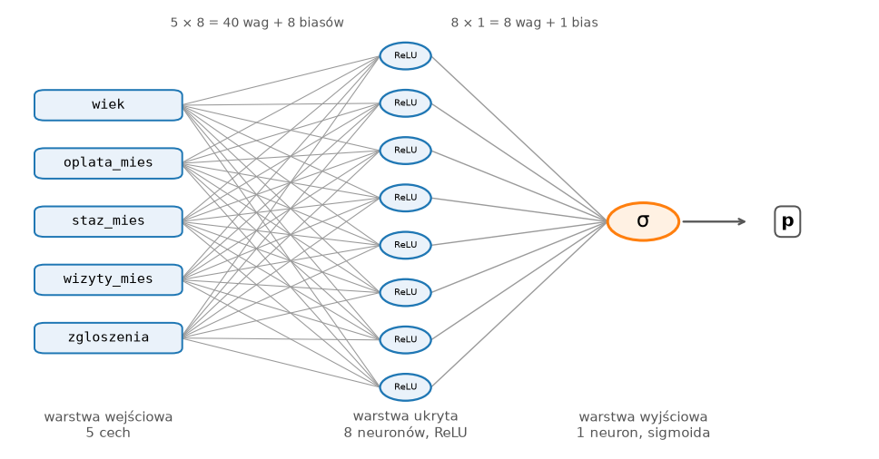
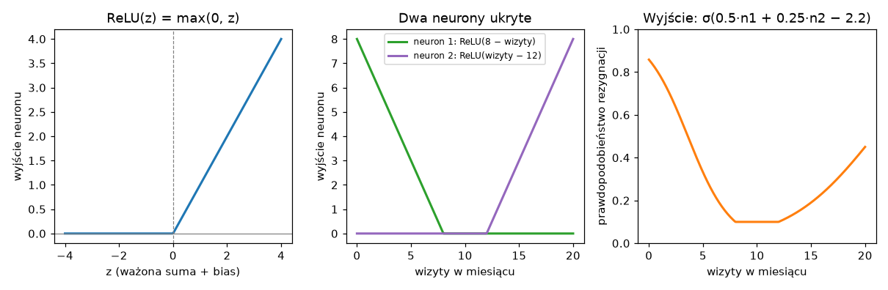
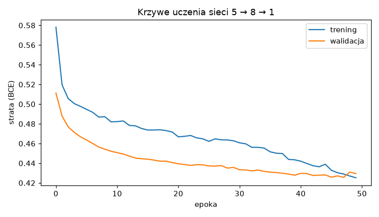
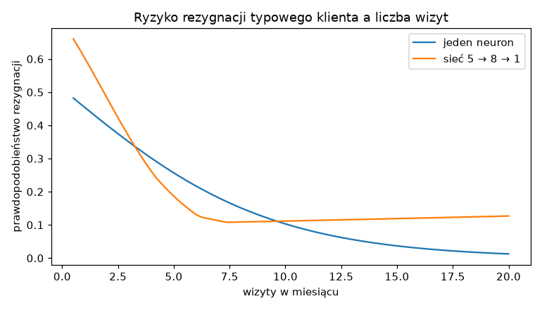
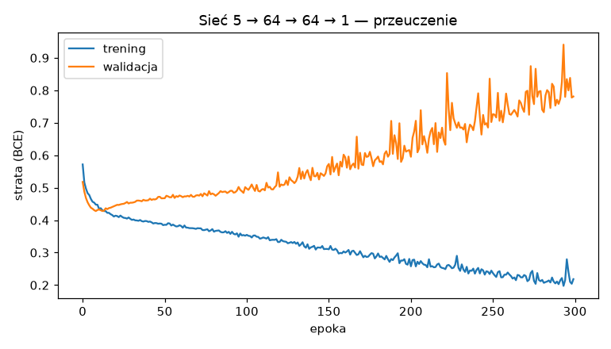

# Zajęcia 5

## Sieć neuronowa — warstwa ukryta i trening w paczkach

Na poprzednich zajęciach zbudowaliśmy jeden neuron i okazało się, że to po
prostu regresja logistyczna. Na koniec padło też zastrzeżenie: neuron liczy
ważoną sumę, więc umie powiedzieć tylko „im więcej X, tym większe (albo
mniejsze) ryzyko" — zawsze w tę samą stronę. Dziś pokażemy na prawdziwych
danych, że to za mało, i zrobimy to, co zapowiedzieliśmy: ułożymy neurony
w **warstwy**. Tak powstaje **sieć neuronowa** — pierwsza prawdziwa w tym
semestrze.

Przy okazji nauczymy się trenować tak, jak trenuje się duże sieci: nie na
całym zbiorze naraz, tylko w **paczkach**, i z oczami utkwionymi w dwóch
krzywych uczenia zamiast jednej.

Po dzisiejszych zajęciach będziesz w stanie:

- wskazać na danych zależność, której jeden neuron nie zapisze,
- wyjaśnić, czym jest warstwa ukryta i funkcja aktywacji ReLU — i dlaczego
  bez aktywacji kolejne warstwy nic nie dają,
- zbudować sieć gęstą w PyTorch i policzyć jej parametry,
- trenować sieć w paczkach (`DataLoader`) i odróżnić krok od epoki,
- narysować krzywą treningową i walidacyjną i rozpoznać na nich przeuczenie.

!!! tip "Przykłady z zajęć w Colabie"

    Cały materiał z tej strony jest też w gotowym notatniku — z kodem do
    uruchomienia. Otwórz go i uruchamiaj komórki po kolei, czytając materiał. Żeby zachować
    swoje zmiany, zapisz kopię: **Plik → Zapisz kopię na Dysku**.

    [](https://colab.research.google.com/github/kubzal/wsb-merito/blob/main/notebooks/semestr_zimowy_2026_27/uczenie_glebokie/zajecia_5.ipynb)

!!! info "Godzinę temu na Data Science w Pythonie"

    Budowaliśmy cechy. Dla MeritoBanku wyszło, że ważniejsza od kwoty kredytu
    i dochodu jest relacja między nimi — **obciążenie ratą** — i że ryzyko
    nie rośnie z nim równo, tylko skacze od ok. 30% dochodu. W zadaniu
    sprawdzisz, co daje więcej: większy model czy lepsza cecha.

---

## Plan na dziś

| Blok | Czas |
|---|---|
| Czego jeden neuron nie umie — na prawdziwych danych | 5 min |
| Warstwa ukryta i ReLU | 10 min |
| Sieć gęsta w PyTorch | 7 min |
| Trening w paczkach — krok i epoka | 10 min |
| Sieć kontra neuron | 5 min |
| Krzywa walidacyjna i przeuczenie | 5 min |
| Ściągawka | 3 min |
| **Zadanie 5** | **45 min** |

---

## Czego jeden neuron nie umie

### Dane — tym razem trzy zbiory

Znowu siłownia i te same pięć cech. Nowość: oprócz zbioru treningowego
i testowego wydzielamy **zbiór walidacyjny** — 20% danych treningowych, na
których będziemy podglądać sieć **w trakcie** treningu. Test zostaje nietknięty
do samego końca, jak na zajęciach 2.

```python
import numpy as np
import pandas as pd
import matplotlib.pyplot as plt
from sklearn.model_selection import train_test_split
from sklearn.preprocessing import StandardScaler

URL = "https://kubzal.github.io/wsb-merito/semestr_zimowy_2026_27/uczenie_glebokie/dane/silownia_czyste.csv"
df = pd.read_csv(URL)

cechy = ["wiek", "oplata_mies", "staz_mies", "wizyty_mies", "zgloszenia"]
X = df[cechy]
y = df["zrezygnowal"]

X_train, X_test, y_train, y_test = train_test_split(
    X, y, test_size=0.2, random_state=42, stratify=y
)
X_tr, X_val, y_tr, y_val = train_test_split(
    X_train, y_train, test_size=0.2, random_state=42, stratify=y_train
)
print("trening:", len(X_tr), " walidacja:", len(X_val), " test:", len(X_test))

scaler = StandardScaler()
X_tr_s = scaler.fit_transform(X_tr)
X_val_s = scaler.transform(X_val)
X_test_s = scaler.transform(X_test)
```

```text
trening: 949  walidacja: 238  test: 297
```

Skaler uczy się **tylko** na zbiorze treningowym — walidacja i test są tylko
przekształcane. To ta sama zasada co przy wycieku danych z zajęć 3.

### Zapaleńcy się wypalają

Na końcu poprzednich zajęć rzuciliśmy hipotezę: a gdyby klienci z bardzo dużą
liczbą wizyt też częściej rezygnowali? Sprawdźmy:

```python
przedzialy = pd.cut(df["wizyty_mies"], bins=[0, 2, 4, 6, 8, 10, 15, 25])
df.groupby(przedzialy, observed=True)["zrezygnowal"].agg(["count", "mean"]).round(2)
```

```text
             count  mean
wizyty_mies             
(0, 2]         104  0.54
(2, 4]         341  0.38
(4, 6]         325  0.23
(6, 8]         274  0.11
(8, 10]        197  0.10
(10, 15]       196  0.16
(15, 25]        47  0.17
```

Odsetek rezygnacji spada z każdą wizytą — do ok. 10% przy 6–10 wizytach
w miesiącu. Ale potem **przestaje spadać**, a nawet lekko rośnie: wśród
klientów, którzy przychodzą ponad 10 razy w miesiącu, odchodzi 16–17%.

Jeden neuron tego nie zapisze. Ma dla wizyt jedną wagę — ujemną — więc
zawsze mówi „więcej wizyt, mniejsze ryzyko", aż do zera. Dla klienta
z 20 wizytami da ryzyko bliskie 0%, choć w danych jest 17%. Potrzebujemy
modelu, który umie **zgiąć** krzywą.

---

## Warstwa ukryta

### Kilka neuronów zamiast jednego

Pomysł jest prosty: zamiast od razu liczyć wynik, najpierw puszczamy cechy
przez **kilka neuronów naraz**. Każdy z nich liczy własną ważoną sumę
z własnymi wagami — każdy może więc „zauważyć" coś innego. Ich wyniki trafiają
do ostatniego neuronu, który liczy z nich prawdopodobieństwo.



- **Warstwa wejściowa** to po prostu cechy — tu 5 liczb. Nic w niej nie
  liczymy.
- **Warstwa ukryta** to 8 neuronów. „Ukryta", bo jej wyników nikt nie ogląda —
  to obliczenia pośrednie. Każdy neuron jest połączony z **każdą** cechą.
- **Warstwa wyjściowa** to jeden neuron z sigmoidą — ten sam, który znasz
  z zajęć 4, tyle że jego wejściami są wyniki warstwy ukrytej, a nie cechy.

Taka sieć, w której każdy neuron jednej warstwy jest połączony z każdym
neuronem następnej, to **sieć gęsta** (*dense*, *fully connected*), zwana też
**perceptronem wielowarstwowym** (*multilayer perceptron*, MLP). Zapisujemy ją
skrótem **5 → 8 → 1**. Kiedy warstw ukrytych jest kilka, mówimy o sieci
**głębokiej** — stąd nazwa naszego przedmiotu.

### ReLU — po co aktywacja w środku

W neuronach warstwy ukrytej nie używa się zwykle sigmoidy, tylko dużo
prostszej funkcji **ReLU** (*rectified linear unit*):

> ReLU(z) = max(0, z) — liczby ujemne zamienia na zero, dodatnie zostawia bez
> zmian.

Brzmi niewinnie, ale to ona robi całą robotę. Spójrz, jak dwa neurony z ReLU
potrafią razem zgiąć krzywą:



- Po lewej sama ReLU: płasko, a od zera w górę.
- W środku dwa neurony ukryte, każdy z inną wagą i biasem. Pierwszy „odpala"
  przy **małej** liczbie wizyt (im mniej, tym mocniej), drugi — dopiero przy
  **bardzo dużej**. Pomiędzy oba milczą.
- Po prawej neuron wyjściowy dodaje je z wagami i przepuszcza przez sigmoidę.
  Wychodzi krzywa, która spada, leży płasko i znowu rośnie — dokładnie kształt
  z naszej tabeli, którego jeden neuron nie umiał.

Więcej neuronów ukrytych to więcej „załamań" — z odpowiednio wielu kawałków da
się złożyć dowolny kształt. Wagi i biasy, które o tym decydują, sieć znajduje
**sama** podczas treningu, tym samym spadkiem gradientu co na zajęciach 4.

!!! warning "Bez aktywacji warstwy nic nie dają"

    Gdyby usunąć ReLU, warstwa ukryta liczyłaby ważone sumy, a warstwa
    wyjściowa — ważoną sumę ważonych sum. A ważona suma ważonych sum to…
    znowu ważona suma, tylko z innymi wagami. Sieć 5 → 8 → 1 bez aktywacji
    potrafi dokładnie tyle samo co jeden neuron. Funkcja aktywacji między
    warstwami to warunek konieczny, żeby więcej warstw dawało więcej
    możliwości.

---

## Sieć gęsta w PyTorch

### Tensory

Jak na zajęciach 4 zamieniamy dane na tensory — tym razem trzy zestawy:

```python
import torch
from torch import nn

X_tr_t = torch.tensor(X_tr_s, dtype=torch.float32)
X_val_t = torch.tensor(X_val_s, dtype=torch.float32)
X_test_t = torch.tensor(X_test_s, dtype=torch.float32)

y_tr_t = torch.tensor(y_tr.values, dtype=torch.float32).view(-1, 1)
y_val_t = torch.tensor(y_val.values, dtype=torch.float32).view(-1, 1)
```

Etykiet testowych nie zamieniamy — do metryk ze scikit-learn wystarczy zwykłe
`y_test`.

### Model

Sieć 5 → 8 → 1 to cztery kroki w `nn.Sequential`:

```python
torch.manual_seed(42)

siec = nn.Sequential(
    nn.Linear(5, 8),   # warstwa ukryta: 8 neuronów, każdy widzi 5 cech
    nn.ReLU(),         # aktywacja warstwy ukrytej
    nn.Linear(8, 1),   # warstwa wyjściowa: 1 neuron, widzi 8 wyników warstwy ukrytej
    nn.Sigmoid(),      # prawdopodobieństwo 0–1
)
siec
```

```text
Sequential(
  (0): Linear(in_features=5, out_features=8, bias=True)
  (1): ReLU()
  (2): Linear(in_features=8, out_features=1, bias=True)
  (3): Sigmoid()
)
```

Porównaj z neuronem z zajęć 4 — `nn.Sequential(nn.Linear(5, 1), nn.Sigmoid())`.
Doszły dwie linijki w środku. Zasada jest jedna: **liczba wyjść jednej warstwy
`Linear` = liczba wejść następnej** (tu 8 i 8).

### Ile sieć ma parametrów

Parametry to wszystkie wagi i biasy, których sieć się uczy:

```python
for nazwa, p in siec.named_parameters():
    print(nazwa, tuple(p.shape))

print("razem:", sum(p.numel() for p in siec.parameters()))
```

```text
0.weight (8, 5)
0.bias (8,)
2.weight (1, 8)
2.bias (1,)
razem: 57
```

Policzmy na palcach:

| Warstwa | Wagi | Biasy | Razem |
|---|---|---|---|
| `Linear(5, 8)` | 5 × 8 = 40 (każdy z 8 neuronów ma wagę dla każdej z 5 cech) | 8 | 48 |
| `Linear(8, 1)` | 8 × 1 = 8 | 1 | 9 |
| **sieć** | | | **57** |

Jeden neuron miał 6 parametrów, sieć ma 57. `ReLU` i `Sigmoid` nie mają
żadnych — to stałe funkcje. Ogólnie: warstwa `Linear(a, b)` ma
**a × b + b** parametrów.

---

## Trening w paczkach

### Krok i epoka

Na zajęciach 4 każdy krok spadku gradientu liczyliśmy na **wszystkich**
klientach naraz. Przy tysiącu klientów to działa. Przy milionie zdjęć — nie:
nie zmieszczą się w pamięci karty graficznej, a jeden krok trwałby wieki.

Dlatego sieci trenuje się w **paczkach** (*mini-batch*): bierzemy 32 losowych
klientów, liczymy stratę i gradient tylko na nich, robimy krok — i bierzemy
następnych 32. Gradient z 32 przykładów jest trochę „zaszumiony", ale za to
kroków jest dużo więcej i są szybkie. W praktyce sieć uczy się tak szybciej.

- **krok** — jedna paczka: przewidywania, strata, gradient, poprawka wag,
- **epoka** — jedno przejście przez cały zbiór treningowy, czyli tyle kroków,
  ile jest paczek.

Paczki kroi za nas `DataLoader`:

```python
from torch.utils.data import TensorDataset, DataLoader

paczki = DataLoader(TensorDataset(X_tr_t, y_tr_t), batch_size=32, shuffle=True)

xb, yb = next(iter(paczki))
print("jedna paczka:", tuple(xb.shape), tuple(yb.shape))
print("paczek w epoce:", len(paczki))
```

```text
jedna paczka: (32, 5) (32, 1)
paczek w epoce: 30
```

- `TensorDataset(X, y)` skleja cechy z etykietami, żeby paczka zawsze miała
  pasujące do siebie wiersze.
- `batch_size=32` — wielkość paczki. 32 to bardzo typowa wartość.
- `shuffle=True` — w każdej epoce paczki są losowane od nowa, żeby sieć nie
  uczyła się w kółko tej samej kolejności.
- 949 klientów / 32 = 29.7, więc w epoce jest 30 paczek (ostatnia mniejsza).

### Pętla treningowa w paczkach

Pięć kroków z zajęć 4 zostaje bez zmian. Dochodzi tylko druga, wewnętrzna
pętla — po paczkach — i sprawdzian na walidacji po każdej epoce:

```python
funkcja_straty = nn.BCELoss()
optymalizator = torch.optim.SGD(siec.parameters(), lr=0.1)

historia_tr, historia_val = [], []
for epoka in range(50):
    suma = 0
    for xb, yb in paczki:                          # jedna paczka = jeden krok
        optymalizator.zero_grad()
        strata = funkcja_straty(siec(xb), yb)
        strata.backward()
        optymalizator.step()
        suma += strata.item()
    historia_tr.append(suma / len(paczki))         # średnia strata w epoce

    with torch.no_grad():                          # po epoce: sprawdzian na walidacji
        historia_val.append(funkcja_straty(siec(X_val_t), y_val_t).item())

print("strata treningowa:", round(historia_tr[-1], 3), " walidacyjna:", round(historia_val[-1], 3))
```

```text
strata treningowa: 0.425  walidacyjna: 0.43
```

50 epok × 30 paczek = 1500 kroków. Na zajęciach 4 przez 200 epok zrobiliśmy
200 kroków.

```python
plt.plot(historia_tr, label="trening")
plt.plot(historia_val, label="walidacja")
plt.legend()
plt.title("Krzywe uczenia sieci 5 → 8 → 1")
plt.xlabel("epoka")
plt.ylabel("strata (BCE)")
```



Dwie krzywe, dwie informacje:

- **treningowa** — jak dobrze sieć radzi sobie z danymi, na których się uczy,
- **walidacyjna** — jak dobrze radzi sobie z danymi, których **nie widziała**.
  To jest ta, która nas naprawdę obchodzi.

Obie spadają — sieć nauczyła się czegoś, co działa też na nowych klientach.
Walidacyjna leży nawet trochę niżej niż treningowa. To nic dziwnego: strata
treningowa to średnia z całej epoki, w trakcie której sieć dopiero się
poprawiała, a walidacja to tylko 238 osób, akurat trochę łatwiejszych.
Ważne, że obie idą w dół razem.

!!! note "Dlaczego krzywa treningowa skacze?"

    Każda epoka to inne losowanie paczek, a każdy krok — gradient tylko z 32
    osób. Strata treningowa nie spada więc idealnie gładko, jak na zajęciach 4.
    To normalne i nie ma się czym martwić, dopóki ogólny kierunek jest w dół.

### Pętla w funkcji

Ta sama pętla przyda się nam jeszcze kilka razy, więc zamykamy ją w funkcji.
Dostaje model i dane, zwraca obie historie:

```python
def trenuj(model, X_tr_t, y_tr_t, X_val_t, y_val_t, epoki=50, lr=0.1):
    paczki = DataLoader(TensorDataset(X_tr_t, y_tr_t), batch_size=32, shuffle=True)
    funkcja_straty = nn.BCELoss()
    optymalizator = torch.optim.SGD(model.parameters(), lr=lr)

    historia_tr, historia_val = [], []
    for epoka in range(epoki):
        suma = 0
        for xb, yb in paczki:
            optymalizator.zero_grad()
            strata = funkcja_straty(model(xb), yb)
            strata.backward()
            optymalizator.step()
            suma += strata.item()
        historia_tr.append(suma / len(paczki))
        with torch.no_grad():
            historia_val.append(funkcja_straty(model(X_val_t), y_val_t).item())
    return historia_tr, historia_val
```

---

## Sieć kontra neuron

### Wyniki na teście

Trenujemy jeden neuron dokładnie tak samo — te same paczki, ten sam
współczynnik uczenia, te same 50 epok:

```python
torch.manual_seed(42)
neuron = nn.Sequential(nn.Linear(5, 1), nn.Sigmoid())
historia_neuron = trenuj(neuron, X_tr_t, y_tr_t, X_val_t, y_val_t)
```

I porównujemy oba modele na zbiorze testowym. Krótka funkcja liczy stratę
logarytmiczną (z zajęć 4) i F1 (z zajęć 2):

```python
from sklearn.metrics import log_loss, f1_score

def ocen(model, X_t, y):
    with torch.no_grad():
        p = model(X_t).numpy().ravel()
    return round(log_loss(y, p), 3), round(f1_score(y, (p > 0.5).astype(int)), 3)

print("jeden neuron   strata, F1:", ocen(neuron, X_test_t, y_test))
print("sieć 5 → 8 → 1 strata, F1:", ocen(siec, X_test_t, y_test))
```

```text
jeden neuron   strata, F1: (0.463, 0.485)
sieć 5 → 8 → 1 strata, F1: (0.42, 0.632)
```

Sieć wygrywa wyraźnie — i na stracie, i na F1. To pierwsze w tym semestrze
porównanie, w którym coś pokonało regresję logistyczną.

### Co sieć zauważyła

Zobaczmy dlaczego. Weźmy „typowego klienta" — medianę każdej cechy — i
zmieniajmy mu tylko liczbę wizyt od 0.5 do 20. Dla każdej wartości pytamy oba
modele o ryzyko rezygnacji:

```python
wizyty = np.linspace(0.5, 20, 100)
typowy = pd.DataFrame([X_tr.median()] * len(wizyty))
typowy["wizyty_mies"] = wizyty
typowy_t = torch.tensor(scaler.transform(typowy), dtype=torch.float32)

with torch.no_grad():
    p_neuron = neuron(typowy_t).numpy().ravel()
    p_siec = siec(typowy_t).numpy().ravel()

plt.plot(wizyty, p_neuron, label="jeden neuron")
plt.plot(wizyty, p_siec, label="sieć 5 → 8 → 1")
plt.legend()
plt.title("Ryzyko rezygnacji typowego klienta a liczba wizyt")
plt.xlabel("wizyty w miesiącu")
plt.ylabel("prawdopodobieństwo rezygnacji")
```



Neuron rysuje swoją jedyną możliwą krzywą — gładki kawałek litery S, który
schodzi do zera. Sieć nauczyła się, że powyżej ok. 7 wizyt ryzyko **przestaje
spadać**, a potem nawet lekko rośnie — tak jak w tabeli z początku zajęć.
Nikt jej tego nie powiedział — znalazła to w danych sama, dobierając wagi
8 neuronów ukrytych.

!!! note "Sieć sama buduje cechy"

    Godzinę temu na DS w Pythonie budowałeś cechy ręcznie — flagę „nowy
    klient", koszt wizyty. Neurony warstwy ukrytej robią coś podobnego
    automatycznie: każdy uczy się jakiejś pośredniej cechy, z której neuron
    wyjściowy liczy wynik. Dlatego sieci tak dobrze radzą sobie z obrazami
    i tekstem, gdzie ręcznie cech zbudować się nie da. Czy to znaczy, że
    feature engineering nie jest już potrzebny? Sprawdzisz w zadaniu.

---

## Krzywa walidacyjna i przeuczenie

Skoro 8 neuronów pomogło, to może 64 — i to w dwóch warstwach — pomogą
jeszcze bardziej? Zbudujmy naszą pierwszą sieć **głęboką**, 5 → 64 → 64 → 1,
i potrenujmy ją dłużej:

```python
torch.manual_seed(42)
duza = nn.Sequential(
    nn.Linear(5, 64), nn.ReLU(),
    nn.Linear(64, 64), nn.ReLU(),
    nn.Linear(64, 1), nn.Sigmoid(),
)
print("parametrów:", sum(p.numel() for p in duza.parameters()))

historia_tr, historia_val = trenuj(duza, X_tr_t, y_tr_t, X_val_t, y_val_t, epoki=300)
print("najniższa strata walidacyjna w epoce:", np.argmin(historia_val))
print("duża sieć      strata, F1:", ocen(duza, X_test_t, y_test))
```

```text
parametrów: 4609
najniższa strata walidacyjna w epoce: 8
duża sieć      strata, F1: (0.621, 0.535)
```

```python
plt.plot(historia_tr, label="trening")
plt.plot(historia_val, label="walidacja")
plt.legend()
plt.title("Sieć 5 → 64 → 64 → 1 — przeuczenie")
plt.xlabel("epoka")
plt.ylabel("strata (BCE)")
```



To jest najważniejszy wykres dzisiejszych zajęć. Przez pierwszych kilka epok
obie krzywe spadają razem. Potem się **rozjeżdżają**: strata treningowa leci
w dół, a walidacyjna zawraca i rośnie. Sieć z ponad czterema tysiącami
parametrów i tylko 949 klientami do nauki zaczęła się uczyć **na pamięć** —
łącznie z szumem, czyli klientami, którzy odeszli bez widocznego powodu.
Na teście ma stratę gorszą niż mała sieć, a nawet gorszą niż jeden neuron.

To samo **przeuczenie**, które na zajęciach 2 widziałeś przy głębokim
drzewie, tylko teraz widać je epoka po epoce. I od razu widać najprostsze
lekarstwo: przerwać trening tam, gdzie krzywa walidacyjna była najniżej.
Do tego i do innych sposobów — regularyzacji — wrócimy na następnych
zajęciach.

!!! tip "Jak czytać dwie krzywe"

    | Co widzisz | Co to znaczy | Co zrobić |
    |---|---|---|
    | obie spadają i się wypłaszczają | dobrze | nic, może dłużej trenować |
    | obie wysoko i płasko | niedouczenie — model za słaby | większa sieć, lepsze cechy |
    | treningowa spada, walidacyjna rośnie | przeuczenie | mniejsza sieć, krótszy trening, regularyzacja |

---

## Ściągawka

| Chcę… | Kod |
|---|---|
| wydzielić zbiór walidacyjny | `train_test_split(X_train, y_train, test_size=0.2, random_state=42, stratify=y_train)` |
| sieć z jedną warstwą ukrytą | `nn.Sequential(nn.Linear(5, 8), nn.ReLU(), nn.Linear(8, 1), nn.Sigmoid())` |
| sieć z dwiema warstwami ukrytymi | `nn.Sequential(nn.Linear(5, 64), nn.ReLU(), nn.Linear(64, 64), nn.ReLU(), nn.Linear(64, 1), nn.Sigmoid())` |
| liczba parametrów | `sum(p.numel() for p in model.parameters())` |
| parametry warstwy `Linear(a, b)` | a × b wag + b biasów |
| kształty parametrów | `for nazwa, p in model.named_parameters(): print(nazwa, p.shape)` |
| paczki danych | `DataLoader(TensorDataset(X_t, y_t), batch_size=32, shuffle=True)` |
| liczba paczek w epoce | `len(paczki)` |
| pętla w paczkach | `for epoka in ...:` → `for xb, yb in paczki:` → 5 kroków z zajęć 4 |
| strata walidacyjna po epoce | `with torch.no_grad(): funkcja_straty(model(X_val_t), y_val_t).item()` |
| trening jedną linijką | `historia_tr, historia_val = trenuj(model, X_tr_t, y_tr_t, X_val_t, y_val_t)` |
| ocena na teście | `ocen(model, X_test_t, y_test)` → (strata, F1) |
| epoka z najniższą stratą walidacyjną | `np.argmin(historia_val)` |

---

## Zadanie 5 — Większy model czy lepsza cecha? (6 pkt)

**Czas:** maks. 45 minut
**Środowisko:** Google Colab
**Oddanie:** notatnik `.ipynb` na Moodle

Neuron z zajęć 4 ocenia wnioski kredytowe MeritoBanku. Zespół IT proponuje
zastąpić go siecią neuronową. Analitycy ryzyka twierdzą, że zamiast tego
wystarczy dorzucić do neuronu cechy, które przygotowałeś godzinę temu na DS
w Pythonie — z obciążeniem ratą na czele. Masz rozstrzygnąć ten spór
liczbami.

Na początku notatnika wpisz swój numer albumu — od niego zależy wielkość
warstwy ukrytej Twojej sieci. Komórka startowa liczy cechy z DS w Pythonie
i przygotowuje dane — funkcja `przygotuj` zwraca tensory treningowe
i walidacyjne, tensor testowy i `y_test`:

```python
import numpy as np
import pandas as pd
import matplotlib.pyplot as plt
import torch
from torch import nn
from torch.utils.data import TensorDataset, DataLoader
from sklearn.model_selection import train_test_split
from sklearn.preprocessing import StandardScaler
from sklearn.metrics import log_loss, f1_score

NR_ALBUMU = 123456   # ← wpisz swój numer albumu
MOJE_H = [4, 8, 16, 32][NR_ALBUMU % 4]
print("Neuronów w warstwie ukrytej:", MOJE_H)

URL = "https://kubzal.github.io/wsb-merito/semestr_zimowy_2026_27/data_science_w_pythonie/dane/kredyty_2026.csv"
df = pd.read_csv(URL)

# cechy z DS w Pythonie (zadanie 5)
df["rata"] = df["kwota_kredytu"] / df["okres_mies"]
df["obciazenie"] = df["rata"] / df["dochod_mies"]
df["mial_opoznienia"] = (df["opoznienia_12m"] > 0).astype(int)
df = pd.concat([df, pd.get_dummies(df["cel_kredytu"], prefix="cel", dtype=int)], axis=1)

cechy_surowe = ["wiek", "dochod_mies", "staz_pracy_lat", "kwota_kredytu",
                "okres_mies", "inne_kredyty", "opoznienia_12m"]
cechy_ds = cechy_surowe + ["rata", "obciazenie", "mial_opoznienia", "cel_gotówkowy",
                           "cel_konsolidacyjny", "cel_remont", "cel_samochodowy"]


def przygotuj(cechy):
    X_train, X_test, y_train, y_test = train_test_split(
        df[cechy], df["niesplacony"], test_size=0.2, random_state=42, stratify=df["niesplacony"])
    X_tr, X_val, y_tr, y_val = train_test_split(
        X_train, y_train, test_size=0.2, random_state=42, stratify=y_train)
    scaler = StandardScaler().fit(X_tr)
    X_t = lambda X: torch.tensor(scaler.transform(X), dtype=torch.float32)
    y_t = lambda y: torch.tensor(y.values, dtype=torch.float32).view(-1, 1)
    return X_t(X_tr), y_t(y_tr), X_t(X_val), y_t(y_val), X_t(X_test), y_test


X_tr_t, y_tr_t, X_val_t, y_val_t, X_test_t, y_test = przygotuj(cechy_surowe)
print(X_tr_t.shape, X_val_t.shape, X_test_t.shape)
```

Do notatnika skopiuj też z notatek funkcje `trenuj` i `ocen`.

Rób części po kolei i **pokaż mi wynik każdej części, gdy będzie gotowa**.

### Część 1 — sieć na surowych cechach (ok. 20 min)

1. Zbuduj sieć 7 → `MOJE_H` → 1 (ReLU w warstwie ukrytej, sigmoida na
   wyjściu, `torch.manual_seed(42)` przed budową). W komórce tekstowej policz
   ręcznie, ile ma parametrów, i sprawdź wynik kodem.
2. Wytrenuj ją funkcją `trenuj` przez **100 epok** (`lr=0.1`) i narysuj krzywą
   treningową i walidacyjną na jednym wykresie. W komórce tekstowej: w której
   epoce strata walidacyjna była najniższa? Czy pod koniec treningu sieć się
   przeucza — po czym to widać?
3. Wytrenuj tak samo (seed, 100 epok, `lr=0.1`) jeden neuron na tych samych
   7 cechach. Porównaj oba modele na teście funkcją `ocen`. Czy sieć wygrała
   z neuronem?

### Część 2 — a może lepsze cechy? (ok. 25 min)

1. Przygotuj dane na 14 cechach z DS w Pythonie (`przygotuj(cechy_ds)`)
   i wytrenuj na nich od nowa neuron i sieć z `MOJE_H` neuronami ukrytymi —
   tak samo jak w części 1 (pamiętaj, że liczba wejść się zmieniła).
2. Zestaw wyniki wszystkich czterech modeli w jednej tabeli: neuron i sieć ×
   surowe cechy i cechy z DS, kolumny — strata i F1 na teście. Narysuj krzywą
   treningową i walidacyjną sieci na 14 cechach.
3. W komórce tekstowej napisz 2–3 zdania do zespołu IT i analityków: co dało
   większą poprawę względem neuronu na surowych cechach — sieć czy lepsze
   cechy? Czy sieć na 14 cechach pobiła neuron na 14 cechach? Jak myślisz,
   dlaczego tak wyszło? (Podpowiedź: ilu klientów ma sieć do nauki, a ile ma
   parametrów?)

### Wskazówki

- Parametry warstwy `Linear(a, b)` to a × b wag + b biasów — przykład
  z sekcji „Ile sieć ma parametrów".
- Trening i wykres to jedna linijka i pięć linijek:
  `historia_tr, historia_val = trenuj(siec, X_tr_t, y_tr_t, X_val_t, y_val_t, epoki=100)`,
  potem dwa razy `plt.plot` jak w notatkach. Każdy wykres ma mieć tytuł
  i podpisane osie.
- Epoka z najniższą stratą walidacyjną: `np.argmin(historia_val)`.
- Przed **każdym** budowaniem modelu `torch.manual_seed(42)` — wtedy wyniki
  da się porównać i powtórzyć.
- W części 2 najpierw `X_tr_t, y_tr_t, X_val_t, y_val_t, X_test_t, y_test = przygotuj(cechy_ds)`,
  a w modelach `nn.Linear(14, ...)` zamiast `nn.Linear(7, ...)`.
- Wyniki z części 1 zapisz w zmiennych, zanim nadpiszesz dane w części 2 —
  np. `wynik_siec_surowe = ocen(siec, X_test_t, y_test)`.
- Tabela z czterema wynikami: `pd.DataFrame` ze słownika albo z listy
  wierszy, jak w zadaniu 3.
- Niższa strata = lepiej, wyższe F1 = lepiej. Różnice na trzecim miejscu po
  przecinku to szum — nie wyciągaj z nich wniosków.

### Punktacja (6 pkt)

| Punkty | Za co |
|---|---|
| **6 pkt** | obie części zrobione **na zajęciach** i pokazane prowadzącemu |
| **4 pkt** | jedna z dwóch części zrobiona na zajęciach |
| **2 pkt** | zadanie dokończone po zajęciach i wysłane na Moodle **w terminie** |
| **0 pkt** | brak rozwiązania albo wysłane po terminie |

Termin przesłania na Moodle: **dzień przed kolejnymi zajęciami**.

!!! danger "Serio, róbcie to na zajęciach"

    Te same 45 minut pracy jest warte 6 pkt tu i teraz albo 2 pkt w domu. Przez
    cały semestr robi to różnicę 32 punktów, czyli całej oceny w górę lub w dół.
