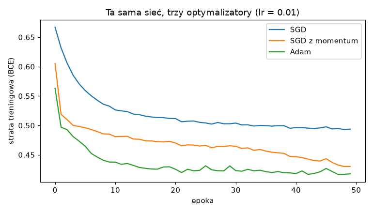
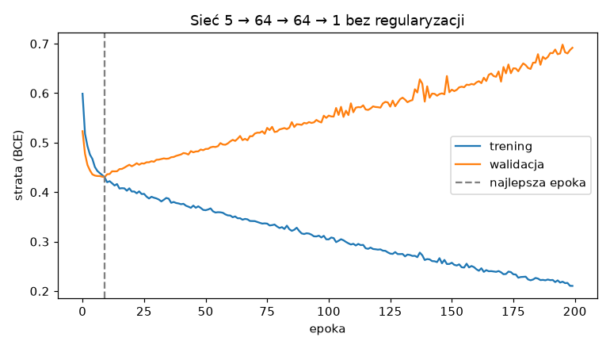
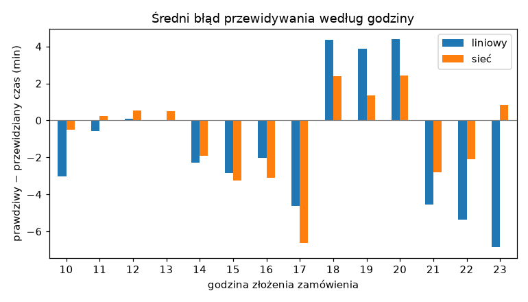

# Zajęcia 6

## Trening w praktyce — optymalizatory, regularyzacja i funkcje straty

Na poprzednich zajęciach zostawiliśmy dwa problemy. Pierwszy: duża sieć
5 → 64 → 64 → 1 nauczyła się danych na pamięć i na teście wypadła gorzej niż
jeden neuron. Drugi, mniej widoczny: zwykły spadek gradientu (SGD) jest
powolny i bardzo czuły na współczynnik uczenia. Dziś naprawiamy oba. Poznasz
trzy pokrętła, które ustawia każdy, kto trenuje sieci: **optymalizator**,
**regularyzację** i **funkcję straty**.

Przy funkcji straty wyjdziemy wreszcie poza klasyfikację. Sieć nie musi
odpowiadać „tak/nie" — może przewidywać **liczbę**. Na danych MeritoEats
z dzisiejszych zajęć z DS w Pythonie zbudujemy sieć, która przewiduje, ile
minut potrwa dostawa.

Po dzisiejszych zajęciach będziesz w stanie:

- porównać SGD, SGD z momentum i Adam i wybrać rozsądny punkt startu,
- zatrzymać trening we właściwym momencie i odzyskać najlepsze wagi
  (wczesne zatrzymanie),
- zastosować weight decay i dropout i wyjaśnić, dlaczego działają,
- pamiętać o `model.train()` i `model.eval()`,
- dobrać ostatnią warstwę i funkcję straty do zadania — klasyfikacji albo
  regresji,
- zbudować sieć do regresji w PyTorch i ocenić ją średnim błędem w minutach.

!!! tip "Przykłady z zajęć w Colabie"

    Cały materiał z tej strony jest też w gotowym notatniku — z kodem do
    uruchomienia. Otwórz go i uruchamiaj komórki po kolei, czytając materiał. Żeby zachować
    swoje zmiany, zapisz kopię: **Plik → Zapisz kopię na Dysku**.

    [](https://colab.research.google.com/github/kubzal/wsb-merito/blob/main/notebooks/semestr_zimowy_2026_27/uczenie_glebokie/zajecia_6.ipynb)

!!! info "Godzinę temu na Data Science w Pythonie"

    Robiliśmy mini-projekt dla MeritoEats. Wyszło, że oceny spadają nie przez
    długie dostawy, tylko przez **niedotrzymane obietnice**, a aplikacja
    obiecuje ten sam czas o 15:00 i o 19:00. Dziś sprawdzimy, czy sieć
    neuronowa przewidzi czas dostawy lepiej niż wzór, którego używa aplikacja.

---

## Plan na dziś

| Blok | Czas |
|---|---|
| Nowa wersja funkcji `trenuj` | 3 min |
| Optymalizatory — SGD, momentum, Adam | 8 min |
| Wczesne zatrzymanie | 7 min |
| Weight decay i dropout | 10 min |
| Funkcje straty — klasyfikacja i regresja | 5 min |
| Sieć do regresji — czas dostawy | 10 min |
| Ściągawka | 2 min |
| **Zadanie 6** | **45 min** |

---

## Przygotowanie

### Dane

Pierwsza część zajęć to znowu siłownia — te same trzy zbiory co na
zajęciach 5:

```python
import copy
import numpy as np
import pandas as pd
import matplotlib.pyplot as plt
import torch
from torch import nn
from torch.utils.data import TensorDataset, DataLoader
from sklearn.model_selection import train_test_split
from sklearn.preprocessing import StandardScaler
from sklearn.metrics import log_loss, f1_score, mean_absolute_error

URL = "https://kubzal.github.io/wsb-merito/semestr_zimowy_2026_27/uczenie_glebokie/dane/silownia_czyste.csv"
df = pd.read_csv(URL)

cechy = ["wiek", "oplata_mies", "staz_mies", "wizyty_mies", "zgloszenia"]
X_train, X_test, y_train, y_test = train_test_split(
    df[cechy], df["zrezygnowal"], test_size=0.2, random_state=42, stratify=df["zrezygnowal"])
X_tr, X_val, y_tr, y_val = train_test_split(
    X_train, y_train, test_size=0.2, random_state=42, stratify=y_train)

scaler = StandardScaler().fit(X_tr)
X_tr_t = torch.tensor(scaler.transform(X_tr), dtype=torch.float32)
X_val_t = torch.tensor(scaler.transform(X_val), dtype=torch.float32)
X_test_t = torch.tensor(scaler.transform(X_test), dtype=torch.float32)
y_tr_t = torch.tensor(y_tr.values, dtype=torch.float32).view(-1, 1)
y_val_t = torch.tensor(y_val.values, dtype=torch.float32).view(-1, 1)

dane = (X_tr_t, y_tr_t, X_val_t, y_val_t)
```

`dane` to po prostu cztery tensory spakowane razem, żeby nie przepisywać ich
przy każdym wywołaniu.

### Nowa wersja funkcji `trenuj`

Funkcja z zajęć 5 sama tworzyła optymalizator i stratę. Dziś będziemy je
zmieniać, więc podajemy je z zewnątrz. Dochodzą też dwie rzeczy, które
wyjaśnimy za chwilę — oznaczone w komentarzach:

```python
def trenuj(model, dane, funkcja_straty, optymalizator, epoki=100, cierpliwosc=None):
    X_tr_t, y_tr_t, X_val_t, y_val_t = dane
    paczki = DataLoader(TensorDataset(X_tr_t, y_tr_t), batch_size=32, shuffle=True)

    historia_tr, historia_val = [], []
    najlepsza_strata, najlepsze_wagi, bez_poprawy = float("inf"), None, 0
    for epoka in range(epoki):
        model.train()                                   # tryb treningu (dropout)
        suma = 0
        for xb, yb in paczki:
            optymalizator.zero_grad()
            strata = funkcja_straty(model(xb), yb)
            strata.backward()
            optymalizator.step()
            suma += strata.item()
        historia_tr.append(suma / len(paczki))

        model.eval()                                    # tryb oceny (dropout)
        with torch.no_grad():
            strata_val = funkcja_straty(model(X_val_t), y_val_t).item()
        historia_val.append(strata_val)

        if strata_val < najlepsza_strata:               # wczesne zatrzymanie
            najlepsza_strata, bez_poprawy = strata_val, 0
            najlepsze_wagi = copy.deepcopy(model.state_dict())
        else:
            bez_poprawy += 1
            if cierpliwosc is not None and bez_poprawy >= cierpliwosc:
                break

    if cierpliwosc is not None:
        model.load_state_dict(najlepsze_wagi)           # wracamy do najlepszej epoki
    return historia_tr, historia_val


def ocen(model, X_t, y):
    model.eval()
    with torch.no_grad():
        p = model(X_t).numpy().ravel()
    return round(log_loss(y, p), 3), round(f1_score(y, (p > 0.5).astype(int)), 3)
```

Środek — pięć kroków w pętli po paczkach — jest dokładnie taki jak na
zajęciach 5.

---

## Optymalizatory

### SGD, momentum i Adam

Optymalizator to „ten, który robi kroki" — decyduje, jak na podstawie
gradientu zmienić wagi. Do tej pory używaliśmy najprostszego, **SGD**: krok =
współczynnik uczenia × gradient. Wytrenujmy tę samą sieć 5 → 8 → 1 trzema
optymalizatorami, z tym samym `lr=0.01`:

```python
for nazwa in ["SGD", "SGD z momentum", "Adam"]:
    torch.manual_seed(42)
    siec = nn.Sequential(nn.Linear(5, 8), nn.ReLU(), nn.Linear(8, 1), nn.Sigmoid())

    if nazwa == "SGD":
        optymalizator = torch.optim.SGD(siec.parameters(), lr=0.01)
    elif nazwa == "SGD z momentum":
        optymalizator = torch.optim.SGD(siec.parameters(), lr=0.01, momentum=0.9)
    else:
        optymalizator = torch.optim.Adam(siec.parameters(), lr=0.01)

    historia_tr, historia_val = trenuj(siec, dane, nn.BCELoss(), optymalizator, epoki=50)
    plt.plot(historia_tr, label=nazwa)
    print(f"{nazwa:15} strata po 5 epokach: {historia_tr[4]:.3f}   po 50: {historia_tr[-1]:.3f}")

plt.legend()
plt.title("Ta sama sieć, trzy optymalizatory (lr = 0.01)")
plt.xlabel("epoka")
plt.ylabel("strata treningowa (BCE)")
```

```text
SGD             strata po 5 epokach: 0.571   po 50: 0.494
SGD z momentum  strata po 5 epokach: 0.498   po 50: 0.430
Adam            strata po 5 epokach: 0.473   po 50: 0.418
```



- **SGD** z `lr=0.01` ledwo się rusza — po 50 epokach jest tam, gdzie Adam był
  po kilku. Na zajęciach 5 działał, bo daliśmy mu dziesięć razy większy krok.
- **Momentum** („pęd") dodaje do każdego kroku część poprzedniego. Wracamy do
  schodzenia z góry we mgle: zamiast stawiać każdy krok od zera, toczysz się
  jak kula — na długim, łagodnym zboczu nabierasz prędkości, a drobne nierówności
  nie zbijają Cię z kursu. `momentum=0.9` to wartość, którą prawie wszyscy
  zostawiają.
- **Adam** idzie dalej: oprócz pędu pilnuje **osobnej długości kroku dla każdej
  wagi**. Waga, której gradient jest zwykle malutki, dostaje większy krok, a ta,
  której gradient skacze — mniejszy. Dzięki temu jest dużo mniej czuły na wybór
  `lr`.

!!! tip "Od czego zacząć"

    W praktyce prawie każdy zaczyna od **Adama z `lr=0.001`** — to wartość
    domyślna w PyTorch i zwykle działa od razu. Dopiero gdy krzywa uczenia
    wygląda źle, zmieniasz `lr` kilkukrotnie w górę albo w dół. SGD z momentum
    wciąż spotkasz przy dużych sieciach do obrazów — bywa tam odrobinę lepszy,
    ale wymaga cierpliwego strojenia.

---

## Wczesne zatrzymanie

### Przeuczenie jeszcze raz

Wracamy do dużej sieci z zajęć 5 — tym razem z Adamem i przez 200 epok:

```python
def duza_siec():
    torch.manual_seed(42)
    return nn.Sequential(
        nn.Linear(5, 64), nn.ReLU(),
        nn.Linear(64, 64), nn.ReLU(),
        nn.Linear(64, 1), nn.Sigmoid(),
    )

siec = duza_siec()
optymalizator = torch.optim.Adam(siec.parameters(), lr=0.001)
historia_tr, historia_val = trenuj(siec, dane, nn.BCELoss(), optymalizator, epoki=200)

print("najniższa strata walidacyjna w epoce:", np.argmin(historia_val))
print("bez regularyzacji     strata, F1:", ocen(siec, X_test_t, y_test))
```

```text
najniższa strata walidacyjna w epoce: 9
bez regularyzacji     strata, F1: (0.594, 0.491)
```

```python
plt.plot(historia_tr, label="trening")
plt.plot(historia_val, label="walidacja")
plt.axvline(np.argmin(historia_val), color="gray", linestyle="--", label="najlepsza epoka")
plt.legend()
plt.title("Sieć 5 → 64 → 64 → 1 bez regularyzacji")
plt.xlabel("epoka")
plt.ylabel("strata (BCE)")
```



Ten sam obraz co tydzień temu: po kilku epokach krzywa walidacyjna zawraca.
Wszystko, co sieć „nauczyła się" po przerywanej linii, to zapamiętywanie szumu.

### Zatrzymaj, zanim będzie za późno

Najprostsze lekarstwo widać na wykresie: **przerwać trening, kiedy strata
walidacyjna przestaje spadać**, i wrócić do wag z najlepszej epoki. To jest
**wczesne zatrzymanie** (*early stopping*). W naszej funkcji robi je parametr
`cierpliwosc`:

- po każdej epoce sprawdzamy, czy strata walidacyjna jest najniższa
  z dotychczasowych — jeśli tak, zapamiętujemy kopię wag
  (`copy.deepcopy(model.state_dict())`),
- jeśli przez `cierpliwosc` epok z rzędu nie było poprawy — przerywamy,
- na koniec wczytujemy zapamiętane wagi (`model.load_state_dict(...)`).

Cierpliwość jest potrzebna, bo krzywa walidacyjna jest poszarpana — jedna gorsza
epoka nie znaczy jeszcze, że sieć zaczęła się przeuczać.

```python
siec = duza_siec()
optymalizator = torch.optim.Adam(siec.parameters(), lr=0.001)
historia_tr, historia_val = trenuj(siec, dane, nn.BCELoss(), optymalizator, epoki=200, cierpliwosc=10)

print("trening trwał epok:", len(historia_val), "| najlepsza:", np.argmin(historia_val))
print("wczesne zatrzymanie   strata, F1:", ocen(siec, X_test_t, y_test))
```

```text
trening trwał epok: 20 | najlepsza: 9
wczesne zatrzymanie   strata, F1: (0.431, 0.619)
```

Zamiast 200 epok — kilkanaście, a strata na teście spadła z prawie 0.6 do
ok. 0.43. Darmowa poprawa: krótszy trening i lepszy model.

!!! note "`state_dict` — wagi sieci w słowniku"

    `model.state_dict()` zwraca wszystkie wagi i biasy sieci jako słownik
    `{nazwa_warstwy: tensor}`. `copy.deepcopy` robi z niego **niezależną
    kopię** — bez tego „zapamiętane" wagi zmieniałyby się razem z siecią. Tym
    samym słownikiem zapisuje się wytrenowaną sieć do pliku:
    `torch.save(model.state_dict(), "siec.pt")`.

---

## Weight decay i dropout

Wczesne zatrzymanie przerywa trening, zanim sieć zacznie się uczyć na pamięć.
Dwie kolejne metody sprawiają, że **w ogóle trudniej jej się uczyć na pamięć**.
Wszystkie trzy nazywa się wspólnie **regularyzacją**.

### Weight decay — kara za duże wagi

Sieć, która zapamiętuje pojedynczych klientów, potrzebuje do tego
**ogromnych wag** — żeby jeden mały szczegół zmieniał wynik o 180 stopni.
**Weight decay** (dosłownie „zanik wag") w każdym kroku lekko ściąga wszystkie
wagi w stronę zera. Waga zostaje duża tylko wtedy, gdy naprawdę pomaga na
wielu przykładach. To ta sama regularyzacja, którą `LogisticRegression`
stosowała domyślnie na zajęciach 4.

W PyTorch to jeden parametr optymalizatora:

```python
siec = duza_siec()
optymalizator = torch.optim.Adam(siec.parameters(), lr=0.001, weight_decay=0.01)
historia_tr, historia_val = trenuj(siec, dane, nn.BCELoss(), optymalizator, epoki=200)

print("najniższa strata walidacyjna w epoce:", np.argmin(historia_val))
print("weight decay 0.01     strata, F1:", ocen(siec, X_test_t, y_test))
```

```text
najniższa strata walidacyjna w epoce: 96
weight decay 0.01     strata, F1: (0.414, 0.632)
```

Tym razem nie przerywaliśmy treningu, a sieć i tak się nie przeuczyła —
najlepsza epoka wypadła daleko, a nie po kilku krokach.

### Dropout — losowe wyłączanie neuronów

**Dropout** działa inaczej: w każdym kroku treningu **losowo wyłącza** część
neuronów warstwy ukrytej — np. połowę. W kolejnym kroku wyłącza inną połowę.
Sieć nie może więc polegać na żadnym pojedynczym neuronie i musi rozłożyć
wiedzę na wiele z nich. Trochę jak drużyna, w której na każdy trening
przychodzi losowa połowa zawodników — wszyscy muszą umieć grać na kilku
pozycjach.

Dropout to osobna warstwa, którą wstawia się za aktywacją:

```python
def duza_siec_dropout(p):
    torch.manual_seed(42)
    return nn.Sequential(
        nn.Linear(5, 64), nn.ReLU(), nn.Dropout(p),
        nn.Linear(64, 64), nn.ReLU(), nn.Dropout(p),
        nn.Linear(64, 1), nn.Sigmoid(),
    )

siec = duza_siec_dropout(0.5)
optymalizator = torch.optim.Adam(siec.parameters(), lr=0.001)
historia_tr, historia_val = trenuj(siec, dane, nn.BCELoss(), optymalizator, epoki=200)

print("dropout 0.5           strata, F1:", ocen(siec, X_test_t, y_test))
```

```text
dropout 0.5           strata, F1: (0.4, 0.614)
```

`nn.Dropout(0.5)` wyłącza w każdym kroku losowe 50% wyjść poprzedniej warstwy.
Typowe wartości to 0.2–0.5.

!!! warning "`model.train()` i `model.eval()`"

    Dropout ma działać **tylko w czasie treningu**. Przy ocenie i przewidywaniu
    chcemy pełnej sieci, z wszystkimi neuronami. Przełącza to
    `model.train()` (dropout włączony) i `model.eval()` (wyłączony). Nasze
    funkcje `trenuj` i `ocen` robią to same — ale jeśli kiedyś będziesz liczyć
    przewidywania „ręcznie", zacznij od `model.eval()`. Zapomniane przełączenie
    to jeden z najczęstszych błędów: wyniki są wtedy losowo gorsze i za każdym
    razem inne.

### Porównanie

| Duża sieć 5 → 64 → 64 → 1 | Strata na teście |
|---|---|
| bez regularyzacji, 200 epok | ok. 0.59 |
| wczesne zatrzymanie | ok. 0.43 |
| weight decay 0.01 | ok. 0.41 |
| dropout 0.5 | ok. 0.40 |
| *dla porównania: mała sieć 5 → 8 → 1 z zajęć 5* | *ok. 0.42* |

Każda z trzech metod naprawiła przeuczenie, a duża sieć z regularyzacją
wyszła tak dobra jak mała — albo minimalnie lepsza. W praktyce stosuje się je
razem: trochę dropoutu, trochę weight decay i zawsze wczesne zatrzymanie jako
pas bezpieczeństwa.

---

## Funkcje straty

### Strata zależy od tego, co przewidujesz

Do tej pory zawsze przewidywaliśmy **klasę** (odejdzie / nie odejdzie) —
sigmoida na końcu i strata BCE. Ale sieć może też przewidywać **liczbę**: czas
dostawy, cenę mieszkania, sprzedaż w przyszłym tygodniu. To **regresja** —
znasz ją z zajęć 2 razem z metrykami MAE i RMSE. Zmieniają się wtedy dwie
rzeczy: ostatnia warstwa i funkcja straty.

| Zadanie | Przykład | Ostatnia warstwa | Strata | Metryka dla ludzi |
|---|---|---|---|---|
| klasyfikacja binarna | odejdzie czy nie | `Linear(…, 1)` + `Sigmoid()` | `nn.BCELoss()` | F1, precision, recall |
| regresja | ile minut potrwa dostawa | `Linear(…, 1)` **bez aktywacji** | `nn.MSELoss()` albo `nn.L1Loss()` | MAE, RMSE |
| klasyfikacja wieloklasowa | która z 10 cyfr | `Linear(…, 10)` | `nn.CrossEntropyLoss()` | accuracy |

W regresji na końcu nie ma sigmoidy — ona ścisnęłaby wynik do przedziału 0–1,
a dostawa trwa 35 minut, nie 0.35. Ostatni neuron zwraca po prostu ważoną
sumę, czyli dowolną liczbę.

- **`MSELoss`** — średni **kwadrat** błędu. Pomyłka o 10 minut kosztuje 100,
  o 20 minut — 400. Mocno karze duże pomyłki.
- **`L1Loss`** — średni błąd **bez kwadratu**, czyli dokładnie MAE. Spokojniej
  traktuje pojedyncze wartości odstające.

Klasyfikacją wieloklasową zajmiemy się na zajęciach 7, przy obrazkach.

!!! note "A `BCEWithLogitsLoss`?"

    W cudzym kodzie zobaczysz zwykle `nn.BCEWithLogitsLoss()` i sieć **bez**
    sigmoidy na końcu. To to samo co sigmoida + `BCELoss`, tylko połączone
    w jedną funkcję, która liczy się dokładniej przy bardzo pewnych
    przewidywaniach (p = 0.99999). Przy takim kodzie prawdopodobieństwo
    dostajesz przez `torch.sigmoid(model(X))`. My zostajemy przy sigmoidzie
    w modelu, bo tak łatwiej czytać kod.

---

## Sieć do regresji — czas dostawy

### Dane MeritoEats

`dostawy_czyste.csv` to oba miesiące z DS w Pythonie, wyczyszczone
i połączone z restauracjami. Cechy budujemy jak na zajęciach 5 z DS
— godzina, weekend, pogoda jako flagi, kuchnia jako one-hot:

```python
URL_DOSTAWY = "https://kubzal.github.io/wsb-merito/semestr_zimowy_2026_27/uczenie_glebokie/dane/dostawy_czyste.csv"
dost = pd.read_csv(URL_DOSTAWY, parse_dates=["data_godzina"])

dost["godzina"] = dost["data_godzina"].dt.hour
dost["weekend"] = (dost["data_godzina"].dt.day_of_week >= 5).astype(int)
dost["deszcz"] = (dost["pogoda"] == "deszcz").astype(int)
dost["snieg"] = (dost["pogoda"] == "śnieg").astype(int)
dost = pd.concat([dost, pd.get_dummies(dost["kuchnia"], prefix="kuchnia", dtype=int)], axis=1)

cechy_d = (["odleglosc_km", "liczba_pozycji", "wartosc_zl", "godzina", "weekend", "deszcz", "snieg"]
           + [k for k in dost.columns if k.startswith("kuchnia_")])
print(len(dost), "zamówień,", len(cechy_d), "cech")
```

```text
3453 zamówień, 13 cech
```

Kolumny `ocena` nie bierzemy — klient wystawia ją **po** dostawie, więc to
wyciek. Nie bierzemy też `obiecany_czas_min`: to wynik wzoru aplikacji,
z którym chcemy się porównać.

### Skalujemy także cel

Podział robimy jak zawsze, tylko bez `stratify` — to ma sens przy klasach, a nie
przy minutach. Nowość: oprócz cech skalujemy też **zmienną celu**.

```python
X_train, X_test, y_train, y_test = train_test_split(
    dost[cechy_d], dost["czas_dostawy_min"], test_size=0.2, random_state=42)
X_tr, X_val, y_tr, y_val = train_test_split(X_train, y_train, test_size=0.2, random_state=42)

scaler_d = StandardScaler().fit(X_tr)
srednia, odchylenie = y_tr.mean(), y_tr.std()
print("średni czas dostawy:", round(srednia, 1), "min, odchylenie:", round(odchylenie, 1), "min")

def X_na_tensor(X):
    return torch.tensor(scaler_d.transform(X), dtype=torch.float32)

def y_na_tensor(y):
    return torch.tensor(((y - srednia) / odchylenie).values, dtype=torch.float32).view(-1, 1)

dane_d = (X_na_tensor(X_tr), y_na_tensor(y_tr), X_na_tensor(X_val), y_na_tensor(y_val))
X_test_d = X_na_tensor(X_test)
```

```text
średni czas dostawy: 36.9 min, odchylenie: 11.5 min
```

Dlaczego? Świeża sieć zwraca liczby bliskie zera, a prawidłowa odpowiedź to
ok. 37 minut. Zanim sieć zacznie się uczyć czegokolwiek ciekawego, musiałaby
długo „dojeżdżać" do trzydziestu kilku — Adam robi małe kroki, więc zajęłoby
to dziesiątki epok, a wynik zależałby od przypadku. Po skalowaniu cel ma
średnią 0 i odchylenie 1, czyli sieć startuje blisko dobrej odpowiedzi.
Przewidywania zamieniamy z powrotem na minuty: `p * odchylenie + srednia`.

### Model liniowy i sieć

Trenujemy dwa modele: jeden neuron bez aktywacji (czyli zwykła regresja
liniowa) i sieć z warstwą ukrytą. Funkcja `trenuj` jest ta sama — zmienia się
tylko strata:

```python
def przewidz_minuty(model, X_t):
    model.eval()
    with torch.no_grad():
        return model(X_t).numpy().ravel() * odchylenie + srednia

torch.manual_seed(42)
liniowy = nn.Linear(len(cechy_d), 1)
trenuj(liniowy, dane_d, nn.MSELoss(), torch.optim.Adam(liniowy.parameters(), lr=0.001), cierpliwosc=10)

torch.manual_seed(42)
siec_d = nn.Sequential(nn.Linear(len(cechy_d), 32), nn.ReLU(), nn.Linear(32, 1))
trenuj(siec_d, dane_d, nn.MSELoss(), torch.optim.Adam(siec_d.parameters(), lr=0.001), cierpliwosc=10)

p_liniowy = przewidz_minuty(liniowy, X_test_d)
p_siec = przewidz_minuty(siec_d, X_test_d)

print("średnia dla wszystkich MAE:", round(mean_absolute_error(y_test, np.full(len(y_test), srednia)), 2), "min")
print("model liniowy          MAE:", round(mean_absolute_error(y_test, p_liniowy), 2), "min")
print("sieć 13 → 32 → 1       MAE:", round(mean_absolute_error(y_test, p_siec), 2), "min")
```

```text
średnia dla wszystkich MAE: 9.05 min
model liniowy          MAE: 5.15 min
sieć 13 → 32 → 1       MAE: 4.63 min
```

MAE czyta się wprost: **o ile minut średnio myli się model**. Przewidywanie
„każda dostawa potrwa średnio 37 minut" myli się o 9 minut. Model liniowy —
o ok. 5. Sieć jest lepsza o mniej więcej pół minuty. Skąd ta różnica?

### Gdzie myli się model liniowy

Policzmy średni błąd (prawdziwy czas minus przewidziany) osobno dla każdej
godziny:

```python
bledy = pd.DataFrame({
    "godzina": X_test["godzina"].values,
    "liniowy": y_test.values - p_liniowy,
    "sieć": y_test.values - p_siec,
})
bledy.groupby("godzina")[["liniowy", "sieć"]].mean().plot(
    kind="bar", title="Średni błąd przewidywania według godziny")
plt.axhline(0, color="gray", linewidth=0.8)
plt.xticks(rotation=0)
plt.xlabel("godzina złożenia zamówienia")
plt.ylabel("prawdziwy − przewidziany czas (min)")
```



Model liniowy ma dla godziny jedną wagę, więc umie powiedzieć tylko „im
później, tym dłużej" (albo krócej). Wieczorny szczyt 18–20 jest dla niego
niewidoczny — w szczycie **zaniża** czas o ok. 4 minuty, a po 21:00
**zawyża** go o 5–7 minut. Sieć zauważyła, że szczyt to szczyt: w godzinach
18–20 jej błąd jest mniej więcej o połowę mniejszy, a późnym wieczorem prawie
znika. Idealna nie jest — o 17:00 myli się nawet bardziej niż model liniowy,
bo zamówień z tej godziny jest mało. Ten sam mechanizm co z wizytami na
siłowni tydzień temu, tylko teraz w minutach.

---

## Ściągawka

| Chcę… | Kod |
|---|---|
| Adam (dobry start) | `torch.optim.Adam(model.parameters(), lr=0.001)` |
| SGD z momentum | `torch.optim.SGD(model.parameters(), lr=0.01, momentum=0.9)` |
| weight decay | `torch.optim.Adam(model.parameters(), lr=0.001, weight_decay=0.01)` |
| dropout | `nn.Dropout(0.3)` za `nn.ReLU()` |
| tryb treningu / oceny | `model.train()` / `model.eval()` |
| kopia wag | `copy.deepcopy(model.state_dict())` |
| wczytać zapamiętane wagi | `model.load_state_dict(wagi)` |
| trening z wczesnym zatrzymaniem | `trenuj(model, dane, strata, optymalizator, epoki=200, cierpliwosc=10)` |
| klasyfikacja binarna | `Linear(…, 1)` + `Sigmoid()`, `nn.BCELoss()` |
| regresja | `Linear(…, 1)` bez aktywacji, `nn.MSELoss()` albo `nn.L1Loss()` |
| skalowanie celu w regresji | `(y - srednia) / odchylenie`, z powrotem: `p * odchylenie + srednia` |
| błąd w jednostkach celu | `mean_absolute_error(y_test, p)` |
| podział bez stratify (regresja) | `train_test_split(X, y, test_size=0.2, random_state=42)` |

---

## Zadanie 6 — Regularyzacja i czas dostawy (6 pkt)

**Czas:** maks. 45 minut
**Środowisko:** Google Colab
**Oddanie:** notatnik `.ipynb` na Moodle

Dwa krótkie zlecenia. Pierwsze od zespołu IT MeritoBanku: tydzień temu ich
sieć przegrała z neuronem, ale twierdzą, że to dlatego, że nie znali
regularyzacji. Drugie od zespołu produktu MeritoEats: czy sieć przewidzi czas
dostawy lepiej niż wzór, którego dziś używa aplikacja?

Na początku notatnika wpisz swój numer albumu — od niego zależy siła dropoutu
w części 1 i kuchnia w części 2 (ta sama co na DS w Pythonie). Do notatnika
skopiuj też z notatek importy oraz funkcje `trenuj` i `ocen`. Komórka startowa
części 1 przygotowuje dane kredytowe tak jak w zadaniu 5:

```python
NR_ALBUMU = 123456   # ← wpisz swój numer albumu
MOJE_P = [0.2, 0.3, 0.5][NR_ALBUMU % 3]
KUCHNIE = ["pizza", "burgery", "sushi", "kebab", "azjatycka", "polska"]
MOJA_KUCHNIA = KUCHNIE[NR_ALBUMU % 6]
print("Mój dropout:", MOJE_P, "| moja kuchnia:", MOJA_KUCHNIA)

URL_KREDYTY = "https://kubzal.github.io/wsb-merito/semestr_zimowy_2026_27/data_science_w_pythonie/dane/kredyty_2026.csv"
kr = pd.read_csv(URL_KREDYTY)
kr["rata"] = kr["kwota_kredytu"] / kr["okres_mies"]
kr["obciazenie"] = kr["rata"] / kr["dochod_mies"]
kr["mial_opoznienia"] = (kr["opoznienia_12m"] > 0).astype(int)
kr = pd.concat([kr, pd.get_dummies(kr["cel_kredytu"], prefix="cel", dtype=int)], axis=1)

cechy_kr = ["wiek", "dochod_mies", "staz_pracy_lat", "kwota_kredytu", "okres_mies",
            "inne_kredyty", "opoznienia_12m", "rata", "obciazenie", "mial_opoznienia",
            "cel_gotówkowy", "cel_konsolidacyjny", "cel_remont", "cel_samochodowy"]

X_train_k, X_test_k, y_train_k, y_test_k = train_test_split(
    kr[cechy_kr], kr["niesplacony"], test_size=0.2, random_state=42, stratify=kr["niesplacony"])
X_tr_k, X_val_k, y_tr_k, y_val_k = train_test_split(
    X_train_k, y_train_k, test_size=0.2, random_state=42, stratify=y_train_k)
scaler_k = StandardScaler().fit(X_tr_k)
X_t = lambda X: torch.tensor(scaler_k.transform(X), dtype=torch.float32)
y_t = lambda y: torch.tensor(y.values, dtype=torch.float32).view(-1, 1)

dane_k = (X_t(X_tr_k), y_t(y_tr_k), X_t(X_val_k), y_t(y_val_k))
X_test_kt = X_t(X_test_k)
```

Rób części po kolei i **pokaż mi wynik każdej części, gdy będzie gotowa**.

### Część 1 — czy regularyzacja uratuje sieć? (ok. 20 min)

1. Zbuduj sieć 14 → 64 → 1 (ReLU, sigmoida na wyjściu) i wytrenuj ją Adamem
   (`lr=0.001`) przez 100 epok **bez** regularyzacji. Narysuj krzywą
   treningową i walidacyjną i policz wynik na teście funkcją `ocen`.
2. Zbuduj tę samą sieć z `nn.Dropout(MOJE_P)` za ReLU i wytrenuj ją
   z `weight_decay=0.01` i wczesnym zatrzymaniem (`cierpliwosc=10`, maks.
   100 epok). Narysuj krzywe, podaj, po ilu epokach trening się zatrzymał,
   i policz wynik na teście.
3. Wytrenuj tak samo (Adam, 100 epok, bez regularyzacji) jeden neuron na tych
   14 cechach. Zestaw trzy modele w tabeli i odpowiedz w komórce tekstowej
   zespołowi IT: czy regularyzacja pomogła sieci i czy to wystarczyło, żeby
   pobiła neuron?

### Część 2 — czas dostawy (ok. 25 min)

1. Przygotuj dane MeritoEats dokładnie jak w sekcji „Sieć do regresji" (cechy,
   podział, skalowanie cech **i** celu) i wytrenuj sieć 13 → 32 → 1 do
   regresji: `nn.MSELoss()`, Adam `lr=0.001`, `cierpliwosc=10`. Policz MAE na
   teście w minutach.
2. Porównaj sieć na tym samym zbiorze testowym z dwoma punktami odniesienia:
   przewidywaniem średnią i **obietnicą aplikacji** (`obiecany_czas_min`).
   Policz też średni błąd aplikacji ze znakiem (prawdziwy − obiecany): czy
   aplikacja częściej zaniża, czy zawyża czas?
3. Powtórz porównanie MAE sieci i aplikacji tylko dla zamówień z **Twojej
   kuchni** w zbiorze testowym. W komórce tekstowej napisz 2–3 zdania do
   zespołu produktu: czy warto zastąpić wzór siecią — w całej aplikacji
   i w Twojej kuchni?

### Wskazówki

- Sieć z dropoutem:
  `nn.Sequential(nn.Linear(14, 64), nn.ReLU(), nn.Dropout(MOJE_P), nn.Linear(64, 1), nn.Sigmoid())`.
  Przed budową każdego modelu `torch.manual_seed(42)`.
- Liczba epok, po których zatrzymał się trening, to `len(historia_val)`.
- W części 1 dane to `dane_k`, test to `X_test_kt` i `y_test_k`, czyli np.
  `ocen(siec, X_test_kt, y_test_k)`.
- Wyniki zapisuj w zmiennych, zanim przejdziesz dalej — przydadzą się do
  tabeli.
- Obietnica aplikacji dla zamówień testowych:
  `dost.loc[X_test.index, "obiecany_czas_min"]` — `X_test` pamięta numery
  wierszy z `dost`.
- Zamówienia z Twojej kuchni w teście: maska
  `moje = (dost.loc[X_test.index, "kuchnia"] == MOJA_KUCHNIA).values`, potem
  `y_test[moje]`, `p_siec[moje]`.
- Średni błąd ze znakiem: `(y_test - obietnica).mean()` — dodatni znaczy, że
  dostawy trwają dłużej, niż obiecano.

### Punktacja (6 pkt)

| Punkty | Za co |
|---|---|
| **6 pkt** | obie części zrobione **na zajęciach** i pokazane prowadzącemu |
| **4 pkt** | jedna z dwóch części zrobiona na zajęciach |
| **2 pkt** | zadanie dokończone po zajęciach i wysłane na Moodle **w terminie** |
| **0 pkt** | brak rozwiązania albo wysłane po terminie |

Termin przesłania na Moodle: **dzień przed kolejnymi zajęciami**.

!!! danger "Serio, róbcie to na zajęciach"

    Te same 45 minut pracy jest warte 6 pkt tu i teraz albo 2 pkt w domu. Przez
    cały semestr robi to różnicę 32 punktów, czyli całej oceny w górę lub w dół.
