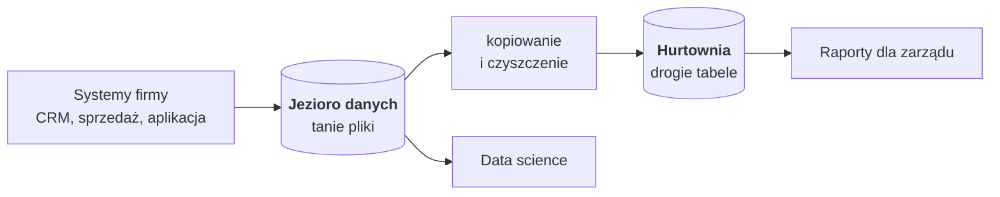

# Zajęcia 2

## Architektura i ekonomia Big Data

Poniedziałek, 9:00, kolejne zebranie zarządu FreshBoxa. Tym razem dyrektor
finansowa kładzie na stole fakturę od Google Cloud: rachunek za dane urósł
w kwartał o **40%**. „Za co my właściwie płacimy? I czy ten nowy dashboard
kierowników miast musi tyle kosztować?” Nikt na sali nie umie odpowiedzieć,
więc pytanie trafia do działu danych. Czyli znowu do Ciebie.

Na zajęciach 1 sprawdzaliśmy, **co** FreshBox ma. Dziś pytamy, **gdzie** to
trzymać i **ile to kosztuje**. Zobaczysz, że w chmurze płaci się nie za serwer,
tylko za każde zapytanie — i że jedno źle napisane zapytanie w dashboardzie
potrafi kosztować więcej niż przechowywanie wszystkich danych firmy.

Po dzisiejszych zajęciach będziesz w stanie:

- porównać hurtownię danych, jezioro danych i lakehouse i dobrać architekturę do
  potrzeb firmy,
- omówić decyzje zarządcze: chmura czy własna serwerownia, kupić czy zbudować,
  jak nie uzależnić się od jednego dostawcy,
- wymienić składniki całkowitego kosztu posiadania (TCO),
- wyjaśnić model kosztowy chmury: osobno przechowywanie, osobno obliczenia,
  „płacisz za przeskanowane bajty”,
- oszacować miesięczny koszt raportu w BigQuery i zaproponować, jak go obniżyć.

!!! tip "Przykłady z zajęć w Colabie"

    Demo z dzisiejszych zajęć jest też w gotowym notatniku. Otwórz go
    i uruchamiaj komórki po kolei, czytając materiał. Żeby zachować swoje zmiany,
    zapisz kopię: **Plik → Zapisz kopię na Dysku**.

    [](https://colab.research.google.com/github/kubzal/wsb-merito/blob/main/notebooks/semestr_zimowy_2026_27/zarzadzanie_big_data/zajecia_2.ipynb)

---

## Plan na dziś

| Blok | Czas |
|---|---|
| Co już wiemy o FreshBoxie | 5 min |
| Gdzie trzymać dane: hurtownia, jezioro, lakehouse | 15 min |
| Decyzje zarządcze: chmura, kupić czy zbudować, uzależnienie od dostawcy | 10 min |
| Ekonomia: TCO, model kosztowy chmury, FinOps | 10 min |
| Demo: BigQuery Sandbox | 20 min |
| Przerwa | 10 min |
| **Zadanie 2** | **65 min** |

---

## Co już wiemy o FreshBoxie

Po zajęciach 1 wiemy, że FreshBox ma pięć zbiorów danych w pięciu różnych
miejscach: CRM, system sprzedażowy, logi aplikacji, Excel obsługi klienta
i słownik miast. Każdy dział liczy „klientów” po swojemu, a za część danych nikt
formalnie nie odpowiada.

Rok temu FreshBox zrobił to, co robi dziś większość firm tej wielkości:
**przeniósł dane do chmury**. Zamówienia trafiają co kilka minut do hurtowni
**BigQuery** w Google Cloud, a kierownicy miast patrzą na nie przez dashboard.
Dashboard ładnie wygląda, wszyscy go lubią — i właśnie przyszła za niego
faktura.

---

## Gdzie trzymać dane: hurtownia, jezioro, lakehouse

Zanim policzymy koszty, trzeba wiedzieć, **za co** się płaci. Firmy trzymają
dane analityczne w jednej z trzech architektur.

### Hurtownia danych

**Hurtownia danych** (*data warehouse*) to jedna baza analityczna, do której
dane z systemów firmy (sprzedaż, CRM, księgowość) są regularnie ładowane,
czyszczone i układane w tabele o z góry ustalonej strukturze. Pomysł pochodzi
z przełomu lat 80. i 90.

- **Mocne strony:** jedno miejsce z „oficjalnymi” liczbami, szybkie raporty
  w SQL, uprawnienia, transakcje, dojrzałe narzędzia. Dla zarządu to naturalne
  **jedno źródło prawdy** z zajęć 1.
- **Słabe strony:** drogie przechowywanie, tylko dane tabelaryczne, każde nowe
  źródło to tygodnie pracy (struktura musi być ustalona **przed** załadowaniem).
- **Przykłady:** Teradata, Oracle Exadata, a w chmurze Snowflake, Amazon
  Redshift, Google BigQuery.

### Jezioro danych

**Jezioro danych** (*data lake*) to tani magazyn plików, do którego wrzuca się
wszystko, jak leci: tabele, logi, JSON-y, zdjęcia, nagrania. Strukturę ustala się
dopiero przy odczycie. Popularne od lat 2010., najpierw jako Hadoop, dziś jako
chmurowe magazyny obiektowe: Amazon S3, Azure Data Lake Storage, Google Cloud
Storage.

- **Mocne strony:** bardzo tanie przechowywanie, dowolne formaty, otwarte
  formaty plików (Parquet, CSV) czytane przez wiele narzędzi, dobre paliwo dla
  data science i uczenia maszynowego.
- **Słabe strony:** brak porządku „z pudełka”. Bez inwentaryzacji, właścicieli
  i kontroli jakości jezioro po kilku latach zamienia się w **bagno danych**
  (*data swamp*): tysiące plików, nie wiadomo, które są aktualne, a które to
  kopia z błędem sprzed roku. To dark data z zajęć 1 w hurtowej ilości.

### Lakehouse

Przez lata firmy miały **jedno i drugie**: jezioro jako tanie archiwum i źródło
dla data science, a wybrane dane kopiowane dalej do hurtowni dla raportów. To
znaczy dwie kopie danych, dwa rachunki, dodatkowy proces kopiowania i dwie
różne liczby na to samo pytanie.



**Lakehouse** (*lake + warehouse*) łączy oba światy: dane leżą raz, w tanim
magazynie i otwartym formacie, a specjalna warstwa (np. Delta Lake, Apache
Iceberg) dokłada do nich to, co daje hurtownia — transakcje, kontrolę
struktury, historię zmian, uprawnienia. Z tych samych danych korzystają i
raporty, i data science. Najbardziej znana platforma tego typu to Databricks,
z której skorzystamy na zajęciach 4.

### Co wybrać

| | Hurtownia | Jezioro | Lakehouse |
|---|---|---|---|
| Typ danych | tabele | wszystko | wszystko |
| Koszt przechowywania | wysoki | niski | niski |
| Kto korzysta | analitycy, raporty | inżynierowie, data science | wszyscy |
| Porządek i jakość | wymuszone przez system | zależą od dyscypliny ludzi | wymuszone przez warstwę tabel |
| Ryzyko | koszt, sztywność | bagno danych | złożoność, kompetencje |
| Pasuje, gdy… | głównie raporty z danych tabelarycznych | dużo danych surowych, ML, niski budżet | i raporty, i ML na tych samych danych |

!!! tip "Nie każda firma ma Big Data"

    Zamówienia FreshBoxa z całego roku to **6 MB** w Parquecie. Zmieściłyby się
    w pamięci telefonu, a DuckDB z zajęć 1 liczył na nich w ułamku sekundy.
    Wybór architektury zaczyna się od pytania, **ile naprawdę mamy danych
    i ile ich będzie za trzy lata** — a nie od tego, czego używa Netflix.
    Przewymiarowana platforma to też koszt.

### Rozdzielenie przechowywania i obliczeń

Najważniejsza zmiana, jaką przyniosła chmura, jest ekonomiczna. W klasycznej
bazie danych dyski i procesory są w tym samym serwerze. Kupujesz je razem
i płacisz za nie razem, nawet gdy w nocy nikt nic nie liczy.

W chmurowych hurtowniach (BigQuery, Snowflake, Databricks) **przechowywanie
(*storage*) i obliczenia (*compute*) są rozdzielone**:

- **przechowywanie** — dane leżą w tanim magazynie i płacisz za gigabajty
  miesięcznie, jak za magazyn na palety,
- **obliczenia** — moc obliczeniowa pojawia się na czas zapytania i znika.
  Płacisz za to, ile jej zużyłeś, jak za taksówkę.

Dzięki temu można trzymać dużo danych tanio i płacić dużo tylko wtedy, gdy się
z nich intensywnie korzysta. Ale też: **koszt zależy od zachowania ludzi**,
a nie od zakupionego sprzętu. Jeden analityk z nawykiem `SELECT *` potrafi
wygenerować rachunek, którego nie przewidział żaden budżet.

---

## Decyzje zarządcze

### Chmura czy własna serwerownia

| | Własna serwerownia (*on-premise*) | Chmura publiczna |
|---|---|---|
| Wydatek | duży z góry: serwery, licencje (**CAPEX**) | co miesiąc, w miarę użycia (**OPEX**) |
| Skalowanie | trzeba kupić sprzęt na szczyt zapotrzebowania | moc dokładana w minuty i oddawana, gdy niepotrzebna |
| Przewidywalność kosztów | wysoka — sprzęt już kupiony | niska — rachunek zależy od użycia |
| Kompetencje | administratorzy sprzętu, sieci, kopii zapasowych | inżynierowie chmury, kontrola kosztów |
| Kontrola nad danymi | pełna | dane u dostawcy — wybór regionu, umowy, audyty |
| Start nowego projektu | tygodnie (zakup, instalacja) | minuty |

Chmura **nie jest tańsza z definicji**. Jest tańsza, gdy zapotrzebowanie się
zmienia (sezonowość, nowe projekty, szybki wzrost) i gdy firma pilnuje kosztów.
Przy stabilnym, dużym i przewidywalnym obciążeniu własny sprzęt bywa tańszy —
kilka znanych firm, m.in. 37signals (twórcy Basecampa), głośno wyprowadziło się
z chmury i policzyło oszczędności w milionach dolarów. Coraz częściej wybiera się
**model hybrydowy**: stałe obciążenie u siebie, szczyty i eksperymenty w chmurze.

### Kupić czy zbudować

Zespół inżynierów zawsze może „napisać to sam” na narzędziach open source. To
się opłaca, gdy rozwiązanie daje firmie **przewagę konkurencyjną** albo gdy na
rynku nie ma niczego, co pasuje. Dla rzeczy, które każda firma ma tak samo
(hurtownia, harmonogram zadań, katalog danych), zwykle taniej jest kupić
gotową usługę i zapłacić za nią miesięcznie, niż utrzymywać na etacie ludzi,
którzy budują i łatają własną.

Open source nie znaczy „za darmo”: licencja nic nie kosztuje, ale instalacja,
aktualizacje, bezpieczeństwo i dyżury o 3:00 w nocy — już tak.

### Uzależnienie od dostawcy (*vendor lock-in*)

Im głębiej firma wejdzie w usługi jednego dostawcy, tym drożej jest od niego
odejść. Źródła uzależnienia:

- **zamknięte formaty danych** — dane da się wyciągnąć tylko narzędziami
  dostawcy,
- **opłaty za wyprowadzenie danych** (*egress*) — wgranie danych do chmury jest
  darmowe, pobranie ich z powrotem kosztuje,
- **specyficzne funkcje** — zapytania i pipeline'y napisane pod jedną
  platformę trzeba przepisać,
- **kompetencje** — zespół zna jedno narzędzie.

Jak się bronić: przechowywać dane w **otwartych formatach** (Parquet, Iceberg,
Delta), mieć spisany **plan wyjścia** i co jakiś czas sprawdzać, ile kosztowałaby
przeprowadzka. Lock-in nie jest zły sam w sobie — to cena za wygodę. Zły jest
lock-in **nieświadomy**.

---

## Ekonomia Big Data

### TCO — całkowity koszt posiadania

Porównując rozwiązania, nie wystarczy zestawić cennika serwera z cennikiem
chmury. **TCO** (*Total Cost of Ownership*) to wszystkie koszty przez cały okres
używania, np. 3–5 lat:

| Składnik | Własna serwerownia | Chmura |
|---|---|---|
| Sprzęt | serwery, dyski, sieć, wymiana co kilka lat | w cenie usługi |
| Licencje | baza danych, system, narzędzia | w cenie usługi albo osobno |
| Miejsce i energia | serwerownia, prąd, chłodzenie | w cenie usługi |
| Ludzie | administratorzy, dyżury | inżynierowie chmury, kontrola kosztów |
| Użycie | — | przechowywanie, zapytania, transfer danych |
| Wdrożenie i migracja | instalacja, konfiguracja | przeniesienie danych, przepisanie procesów |
| Ryzyko | awaria, za mały sprzęt w szczycie | niekontrolowany wzrost rachunku |

W praktyce **największą pozycją są zwykle ludzie**, a nie sprzęt ani chmura.

### Model kosztowy BigQuery

BigQuery liczy osobno przechowywanie i zapytania. Ceny katalogowe w lokalizacjach
USA i UE, w dolarach (przed decyzją zawsze sprawdź aktualny cennik):

| Za co | Cena | Uwagi |
|---|---|---|
| przechowywanie — dane zmieniane w ostatnich 90 dniach | ok. **0,02 $ za GB miesięcznie** | pierwsze 10 GB miesięcznie gratis |
| przechowywanie — dane niezmieniane od 90 dni | ok. **0,01 $ za GB miesięcznie** | obniżka automatyczna |
| zapytania (*on-demand*) | **6,25 $ za TB przeskanowanych danych** | pierwszy 1 TB miesięcznie gratis |
| wczytywanie danych (*load*) | gratis | |

Najważniejsze są **zapytania**. Płacisz nie za czas ani za wynik, tylko za
**bajty, które BigQuery musiał przeczytać**. A BigQuery przechowuje dane
**kolumnowo** — każda kolumna osobno, jak w Parquecie z zajęć 1. Stąd reguły,
które warto znać na pamięć:

| Co robisz | Czy zmniejsza koszt? | Dlaczego |
|---|---|---|
| wybierasz tylko potrzebne kolumny zamiast `SELECT *` | **tak** | czytane są tylko te kolumny |
| dodajesz `LIMIT 10` | **nie** | BigQuery i tak czyta całe kolumny, a potem obcina wynik |
| dodajesz `WHERE miasto = 'Kraków'` | **zwykle nie** | żeby znaleźć Kraków, trzeba przeczytać całą kolumnę |
| filtrujesz po kolumnie **partycjonowania** | **tak** | czytane są tylko pasujące partycje |
| filtrujesz po kolumnie **klastrowania** | **często tak** | dane posortowane, BigQuery pomija bloki — ale z góry nie poda dokładnej oszczędności |
| uruchamiasz ponownie to samo zapytanie bez zmian w danych | **tak** (0 zł) | wynik z pamięci podręcznej (*cache*) przez 24 h |

**Partycjonowanie** dzieli tabelę na fragmenty według wartości jednej kolumny,
zwykle daty — jak segregator z przekładkami na każdy miesiąc. Zapytanie
o październik przegląda tylko przekładkę „październik”. **Klastrowanie**
dodatkowo sortuje dane wewnątrz partycji (np. po mieście), żeby wiersze jednego
miasta leżały obok siebie.

Dwa drobne druki z cennika, o które łatwo się potknąć:

- BigQuery liczy w jednostkach binarnych: **1 MB = 2²⁰ bajtów**, **1 TB =
  2⁴⁰ bajtów** (formalnie MiB i TiB),
- każde zapytanie kosztuje **co najmniej 10 MB za każdą tabelę**, z której
  czyta, nawet jeśli naprawdę przeczytało 1 MB.

!!! info "Dry run — wycena przed zakupem"

    BigQuery potrafi **przed** uruchomieniem zapytania powiedzieć, ile bajtów
    przeczyta. Taki próbny przebieg (*dry run*) jest darmowy. W konsoli widać go
    w prawym górnym rogu edytora: *This query will process 30.4 MB when run*.
    W Pythonie włącza się go jedną opcją. To podstawowe narzędzie każdego, kto
    płaci za chmurę.

Poza modelem *on-demand* BigQuery i inne chmury oferują **rezerwację mocy**
(*capacity*, *slots*): płacisz stałą kwotę za określoną moc obliczeniową,
niezależnie od liczby przeskanowanych bajtów. To jak różnica między taksówką
a leasingiem samochodu — przy małym i nieregularnym użyciu taniej wychodzi
taksówka, przy codziennym intensywnym użyciu leasing. Rezerwacje na rok albo
trzy lata dają zwykle duże rabaty, ale wymagają dobrej prognozy.

### FinOps — kto płaci za zapytanie

W serwerowni koszt był ustalony przy zakupie i zatwierdzał go dyrektor. W chmurze
koszt powstaje **w chwili, gdy ktoś uruchamia zapytanie** — czyli decyduje o nim
analityk, nie dyrektor. **FinOps** (*Financial Operations*) to praktyka, która
łączy finanse, IT i biznes, żeby nad tym panować. Organizacja FinOps Foundation
opisuje ją jako cykl trzech faz:

| Faza | Co robimy | Przykład z FreshBoxa |
|---|---|---|
| **Informowanie** (*inform*) | wiemy, kto i na co wydaje | etykiety projektów i działów, raport kosztów per dashboard |
| **Optymalizacja** (*optimize*) | obniżamy koszt bez utraty wartości | partycjonowanie, poprawione zapytania, rezerwacje |
| **Działanie** (*operate*) | pilnujemy na bieżąco | budżety, alerty po przekroczeniu, limity dzienne na projekt |

Dwa pojęcia, które warto znać:

- **showback** — działy dostają raport „tyle kosztowały Wasze zapytania”,
- **chargeback** — działy dostają za to rachunek ze swojego budżetu.
  Nic tak nie uczy pisania dobrych zapytań.

I jedno pojęcie najważniejsze: **ekonomia jednostkowa** (*unit economics*).
„Rachunek urósł o 40%” brzmi groźnie. „Koszt danych na jedno zamówienie spadł
z 4 gr do 3 gr, bo zamówień przybyło dwa razy więcej” — już nie. Koszt danych
zawsze warto odnieść do tego, co firma z nich ma.

---

## Demo: BigQuery Sandbox

**BigQuery Sandbox** to darmowy tryb BigQuery bez karty płatniczej. Ma
ograniczenia, które dla nas nie są przeszkodą:

| Limit Sandboxa | Wartość |
|---|---|
| przechowywanie | 10 GB |
| zapytania | 1 TB przeskanowanych danych miesięcznie |
| ważność tabel i partycji | **60 dni**, potem znikają |
| czego nie ma | `INSERT`, `UPDATE`, `DELETE` (DML), wczytywanie strumieniowe |

### Zakładamy Sandbox

1. Wejdź na [console.cloud.google.com/bigquery](https://console.cloud.google.com/bigquery)
   i zaloguj się kontem Google.
2. Zaakceptuj regulamin. Jeśli pojawi się prośba o projekt — **Create project**,
   nazwij go np. `freshbox` i zapisz **identyfikator projektu** (*Project ID*,
   np. `freshbox-478312`). Będzie potrzebny w Colabie.
3. Nie podawaj karty. W lewym górnym rogu powinien pojawić się napis
   **SANDBOX**.

!!! warning "Konto uczelniane może nie działać"

    Na kontach Google zarządzanych przez organizację administrator często
    blokuje Google Cloud. Jeśli zobaczysz komunikat o braku uprawnień, użyj
    prywatnego konta Gmail.

### Publiczne dane: ile kosztuje zapytanie

Google udostępnia w BigQuery setki publicznych zbiorów danych. Wklej do edytora
w konsoli zapytanie o pytania ze Stack Overflow — tabela ma dziesiątki
gigabajtów — **ale go nie uruchamiaj**. Spójrz tylko na licznik w prawym
górnym rogu:

```sql
SELECT *
FROM `bigquery-public-data.stackoverflow.posts_questions`
LIMIT 10
```

Licznik pokaże kilkadziesiąt GB — chociaż chcemy tylko 10 wierszy. Teraz zmień
zapytanie na:

```sql
SELECT title
FROM `bigquery-public-data.stackoverflow.posts_questions`
LIMIT 10
```

Licznik spada do ułamka poprzedniej wartości — czytana jest jedna kolumna
zamiast kilkunastu. A tak:

```sql
SELECT COUNT(*)
FROM `bigquery-public-data.stackoverflow.posts_questions`
```

0 B — liczbę wierszy BigQuery zna z metadanych i nie musi czytać ani jednej
kolumny. Trzy zapytania, trzy rzędy wielkości kosztu. Żadne z nich nie zostało
uruchomione, więc nic nie wydaliśmy.

### FreshBox w BigQuery: łączymy się z Colaba

Teraz wgrywamy do BigQuery zamówienia FreshBoxa. Wszystko robimy z Colaba —
pierwsza komórka loguje Cię do Google Cloud (pojawi się okno z prośbą o zgodę):

```python
from google.colab import auth
auth.authenticate_user()
```

```python
import urllib.request

import pandas as pd
from google.cloud import bigquery

PROJEKT = "freshbox-478312"        # ← identyfikator Twojego projektu z konsoli

client = bigquery.Client(project=PROJEKT, location="EU")
client.create_dataset("freshbox", exists_ok=True)

URL = "https://kubzal.github.io/wsb-merito/semestr_zimowy_2026_27/zarzadzanie_big_data/dane/"
urllib.request.urlretrieve(URL + "zamowienia.parquet", "zamowienia.parquet")
zamowienia = pd.read_parquet("zamowienia.parquet")

TABELA = f"{PROJEKT}.freshbox.zamowienia"
config = bigquery.LoadJobConfig(
    write_disposition="WRITE_TRUNCATE",                                # nadpisz, jeśli już jest
    schema=[bigquery.SchemaField("ts_zamowienia", "DATETIME")],
)
client.load_table_from_dataframe(zamowienia, TABELA, job_config=config).result()

tabela = client.get_table(TABELA)
print(f"{tabela.num_rows:,} wierszy, {tabela.num_bytes / 2**20:.1f} MB w BigQuery")
```

```text
407,189 wierszy, 30.4 MB w BigQuery
```

`location="EU"` to nie ozdobnik: dane osobowe klientów z Polski wygodniej
trzymać w Unii Europejskiej, a region wybiera się przy tworzeniu zbioru danych
i później nie da się go zmienić. To też decyzja zarządcza.

Plik Parquet miał 6 MB, a w BigQuery tabela ma 30 MB. BigQuery podaje
**rozmiar logiczny** — ile danych zajmowałyby bez kompresji — i od niego liczy
cenę zapytań.

### Dry run z Pythona

Funkcja, która wycenia zapytanie bez uruchamiania go:

```python
def dry_run(sql):
    """Ile MB przeczyta zapytanie — bez uruchamiania i bez kosztów."""
    config = bigquery.QueryJobConfig(dry_run=True, use_query_cache=False)
    return client.query(sql, job_config=config).total_bytes_processed / 2**20
```

Porównajmy te same pomysły co w konsoli, tym razem na danych FreshBoxa:

```python
zapytania = {
    "SELECT * LIMIT 10":
        f"SELECT * FROM `{TABELA}` LIMIT 10",
    "dwie kolumny":
        f"SELECT miasto, wartosc_brutto FROM `{TABELA}`",
    "dwie kolumny + WHERE":
        f"SELECT miasto, wartosc_brutto FROM `{TABELA}` WHERE miasto = 'Kraków'",
}
pd.DataFrame({"MB": {nazwa: round(dry_run(sql), 2) for nazwa, sql in zapytania.items()}})
```

```text
                         MB
SELECT * LIMIT 10     30.39
dwie kolumny           6.78
dwie kolumny + WHERE   6.78
```

`LIMIT` nie pomógł wcale, wybór kolumn — 4,5 raza. `WHERE miasto = 'Kraków'`
też nic nie dał: żeby wiedzieć, które wiersze są z Krakowa, BigQuery musi
przeczytać całą kolumnę `miasto`.

Wynik zapytania pobiera się do pandas:

```python
client.query(f"""
SELECT miasto, COUNT(*) AS zamowienia, ROUND(SUM(wartosc_brutto)) AS przychod
FROM `{TABELA}`
GROUP BY miasto
ORDER BY przychod DESC
""").to_dataframe()
```

### Partycjonowanie

Kierownicy miast patrzą zwykle na **jeden miesiąc**, a każde ich zapytanie
czyta cały rok. Tworzymy kopię tabeli podzieloną na miesiące:

```python
client.query(f"""
CREATE OR REPLACE TABLE `{PROJEKT}.freshbox.zamowienia_miesiace`
PARTITION BY RANGE_BUCKET(miesiac, GENERATE_ARRAY(202511, 202611, 1))
AS
SELECT *, EXTRACT(YEAR FROM ts_zamowienia) * 100 + EXTRACT(MONTH FROM ts_zamowienia) AS miesiac
FROM `{TABELA}`
""").result()
```

Nowa kolumna `miesiac` to liczba w postaci `202610` (rok i miesiąc), a
`RANGE_BUCKET` robi z każdej jej wartości osobną partycję.

!!! warning "Dlaczego nie po prostu `PARTITION BY DATE(ts_zamowienia)`?"

    Normalnie tak właśnie partycjonuje się po dacie. Ale w Sandboxie **każda
    partycja dzienna znika 60 dni po swojej dacie**. Nasze zamówienia sięgają
    listopada 2025, więc większość partycji zostałaby skasowana od razu po
    utworzeniu tabeli. Partycje po liczbie (`RANGE_BUCKET`) tego ograniczenia
    nie mają. To dobry przykład „drobnego druku” w umowie z dostawcą — warto go
    czytać, zanim się podejmie decyzję.

Porównanie — ten sam przychód za październik 2026, z obu tabel:

```python
zapytania = {
    "bez partycji, filtr po dacie": f"""
        SELECT SUM(wartosc_brutto) FROM `{TABELA}`
        WHERE DATE_TRUNC(DATE(ts_zamowienia), MONTH) = '2026-10-01'""",
    "z partycjami, filtr po miesiac": f"""
        SELECT SUM(wartosc_brutto) FROM `{PROJEKT}.freshbox.zamowienia_miesiace`
        WHERE miesiac = 202610""",
    "z partycjami, filtr po dacie": f"""
        SELECT SUM(wartosc_brutto) FROM `{PROJEKT}.freshbox.zamowienia_miesiace`
        WHERE DATE_TRUNC(DATE(ts_zamowienia), MONTH) = '2026-10-01'""",
}
pd.DataFrame({"MB": {nazwa: round(dry_run(sql), 2) for nazwa, sql in zapytania.items()}})
```

```text
                                  MB
bez partycji, filtr po dacie    6.21
z partycjami, filtr po miesiac  0.60
z partycjami, filtr po dacie    6.21
```

Dziesięć razy mniej, ale **tylko wtedy, gdy filtr dotyczy kolumny
partycjonowania**. Trzecie zapytanie pyta o to samo, ale filtruje po
`ts_zamowienia` — BigQuery nie wie, że to ten sam miesiąc, i czyta wszystko.
Sama tabela z partycjami nic nie da, jeśli zapytania dashboardu nie zostaną
poprawione.

### Ile to kosztuje

Funkcja licząca cenę jednego uruchomienia zgodnie z cennikiem — z zaokrągleniem
w górę do pełnego MB i minimum 10 MB:

```python
import math

CENA_ZA_TB = 6.25      # USD, on-demand

def koszt_usd(mb):
    """Koszt jednego uruchomienia zapytania czytającego jedną tabelę."""
    rozliczone_mb = max(math.ceil(mb), 10)
    return rozliczone_mb / 2**20 * CENA_ZA_TB          # 1 TB = 2**20 MB

for mb in [30.39, 6.78, 0.60]:
    print(f"{mb:6.2f} MB  →  {koszt_usd(mb):.7f} USD")
```

```text
 30.39 MB  →  0.0001848 USD
  6.78 MB  →  0.0000596 USD
  0.60 MB  →  0.0000596 USD
```

Jedno uruchomienie `SELECT *` kosztuje dwie setne centa. Brzmi jak nic — dopóki
nie przemnożymy tego przez liczbę uruchomień, a dashboard uruchamia swoje
zapytania przy każdym wejściu każdego użytkownika.

Zwróć też uwagę na dwa ostatnie wiersze: zapytanie czytające 0,6 MB kosztuje
**tyle samo** co czytające 6,8 MB. Oba rozliczono jako minimalne 10 MB. Przy
małych tabelach minimum rozliczeniowe zjada część oszczędności z optymalizacji —
ten efekt zobaczysz w zadaniu.

---

## Ściągawka

| Chcę… | Kod |
|---|---|
| zalogować Colaba do Google Cloud | `from google.colab import auth; auth.authenticate_user()` |
| połączyć się z BigQuery | `client = bigquery.Client(project=PROJEKT, location="EU")` |
| uruchomić zapytanie i dostać DataFrame | `client.query(sql).to_dataframe()` |
| uruchomić zapytanie bez wyniku (np. `CREATE TABLE`) | `client.query(sql).result()` |
| wycenić zapytanie bez uruchamiania | `dry_run(sql)` — funkcja z demo, zwraca MB |
| liczbę wierszy i rozmiar tabeli | `t = client.get_table(TABELA); t.num_rows, t.num_bytes` |
| nazwa tabeli w SQL | `` `projekt.zbior.tabela` `` — w odwrotnych apostrofach |
| zmienną Pythona w SQL | `f"... WHERE miasto = '{MIASTO}'"` |
| tabelę partycjonowaną po liczbie | `PARTITION BY RANGE_BUCKET(kol, GENERATE_ARRAY(od, do, krok))` |
| tabelę klastrowaną | `CLUSTER BY kol` (po `PARTITION BY`, przed `AS`) |
| kopię tabeli z nową strukturą | `CREATE OR REPLACE TABLE ... PARTITION BY ... CLUSTER BY ... AS SELECT ...` |
| rok i miesiąc jako liczbę `202610` | `EXTRACT(YEAR FROM ts) * 100 + EXTRACT(MONTH FROM ts)` |
| filtr „cały miesiąc” po dacie | `DATE_TRUNC(DATE(ts), MONTH) = '2026-10-01'` |
| dzień z daty i godziny | `DATE(ts)` |
| zaokrąglić w górę | `math.ceil(x)` |
| tabelę z wyników w Pythonie | `pd.DataFrame({"MB": {"nazwa1": 1.0, "nazwa2": 2.0}})` |

Jednostki: `bajty / 2**20` → MB, `MB / 2**20` → TB.

---

## Zadanie 2 — Budżet dashboardu (9 pkt)

- **Czas:** ok. 65 minut
- **Środowisko:** Google Colab + BigQuery Sandbox
- **Oddanie:** notatnik `.ipynb` na Moodle (*Plik → Pobierz → Pobierz plik .ipynb*)

Zadanie ma dwie części. Rób je po kolei i **pokaż mi wynik każdej części, gdy
będzie gotowa** — punktacja zależy od tego, ile zrobisz na zajęciach.

Dyrektor finansowa chce wiedzieć, ile kosztuje dashboard kierowników miast
i czy da się taniej. Dashboard ma trzy kafelki, a każdy kafelek to jedno
zapytanie do BigQuery. Napisał je stażysta, który odszedł z firmy.

### Twoje miasto i miesiąc

Pierwsze komórki notatnika (zanim je uruchomisz, załóż Sandbox i wpisz
identyfikator projektu):

```python
from google.colab import auth
auth.authenticate_user()
```

```python
import math
import urllib.request

import pandas as pd
from google.cloud import bigquery

NR_ALBUMU = 123456                 # ← wpisz swój numer albumu
PROJEKT = "freshbox-478312"        # ← identyfikator Twojego projektu

MIASTA = ["Warszawa", "Kraków", "Wrocław", "Poznań", "Gdańsk", "Łódź", "Katowice", "Lublin"]
MIASTO = MIASTA[NR_ALBUMU % 8]
MIESIACE = [202511, 202512, 202601, 202602, 202603, 202604,
            202605, 202606, 202607, 202608, 202609, 202610]
MIESIAC = MIESIACE[NR_ALBUMU % 12]
MIESIAC_DATA = f"{MIESIAC // 100}-{MIESIAC % 100:02d}-01"
print(f"Moje miasto: {MIASTO}, mój miesiąc: {MIESIAC_DATA[:7]}")

client = bigquery.Client(project=PROJEKT, location="EU")
client.create_dataset("freshbox", exists_ok=True)

URL = "https://kubzal.github.io/wsb-merito/semestr_zimowy_2026_27/zarzadzanie_big_data/dane/"
urllib.request.urlretrieve(URL + "zamowienia.parquet", "zamowienia.parquet")
TABELA = f"{PROJEKT}.freshbox.zamowienia"
config = bigquery.LoadJobConfig(write_disposition="WRITE_TRUNCATE",
                                schema=[bigquery.SchemaField("ts_zamowienia", "DATETIME")])
client.load_table_from_dataframe(pd.read_parquet("zamowienia.parquet"), TABELA,
                                 job_config=config).result()

def dry_run(sql):
    """Ile MB przeczyta zapytanie — bez uruchamiania i bez kosztów."""
    config = bigquery.QueryJobConfig(dry_run=True, use_query_cache=False)
    return client.query(sql, job_config=config).total_bytes_processed / 2**20

CENA_ZA_TB = 6.25                  # USD za TB, on-demand
KURS_USD = 3.65                    # PLN za 1 USD — przyjmij
URUCHOMIENIA = 120 * 40 * 30       # 120 osób × 40 odsłon dziennie × 30 dni
```

Zapytania stażysty — skopiuj je do notatnika:

```python
KAFELKI = {
    "ostatnie zamowienia": f"""
        SELECT *
        FROM `{TABELA}`
        WHERE miasto = '{MIASTO}'
          AND DATE_TRUNC(DATE(ts_zamowienia), MONTH) = '{MIESIAC_DATA}'
        ORDER BY ts_zamowienia DESC
        LIMIT 20""",
    "przychod dzienny": f"""
        SELECT DATE(ts_zamowienia) AS dzien, ROUND(SUM(wartosc_brutto), 2) AS przychod
        FROM `{TABELA}`
        WHERE miasto = '{MIASTO}'
          AND DATE_TRUNC(DATE(ts_zamowienia), MONTH) = '{MIESIAC_DATA}'
          AND status NOT IN ('anulowane', 'cancelled', 'ANUL')
        GROUP BY dzien
        ORDER BY dzien""",
    "klienci wg kanalu": f"""
        SELECT kanal, COUNT(*) AS zamowienia, COUNT(DISTINCT id_klienta) AS klienci
        FROM `{TABELA}`
        WHERE miasto = '{MIASTO}'
          AND DATE_TRUNC(DATE(ts_zamowienia), MONTH) = '{MIESIAC_DATA}'
        GROUP BY kanal
        ORDER BY zamowienia DESC""",
}
```

Rozwiązania z cudzym miastem lub miesiącem nie zaliczam.

### Część 1 — ile to kosztuje (ok. 30 min)

1. Uruchom każde z trzech zapytań i pokaż jego wynik. Dla każdego zrób też
   **dry run** i zbierz wyniki w DataFrame `koszty` z kolumnami: `kafelek`,
   `mb` (z dry run, 2 miejsca po przecinku).
2. Dodaj do `koszty` kolumny: `rozliczone_mb` (zaokrąglenie w górę, minimum
   10 MB), `usd_miesiecznie` i `pln_miesiecznie` — koszt **miesięczny**
   kafelka, jeśli uruchamia się go `URUCHOMIENIA` razy w miesiącu. Policz
   łączny koszt dashboardu w PLN miesięcznie i rocznie. Darmowy 1 TB pomiń —
   FreshBox zużywa go na inne zapytania.
3. W komórce Markdown odpowiedz w 2–3 zdaniach: który kafelek jest
   najdroższy i co dokładnie w jego zapytaniu sprawia, że jest drogi? Dlaczego
   `LIMIT 20` i `WHERE miasto = ...` nic tu nie pomagają?

### Część 2 — jak to obniżyć (ok. 35 min)

1. Utwórz tabelę `freshbox.zamowienia_opt`: kopię zamówień z kolumną
   `miesiac`, **partycjonowaną** po `miesiac` i **klastrowaną** po `miasto`.
   Przepisz trzy zapytania tak, żeby czytały z nowej tabeli, filtrowały po
   kolumnie `miesiac` i czytały **tylko potrzebne kolumny** (kafelek „ostatnie
   zamówienia” pokazuje: numer i czas zamówienia, kanał, wartość, status).
   Sprawdź, że wyniki są takie same jak w części 1.
2. Zrób dry run poprawionych zapytań i zbuduj tabelę porównawczą: dla każdego
   kafelka MB i PLN miesięcznie **przed** i **po** oraz oszczędność w procentach.
   Policz to samo dla całego dashboardu. Oszczędność w MB i w złotych wyjdzie
   różna — wyjaśnij w jednym zdaniu dlaczego.
3. W komórce Markdown napisz **rekomendację dla zarządu** (maks. 5 zdań, bez
   żargonu): co zmienić, ile to da w złotych rocznie, co jeszcze można zrobić,
   żeby było taniej, i czy optymalizacja w ogóle jest warta pracy inżyniera.

### Wskazówki

- Ściągawka jest kilka sekcji wyżej — wszystkie potrzebne polecenia tam są.
- **Sandbox nie działa?** Najpierw spróbuj z prywatnego konta Gmail. Jeśli
  nadal nie, zgłoś się — dry run i wyniki możesz policzyć w parze na koncie
  kolegi, ale notatnik oddajesz swój, z **własnym** miastem i miesiącem.
- Część 1, punkt 1: zapytanie wykonasz przez `client.query(sql).to_dataframe()`,
  a dry run — funkcją `dry_run(sql)` z pierwszej komórki. Po wszystkich
  trzech kafelkach przejdziesz pętlą `for nazwa, sql in KAFELKI.items():`.
- Część 1, punkt 2: kolumnę z funkcji zrobisz przez
  `koszty["mb"].apply(lambda mb: ...)`. 1 TB = 2²⁰ MB.
- Część 2, punkt 1: tabelę tworzysz tak jak w demo, z dodatkiem
  `CLUSTER BY miasto` między `PARTITION BY ...` a `AS`. W poprawionych
  zapytaniach zamień warunek na datę na `miesiac = {MIESIAC}`.
- Część 2, punkt 1: wyniki porównasz np. przez
  `przed.equals(po)` albo po prostu wyświetl obie tabele obok siebie.
- Część 2, punkt 2: dry run tabeli klastrowanej podaje **górne oszacowanie** —
  klastrowanie może obniżyć koszt jeszcze bardziej, ale dry run tego nie pokaże.
  Liczymy na oszacowaniu, tak jak robi to dział finansów.
- Część 2, punkt 3: zastanów się, co się stanie z oszczędnością, gdy tabela
  zamówień urośnie 100 razy (pełna historia od 2021 roku, pozycje zamówień),
  i ile godzin pracy inżyniera można opłacić zaoszczędzoną kwotą.

!!! tip "Na co patrzę przy ocenie"

    W części 1 — na liczby MB i koszt (wszystkie są deterministyczne, mam je
    dla każdego wariantu) oraz na to, czy wskazujesz prawdziwą przyczynę
    kosztu. W części 2 — na to, czy wyniki po optymalizacji są **takie same**
    jak przed (tańszy, ale błędny dashboard to żadna oszczędność), na tabelę
    przed/po i na to, czy rekomendację zrozumiałby ktoś, kto nie zna SQL.

### Punktacja (9 pkt)

| Punkty | Za co |
|---|---|
| **9 pkt** | obie części zrobione **na zajęciach** i pokazane prowadzącemu |
| **6 pkt** | jedna z dwóch części zrobiona na zajęciach |
| **3 pkt** | zadanie dokończone po zajęciach i wysłane na Moodle **w terminie** |
| **0 pkt** | brak rozwiązania albo wysłane po terminie |

Termin przesłania na Moodle: **2026-12-05** (dzień przed kolejnymi zajęciami).

!!! danger "Zajęcia też mają model kosztowy"

    Te same 65 minut pracy jest warte 9 pkt na zajęciach albo 3 pkt w domu.
    Rabat za „rezerwację” jest tu wyjątkowo wysoki.
